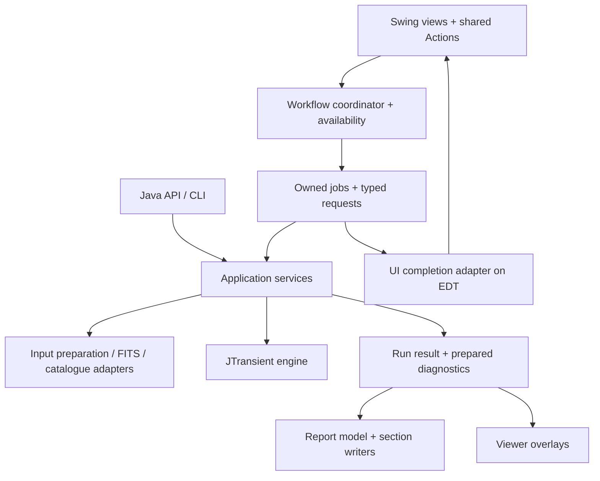

# Design and architecture improvements

This is the current architecture and pending work, not an implementation diary. Preserve original IDs so requests can be revisited through the final status register. Current behavior belongs in [DEVELOPER.md](DEVELOPER.md), [HIGH_LEVEL_DESIGN.md](HIGH_LEVEL_DESIGN.md), [MANUAL.md](MANUAL.md) and [API.md](API.md). Completed reasoning and evidence are in the [closed archive](docs/archive/design-improvements-completed-2026-10.md).

## Design goals and release policy

SpacePixels owns preparation, orchestration, persistence and presentation; JTransient owns detection/tuning and JPlateSolve owns solver execution/unsuccessful cleanup. Develop all three through sibling composites and update callers together. Backward library API/version compatibility is not required. At release, select and verify one pinned artifact combination. Scientific results, ownership, user data and documented application behavior are separate contracts.

### Boundaries to preserve

- **The engine boundary.** SpacePixels prepares data, orchestrates work and presents results. JTransient owns detection. Do not move GUI workflow or FITS-file interaction into the engine.
- **The public API shape.** [SpacePixelsPipelineRequest](src/main/java/eu/startales/spacepixels/api/SpacePixelsPipelineRequest.java) defensively copies its detection configuration, and [DefaultSpacePixelsPipelineApi](src/main/java/eu/startales/spacepixels/api/DefaultSpacePixelsPipelineApi.java) uses shared preparation and pipeline services. Those are useful patterns for GUI run requests too.
- **The settings navigation.** [SettingsNavigator](src/main/java/eu/startales/spacepixels/gui/SettingsNavigator.java) already provides search, changed-only filtering and expert disclosure. Keep the maintainer's basic/expert/hidden classification and the preservation of hidden configuration fields.
- **The shared viewers.** [SequenceViewerFrame](src/main/java/eu/startales/spacepixels/gui/SequenceViewerFrame.java), [FrameView](src/main/java/eu/startales/spacepixels/gui/FrameView.java), [StretchControls](src/main/java/eu/startales/spacepixels/gui/StretchControls.java) and [ViewerSupport](src/main/java/eu/startales/spacepixels/gui/ViewerSupport.java) reuse display and interaction code. The sequence viewer rejects obsolete work by worker identity and target frame; viewers detach listeners and release displayed data. Extend these patterns rather than replacing them.
- **Report identities and export snapshots.** [ReportData](src/main/java/eu/startales/spacepixels/util/reporting/ReportData.java) centralises findings and frame selection. [ExportVisualizationSettings](src/main/java/eu/startales/spacepixels/util/reporting/ExportVisualizationSettings.java) captures export options. [AtomicReportFile](src/main/java/eu/startales/spacepixels/util/reporting/AtomicReportFile.java) publishes completed text files. These solve part of the problems below already.
- **Existing validation and testing.** Input preparation, WCS handling, catalogue matching, API execution and reporting have focused tests. The site configuration already gives inline validation feedback. The review calls for extending these strengths, not starting over.
- **The frame table without sorting.** The table has no row sorter, so a selected row indexes the model directly. If sorting or filtering is added:
  - convert view rows to model rows in every selected-file and solve-result path;
  - use file and session identity rather than a visible row number;
  - return numeric values and column classes before offering numeric sorting.

## Package, class and ownership analysis

### Workflow boundaries

The following is a target/dependency map, not a second work list or a claim that all boxes are missing. Jobs, session ownership, commands, shared preparation, explicit GUI interactions and most completion adapters already follow it. The remaining gaps are the D09/D10 run/result boundaries. Do not create a package/interface for every box; UI completion stays on the Swing side.

- **Views** build components and show state. The main panel stops being the place that decides job policy, rewrites FITS and owns catalogue fetching.
- **Workflow coordinator** handles user intent, session handover, admission and outcomes. It has no dependence on individual button enabled flags.
- **Application services** take explicit inputs and options and return data. They do not show Swing dialogs or reach through `ApplicationWindow` for logging/configuration. Keep concrete services unless a seam needs substituting in tests or has multiple implementations.
- **Adapters** contain file formats, solver/network calls, persistence and interactive preparation decisions. The GUI and API supply different decision policies to shared operations.
- **Presentation** consumes a stable result. Existing report writers and shared viewer components stay in use.

The pattern is close to a modest **model–view–presenter** arrangement: a state model and testable workflow/presenter between Swing widgets and services. Use plain Java constructor injection, typed requests, `Action`s and explicit completion callbacks. A service locator, a second global event bus, deep inheritance tree or mandatory DI/reactive framework would add machinery without resolving the ownership questions.

### Implementation patterns

| Pattern | Concrete use here | Limit |
|---|---|---|
| Command | A shared Swing `Action` starts a typed operation from a button, shortcut or menu. | A local one-off listener does not need a command hierarchy. |
| Model–view–presenter | Availability, validation and workflow transitions can be tested independently of component layout. | Avoid replacing the panel with an equally large presenter. |
| Immutable request / result | Capture settings and identities once; return a typed outcome and stable report model. | Share large read-only image data by ownership contract rather than deep-copying it. |
| Strategy / adapter | GUI preparation questions and API preparation policy choose how to handle the same conversion facts. | Introduce an interface where behaviour really varies, not for every concrete helper. |
| Observer | Notify views about session/catalogue/settings changes through explicit, scoped subscriptions. | Subscriptions need an owner, detach path and stated delivery thread. |
| Composition and focused reuse | Keep shared stretch, drawing, navigation and report helpers behind their existing views. | Do not force every viewer or report section into a large inheritance framework. |
| Resource ownership | A job or viewer owns its engine, worker, listener subscription and buffers, and releases them predictably. | A cancelled future is not proof that its underlying operation has terminated. |

### Ownership and lifetime

| Scope | Owned state | Lifetime / rule |
|---|---|---|
| Application | User-level configuration, startup defaults, supported integrations, job resources | Loaded independently of a dataset; save failures are visible. |
| Session | Session ID, frame metadata, current selection, catalogue/correction, session caches and last-result references | Replaced on a successful handover; stale results cannot attach to its successor. |
| Run | Click-time config and export options, input identities, resolved context, diagnostics, outcome and artifact paths | Stable for reproducibility; does not read live controls during work. |
| Viewer | Current frame, zoom, playback state, listeners and owned display buffers | Explicitly detached/released on close; shared stretch models retain intentional semantics. |
| Report lookup | Provider request, report identity and enrichment cache | Independent of detection verdict; bounded work and existing target/path validation remain. |

**Current versus future:** application/session/viewer ownership above is largely implemented by D02/D04/D06/D08. The remaining run-wide capture is S14, and richer retained/persisted results belong to D09/D11. A saved-run record should include a schema version, supported build identifiers, input identities, effective settings, catalogue/correction provenance, analysis/export inclusion and artifacts. Some of this already exists in `detection_config.json`, versioned `report-data.json`, iterative `run-data.json` and per-pass manifests; extend those rather than writing a conflicting summary. Avoid storing private absolute paths or observing-site data in a shareable manifest by default. A reproducibility record is distinct from retaining all image buffers or promising replay from data that is no longer available.

`ApplicationWindow` already starts/stops the localhost lookup proxy; preserve that application-scoped lifetime rather than reopening an ownership task. If a feature expands lookup/server work, define its I/O/cache limits explicitly and preserve provider/target/path validation and atomic caching. This is an implementation guardrail, not an additional queue item or a newly established security defect.

### Class and responsibility scope

- **Settings (D10):** reuse extracted persistence/background storage and engine rules; work on typed config/widget/visualization bindings and explicit capabilities. Split page builders only when those boundaries help. Preserve profile formats, hidden values, shared models, migration backups and defaults/revert/auto-apply semantics.
- **Input preparation:** preserve completed S12/S13/F07 shared preparation, interactive versus API policy and output naming. WCS writeback already has a task/service boundary and JPlateSolve owns unsuccessful-solve cleanup; do not re-propose those as missing. Preserve explicit interaction injection and service-owned loggers.
- **Reporting (D09):** extract image assets, maps or iterative index helpers when relevant feature work needs them. Preserve stable finding identities, filenames, CSV data and lookup/live-render behavior. `DetectionReportAstrometry` already delegates its query/URL/HTML helpers; it is not a standing extraction project.
- **Main panel (D11):** preserve the implemented session owner, application preferences, jobs, shared actions and explicit UI interaction adapters from D02/D06/D07/S13. Extract only a remaining result/workflow or UI-decision responsibility justified by the owning outcome; a panel's size is not an extraction order or a reason to rebuild session state.
- **Cohesive renderers:** leave `CreativeTributeRenderer` and target section writers intact unless feature work exposes an independent responsibility. No target line counts or mass static-helper replacement are proposed.

Verification follows the strategy above and [AGENTS.md](AGENTS.md). Import changes cover ready mono FITS, compressed files, signed/scaled and 32-bit conversions, color, XISF, exposure groups and negative-value policy in both GUI and headless modes. Settings changes cover load/save, failed saves, defaults/revert, migration, hidden values, previews and both tuners. Report changes compare equivalent standard/iterative bundles, CSVs, identities, crops/GIFs and offline/live lookup behavior against a baseline. Use disposable settings and inputs.

## Pending findings

### D09. Complete the distinction between measurements and report presentation

**Current foundation.** `FindingCategory` now owns stable prefixes, JSON category text, detailed-card anchors, marker/legend colors, summary labels/counts, report inclusion, computed-row visibility and representative-coordinate policy. `ReportData`, report-category filtering, detection-map legends/buttons and the GUI report prompt consume it while preserving existing IDs/text/anchors/colors and JSON schema. See the [completion record](docs/archive/design-improvements-completed-2026-10.md#d09-shared-finding-category-descriptors-first-slice-2026-10-22).

**Remaining evidence.** [DetectionReportGenerator](src/main/java/eu/startales/spacepixels/util/reporting/DetectionReportGenerator.java) already delegates sections, snapshots display settings, constructs `ReportData` and atomically publishes HTML. [NightEquipment](src/main/java/eu/startales/spacepixels/util/reporting/NightEquipment.java) and [FieldDepth](src/main/java/eu/startales/spacepixels/util/reporting/FieldDepth.java) still calculate diagnostics from frames during report export. `SessionCatalogue` loads catalogue state lazily from the session folder. Some individual section/CSV renderers still construct compatible labels/anchors directly; finish their consolidation when completing S15 against the prepared-result contract.

**Proposal.** Keep section writers, but prepare a read-only report model once: stable finding IDs, accepted candidates, included categories, rejected frames, coordinates, catalogue snapshot and optional session diagnostics. Extend `ReportData`; do not introduce a competing identity system. A small category descriptor can provide the label, colour, prefix, count, inclusion option and anchor rule for the dialog, legends and maps. Existing report consistency checks are useful protection when consolidating these rules.

Separate diagnostic measurement services from HTML emission when the next diagnostic feature needs it. Their FITS/session orchestration can remain in SpacePixels; moving them into JTransient is not implied. Carry explicit diagnostic states such as unavailable, failed and measured instead of making every failure indistinguishable from an empty result. Keep browser lookup enrichment separate from detection confidence and preserve current offline exports.

Capture resolved catalogue/correction/export context at a documented point. Current export snapshots and field checks already help; the concern is completing reproducibility across a full run, not claiming every report changes midway. Keep live rendering defaults out of new APIs: pass options rather than changing process-wide statics.

**Acceptance.** HTML, JSON, maps and CSVs agree on IDs, numbering, counts and exclusions. Re-rendering an existing prepared result with different presentation options does not re-run detection or silently recompute diagnostics against newer catalogue state. Do not retain all raw frames forever merely to enable a later re-export; define what a lightweight saved result supports.

**Review note (2026-10-23).** S15 is worth finishing: one category descriptor replaces label, prefix and anchor rules that writers, maps, JSON and the report prompt still repeat. S16 and the re-rendering clause in the acceptance pay off only when a saved result can be rendered again. SpacePixels has no such path today: every report is written in the run that measured it. Defer S16 and that clause until D11 step 2 (restoring a saved run) is chosen, rather than building prepared diagnostic states that nothing reads a second time.

### D10. Describe settings and engine contracts once, with typed boundaries

**Current foundation.** Residual Analysis's seven visible controls now use typed application definitions for stable field ID, title, units, guidance, expert disclosure and direct getter/setter ownership. Their load/apply bindings are registered with their rows rather than copied in separate lists. Search accepts field IDs, and engine diagnostics use the same identity/title. Shared Overview button models and saved/Auto-Tune state stay intact. Optional setting reflection and silent fallback setters are removed; the pinned compile-time JTransient contract supplies those fields. See the [completion record](docs/archive/design-improvements-completed-2026-10.md#d10-typed-residual-settings-and-pinned-engine-contract-first-slice-2026-10-22).

**Remaining scope.** Other visible pages still describe/bind/copy/load controls separately and maintain core/tuned lists. Migrate them only in focused slices; do not generate hidden controls. Processor factory naming and distributed dependency-pair validation remain. Shared numeric rules/metadata and persistence/background storage are complete foundations. Preserve hidden DTO fields and defensive snapshots; arbitrary unknown JSON keys are a different concern (Gson ignores them, migration compares key sets).

**Proposal.** Introduce typed setting definitions incrementally for an existing page: stable ID, title, unit, description, basic/expert visibility, typed getter/setter and validation. Use the same identity for search, changed markers and validation messages. Preserve shared button models between Overview and detail pages. Keep “changed from saved” distinct from “set by Auto-Tune”. Do not turn all engine fields into a generated form or add hidden rows back.

Make side effects clear in new method names. `ImageProcessing.getInstance()` constructs a new processor rather than returning a singleton; a name such as `openProcessor` would convey the actual operation. Preserve compatibility wrappers where public callers depend on existing names; this is gradual clarity work, not a mass rename.

SpacePixels builds against one pinned JTransient, so a missing setting is a compile error, not a capability to probe. A composite build can use unpublished engine changes; release validation (JA-11) checks the selected pair before distribution. Do not treat a local composite compile as proof that a published-dependency build works. [AutoTunerRunner](src/main/java/eu/startales/spacepixels/util/AutoTunerRunner.java) passes per-run tuner options; it no longer changes an engine static (JTransient JA-04).

**Current foundation:** engine rules already own field metadata/validation/alignment; remaining D10 work is typed application bindings, explicit factories/options and ownership, not another rules implementation.

The [field and dependency review](docs/detection-settings-rule-review.md#implementation-decisions-ja-01-2026-10-22) now records implemented decisions: advisory quality-grow, geometric jitter/jump, photometry cap and limited-amplitude findings; explicit reviewed alignment; shared effective pixel geometry; and preservation of independent image thresholds, sentinels and accepted finite profiles. Rhythm/jump remains a legacy GUI policy, not an engine rejection rule. Typed setting bindings, capability handling, richer dataset-readiness feedback and published-pair release validation remain D10/JA-11 work.

**Acceptance.** Moving a setting between existing sections does not require editing unrelated string/index lists. UI and API validation use the intended shared rules, hidden values survive, unsupported settings are not falsely shown as applied, and release builds test the dependency pair they distribute.

**Review note (2026-10-23).**

- **The typed slice covers 7 of about 110 controls.** `DetectionConfigurationPanel` therefore has two binding mechanisms: typed definitions on Residual Analysis, and separate describe/bind/copy/load code everywhere else. The panel changed in 24 commits since 18 October, so that double cost is paid often. Either finish the migration, one page per mechanical commit, or stop and keep the slice as it is. Finishing is the better choice: the pattern is proven, and the acceptance above holds only once every visible page uses it. Leaving both mechanisms in place indefinitely is the worst outcome.
- **The `getInstance` → `openProcessor` rename is low value.** `ImageProcessing` is an internal facade (API.md says so), and the rename touches 46 calls in 21 files for a naming gain. Drop it from D10 unless the factory changes for another reason.
- **Stale text, corrected 2026-10-23.** Two paragraphs here described an engine-version capability adapter and a tuner static that `AutoTunerRunner` changed. Both are gone under the pinned-release policy and JA-04. The paragraph above now states the current position.

### D11. Make the main window a clear analysis workspace

**Remaining scope.** The workflow strip, primary action, status explanations, selected-frame preview and active-settings readout already exist. Application-owned ASTAP/site preferences are available before import, survive session replacement, and are backed by `ApplicationSettings`, not a nullable processor; D06/D08 delivered that work. Image Stretch and Detection Settings remain session-dependent, while independent iterative configuration is available before import. **Open last report**, cached track overlays in Blink and cached variable-candidate overlays in Blink/Preview also exist. The 2026-10-22 first slice adds visible frame/analysis scope and **Open output folder**, with [validation evidence](docs/archive/design-improvements-completed-2026-10.md#d11-visible-analysis-scope-and-output-folder-first-slice-2026-10-22). General run history/restoration, unified all-category completed-run inspection and dimension-aware normal/iterative guidance remain. The normal import warning still uses a frame-count threshold; blink already has a dimension-aware memory estimate.

**Proposal.** Keep the four workflow groups, but make their roles clearer:

- **Current session:** folder display name, frame count, dimensions, mono/colour, timing readiness and solved status in one compact summary. Use text as well as colour. Do not display observing-site details unnecessarily.
- **Preferences:** preserve the implemented pre-import ASTAP/site settings and stable application ownership. Improve explanations for session-dependent actions where needed; do not reopen D06 or make Detection Settings available before import merely by toggling a tab.
- **Analysis plan:** show which analyses are enabled and what frames they use. Blink uses the selected frames; Preview opens the sequence at the selected frame; Auto-Tune uses a sufficiently large selection or falls back to the imported sequence; a normal run uses the whole sequence. Make these differences and the Auto-Tune fallback visible before starting.
- **Run:** consider “Run analysis” or an adjacent explanation when variable stars and diagnostics are included under “Detect Moving Targets”. Keep the familiar wording until a deliberate UI wording decision is made. Clearly distinguish analyses to compute from categories to include in the report; omitting a report category need not disable a filter used by detection.
- **Results:** next to **Open last report**, add an Open output folder action and a compact local run history. Record when, which session, which profile and the outcome. Do not hold full-resolution frame arrays in run-history entries.

#### Completed-run inspection workspace

Add **View detections from last run** beside **Open last report**, with access from Blink, Preview Frame and Manual Transient Inspection. Display that run's measured positions over the original FITS pixels without running extraction, the star mask or linking again. Show which run is in view and keep its findings separate from the current settings. Trying new thresholds remains an explicit Preview/re-run operation; editing settings must not silently replace or recompute a saved overlay.

**Already available:** `TrackOverlay` and `VariableStarOverlay` retain lightweight last-run display data, and Blink/Preview consume the supported categories without recomputing them. They are not a full saved-run replay model; variable overlays intentionally do not retain light-curve arrays, and Manual Transient Inspection still starts its own transient-analysis operation.

Deliver the remaining work in two steps:

1. Extend/reuse those lightweight overlays through a unified completed-run entry point, adding the missing category/measurement/association data and read-only inspection mode. Retain report labels, confidence and flags; include light curves only through an explicit bounded contract. Do not rebuild existing track/variable overlay support. Read original frames on demand instead of keeping full-resolution arrays alive.
2. Restore a compatible saved run after reimport or restart. Extend the existing versioned `report-data.json`/run metadata rather than introduce a competing results summary. Today's JSON is a findings summary with representative positions and frame numbers, not a complete replay record. Save the per-frame evidence, input identities (relative file names, dimensions, timestamps and suitable identity checks), rejection information, effective settings and resolved catalogue/WCS provenance needed by the supported viewers. Preserve the report's V/T/ST/A identifiers and anchors.

Validate the selected run against the imported dataset before attaching overlays. Missing or changed frames and older summary-only exports should explain their limits; never substitute a fresh detection silently. A completed run may support viewing even when the current settings differ. Keep exports shareable without private absolute paths or observing-site details. This is read-only result viewing, not a promise to reproduce every processing stage from JSON alone.

Acceptance: compare the displayed markers and light curves with the original completed run in all three viewers; reopen after restart; confirm that changed settings do not alter saved findings and viewing starts no engine job; exercise different datasets with identical file names, missing/changed frames, rejected frames and old JSON versions. Check bounded memory and preserved links/labels. Coordinate this with D06 session ownership, D09 prepared report data and F04 agent services.

Use image dimensions and a conservative estimate of stage buffers to recommend normal versus iterative processing. Reuse the blink preflight pattern; do not label an estimate an exact peak-memory guarantee. Show progress stage and elapsed time; use counts when available, and avoid invented ETA precision.

A useful larger idea is a small, persistent **session workspace** connecting frames, settings and completed results. It can remain a single-session desktop app; it does not require a database, project-file format or dockable-window framework.

**Acceptance.** A new user can tell what will be analysed, which steps are optional, why an action is unavailable, where output goes and how to reopen the result. Cancelling/skipping a report is not presented as a failed detection. Validate these choices with a short task-based usability pass rather than assuming new labels are automatically better.

**Review note (2026-10-23).** D11 bundles cheap guidance (the session summary, the analysis plan, the normal/iterative memory hint) with the expensive part: restoring a saved run after restart (step 2). Step 2 needs a per-frame replay record, and F09's super report and D09's prepared model need much the same record. Commit only to the guidance and step 1, which shows the last run's findings in the open session by extending `TrackOverlay`/`VariableStarOverlay`. Defer step 2 and the run history until F04 or F09 needs a persisted per-frame record, then design that record once for all three. For a single-session app, a run history adds little over **Open last report** and **Open output folder**.

### D12. Use shared visual rules and content-driven layout

**Current foundation.** Detection/application settings now share `SettingsRowPanel`, measured HTML wrapping and `UiStyle` typography/spacing. The fixed `480 × 85` description and configuration text-column heights are removed. Inputs retain native font-dependent height; enabled descriptions, Overview guidance and viewer key hints use readable theme help colors. Layout tests cover narrow/wide forms, larger base fonts and FlatLaf 100/150/200% user scaling. See the [completion record](docs/archive/design-improvements-completed-2026-10.md#d12-settings-layout-and-shared-styles-first-slice-2026-10-22).

**Remaining scope.** Some Overview status/table HTML and main-window/viewer controls retain local widths/font sizes. The current `ProcessingProgressDialog` wraps its status and live-view caption at a scaled width with a reserved two-line height, and uses `UiStyle` spacing and help colour and an `AccessibleControls` link for Hide/Show picture. `ProcessingProgressDialogTest` checks long messages at 13/20/26 pt base fonts; 150/200 % display scaling of the dialog has not been inspected. The workflow already wraps and `WindowPlacement` is screen-aware. A full empty/loaded desktop review across display scaling remains required; layout tests do not establish visual contrast compliance.

**Proposal.** Define a small set of application UI defaults: body/help/section typography, spacing, content widths and semantic status colours. Use relative typography and scale custom dimensions with the supported FlatLaf/JDK mechanisms; prefer measured text and wrapping to fixed description heights. FlatLaf's [customisation guide](https://www.formdev.com/flatlaf/how-to-customize/) supports application-specific defaults, and its [scaling guidance](https://www.formdev.com/flatlaf/properties-files/#scaled-values) distinguishes scaled UI values. This is not a recommendation to use newer APIs unavailable in the pinned FlatLaf version.

Keep the existing dark theme and restrained primary-action emphasis. Make enabled help text readable rather than visually identical to disabled controls; measure contrast before calling it a standards failure. Use standard text/buttons and consistent spacing before adding decorative icons. Charts may keep domain-specific colours, with consistent labels and legends across the app and reports.

**Acceptance.** Inspect the empty and loaded main window, core/expert settings, configuration and viewers at representative small/large windows, 100/150/200% scale and a larger base font. Long descriptions and error messages wrap, primary actions remain visible and the workflow strip does not consume the usable frame/table area. Existing screenshots are context, not evidence that these tests have passed.

### D14. Remove leftover compatibility code (post-implementation review)

**Status: proposed 2026-10-23.** Under the coordinated-development policy, old signatures need not survive. A review of the changes since 18 October found these leftovers; none has a production caller.

| Leftover | Callers today | Proposal |
|---|---|---|
| `config.DetectionSettingsRules` (`@Deprecated` adapter over JTransient's rules) | Only `DetectionSettingsRulesTest` | Delete both. |
| `ImageProcessing.applyWCSHeader` and `onlyStretch` (`@Deprecated`) | None; `onlyStretch` only from `FitsServiceTest` | Delete; the test calls `FitsBatchService`. |
| One-argument `ImageProcessing.offerToImportLargestExposureGroup` (`@Deprecated`) | None | Delete. |
| `ImageProcessing.DetectionSummary.confirmReport` (`@Deprecated`) | Only two assertions in `DetectionSummaryTest` | Delete with them. |
| `ImageProcessing.solve` and `PlateSolveService.solve` (`Future` wrappers) | None; `PlateSolveTask` uses `startSolve` | Delete. |
| `JobHandle.session`, typed `Object` "for compatibility" | The window always passes a `ProcessingSession` | Type it. |

Update API.md's paragraph on the `ImageProcessing` facade, which still mentions the legacy confirmation and exposure-group signatures. In JTransient, the matching items are in JA-12.

**Reviewed and worth keeping.** These were checked for value against complexity:

- Job and session ownership (`JobCoordinator`, `SessionOwner`, `SessionPersistence`). They fixed real late-result and frozen-window problems, and the GUI mechanics tests cover them.
- `FitsUploadCopy`. Every anonymous Astrometry.net login shares one account, so blanking the site and observer cards protects real privacy.
- `StagedFile` and `AtomicReportFile`. This is one mechanism, used by 17 writers.
- `verifyApiPublication` and `verifyDesktopArchive`. Both are cheap and catch real packaging mistakes.

**Noted, no change proposed:**

- `SettingsStorage` and `SessionStorage` are near-identical single-thread write queues. Merge them only when one of them changes for another reason.
- The F10 `RunPreviewScope` adds a `ThreadLocal`. That is acceptable for one SpacePixels-internal consumer. The engine side of F10 slice 2 must use an explicit observer, not another thread-bound scope.

**Decision needed: is the release validation in proportion?** It is about 770 lines of Gradle and PowerShell: a staged repository, plus an isolated consumer build run with both Gradle and POM-only metadata. `apiConsumerTest` is part of every `check`. That is in proportion if the published API has outside users. If it has none, keep the archive/POM checks and the pinned-version resolution check, and drop the POM-only repeat and the nested consumer build from `check`.

**Acceptance.** `compileJava compileDesktopJava`, `test`, `guiMechanicsTest` and `check` pass. No behavior changes, so no reference-data run is needed.

### Remaining architecture steps

S14–S16 are parts of D09/D10, not a duplicate backlog. Earlier steps are indexed as implemented at the end.

| Step | Owner | Remaining implementation and acceptance |
|---|---|---|
| S14 | D09, D10 | Complete run-wide capture and explicit site/render/tuning/report context for standard/API/CLI paths; remove remaining home/default/static reads during work. Do not read a live application tuning limit from report diagnostics; engine tuning/debug globals are removed; capture any remaining application options explicitly. Verify independent runs retain their own context. |
| S15 | D09 | Make category/identity descriptors authoritative across writers, maps, JSON, inclusion UI and overlays instead of parallel counters/prefix rules. Preserve T/ST/A/V anchors, filenames, counts and filtering. |
| S16 | D09 | Prepare `FieldDepth`, `NightEquipment` and catalogue/correction snapshots before rendering, with measured/unavailable/failed states and a consistent optional-section failure policy. Re-export must reuse prepared values, not newer live state; inject failures and compare real measurements. |

## Pending and deferred features

### Tuning-threshold experiment (F01)

Proposed investigation only: compare maximum-stack/slow-mover thresholds against tuned per-frame thresholds on the same real datasets before changing defaults. JTransient SM-2 remains deferred; existing calibrated master tuning is not missing work. Measure recovery, false positives and runtime; do not change science merely because values look related.

### Session summary (F02)

Deferred. Richer header-derived session/multiple-night guidance belongs with D11, not a mandatory expensive pre-run quality table. Revisit when workspace guidance is prioritized.

### Stretch preview visibility (F05)

Deferred. Evaluate the current preview cap and small-star visibility against the full-size viewer before changing sampling. This does not reopen the implemented latest-request-wins scheduling.

### MCP agent services (F04)

The maintainer wants AI agents to operate SpacePixels through an MCP server, beginning with capabilities similar to the existing [Java API](API.md). This is an exploratory proposal; the server interface, transport and packaging remain to be designed.

- **First scope: full dataset analysis.** Accept a folder of aligned frames and a detection profile/configuration, with supported preparation, Auto-Tune and report options. Reuse `SpacePixelsPipelineApi` and its request/result contracts. Return the effective settings, a structured result summary and the report/export locations. Provide a way for the agent or user to access the HTML report and its associated assets, rather than assuming a server-local path is readable by every client.
- **Long-running work.** Explore separate start, status/progress and result/report operations so an agent can follow a pipeline run. Reuse the ownership and outcome work in D02/D04; cancellation behavior must reflect what the underlying processing can actually stop.
- **Possible extension: single-frame extraction.** Let an agent select a frame and specify detection sigma, grow sigma, minimum pixels or a profile, then inspect structured detections and an annotated preview. This is extraction on that frame, before the dataset's stationary-star veto.
- **Possible extension: session-aware transient inspection.** Given a complete dataset, configuration and a selected frame, expose the transients remaining after the session's quality selection, median reference, star mask and filtering, with positions and a preview/overlay. Reuse prepared session context where appropriate. Keep this operation distinct from running extraction on the selected frame alone; the surrounding dataset changes which sources count as transients.

Use headless application services, with the existing public API as the starting boundary. The lower-level inspection operations need an explicit application contract; they are not currently methods on `SpacePixelsPipelineApi` and should not be exposed by driving `ApplicationWindow`. Reuse `report-data.json` and existing run metadata where sufficient, adding a shared result contract only when a concrete use case needs it. The earlier external agent-services proposal is background context, not a checked-in specification.

Before implementation, decide the initial client/local-file workflow, supported settings and defaults, job/session lifetime, result/artifact access and how much lower-level inspection belongs in the first version. A first acceptance exercise would have an agent submit a folder/profile, follow the run and retrieve the same findings and report as an equivalent Java API call. Single-frame operations would need comparisons with the corresponding extraction and session-inspection paths.

**Decision needed.** the initial transport/client preference: local stdio using local folders/profiles and full-analysis jobs/artifacts, or HTTP with remote artifact access. Other independent features proceed while this larger interface decision is pending.

### Native platform installers (F06)

Explore a native installer for SpacePixels, starting on Windows. The goal is a normal install, launch, upgrade and uninstall experience. Other platforms can follow after the Windows approach is established.

Decide the Windows package format (for example, EXE or MSI), whether to bundle a Java runtime, installation scope/location, shortcuts, signing and how new releases update an existing installation. Keep user settings and datasets separate from application files so upgrades preserve them and uninstall behavior is explicit. Consider how the desktop application, CLI and a future MCP server would be distributed or selected during installation; this does not require delivering all three in the first installer.

Compare packaging options against the existing Gradle distribution and publishing workflow before selecting tooling. Validate a proposed installer on a clean Windows environment: install, launch, run a small analysis and open its report, upgrade from a previous version, and uninstall while preserving saved profiles and observing data. These are exploration criteria, not a claim that a native installer or bundled runtime already exists.

**Related bootstrap idea:** investigate optional launcher guidance for installing a suitable OpenJDK through native package managers on Windows/macOS/Linux. Current development uses Java 21; verify package identifiers, platform support, licensing and runtime compatibility when this proposal is taken up. Do not install software silently or treat an unverified package-manager command as a shipped bootstrap feature.

**Decision needed.** whether the per-user Windows installer should bundle Java 21 or require an existing Java 21 installation. Signing and clean-machine install/upgrade/uninstall verification remain release work; no runtime is downloaded or installed as part of the current feature sequence.

### Directory-based iterative detection (F09)

**Status: deferred.** Basic iteration is available; this pending scope concerns optional cross-pass consolidation, not rebuilding iteration.

The basic directory-based workflow is implemented: independent ordinary runs with Start/Increase/Maximum planning, fixed manual settings or one-time Auto-Tune, and an index of per-pass reports. The manual-setting reminder replaces the proposed dedicated sample-import workflow. Implementation decisions and validation are recorded in the [F09 completion record](docs/archive/design-improvements-completed-2026-10.md#f09-directory-based-iterative-detection-2026-10-22); current behavior belongs in the manual and developer/architecture guides.

**Proposed enhancement: a consolidated “super report”.** Read the completed pass reports and saved run metadata, identify findings that refer to the same physical object or event, and present one combined finding with the best available information from its contributing runs. Keep the individual reports and their original identities accessible.

- **Associate findings across passes.** Use shared input identities, timestamps, sky/pixel positions, motion and category-specific evidence. Report-local T/ST/A/V IDs alone are insufficient. Handle split/merged tracks, missing WCS, ambiguous matches and incompatible datasets explicitly; preserve disagreements instead of forcing a merge.
- **Combine evidence with provenance.** A finding may have its strongest detection in one pass, a longer track in another, and better astrometry, photometry, crops or animations elsewhere. Define how to select or combine each measurement, and link it to its source pass and report anchor. Repeated use of the same frames is correlated evidence, not an independent confirmation or an automatic confidence increase.
- **Present a useful combined view.** Show distinct consolidated findings, contributing passes and their frame counts, coverage and confidence/measurement limitations. Provide the best supported visualizations and direct links to all source reports. Treat combined counts separately from per-pass counts.
- **Persist enough evidence.** The implemented `run-data.json` and per-pass input manifests capture settings, outcomes, selected filenames, dimensions, exposure and timestamps. Today's `report-data.json` is still a findings summary, not a complete per-frame replay record. Determine and version the additional per-frame positions, associations, quality flags, catalogue/WCS provenance or light-curve evidence needed before promising consolidation of every category. Coordinate with D09/D11 instead of introducing another identity or replay format.
- **Support partial runs and bounded memory.** Consolidate usable completed outputs after cancellation or pass failure, explain omissions, and work from saved measurements and on-demand images without retaining every run's pixel buffers.

**Acceptance for the enhancement.** Exercise one finding seen in several passes, distinct nearby objects, split tracks, conflicting measurements, changed/missing inputs, different fields with matching filenames, missing WCS and older summary-only reports. Verify that chosen measurements remain traceable, ambiguous associations remain visible, unique counts are justified, and individual reports stay unchanged. Cross-pass consolidation is not part of the completed basic workflow; its matching and evidence-selection policies need a separate implementation decision.

### Live detection preview (F10)

**Status: in progress, maintainer-owned.** Preserve the current preview implementation; additional engine imagery needs an explicitly agreed safe observer contract.

**Idea.** Make waiting more engaging with a small “Live view” or “Observatory window” showing a representative image from the work actually under way. Refresh roughly every 3–5 seconds when a useful new snapshot is available, not on every frame or progress event. This is a proposed future feature, not an implementation commitment or a replacement for the final report.

**Preferred placement.** Start with a collapsible area inside the existing `ProcessingProgressDialog`, rather than a second splash window that steals focus or covers controls. Explore a thumbnail around 240–320 logical pixels on its long side, with a short stage/caption line. Keep progress, status and Cancel visible; avoid repeated dialog resizing. Offer Hide/Show preview and retain the preference. Use readable text and accessible descriptions, not colour alone, and avoid flashing or continuous animation.

**Possible content by phase, only when already available:**

- **Loading/preparation:** an appropriately stretched source-frame thumbnail, optionally with frame number or observation time. Show a neutral waiting state until real pixels are available.
- **Reference and masking:** a reduced master/reference image or a star-mask view, with a plain explanation such as “Building the stationary-sky reference”. Do not suggest the reference is finished while it is still being built.
- **Extraction and linking:** a crop of an interesting source, streak or emerging track, with a restrained marker. Label it “Provisional candidate” or “Sample extraction”; an extracted source is not necessarily a surviving detection, and later filtering can reject it.
- **Report generation:** reuse a crop or track visualization as the report produces it. Show “Latest preview from …” if the image belongs to an earlier stage; the current textual progress remains authoritative. No detections, disabled analyses and stages without imagery must remain understandable without manufactured discoveries or unrelated pictures.

**A little creative polish.** Consider an optional small field-of-view inset marking where a crop came from. A short two/three-frame motion strip could later make moving sources or streaks more intuitive; a miniature light curve could serve variable-star analysis if those measurements are already available. These are follow-ups, not prerequisites for the first static-thumbnail version. Prefer real astronomical data over decorative random images, a simulated radar sweep or an invented discovery counter. The preview is illustrative, not a claim to show every finding, the strongest finding or the current full analysis state.

**Normal and iterative runs.** Build on the shared standard-run path so the same component can serve both workflows. For iteration, display the pass number and subset frame count; clear or explicitly retire the previous pass's image. If shown during the one-time Auto-Tune, identify it as a tuning sample, not an iterative detection result. Do not attach another directory's preview to the open session or change its selection, overlays or report reference.

**Technical boundary and cost.** The current engine progress callback carries percentages and text, not image snapshots. Do not infer stages or objects by parsing those messages, or promise live extraction crops without a safe engine integration. Reuse available loading/report assets first; explore an explicit optional, GUI-independent preview/diagnostic observer at safe engine stages in coordination with JA-09 and D09. SpacePixels owns stretching and Swing presentation. Pass bounded, detached thumbnails/crops or safe copied data, not mutable in-flight engine objects or retained full-resolution frame buffers. Rendering must not change scientific pixels, thresholds or exported visualization settings.

Throttle before expensive snapshot/crop work, render off the EDT and keep only the displayed image and at most the newest pending update. Prefer existing pipeline buffers and produced report assets over extra FITS reads, extraction passes or disk exports. Drop stale updates by job/session/pass identity and snapshot order; cancel/release preview work and listeners when hidden, cancelled, completed or superseded. A slow or failed preview must be skipped, never fail detection, delay cancellation or queue work indefinitely. Headless/API runs and disabled previews should incur no preview-generation work.

**Delivery and open decisions.** First prototype the small progress-dialog layout with real source thumbnails and already-produced report images; decide default visibility, size, cadence and stretch policy after using it on short and long runs. Add live reference/extraction/streak samples only where explicit safe snapshots are available. Do not expand the first version into an interactive viewer, saved-results store or the F09 super report.

**Current foundation.** The live view in `ProcessingProgressDialog` shows loading frames, a caption-only "picture from loading" update during the engine call, the master stack after it, report pictures as they are written, and a cleared view per iterative pass. Decisions taken: shown by default with a remembered Hide/Show picture choice; a box of 300 × 200 logical pixels from thumbnails of at most 420 px; at most one picture per 3 s, stage changes at once; the report's automatic stretch. Findings, CSVs and settings are identical with the view on and off, and klangwolke-1 showed no measurable time or memory overhead. See the [completion record](docs/archive/design-improvements-completed-2026-10.md#f10-first-slice-live-view-in-the-progress-dialog-2026-10-22).

**Remaining (second slice).** Findings while the detection runs; see [slice 2](#slice-2-findings-while-the-detection-runs-specified-2026-10-23) below.

**Acceptance.** Compare findings and report measurements with preview enabled and disabled; measure wall time and peak memory on representative large frames and set an acceptable overhead budget before release. Exercise no detections, rejected candidates, missing imagery, long stages, short runs, slow rendering and preview failures. Verify responsive Cancel, bounded queues/buffers, correct provisional/stale captions and no updates after completion. Check iterative pass transitions, cancellation/restart and different source directories, including a run while another session remains open. Confirm hiding/disabling stops preview work, headless runs do not produce previews, and text/progress remain usable with keyboard navigation and larger fonts.

#### Slice 2: findings while the detection runs (specified 2026-10-23)

**Goal (maintainer request, 2026-10-23).** While the engine call runs, show what it has found so far, and the reference and star mask as each stage finishes them. Findings here means moving-object tracks, streaks, anomalies, slow-mover candidates, local-rescue candidates and variable-star candidates. Today the view changes only at the start and end of the engine call: it shows "Picture from loading" until the engine returns with the master stack, and on a long run that wait is most of the time.

**Where the pictures come from.** The engine finishes its stages in this order: median reference, star mask, maximum stack and slow movers, tracking (tracks, streaks, anomalies), common motion, residual analysis, then photometry (variable stars). JTransient JA-09 adds an optional stage observer that receives each stage's finished products (see [JA-09's F10 requirement](../JTransient/DESIGN-IMPROVEMENTS.md#ja-09-make-progress-stage-outcomes-and-diagnostics-consistent)). No progress text is parsed and no extra computation runs. Without that observer, the only source is SpacePixels' own work after the engine returns, which is slice 1.

**What SpacePixels does with them:**

- **On the engine thread, only copy and hand over.** The observer copies the small facts a picture needs: positions, frame numbers, bounding boxes, scores and light-curve points. It hands them to one preview worker and returns. It never keeps engine objects that a later stage could still change. The large images it hands over by reference are the frames SpacePixels loaded for the run, and the reference/mask once JA-09 documents them as final.
- **On the preview worker, choose and render.** Pick a few representative findings for each stage, such as the longest track, the brightest streak, the strongest anomaly and the highest-scored variable candidate. Render each one as a crop from the run's frames with a restrained marker. Reuse the report's crop and marker code (`TrackVisualizationRenderer`, `VariableStarPresentation`) so the live pictures match the report.
- **Show several findings, not just one.** When a stage yields several findings, keep up to 8 thumbnails and rotate through them at the existing 3 s cadence while later stages run; the next stage's set replaces them. A moving object can show a three-crop strip (first, middle and last frame side by side) rather than an animation. A variable star can show its crop beside a small light curve.
- **Caption with the kind and the evidence.** For example: "Moving-object candidate · 7 frames · provisional", "Streak · frame 12 · provisional", "Variable-star candidate · provisional". A caption may give real counts so far ("3 tracks, 1 streak, 12 anomalies so far"), never an invented figure. A stage with no findings says so, e.g. "No moving-object candidates", instead of leaving an older picture unexplained.
- **Mark everything provisional.** Common-motion filtering can still remove findings after tracking, and the report applies its own inclusion choices. A picture is "provisional" until the report includes the finding.
- **Iterative runs.** Clear the set at the start of each pass, and put the pass in the caption.

**Limits.** Keep everything from slice 1: no work while the picture is hidden or in headless/API runs, latest stage wins, and at most 8 thumbnails of at most 420 px retained. Stop the worker and drop every reference before the run releases its frames. A preview that fails is logged at FINE and skipped. The observer can never fail or cancel the run, and its callback only copies and returns; cancellation stays with the job.

**Acceptance:**

- `report-data.json`, the CSVs and the rejected frames are byte-identical with the picture shown, hidden and with no observer attached. Check klangwolke-1, klangwolde-2 and one variable-star dataset.
- Wall time and peak heap stay within slice 1's overhead.
- Cancel responds during every stage.
- Captions say "provisional", nothing is shown after the run ends, and an iterative pass clears the set.
- A GUI test feeds tracks, streaks and variable candidates through a fake observer.

**Order.** The JTransient JA-09 observer comes first, with its own byte-identical check, then this slice. At the same time, revisit the report-phase cadence: on short runs the report can finish within one 3 s interval.

## Engine and application coordination

Use current sibling APIs directly and update importing callers with library changes. JTransient now provides private-copy frame sorting, immutable tuning defaults, scoped core/tuner diagnostics and structured `OperationFailedException` stage/frame causes through ordinary methods. SpacePixels services/jobs/API use those calls; no old-engine reflection, global tuner/debug bridge or alternate snapshot/outcome engine facade is required.

| Engine work | Remaining application responsibility |
|---|---|
| JA-06/07 | Migrate tracking/result models and imports together; preserve scientific identity and shared buffers. |
| JA-08 | Update Overview/charts/tuning persistence with clarified measurement units and ownership. |
| JA-09 | Adopt stage events/outcomes without GUI concerns in the engine; preserve maintainer-owned F10 preview behavior. F10 slice 2 consumes the stage-products observer. |
| JA-12 | Remove unused execution surface; SpacePixels only needs its compile and tests to pass. |
| JA-10 | Use provenance only for actual reference consumers; do not reintroduce removed cross-pass caching to exercise it. |
| JA-11 | At release, pin one engine/solver combination and validate actual final repository artifacts without composites or the local validation repository. |

Scientific algorithm proposals retain the decisions in [JTransient's plan](../JTransient/DESIGN-IMPROVEMENTS.md). This application plan does not reactivate deferred engine work.

## Verification and maintenance

Implement one coherent feature at a time. Document new Java types/methods and ownership, update current reference docs, run focused tests then relevant broader checks, and include validation/remaining limits in feature commit bodies. Commit and push affected repositories without empty commits or ignored configuration changes. Scientific changes need paired reference-data comparisons; documentation-only changes use source/link checks. Completed implementation narratives belong in the archive, leaving only pending scope and the status row here.

### Validation boundaries

The current suite includes `JobCoordinatorTest`, `CommandAvailabilityTest`, session/storage/preparation and report-consistency tests, `SettingsNavigatorSnapshotTest`, shared-rules/profile tests and opt-in GUI mechanics coverage. Do not reuse the 2026-10-19 'no dedicated tests' observation as current evidence. Newly extracted state/binding/workflow seams should have focused tests; the entire panel need not be constructed to test a policy.

| Behaviour | Verification that would justify the change |
|---|---|
| Job ownership | Deterministic fake jobs: duplicate start, A finishes after B, late progress, session replaced, ordinary failure, export declined. |
| Settings | Invalid typed values, dependent limits, non-finite profile/API inputs, hidden-value round trips, migration, defaults/revert and failed-save dirty state. |
| Actions and table | Same enabled reason/action across button, shortcut and menu; correct model-row conversion if sorting is introduced. |
| EDT responsiveness | Slow fake storage/service with a responsive UI heartbeat; UI mutations happen on the EDT. Do not use fragile timing thresholds as the only proof. |
| Viewer lifecycle/access | Actual focused key events, editing versus navigation, listener counts and released frame references after close. |
| Report refactors | Same engine results, IDs, counts, CSV values, rejected frames and assets for equivalent options; offline browser checks for changed interactions. |
| Selected release artifacts | Compile/test the pinned engine/solver/application combination without composites; verify actual artifact availability. |
| GUI mechanics | [GUI mechanics tests](#gui-interaction-checks): drive the real window by the visible text of its controls. Check that actions, saving and cancellation work. Do not compare detection results. |

For behavioural changes, follow the maintainer's real-data comparison method. Anything affecting detection, preparation or numeric diagnostics needs the relevant before/after datasets and one engine fix at a time. A pure wiring/presentation change should demonstrate unchanged processing inputs and outputs and exercise its GUI/interaction boundary. Do not rewrite user settings during verification; use an isolated JVM home and preserve or isolate Java preferences.

### GUI interaction checks

Use the existing opt-in headed GUI fixtures when changing focus, keyboard actions, dialog mechanics or layout. Reuse `ProcessingProgressDialogTest`, report/import prompt fixtures, viewer smoke/keyboard tests and disposable preferences/data; keep Swing work on the EDT and background preparation off it. Separate headless service/unit checks from native file chooser, display/Robot and real-application verification. A passing source inventory or headless build is not proof of rendered/native interaction behavior. Record what was actually exercised with each implementation.

### Constraints

- A wholesale Swing-to-JavaFX/web rewrite to solve lifecycle and state problems.
- Splitting every long class or moving all `util` files before extracting a real responsibility.
- A single giant controller replacing a single giant panel.
- Generic jobs with untyped results, a global EDT EventBus wrapper, or assuming interruption instantly stops computation.
- Making every domain object observable or giving every one-off callback its own interface.
- Reintroducing hidden settings, silently changing thresholds, or tying engine acceptance to a report checkbox.
- Keeping large image buffers in session history to make later rendering convenient.
- Replacing the current viewer focus rules without testing real keyboard focus and editing.

## Original request status register

Implemented rows are not a second backlog. Partial/deferred rows retain only the remaining scope above; detailed original evidence stays in the archive. F10 remains the maintainer's parallel work.

| ID | Request | Status |
|---|---|---|
| D01 | Atomic file replacement | Implemented |
| D02 | Owned background jobs and identities | Implemented |
| D03 | Latest-request-wins stretch previews | Implemented |
| D04 | Cancellation, failure and resource cleanup | Implemented |
| D05 | Validated settings capture | Implemented |
| D06 | Session/service boundaries | Implemented; factory clarity remains D10 |
| D07 | State-driven commands and availability | Implemented |
| D08 | Background I/O and preference writes | Implemented |
| D09 | Prepared report diagnostics and identities | In progress |
| D10 | Typed settings and explicit run options | In progress |
| D11 | Completed-run workspace/history | In progress |
| D12 | Shared visual/layout rules | In progress |
| D13 | Keyboard access and viewer focus | Implemented |
| D14 | Leftover compatibility code (post-implementation review) | Proposed |
| F01 | Slow-mover/per-frame tuning relation | Proposed experiment; engine SM-2 deferred |
| F02 | Header session summary/multiple-night warning | Deferred |
| F03 | Viewer magnitude/name controls | Implemented |
| F04 | MCP services over headless API | Agreed / pending; last |
| F05 | Small-star visibility in stretch previews | Deferred |
| F06 | Native installers/runtime distribution | Agreed / pending; Windows first, last |
| F07 | Combined compressed FITS preparation | Implemented |
| F08 | Variable-star field image | Implemented |
| F09 | Cross-pass super report | Deferred; basic iteration implemented |
| F10 | Live detection preview | In progress; maintainer-owned; slice 2 (findings during detection) specified, waits on JA-09 |
| F11 | Headless API/CLI publication | Implemented |
| S1 | Reliable job terminal events | Implemented |
| S2 | Job admission/coordinator | Implemented |
| S3 | Typed job outcomes | Implemented |
| S4 | Shared actions and availability | Implemented |
| S5 | One batch-stretch task | Implemented |
| S6 | Tasks independent of GUI | Implemented |
| S7 | Session owner and application settings | Implemented |
| S8 | Background WCS/session I/O | Implemented |
| S9 | Replace global EventBus | Implemented |
| S10 | Split processing/session/I/O services | Implemented |
| S11 | Truthful failure reporting | Implemented |
| S12 | Shared GUI/API input preparation | Implemented |
| S13 | Headless util and explicit interactions | Implemented |
| S14 | Explicit application run context | In progress; D09/D10 |
| S15 | Authoritative finding identities/categories | In progress; D09 |
| S16 | Prepared diagnostic states/failure policy | Pending; D09 |
| Library compatibility | Historical API/version fallback machinery | Dropped; coordinated cleanup implemented |
