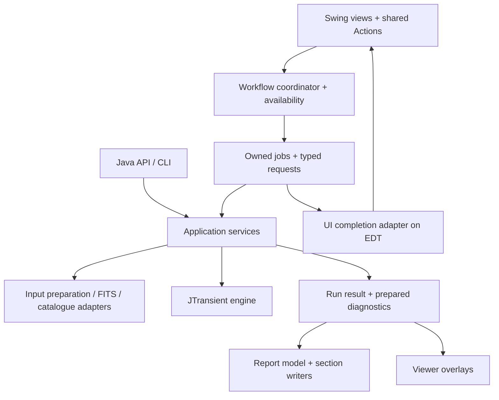

# Design and architecture improvements

This is the current architecture and pending work, not an implementation diary. Preserve original IDs so requests can be revisited through the final status register. Current behavior belongs in [DEVELOPER.md](DEVELOPER.md), [HIGH_LEVEL_DESIGN.md](HIGH_LEVEL_DESIGN.md), [MANUAL.md](MANUAL.md) and [API.md](API.md). Completed reasoning and evidence are in the [closed archive](docs/archive/design-improvements-completed-2026-10.md).

## Design goals and release policy

SpacePixels owns preparation, orchestration, persistence and presentation; JTransient owns detection/tuning and JPlateSolve owns solver execution/unsuccessful cleanup. Develop all three through sibling composites and update callers together. Backward library API/version compatibility is not required. At release, select and verify one pinned artifact combination. Scientific results, ownership, user data and documented application behavior are separate contracts.

### Boundaries to preserve

- **The engine boundary.** SpacePixels prepares data, orchestrates work and presents results. JTransient owns detection. Do not move GUI workflow or FITS-file interaction into the engine.
- **The public API shape.** [SpacePixelsPipelineRequest](src/main/java/eu/startales/spacepixels/api/SpacePixelsPipelineRequest.java) defensively copies its detection configuration, and [DefaultSpacePixelsPipelineApi](src/main/java/eu/startales/spacepixels/api/DefaultSpacePixelsPipelineApi.java) uses shared preparation and pipeline services. Those are useful patterns for GUI run requests too.
- **The settings navigation.** [SettingsNavigator](src/main/java/eu/startales/spacepixels/gui/SettingsNavigator.java) already provides search, changed-only filtering and expert disclosure. Keep the maintainer's basic/expert/hidden classification and the preservation of hidden configuration fields.
- **The shared viewers.** [SequenceViewerFrame](src/main/java/eu/startales/spacepixels/gui/SequenceViewerFrame.java), [FrameView](src/main/java/eu/startales/spacepixels/gui/FrameView.java), [StretchControls](src/main/java/eu/startales/spacepixels/gui/StretchControls.java) and [ViewerSupport](src/main/java/eu/startales/spacepixels/gui/ViewerSupport.java) reuse display and interaction code. The sequence viewer rejects obsolete work by worker identity and target frame; viewers detach listeners and release displayed data. Extend these patterns rather than replacing them.
- **Report identities and export snapshots.** [ReportData](src/main/java/eu/startales/spacepixels/util/reporting/ReportData.java) centralises findings and frame selection. [ExportVisualizationSettings](src/main/java/eu/startales/spacepixels/util/reporting/ExportVisualizationSettings.java) captures export options. [AtomicReportFile](src/main/java/eu/startales/spacepixels/util/reporting/AtomicReportFile.java) publishes completed text files. These solve part of the problems below already.
- **Existing validation and testing.** Input preparation, WCS handling, catalogue matching, API execution and reporting have focused tests. The site configuration already gives inline validation feedback. The review calls for extending these strengths, not starting over.
- **The frame table without sorting.** The table has no row sorter, so a selected row indexes the model directly. If sorting or filtering is added:
  - convert view rows to model rows in every selected-file and solve-result path;
  - use file and session identity rather than a visible row number;
  - return numeric values and column classes before offering numeric sorting.

## Package, class and ownership analysis

### Workflow boundaries

The following is a target/dependency map, not a second work list or a claim that all boxes are missing. Jobs, session ownership, commands, shared preparation, explicit GUI interactions and most completion adapters already follow it. The remaining gaps are the D09/D10 run/result boundaries. Do not create a package/interface for every box; UI completion stays on the Swing side.

- **Views** build components and show state. The main panel stops being the place that decides job policy, rewrites FITS and owns catalogue fetching.
- **Workflow coordinator** handles user intent, session handover, admission and outcomes. It has no dependence on individual button enabled flags.
- **Application services** take explicit inputs and options and return data. They do not show Swing dialogs or reach through `ApplicationWindow` for logging/configuration. Keep concrete services unless a seam needs substituting in tests or has multiple implementations.
- **Adapters** contain file formats, solver/network calls, persistence and interactive preparation decisions. The GUI and API supply different decision policies to shared operations.
- **Presentation** consumes a stable result. Existing report writers and shared viewer components stay in use.

The pattern is close to a modest **model–view–presenter** arrangement: a state model and testable workflow/presenter between Swing widgets and services. Use plain Java constructor injection, typed requests, `Action`s and explicit completion callbacks. A service locator, a second global event bus, deep inheritance tree or mandatory DI/reactive framework would add machinery without resolving the ownership questions.

### Implementation patterns

| Pattern | Concrete use here | Limit |
|---|---|---|
| Command | A shared Swing `Action` starts a typed operation from a button, shortcut or menu. | A local one-off listener does not need a command hierarchy. |
| Model–view–presenter | Availability, validation and workflow transitions can be tested independently of component layout. | Avoid replacing the panel with an equally large presenter. |
| Immutable request / result | Capture settings and identities once; return a typed outcome and stable report model. | Share large read-only image data by ownership contract rather than deep-copying it. |
| Strategy / adapter | GUI preparation questions and API preparation policy choose how to handle the same conversion facts. | Introduce an interface where behaviour really varies, not for every concrete helper. |
| Observer | Notify views about session/catalogue/settings changes through explicit, scoped subscriptions. | Subscriptions need an owner, detach path and stated delivery thread. |
| Composition and focused reuse | Keep shared stretch, drawing, navigation and report helpers behind their existing views. | Do not force every viewer or report section into a large inheritance framework. |
| Resource ownership | A job or viewer owns its engine, worker, listener subscription and buffers, and releases them predictably. | A cancelled future is not proof that its underlying operation has terminated. |

### Ownership and lifetime

| Scope | Owned state | Lifetime / rule |
|---|---|---|
| Application | User-level configuration, startup defaults, supported integrations, job resources | Loaded independently of a dataset; save failures are visible. |
| Session | Session ID, frame metadata, current selection, catalogue/correction, session caches and last-result references | Replaced on a successful handover; stale results cannot attach to its successor. |
| Run | Click-time config and export options, input identities, resolved context, diagnostics, outcome and artifact paths | Stable for reproducibility; does not read live controls during work. |
| Viewer | Current frame, zoom, playback state, listeners and owned display buffers | Explicitly detached/released on close; shared stretch models retain intentional semantics. |
| Report lookup | Provider request, report identity and enrichment cache | Independent of detection verdict; bounded work and existing target/path validation remain. |

**Current versus future:** application/session/viewer ownership above is largely implemented by D02/D04/D06/D08; S14 implements run-wide capture. Restoring a saved run was dropped from D11 on 2026-10-23; the F09 super report defines what it needs to persist. A saved-run record should include a schema version, supported build identifiers, input identities, effective settings, catalogue/correction provenance, analysis/export inclusion and artifacts. Some of this already exists in `detection_config.json`, versioned `report-data.json`, iterative `run-data.json` and per-pass manifests; extend those rather than writing a conflicting summary. Avoid storing private absolute paths or observing-site data in a shareable manifest by default. A reproducibility record is distinct from retaining all image buffers or promising replay from data that is no longer available.

`ApplicationWindow` already starts/stops the localhost lookup proxy; preserve that application-scoped lifetime rather than reopening an ownership task. If a feature expands lookup/server work, define its I/O/cache limits explicitly and preserve provider/target/path validation and atomic caching. This is an implementation guardrail, not an additional queue item or a newly established security defect.

### Class and responsibility scope

- **Settings (D10):** reuse extracted persistence/background storage and engine rules; work on typed config/widget/visualization bindings and explicit capabilities. Split page builders only when those boundaries help. Preserve profile formats, hidden values, shared models, migration backups and defaults/revert/auto-apply semantics.
- **Input preparation:** preserve completed S12/S13/F07 shared preparation, interactive versus API policy and output naming. WCS writeback already has a task/service boundary and JPlateSolve owns unsuccessful-solve cleanup; do not re-propose those as missing. Preserve explicit interaction injection and service-owned loggers.
- **Reporting (D09):** extract image assets, maps or iterative index helpers when relevant feature work needs them. Preserve stable finding identities, filenames, CSV data and lookup/live-render behavior. `DetectionReportAstrometry` already delegates its query/URL/HTML helpers; it is not a standing extraction project.
- **Main panel:** preserve the implemented session owner, application preferences, jobs, shared actions and explicit UI interaction adapters from D02/D06/D07/S13. Extract only a remaining result/workflow or UI-decision responsibility justified by the owning outcome; a panel's size is not an extraction order or a reason to rebuild session state.
- **Cohesive renderers:** leave `CreativeTributeRenderer` and target section writers intact unless feature work exposes an independent responsibility. No target line counts or mass static-helper replacement are proposed.

Verification follows the strategy above and [AGENTS.md](AGENTS.md). Import changes cover ready mono FITS, compressed files, signed/scaled and 32-bit conversions, color, XISF, exposure groups and negative-value policy in both GUI and headless modes. Settings changes cover load/save, failed saves, defaults/revert, migration, hidden values, previews and Auto-Tune. Report changes compare equivalent standard/iterative bundles, CSVs, identities, crops/GIFs and offline/live lookup behavior against a baseline. Use disposable settings and inputs.

## Pending findings

### D09. Complete the distinction between measurements and report presentation

**Current foundation.** `FindingCategory` now owns stable prefixes, JSON category text, detailed-card anchors, marker/legend colors, summary labels/counts, report inclusion, computed-row visibility and representative-coordinate policy. `ReportData`, report-category filtering, detection-map legends/buttons and the GUI report prompt consume it while preserving existing IDs/text/anchors/colors and JSON schema. See the [completion record](docs/archive/design-improvements-completed-2026-10.md#d09-shared-finding-category-descriptors-first-slice-2026-10-22).

**Implemented follow-up (S14/S15, 2026-10-23).** [DetectionReportGenerator](src/main/java/eu/startales/spacepixels/util/reporting/DetectionReportGenerator.java) delegates sections, consumes captured display/site/tuning options, constructs `ReportData` and atomically publishes HTML. S14's `ReportRunContext` resolves copied FITS metadata, plate correction and catalogue before detection; report writers and variable-star overlays share that context. S15 makes `FindingCategory`, shared track grouping/variable numbering and prepared findings authoritative across cards, maps, CSV labels and overlays. Filenames, counts, colors, filtering and JSON schema remain unchanged. See the [S15 completion record](docs/archive/design-improvements-completed-2026-10.md#s15-authoritative-report-and-overlay-identities-2026-10-23). [NightEquipment](src/main/java/eu/startales/spacepixels/util/reporting/NightEquipment.java) and [FieldDepth](src/main/java/eu/startales/spacepixels/util/reporting/FieldDepth.java) still calculate diagnostics during report export, as allowed while S16 is deferred.

**Proposal.** Keep section writers, but prepare a read-only report model once: stable finding IDs, accepted candidates, included categories, rejected frames, coordinates, catalogue snapshot and optional session diagnostics. Extend `ReportData`; do not introduce a competing identity system. A small category descriptor can provide the label, colour, prefix, count, inclusion option and anchor rule for the dialog, legends and maps. Existing report consistency checks are useful protection when consolidating these rules.

Separate diagnostic measurement services from HTML emission when the next diagnostic feature needs it. Their FITS/session orchestration can remain in SpacePixels; moving them into JTransient is not implied. Carry explicit diagnostic states such as unavailable, failed and measured instead of making every failure indistinguishable from an empty result. Keep browser lookup enrichment separate from detection confidence and preserve current offline exports.

Capture resolved catalogue/correction/export context at a documented point. Current export snapshots and field checks already help; the concern is completing reproducibility across a full run, not claiming every report changes midway. Keep live rendering defaults out of new APIs: pass options rather than changing process-wide statics.

**Acceptance.** HTML, JSON, maps and CSVs agree on IDs, numbering, counts and exclusions. Re-rendering an existing prepared result with different presentation options does not re-run detection or silently recompute diagnostics against newer catalogue state. Do not retain all raw frames forever merely to enable a later re-export; define what a lightweight saved result supports.

**Review decision (2026-10-23).** S15 is implemented: shared descriptors replace parallel label, prefix and anchor rules. S16 and the re-rendering clause in the acceptance pay off only when a saved result can be rendered again. SpacePixels has no such path today: every report is written in the run that measured it. Defer S16 and that clause until a saved result can be rendered again (D11's restore step was dropped on 2026-10-23), rather than building prepared diagnostic states that nothing reads a second time.

Decisions: Please go ahead as proposed in the review note.  

### D10. Complete explicit run options and selected-release validation

**Completed foundation (2026-10-23).** All 78 visible engine controls now use typed page definitions indexed by `DetectionSettings`; twelve application-owned controls register typed profile/rendering access with their rows. IDs, titles, units, guidance, disclosure and load/apply ownership stay together. Overview search, saved markers and shared Preview Frame guidance derive from the same definitions. Rule alignment uses typed drafts and editor IDs, without reflective field writes or a separate pair/spinner map. Existing ranges, hidden values, JSON formats, shared models and saved-versus-tuned state are preserved. Rendering values reload together under auto-apply suppression so Revert cannot overwrite later values with stale controls. The processor factories are named `ImageProcessing.openProcessor`; every call creates a new caller-owned facade that must be closed. See the [completion records](docs/archive/design-improvements-completed-2026-10.md#d10-all-visible-application-settings-bound-with-their-rows-2026-10-23) and [current settings design](DEVELOPER.md#settings).

**Run context completed (S14, 2026-10-23).** `DetectionRunOptions` and `ReportRunContext` capture application choices and resolved input context before processing. GUI jobs freeze configuration/options before queuing; API requests carry explicit options and deterministic defaults; CLI preference loading supplies detached values. Reports, diagnostics and live previews no longer read changing rendering/tuning defaults, and catalogue/WCS state is owned by each ordinary run. See [API behavior and isolation](API.md#run-options-and-isolation).

**Remaining scope.** Selected-release verification remains JA-11: a successful local composite build does not certify the final published engine/solver/application combination. Dataset-specific readiness feedback may be extended when its concrete checks and presentation are agreed. Typed bindings, run context, shared validation/metadata, persistence and background storage are completed foundations.

**Acceptance.** Independent runs retain their captured options. Hidden values and saved/Auto-Tune behavior continue to round-trip, and release checks exercise the exact artifacts being distributed. Completed widget migration is protected by typed ownership tests and an all-control Save/Revert/defaults/startup mechanics test; do not reopen it as pending work.

### D12. Use shared visual rules and content-driven layout

**Current foundation.** Detection/application settings now share `SettingsRowPanel`, measured HTML wrapping and `UiStyle` typography/spacing. The fixed `480 × 85` description and configuration text-column heights are removed. Inputs retain native font-dependent height; enabled descriptions, Overview guidance and viewer key hints use readable theme help colors. Layout tests cover narrow/wide forms, larger base fonts and FlatLaf 100/150/200% user scaling. See the [completion record](docs/archive/design-improvements-completed-2026-10.md#d12-settings-layout-and-shared-styles-first-slice-2026-10-22).

**Remaining scope.** Some Overview status/table HTML and main-window/viewer controls retain local widths/font sizes. The current `ProcessingProgressDialog` wraps its status and live-view caption at a scaled width with a reserved two-line height, and uses `UiStyle` spacing and help colour and an `AccessibleControls` link for Hide/Show picture. `ProcessingProgressDialogTest` checks long messages at 13/20/26 pt base fonts; 150/200 % display scaling of the dialog has not been inspected. The workflow already wraps and `WindowPlacement` is screen-aware. A full empty/loaded desktop review across display scaling remains required; layout tests do not establish visual contrast compliance.

**Proposal.** Define a small set of application UI defaults: body/help/section typography, spacing, content widths and semantic status colours. Use relative typography and scale custom dimensions with the supported FlatLaf/JDK mechanisms; prefer measured text and wrapping to fixed description heights. FlatLaf's [customisation guide](https://www.formdev.com/flatlaf/how-to-customize/) supports application-specific defaults, and its [scaling guidance](https://www.formdev.com/flatlaf/properties-files/#scaled-values) distinguishes scaled UI values. This is not a recommendation to use newer APIs unavailable in the pinned FlatLaf version.

Keep the existing dark theme and restrained primary-action emphasis. Make enabled help text readable rather than visually identical to disabled controls; measure contrast before calling it a standards failure. Use standard text/buttons and consistent spacing before adding decorative icons. Charts may keep domain-specific colours, with consistent labels and legends across the app and reports.

**Acceptance.** Inspect the empty and loaded main window, core/expert settings, configuration and viewers at representative small/large windows, 100/150/200% scale and a larger base font. Long descriptions and error messages wrap, primary actions remain visible and the workflow strip does not consume the usable frame/table area. Existing screenshots are context, not evidence that these tests have passed.

### Remaining architecture steps

S16 is the deferred part of D09, not a duplicate backlog. S14/S15 and earlier steps are indexed as implemented at the end.

| Step | Owner | Remaining implementation and acceptance |
|---|---|---|
| S16 | D09 | Prepare `FieldDepth`, `NightEquipment` and catalogue/correction snapshots before rendering, with measured/unavailable/failed states and a consistent optional-section failure policy. Re-export must reuse prepared values, not newer live state; inject failures and compare real measurements. |

## Pending and deferred features

### Tuning-threshold experiment (F01)

Proposed investigation only: compare maximum-stack/slow-mover thresholds against tuned per-frame thresholds on the same real datasets before changing defaults. JTransient SM-2 remains deferred; existing calibrated master tuning is not missing work. Measure recovery, false positives and runtime; do not change science merely because values look related.

### Session summary (F02)

Deferred. D11's session summary was dropped on 2026-10-23, so nothing schedules this. A multiple-night warning would be a light header check, not an expensive pre-run quality table. Revisit only if asked.

### Stretch preview visibility (F05)

Deferred. Evaluate the current preview cap and small-star visibility against the full-size viewer before changing sampling. This does not reopen the implemented latest-request-wins scheduling.

### MCP agent services (F04)

The maintainer wants AI agents to operate SpacePixels through an MCP server, beginning with capabilities similar to the existing [Java API](API.md). This is an exploratory proposal; the server interface, transport and packaging remain to be designed.

- **First scope: full dataset analysis.** Accept a folder of aligned frames and a detection profile/configuration, with supported preparation, Auto-Tune and report options. Reuse `SpacePixelsPipelineApi` and its request/result contracts. Return the effective settings, a structured result summary and the report/export locations. Provide a way for the agent or user to access the HTML report and its associated assets, rather than assuming a server-local path is readable by every client.
- **Long-running work.** Explore separate start, status/progress and result/report operations so an agent can follow a pipeline run. Reuse the ownership and outcome work in D02/D04; cancellation behavior must reflect what the underlying processing can actually stop.
- **Possible extension: single-frame extraction.** Let an agent select a frame and specify detection sigma, grow sigma, minimum pixels or a profile, then inspect structured detections and an annotated preview. This is extraction on that frame, before the dataset's stationary-star veto.
- **Possible extension: session-aware transient inspection.** Given a complete dataset, configuration and a selected frame, expose the transients remaining after the session's quality selection, median reference, star mask and filtering, with positions and a preview/overlay. Reuse prepared session context where appropriate. Keep this operation distinct from running extraction on the selected frame alone; the surrounding dataset changes which sources count as transients.

Use headless application services, with the existing public API as the starting boundary. The lower-level inspection operations need an explicit application contract; they are not currently methods on `SpacePixelsPipelineApi` and should not be exposed by driving `ApplicationWindow`. Reuse `report-data.json` and existing run metadata where sufficient, adding a shared result contract only when a concrete use case needs it. The earlier external agent-services proposal is background context, not a checked-in specification.

Before implementation, decide the initial client/local-file workflow, supported settings and defaults, job/session lifetime, result/artifact access and how much lower-level inspection belongs in the first version. A first acceptance exercise would have an agent submit a folder/profile, follow the run and retrieve the same findings and report as an equivalent Java API call. Single-frame operations would need comparisons with the corresponding extraction and session-inspection paths.

**Decision needed.** the initial transport/client preference: local stdio using local folders/profiles and full-analysis jobs/artifacts, or HTTP with remote artifact access. Other independent features proceed while this larger interface decision is pending.

Decision: I propose to have an http interface. But forst we should do a table with the services that we will provide and each service description. After we agree on the services we will proceed with an implementation. 

#### Proposed services (for agreement, 2026-10-23)

The server is an MCP server on the Streamable HTTP transport, so an agent connects to one URL and calls these services as MCP tools. Report files are served over the same HTTP server, so a client on another machine can read them. Nothing below is implemented yet.

| Service | What it does | Main inputs | Returns | First version? |
|---|---|---|---|---|
| `server_info` | Describes the server: SpacePixels, JTransient and JPlateSolve versions, the folders it may read, the memory limit, and whether a job is running. | none | versions, allowed folders, limits, busy/idle | Yes |
| `get_settings_schema` | Lists every detection setting an agent may change: field ID, title, unit, range, default, and basic or expert. It comes from the same rules the settings panel uses, and hidden settings are not listed. | none | one entry per setting | Yes |
| `get_default_profile` | Returns the default detection profile, as saved in a profile file. | none | profile JSON | Yes |
| `inspect_dataset` | Checks a folder without processing it: frame count, size, mono or colour, FITS or XISF, timing, exposure groups, and whether it is ready or needs preparation. Same checks as the import. | folder | readiness, the problems found, and the exposure groups | Yes |
| `start_analysis` | Starts a full analysis of a folder, the same as the Java API's `run`: optional preparation, optional Auto-Tune, detection, then the report. Only one analysis runs at a time; a second request is refused while one runs. | folder, profile or setting overrides, preparation mode, Auto-Tune profile, report on/off | job ID | Yes |
| `start_auto_tune` | Runs only Auto-Tune on a folder and returns the tuned settings. Nothing is detected. | folder, profile, Auto-Tune profile, max candidate frames | job ID | Yes |
| `get_job_status` | Reports a job's state (queued, running, finished, failed or cancelled), its stage and percentage, the last progress message, and the elapsed time. | job ID | status | Yes |
| `cancel_job` | Asks a running job to stop. The job reports "cancelled" once the work has actually stopped. | job ID | accepted or not running | Yes |
| `get_analysis_result` | Summarises a finished analysis: the effective settings, Auto-Tune choice, rejected frames, counts per category, and the findings from `report-data.json` (ID, category, position, sky position, frames, variable-star tier). | job ID | structured summary | Yes |
| `list_artifacts` / artifact URLs | Lists a finished job's files (HTML report, `report-data.json`, CSVs, images) with an HTTP URL for each. The agent or the user opens the report from that URL. | job ID | file list with URLs | Yes |
| `extract_frame_sources` | Runs source extraction on one frame with given sigma, grow sigma and minimum pixels (or a profile), and returns the detections and an annotated preview. This is extraction on that frame alone, before the stationary-star veto. | folder, frame, settings | detections, preview image URL | Later |
| `inspect_frame_transients` | Returns the transients left on one frame after the whole dataset's frame selection, median reference, star mask and filtering, with an overlay. Same as Manual Transient Inspection. | folder, frame, settings | transients, overlay image URL | Later |

**Limits that apply to every service.** The server listens on localhost unless configured otherwise, and needs a token when it listens on a network address. It reads only inside configured root folders, and writes only report folders under the dataset (as the Java API does). Results and artifacts leave out observing-site coordinates and absolute paths. Settings files in the user's home folder are never changed.

**Still to decide after this table.** Whether the first version needs `start_auto_tune` as its own service (it could stay an option of `start_analysis`); how long finished jobs and their artifact URLs are kept; and how the server is started (its own launcher, or an option of the desktop application).

### Native platform installers (F06)

Explore a native installer for SpacePixels, starting on Windows. The goal is a normal install, launch, upgrade and uninstall experience. Other platforms can follow after the Windows approach is established.

Decide the Windows package format (for example, EXE or MSI), whether to bundle a Java runtime, installation scope/location, shortcuts, signing and how new releases update an existing installation. Keep user settings and datasets separate from application files so upgrades preserve them and uninstall behavior is explicit. Consider how the desktop application, CLI and a future MCP server would be distributed or selected during installation; this does not require delivering all three in the first installer.

Compare packaging options against the existing Gradle distribution and publishing workflow before selecting tooling. Validate a proposed installer on a clean Windows environment: install, launch, run a small analysis and open its report, upgrade from a previous version, and uninstall while preserving saved profiles and observing data. These are exploration criteria, not a claim that a native installer or bundled runtime already exists.

**Related bootstrap idea:** investigate optional launcher guidance for installing a suitable OpenJDK through native package managers on Windows/macOS/Linux. Current development uses Java 21; verify package identifiers, platform support, licensing and runtime compatibility when this proposal is taken up. Do not install software silently or treat an unverified package-manager command as a shipped bootstrap feature.

**Decision needed.** whether the per-user Windows installer should bundle Java 21 or require an existing Java 21 installation. Signing and clean-machine install/upgrade/uninstall verification remain release work; no runtime is downloaded or installed as part of the current feature sequence.
Decision: The per-windows installer should have an exe format and bundle a java runtime. I would follow best practices for the rest of the questions about shortcuts, app updates, etc. Signing would be a second step, we can start with an unsigned release. If there are other decision points that we need before we start, please let me know. I think java already has such a machanism natively (at least partly), please confirm.     

**Answer (2026-10-23).** Yes. The JDK's `jpackage` tool (in JDK 21) builds a Windows `.exe` installer that contains the application and a Java runtime cut down with `jlink`. It needs the WiX Toolset on the build machine (WiX 3 for JDK 21). It covers most of the questions above:

- **Install scope:** `--win-per-user-install` installs under the user's local application folder without administrator rights.
- **Shortcuts:** a Start menu entry (`--win-menu`, `--win-menu-group`) and an optional desktop shortcut (`--win-shortcut`).
- **Upgrades:** a fixed `--win-upgrade-uuid` with a higher version replaces the installed version. Settings and profiles stay in the user's home folder, so an upgrade or an uninstall leaves them in place.
- **Several launchers:** `--add-launcher` can add a console launcher for the batch command-line tool next to the desktop application.

It does not include an automatic updater; a new release is installed by running the new installer. A Gradle plugin (for example the Badass Runtime plugin, which suits a non-modular application) or a plain `jpackage` task can build it from the existing distribution.

**Decision points before starting:**

1. **Installer version number.** Windows installers need a version of the form major.minor.build with major and minor at most 255. `2026.10-04` does not fit. Proposal: the installer uses `26.10.4` for `2026.10-04`, and the application keeps showing its own version.
2. **Memory.** The launcher keeps today's `-XX:MaxRAMPercentage=80.0 -XX:+UseG1GC`. A user can change it in the launcher's `.cfg` file. Proposal: keep it.
3. **Command-line tool.** Proposal: also install the batch tool as a console launcher (`spacepixels-batch`), no extra cost.
4. **Icon.** An `.ico` is needed; proposal: build it from the existing `spacepixels-16`…`256` PNG icons.
5. **Where the installer is built.** On a Windows machine with WiX: your PC, or a Windows GitHub Actions runner. Proposal: a Gradle task on your PC first; CI can come later.
6. **Unsigned release.** Windows SmartScreen warns about an unsigned download ("Windows protected your PC" → More info → Run anyway). The manual should say so until signing is added.

### Directory-based iterative detection (F09)

**Status: agreed 2026-10-23.** Basic iteration is available; this pending scope concerns cross-pass consolidation, not rebuilding iteration. The matching and evidence-selection policies are proposed for agreement before implementation.

The basic directory-based workflow is implemented: independent ordinary runs with Start/Increase/Maximum planning, fixed manual settings or one-time Auto-Tune, and an index of per-pass reports. The manual-setting reminder replaces the proposed dedicated sample-import workflow. Implementation decisions and validation are recorded in the [F09 completion record](docs/archive/design-improvements-completed-2026-10.md#f09-directory-based-iterative-detection-2026-10-22); current behavior belongs in the manual and developer/architecture guides.

**Proposed enhancement: a consolidated “super report”.** Read the completed pass reports and saved run metadata, identify findings that refer to the same physical object or event, and present one combined finding with the best available information from its contributing runs. Keep the individual reports and their original identities accessible.

- **Associate findings across passes.** Use shared input identities, timestamps, sky/pixel positions, motion and category-specific evidence. Report-local T/ST/A/V IDs alone are insufficient. Handle split/merged tracks, missing WCS, ambiguous matches and incompatible datasets explicitly; preserve disagreements instead of forcing a merge.
- **Combine evidence with provenance.** A finding may have its strongest detection in one pass, a longer track in another, and better astrometry, photometry, crops or animations elsewhere. Define how to select or combine each measurement, and link it to its source pass and report anchor. Repeated use of the same frames is correlated evidence, not an independent confirmation or an automatic confidence increase.
- **Present a useful combined view.** Show distinct consolidated findings, contributing passes and their frame counts, coverage and confidence/measurement limitations. Provide the best supported visualizations and direct links to all source reports. Treat combined counts separately from per-pass counts.
- **Persist enough evidence.** The implemented `run-data.json` and per-pass input manifests capture settings, outcomes, selected filenames, dimensions, exposure and timestamps. Today's `report-data.json` is still a findings summary, not a complete per-frame replay record. Determine and version the additional per-frame positions, associations, quality flags, catalogue/WCS provenance or light-curve evidence needed before promising consolidation of every category. Coordinate with D09 instead of introducing another identity format.
- **Support partial runs and bounded memory.** Consolidate usable completed outputs after cancellation or pass failure, explain omissions, and work from saved measurements and on-demand images without retaining every run's pixel buffers.

**Acceptance for the enhancement.** Exercise one finding seen in several passes, distinct nearby objects, split tracks, conflicting measurements, changed/missing inputs, different fields with matching filenames, missing WCS and older summary-only reports. Verify that chosen measurements remain traceable, ambiguous associations remain visible, unique counts are justified, and individual reports stay unchanged. Cross-pass consolidation is not part of the completed basic workflow; its matching and evidence-selection policies need a separate implementation decision.

Decision: Agreed. please also use a similar page layout for the super report (colors , background, ...) as the individual reports. 

### Live detection preview (F10)

**Status: in progress, maintainer-owned.** Preserve the current preview implementation; additional engine imagery needs an explicitly agreed safe observer contract.

**Idea.** Make waiting more engaging with a small “Live view” or “Observatory window” showing a representative image from the work actually under way. Refresh roughly every 3–5 seconds when a useful new snapshot is available, not on every frame or progress event. This is a proposed future feature, not an implementation commitment or a replacement for the final report.

**Preferred placement.** Start with a collapsible area inside the existing `ProcessingProgressDialog`, rather than a second splash window that steals focus or covers controls. Explore a thumbnail around 240–320 logical pixels on its long side, with a short stage/caption line. Keep progress, status and Cancel visible; avoid repeated dialog resizing. Offer Hide/Show preview and retain the preference. Use readable text and accessible descriptions, not colour alone, and avoid flashing or continuous animation.

**Possible content by phase, only when already available:**

- **Loading/preparation:** an appropriately stretched source-frame thumbnail, optionally with frame number or observation time. Show a neutral waiting state until real pixels are available.
- **Reference and masking:** a reduced master/reference image or a star-mask view, with a plain explanation such as “Building the stationary-sky reference”. Do not suggest the reference is finished while it is still being built.
- **Extraction and linking:** a crop of an interesting source, streak or emerging track, with a restrained marker. Label it “Provisional candidate” or “Sample extraction”; an extracted source is not necessarily a surviving detection, and later filtering can reject it.
- **Report generation:** reuse a crop or track visualization as the report produces it. Show “Latest preview from …” if the image belongs to an earlier stage; the current textual progress remains authoritative. No detections, disabled analyses and stages without imagery must remain understandable without manufactured discoveries or unrelated pictures.

**A little creative polish.** Consider an optional small field-of-view inset marking where a crop came from. A short two/three-frame motion strip could later make moving sources or streaks more intuitive; a miniature light curve could serve variable-star analysis if those measurements are already available. These are follow-ups, not prerequisites for the first static-thumbnail version. Prefer real astronomical data over decorative random images, a simulated radar sweep or an invented discovery counter. The preview is illustrative, not a claim to show every finding, the strongest finding or the current full analysis state.

**Normal and iterative runs.** Build on the shared standard-run path so the same component can serve both workflows. For iteration, display the pass number and subset frame count; clear or explicitly retire the previous pass's image. If shown during the one-time Auto-Tune, identify it as a tuning sample, not an iterative detection result. Do not attach another directory's preview to the open session or change its selection, overlays or report reference.

**Technical boundary and cost.** The current engine progress callback carries percentages and text, not image snapshots. Do not infer stages or objects by parsing those messages, or promise live extraction crops without a safe engine integration. Reuse available loading/report assets first; explore an explicit optional, GUI-independent preview/diagnostic observer at safe engine stages in coordination with JA-09 and D09. SpacePixels owns stretching and Swing presentation. Pass bounded, detached thumbnails/crops or safe copied data, not mutable in-flight engine objects or retained full-resolution frame buffers. Rendering must not change scientific pixels, thresholds or exported visualization settings.

Throttle before expensive snapshot/crop work, render off the EDT and keep only the displayed image and at most the newest pending update. Prefer existing pipeline buffers and produced report assets over extra FITS reads, extraction passes or disk exports. Drop stale updates by job/session/pass identity and snapshot order; cancel/release preview work and listeners when hidden, cancelled, completed or superseded. A slow or failed preview must be skipped, never fail detection, delay cancellation or queue work indefinitely. Headless/API runs and disabled previews should incur no preview-generation work.

**Delivery and open decisions.** First prototype the small progress-dialog layout with real source thumbnails and already-produced report images; decide default visibility, size, cadence and stretch policy after using it on short and long runs. Add live reference/extraction/streak samples only where explicit safe snapshots are available. Do not expand the first version into an interactive viewer, saved-results store or the F09 super report.

**Current foundation.** The live view in `ProcessingProgressDialog` shows loading frames, then, while the engine runs, the findings of each finished stage from JTransient's stage observer (second slice, 2026-10-23): the reference, the star mask, slow movers, moving objects, streaks, anomalies, local-rescue and variable-star candidates, up to 8 slides per stage shown in turn and marked provisional. Report pictures follow as they are written, and each iterative pass clears the view and names itself in the captions. Decisions taken: shown by default with a remembered Hide/Show picture choice; a box of 300 × 200 logical pixels from thumbnails of at most 420 px; at most one picture per 3 s, stage changes at once; the report's automatic stretch. Findings, CSVs and settings are identical with the view on and off, and klangwolke-1 showed no measurable time or memory overhead. See the completion records of the [first slice](docs/archive/design-improvements-completed-2026-10.md#f10-first-slice-live-view-in-the-progress-dialog-2026-10-22) and the [second slice](docs/archive/design-improvements-completed-2026-10.md#f10-second-slice-findings-while-the-detection-runs-2026-10-23).

**Open decision: report-phase cadence.** On a large run the report's first picture replaces the last stage's slides after 3 s, so most variable-star slides are never seen (klangwolde-2: 8 variable-star slides, about one shown). Options: keep the report pictures as now; let a stage's slides go round once before report pictures replace them; or show no report pictures after the findings. The choice is the maintainer's.

**Acceptance.** Compare findings and report measurements with preview enabled and disabled; measure wall time and peak memory on representative large frames and set an acceptable overhead budget before release. Exercise no detections, rejected candidates, missing imagery, long stages, short runs, slow rendering and preview failures. Verify responsive Cancel, bounded queues/buffers, correct provisional/stale captions and no updates after completion. Check iterative pass transitions, cancellation/restart and different source directories, including a run while another session remains open. Confirm hiding/disabling stops preview work, headless runs do not produce previews, and text/progress remain usable with keyboard navigation and larger fonts.

## Engine and application coordination

Use current sibling APIs directly and update importing callers with library changes. JTransient now provides private-copy frame sorting, immutable tuning defaults, scoped core/tuner diagnostics and structured `OperationFailedException` stage/frame causes through ordinary methods. SpacePixels services/jobs/API use those calls; no old-engine reflection, global tuner/debug bridge or alternate snapshot/outcome engine facade is required.

| Engine work | Remaining application responsibility |
|---|---|
| JA-06/07 | Done 2026-10-23: imports use the top-level `model` types; the track-linker split needed no SpacePixels change. |
| JA-09 | Done 2026-10-23 for the stage observer, which F10 slice 2 uses (`LiveFindings`). The progress-event part is not scheduled. |
| JA-12 | Adapt to the reduced execution API (cancellation scope, diagnostics, structured failures); compile and tests pass. |
| JA-10 | Closed 2026-10-23; nothing to do. |
| JA-11 | At release, pin one engine/solver combination and validate actual final repository artifacts without composites or the local validation repository. |

Scientific algorithm proposals retain the decisions in [JTransient's plan](../JTransient/DESIGN-IMPROVEMENTS.md). This application plan does not reactivate deferred engine work.

## Verification and maintenance

Implement one coherent feature at a time. Document new Java types/methods and ownership, update current reference docs, run focused tests then relevant broader checks, and include validation/remaining limits in feature commit bodies. Commit and push affected repositories without empty commits or ignored configuration changes. Scientific changes need paired reference-data comparisons; documentation-only changes use source/link checks. Completed implementation narratives belong in the archive, leaving only pending scope and the status row here.

### Validation boundaries

The current suite includes `JobCoordinatorTest`, `CommandAvailabilityTest`, session/storage/preparation and report-consistency tests, `SettingsNavigatorSnapshotTest`, shared-rules/profile tests and opt-in GUI mechanics coverage. Do not reuse the 2026-10-19 'no dedicated tests' observation as current evidence. Newly extracted state/binding/workflow seams should have focused tests; the entire panel need not be constructed to test a policy.

| Behaviour | Verification that would justify the change |
|---|---|
| Job ownership | Deterministic fake jobs: duplicate start, A finishes after B, late progress, session replaced, ordinary failure, export declined. |
| Settings | Invalid typed values, dependent limits, non-finite profile/API inputs, hidden-value round trips, migration, defaults/revert and failed-save dirty state. |
| Actions and table | Same enabled reason/action across button, shortcut and menu; correct model-row conversion if sorting is introduced. |
| EDT responsiveness | Slow fake storage/service with a responsive UI heartbeat; UI mutations happen on the EDT. Do not use fragile timing thresholds as the only proof. |
| Viewer lifecycle/access | Actual focused key events, editing versus navigation, listener counts and released frame references after close. |
| Report refactors | Same engine results, IDs, counts, CSV values, rejected frames and assets for equivalent options; offline browser checks for changed interactions. |
| Selected release artifacts | Compile/test the pinned engine/solver/application combination without composites; verify actual artifact availability. |
| GUI mechanics | [GUI mechanics tests](#gui-interaction-checks): drive the real window by the visible text of its controls. Check that actions, saving and cancellation work. Do not compare detection results. |

For behavioural changes, follow the maintainer's real-data comparison method. Anything affecting detection, preparation or numeric diagnostics needs the relevant before/after datasets and one engine fix at a time. A pure wiring/presentation change should demonstrate unchanged processing inputs and outputs and exercise its GUI/interaction boundary. Do not rewrite user settings during verification; use an isolated JVM home and preserve or isolate Java preferences.

### GUI interaction checks

Use the existing opt-in headed GUI fixtures when changing focus, keyboard actions, dialog mechanics or layout. Reuse `ProcessingProgressDialogTest`, report/import prompt fixtures, viewer smoke/keyboard tests and disposable preferences/data; keep Swing work on the EDT and background preparation off it. Separate headless service/unit checks from native file chooser, display/Robot and real-application verification. A passing source inventory or headless build is not proof of rendered/native interaction behavior. Record what was actually exercised with each implementation.

### Constraints

- A wholesale Swing-to-JavaFX/web rewrite to solve lifecycle and state problems.
- Splitting every long class or moving all `util` files before extracting a real responsibility.
- A single giant controller replacing a single giant panel.
- Generic jobs with untyped results, a global EDT EventBus wrapper, or assuming interruption instantly stops computation.
- Making every domain object observable or giving every one-off callback its own interface.
- Reintroducing hidden settings, silently changing thresholds, or tying engine acceptance to a report checkbox.
- Keeping large image buffers in session history to make later rendering convenient.
- Replacing the current viewer focus rules without testing real keyboard focus and editing.

## Original request status register

Implemented rows are not a second backlog. Partial/deferred rows retain only the remaining scope above; detailed original evidence stays in the archive. F10 remains the maintainer's parallel work.

| ID | Request | Status |
|---|---|---|
| D01 | Atomic file replacement | Implemented |
| D02 | Owned background jobs and identities | Implemented |
| D03 | Latest-request-wins stretch previews | Implemented |
| D04 | Cancellation, failure and resource cleanup | Implemented |
| D05 | Validated settings capture | Implemented |
| D06 | Session/service boundaries | Implemented; factory clarity remains D10 |
| D07 | State-driven commands and availability | Implemented |
| D08 | Background I/O and preference writes | Implemented |
| D09 | Prepared report diagnostics and identities | S14/S15 implemented 2026-10-23; S16 diagnostics/re-export deferred |
| D10 | Typed settings and explicit run options | Typed bindings, factory naming and S14 implemented 2026-10-23; selected-release validation remains JA-11 |
| D11 | Last run's tracks in Blink, Preview Frame and Manual Transient Inspection | Implemented 2026-10-23 (reduced scope) |
| D12 | Shared visual/layout rules | In progress |
| D13 | Keyboard access and viewer focus | Implemented |
| D14 | Leftover compatibility code (post-implementation review) | Implemented 2026-10-23 |
| F01 | Slow-mover/per-frame tuning relation | Proposed experiment; engine SM-2 deferred |
| F02 | Header session summary/multiple-night warning | Deferred |
| F03 | Viewer magnitude/name controls | Implemented |
| F04 | MCP services over headless API | Agreed: HTTP; services table awaits agreement |
| F05 | Small-star visibility in stretch previews | Deferred |
| F06 | Native installers/runtime distribution | Agreed: per-user Windows `.exe` with a bundled runtime; decision points listed |
| F07 | Combined compressed FITS preparation | Implemented |
| F08 | Variable-star field image | Implemented |
| F09 | Cross-pass super report | Agreed; matching policy to be proposed; basic iteration implemented |
| F10 | Live detection preview | In progress; maintainer-owned; slice 2 (findings during detection) implemented 2026-10-23; report-phase cadence open |
| F11 | Headless API/CLI publication | Implemented |
| S1 | Reliable job terminal events | Implemented |
| S2 | Job admission/coordinator | Implemented |
| S3 | Typed job outcomes | Implemented |
| S4 | Shared actions and availability | Implemented |
| S5 | One batch-stretch task | Implemented |
| S6 | Tasks independent of GUI | Implemented |
| S7 | Session owner and application settings | Implemented |
| S8 | Background WCS/session I/O | Implemented |
| S9 | Replace global EventBus | Implemented |
| S10 | Split processing/session/I/O services | Implemented |
| S11 | Truthful failure reporting | Implemented |
| S12 | Shared GUI/API input preparation | Implemented |
| S13 | Headless util and explicit interactions | Implemented |
| S14 | Explicit application run context | Implemented 2026-10-23 |
| S15 | Authoritative finding identities/categories | Implemented 2026-10-23 |
| S16 | Prepared diagnostic states/failure policy | Deferred until a saved result can be re-rendered |
| Library compatibility | Historical API/version fallback machinery | Dropped; coordinated cleanup implemented |
