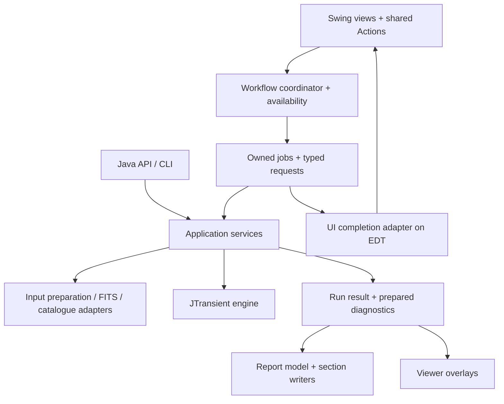

# Design improvements and feature plan

The single active plan for SpacePixels application design, GUI improvements and refactoring. It holds only **pending work and open decisions**. [HIGH_LEVEL_DESIGN.md](HIGH_LEVEL_DESIGN.md) describes the architecture as it is, and [DEVELOPER.md](DEVELOPER.md) gives a short map of the code.

## Status and maintenance

**Proposed** means an idea awaiting a decision; **Accepted** records an explicit implementation decision; **In progress** means implementation has started; **Deferred** records a deliberate postponement; **Dropped** retires a superseded proposal. Priority is separate from authorization.

- **The work queue** is the findings table, the open architecture steps, the [engine changes that need SpacePixels work](#engine-changes-that-need-spacepixels-work) and the feature table below. Add new proposals there; do not keep a separate TODO or refactor list.
- **When an item is done,** describe its behaviour in the manual, API or architecture documents, and move its record (decision, evidence and validation) to the archive. Do not bring completed items back into this plan.
- **Completed work:** [design work completed in October 2026](docs/archive/design-improvements-completed-2026-10.md) holds:
  - D01, D03, D05 and D07, and the done parts of D02 and D04;
  - the architecture review with its finished steps;
  - the EventBus decision.

  Older sources: [GUI review](docs/archive/gui-enhancements-2026-10.md), [refactor snapshot](docs/archive/refactor-2026-09.md), [completed task list](docs/archive/completed-tasks-2026-10.md) and [maintenance notes and regression evidence](docs/archive/maintenance-notes-2026-10-19.md). Their old priorities do not override this plan.

The open findings come from the 2026-10-18 review; its [assessment and scope](docs/archive/design-improvements-completed-2026-10.md#overall-assessment) are archived.

## What to preserve

- **The engine boundary.** SpacePixels prepares data, orchestrates work and presents results. JTransient owns detection. Do not move GUI workflow or FITS-file interaction into the engine.
- **The public API shape.** [SpacePixelsPipelineRequest](src/main/java/eu/startales/spacepixels/api/SpacePixelsPipelineRequest.java) defensively copies its detection configuration, and [DefaultSpacePixelsPipelineApi](src/main/java/eu/startales/spacepixels/api/DefaultSpacePixelsPipelineApi.java) uses shared preparation and pipeline services. Those are useful patterns for GUI run requests too.
- **The settings navigation.** [SettingsNavigator](src/main/java/eu/startales/spacepixels/gui/SettingsNavigator.java) already provides search, changed-only filtering and expert disclosure. Keep the maintainer's basic/expert/hidden classification and the preservation of hidden configuration fields.
- **The shared viewers.** [SequenceViewerFrame](src/main/java/eu/startales/spacepixels/gui/SequenceViewerFrame.java), [FrameView](src/main/java/eu/startales/spacepixels/gui/FrameView.java), [StretchControls](src/main/java/eu/startales/spacepixels/gui/StretchControls.java) and [ViewerSupport](src/main/java/eu/startales/spacepixels/gui/ViewerSupport.java) reuse display and interaction code. The sequence viewer rejects obsolete work by worker identity and target frame; viewers detach listeners and release displayed data. Extend these patterns rather than replacing them.
- **Report identities and export snapshots.** [ReportData](src/main/java/eu/startales/spacepixels/util/reporting/ReportData.java) centralises findings and frame selection. [ExportVisualizationSettings](src/main/java/eu/startales/spacepixels/util/reporting/ExportVisualizationSettings.java) captures export options. [AtomicReportFile](src/main/java/eu/startales/spacepixels/util/reporting/AtomicReportFile.java) publishes completed text files. These solve part of the problems below already.
- **Existing validation and testing.** Input preparation, WCS handling, catalogue matching, API execution and reporting have focused tests. The site configuration already gives inline validation feedback. The review calls for extending these strengths, not starting over.
- **The frame table without sorting.** The table has no row sorter, so a selected row indexes the model directly. If sorting or filtering is added:
  - convert view rows to model rows in every selected-file and solve-result path;
  - use file and session identity rather than a visible row number;
  - return numeric values and column classes before offering numeric sorting.

## Findings and priorities

| ID | Priority | Status | Improvement | First useful result |
|---|---|---|---|---|
| D02 | High | In progress; open: session identity (S7) | Job ownership and resource admission | A late result from one session cannot be applied to the next. |
| D04 | High | In progress; open: engine cancellation waits, the viewer check | Explicit cancellation, outcomes and cleanup | Cancelling does not mean exiting; every ordinary terminal path releases its resources. |
| D06 | Medium | Proposed | Application, session and viewer ownership | State is scoped to the session it describes, and global preferences can be edited before import. |
| D08 | Medium | In progress; open: session-folder I/O and import questions (S8, S12) | Keep slow work off the EDT | Importing a session does not read its catalogue, correction and Auto-Tune files on the UI thread. |
| D09 | Medium | Proposed | Complete the analysis/report separation | Display changes reuse prepared diagnostics and stable finding identities. |
| D10 | Medium | Proposed | Typed settings metadata and engine integration | A setting's identity and rules are not maintained in several unrelated lists. |
| D11 | Medium | Proposed | A clearer analysis workflow and persistent results | Users see what will run and can reopen its results without another detection. |
| D12 | Medium | Proposed | Shared visual rules and adaptable layout | Longer descriptions and larger fonts fit without fixed-height clipping. |
| D13 | Medium | Proposed | Keyboard and assistive-technology access | Visible links, settings inputs and viewer controls are reachable and named. |

“High” means to address before expanding the affected workflow. It does not mean undertaking all high-priority items in one change.

### D02. Give every background job an owner and an identity

**In progress.** Every long job runs under `JobCoordinator`:
- it is admitted on the EDT before its worker starts;
- it has a handle with its id, kind and session;
- it ends with one typed outcome.

The sky-catalogue fetch stays outside the coordinator by decision. See the [archived record](docs/archive/design-improvements-completed-2026-10.md#d02-give-every-background-job-an-owner-and-an-identity).

**Open: session identity.** A job handle names its session by the `ImageProcessing` of the import, a placeholder until the session object (S7).

**Acceptance.** A late progress or finish event from job A cannot unlock job B, change B's status or apply A's result to a new session. Tests should assert this without constructing the entire main window.

### D04. Make cancellation, failure and resource cleanup explicit

**In progress.** Done:
- one ending per job, typed outcomes and one out-of-memory policy;
- Cancel in the progress dialog, and clean-up after a cancel;
- progress while the report is written;
- Copy details in failure messages;
- the last-report link.

See the [archived record](docs/archive/design-improvements-completed-2026-10.md#d04-make-cancellation-failure-and-resource-cleanup-explicit).

**Open:**
- **Engine waits.** A cancel takes effect at the engine's next progress report. Measured on klangwolke-2 (33 frames of 61 MPix):
  - during frame extraction it took 26 s, because the engine's worker threads finish their frames first;
  - the other engine stages waited up to 6–29 s between reports, photometry's ensemble solution the longest;
  - calibrated Auto-Tune waited up to 12.6 s.

  Shorter waits need a cancellation contract in JTransient (its JA-03), discussed there first; SpacePixels then uses it.
- **The viewer check.** Close a viewer while it prepares a frame: its worker's result is dropped and its frames are released.

**Acceptance.**
- Cancel during extraction, photometry and calibrated tuning on real data, and report the measured waits before and after the engine change.
- Close each viewer while it prepares a frame, and verify one terminal outcome, released resources and a correct command state.

### D06. Separate application preferences, the session and individual viewers

**Evidence.** [ApplicationWindow](src/main/java/eu/startales/spacepixels/gui/ApplicationWindow.java) owns an `ImageProcessing` for the current folder. [SkyCatalogueModel](src/main/java/eu/startales/spacepixels/gui/SkyCatalogueModel.java) is process-wide. `MainApplicationPanel` owns selection, sky jobs and a preview window; `DetectionConfigurationPanel` owns a master-stack cache; viewers own other frames and listeners. [ImageProcessing](src/main/java/eu/startales/spacepixels/util/ImageProcessing.java) reloads the user-level `AppConfig` for each instance. `SpacePixelsDetectionProfileIO` also retains an active Auto-Tune frame limit in static state.

Existing session guards deserve credit: sky completion checks worker identity; restore checks the saved field and correction key; overlays check coverage; viewer cleanup detaches listeners. Do not describe these as absent or assume every import currently mixes catalogues. The remaining concern is scattered ownership and dependence on a single process-wide current session, especially for tests or future multiple windows.

**Proposal.** Load application preferences once, independently of importing a folder. Give the window a current session containing an ID, metadata references, selection model, catalogue/correction state, last-result references and session-scoped caches. Replace it only after a successful import handover. Imports already end with a typed outcome, and a declined, cancelled or failed import keeps the open session.

Pass the session or an immutable session snapshot to viewers/services. Treat large frame buffers as owned resources, not data to deep-copy into every snapshot. An old viewer may keep its old session intentionally, but must not silently adopt the new session's catalogue. Retain field/solution guards after removing the singleton.

**Acceptance.** Open A, begin background work, import B, then let A finish: B stays unchanged. Failed or cancelled import preserves the agreed previous-session behaviour. Closing a viewer releases listeners and owned buffers. Two test sessions cannot change each other's catalogue or tuning preferences. Do not add multi-window UI merely to justify this refactor.

### D08. Keep UI access on the EDT and slow work off it

**In progress.** The WCS write runs as a job since 2026-10-20:
- the question is asked on the EDT;
- the write runs on a worker;
- the table is updated from its outcome.

**Evidence (remaining).** `restoreSkyCatalogue`, called while applying an imported table model, reads the catalogue and correction files on the EDT. The Auto-Tune results and the correction switch are read and written there too. Config writes and ASTAP-directory scans also run from UI callbacks. These can be small on local storage, but their duration is not bounded by the GUI code.

The reverse boundary also needs attention: `FitsImportTask.run` calls `ImageProcessing.getFitsfileInformation` on its worker, and that method directly opens compression/format confirmation dialogs. Other helpers correctly bridge to Swing, but there is no consistent rule that prevents a processing method from touching GUI components on a worker thread.

**Proposal.** Load the session's saved catalogue, correction and Auto-Tune results as part of background session preparation, while preserving field checks. Separate a fast edit from potentially slow persistence. The rule is about slow operations, not banning every trivial local read. Swing's [threading contract](https://docs.oracle.com/en/java/javase/21/docs/api/java.desktop/javax/swing/SwingWorker.html) puts UI access on the EDT and lengthy work elsewhere.

Move GUI prompts out of the processing facade into an explicit preparation-decision adapter. `DetectionInputPreparation` already gives the API a policy-driven path. Retain differences between headless refusal/automatic preparation and interactive questions; share the underlying facts and conversions.

**Acceptance.** A deliberately slow disposable file store does not stop repainting or keyboard navigation while a header write or metadata restore runs. Import questions are created and handled on the EDT. Completion returns to the correct session/file, and errors release the command lock. A modal dialog's nested event loop is not itself proof of a deadlock; avoid using modality as the lifecycle mechanism.

### D09. Complete the distinction between measurements and report presentation

**Evidence.** [DetectionReportGenerator](src/main/java/eu/startales/spacepixels/util/reporting/DetectionReportGenerator.java) already delegates sections, snapshots display settings, constructs `ReportData` and atomically publishes HTML. But [NightEquipment](src/main/java/eu/startales/spacepixels/util/reporting/NightEquipment.java) and [FieldDepth](src/main/java/eu/startales/spacepixels/util/reporting/FieldDepth.java) calculate diagnostics from frames during report export. `SessionCatalogue` loads catalogue state lazily from the session folder. `ReportData`, section writers, maps, CSVs and the report-selection dialog still contain some separate category/label rules.

**Proposal.** Keep section writers, but prepare a read-only report model once: stable finding IDs, accepted candidates, included categories, rejected frames, coordinates, catalogue snapshot and optional session diagnostics. Extend `ReportData`; do not introduce a competing identity system. A small category descriptor can provide the label, colour, prefix, count, inclusion option and anchor rule for the dialog, legends and maps. Existing report consistency checks are useful protection when consolidating these rules.

Separate diagnostic measurement services from HTML emission when the next diagnostic feature needs it. Their FITS/session orchestration can remain in SpacePixels; moving them into JTransient is not implied. Carry explicit diagnostic states such as unavailable, failed and measured instead of making every failure indistinguishable from an empty result. Keep browser lookup enrichment separate from detection confidence and preserve current offline exports.

Capture resolved catalogue/correction/export context at a documented point. Current export snapshots and field checks already help; the concern is completing reproducibility across a full run, not claiming every report changes midway. Keep live rendering defaults out of new APIs: pass options rather than changing process-wide statics.

**Acceptance.** HTML, JSON, maps and CSVs agree on IDs, numbering, counts and exclusions. Re-rendering an existing prepared result with different presentation options does not re-run detection or silently recompute diagnostics against newer catalogue state. Do not retain all raw frames forever merely to enable a later re-export; define what a lightweight saved result supports.

### D10. Describe settings and engine compatibility once, with typed boundaries

**Evidence.** `DetectionConfigurationPanel` describes a field in its UI construction, copies it in `applySettingsToMemory`, loads it in `updateSpinnersFromConfig`, normalises dependencies and maintains separate saved/core/tuned lists. Optional reflection helpers accept engine field names as strings. Loaded hidden `DetectionConfig` fields survive applying the visible controls, and the API already clones request configuration; both behaviours should remain. This is distinct from preserving arbitrary unknown JSON keys: Gson ignores those, and migration compares the key sets.

**Proposal.** Introduce typed setting definitions incrementally for an existing page: stable ID, title, unit, description, basic/expert visibility, typed getter/setter and validation. Use the same identity for search, changed markers and validation messages. Preserve shared button models between Overview and detail pages. Keep “changed from saved” distinct from “set by Auto-Tune”. Do not turn all engine fields into a generated form or add hidden rows back.

Make side effects clear in new method names. `ImageProcessing.getInstance()` constructs a new processor rather than returning a singleton; a name such as `openProcessor` would convey the actual operation. Preserve compatibility wrappers where public callers depend on existing names; this is gradual clarity work, not a mass rename.

If supporting several engine versions is a real requirement, isolate capability/reflection handling in one adapter and expose unsupported capabilities clearly. Otherwise prefer a pinned compile-time contract over silently ignoring a missing setting. A composite build can use unpublished engine changes; release validation must check an explicit supported SpacePixels/JTransient pair before distribution. Do not treat a local composite compile as proof that a published-dependency build works.

[AutoTunerRunner](src/main/java/eu/startales/spacepixels/util/AutoTunerRunner.java) temporarily changes a legacy engine static, and the API documents a concurrency restriction. Keep that restriction visible in application admission policy. An eventual engine-instance option would be a separate JTransient proposal, not a GUI-only refactor.

**Open from D05: one set of rules.** Profile loading and the API do not apply `DetectionSettingsRules` yet. JTransient's JA-01 (direction agreed 2026-10-20) moves the finite-number checks and the six pair rules into a shared JTransient rules service. SpacePixels then consumes it and keeps only the presentation: titles, sentences and the field to focus. The settings tab and Preview Frame need these back from the service:
- the direction of each adjustment;
- a rule identifier;
- the field identifiers.

**Acceptance.** Moving a setting between existing sections does not require editing unrelated string/index lists. UI and API validation use the intended shared rules, hidden values survive, unsupported settings are not falsely shown as applied, and release builds test the dependency pair they distribute.

### D11. Make the main window a clear analysis workspace

**Evidence.** The numbered workflow strip, primary action, status explanations, selected-frame preview and active-settings readout already improve orientation. However, application preferences live behind imported-session availability: `ApplicationWindow` disables configuration/settings tabs at startup, and `ConfigurationPanel.config()` reaches them through `ImageProcessing`. A completed report is offered by a dialog, and the Detect group links the session's newest report (**Open last report**); there is no run history. The large-dataset warning uses a frame-count threshold, while blink already has a dimension-aware memory estimate.

**Proposal.** Keep the four workflow groups, but make their roles clearer:

- **Current session:** folder display name, frame count, dimensions, mono/colour, timing readiness and solved status in one compact summary. Use text as well as colour. Do not display observing-site details unnecessarily.
- **Preferences:** allow ASTAP and site defaults to be configured before import. Dataset-dependent actions stay disabled with a reason. This follows D06; it is not just enabling a tab while its backing processor is null.
- **Analysis plan:** show which analyses are enabled and what frames they use. Blink uses the selected frames; Preview opens the sequence at the selected frame; Auto-Tune uses a sufficiently large selection or falls back to the imported sequence; a normal run uses the whole sequence. Make these differences and the Auto-Tune fallback visible before starting.
- **Run:** consider “Run analysis” or an adjacent explanation when variable stars and diagnostics are included under “Detect Moving Targets”. Keep the familiar wording until a deliberate UI wording decision is made. Clearly distinguish analyses to compute from categories to include in the report; omitting a report category need not disable a filter used by detection.
- **Results:** next to **Open last report**, add an Open output folder action and a compact local run history. Record when, which session, which profile and the outcome. Do not hold full-resolution frame arrays in run-history entries.

Use image dimensions and a conservative estimate of stage buffers to recommend normal versus iterative processing. Reuse the blink preflight pattern; do not label an estimate an exact peak-memory guarantee. Show progress stage and elapsed time; use counts when available, and avoid invented ETA precision.

A useful larger idea is a small, persistent **session workspace** connecting frames, settings and completed results. It can remain a single-session desktop app; it does not require a database, project-file format or dockable-window framework.

**Acceptance.** A new user can tell what will be analysed, which steps are optional, why an action is unavailable, where output goes and how to reopen the result. Cancelling/skipping a report is not presented as a failed detection. Validate these choices with a short task-based usability pass rather than assuming new labels are automatically better.

### D12. Use shared visual rules and content-driven layout

**Evidence.** [DetectionConfigurationPanel.addSettingRow](src/main/java/eu/startales/spacepixels/gui/DetectionConfigurationPanel.java) fixes a description panel to `480 × 85` for preferred, minimum and maximum size. Several controls use explicit dimensions and absolute derived font sizes. Explanatory text frequently uses `Label.disabledForeground` even while it is active content. `ProcessingProgressDialog` keeps a fixed width of 420 pixels, so a long message is cut. The main workflow does already wrap and `WindowPlacement` restores a screen-aware window; preserve those improvements.

**Proposal.** Define a small set of application UI defaults: body/help/section typography, spacing, content widths and semantic status colours. Use relative typography and scale custom dimensions with the supported FlatLaf/JDK mechanisms; prefer measured text and wrapping to fixed description heights. FlatLaf's [customisation guide](https://www.formdev.com/flatlaf/how-to-customize/) supports application-specific defaults, and its [scaling guidance](https://www.formdev.com/flatlaf/properties-files/#scaled-values) distinguishes scaled UI values. This is not a recommendation to use newer APIs unavailable in the pinned FlatLaf version.

Keep the existing dark theme and restrained primary-action emphasis. Make enabled help text readable rather than visually identical to disabled controls; measure contrast before calling it a standards failure. Use standard text/buttons and consistent spacing before adding decorative icons. Charts may keep domain-specific colours, with consistent labels and legends across the app and reports.

**Acceptance.** Inspect the empty and loaded main window, core/expert settings, configuration and viewers at representative small/large windows, 100/150/200% scale and a larger base font. Long descriptions and error messages wrap, primary actions remain visible and the workflow strip does not consume the usable frame/table area. Existing screenshots are context, not evidence that these tests have passed.

### D13. Restore keyboard access without breaking viewer navigation

**Evidence.** `AutoTuneOverviewPanel.addAnalysis` makes “Settings ›” a `JLabel` with a mouse listener. The manual/update links and ASTAP download link use similar mouse-driven labels. Settings labels are not associated with their input through `setLabelFor`. [SettingRow](src/main/java/eu/startales/spacepixels/gui/SettingRow.java) makes its reset button non-focusable. `ViewerSupport.removeFocus` recursively removes focusability to stop controls consuming Space and arrow keys. That last choice solved a real viewer interaction problem, but also removes ordinary keyboard access to controls.

**Proposal.** Use link-styled buttons/actions for interactive text, with accessible names and keyboard activation. Associate labels with editors, supply units and descriptions, and make changed state available beyond colour. Provide a keyboard path to reset a setting. Audit `FrameView`'s custom accessible context if it is to expose more than an image, including useful frame/status text and selected-overlay information.

For viewers, scope stepping/playback shortcuts to the image-navigation context while allowing deliberate Tab navigation into controls. Do not simply set everything focusable and reintroduce the Space/arrow bug. Editing a numeric value or operating a combo box must not step the sequence. Oracle's [Swing accessibility guidance](https://docs.oracle.com/javase/tutorial/uiswing/misc/access.html) specifically covers label associations, accessible descriptions and keyboard alternatives.

**Acceptance.** Complete import, settings search/edit/reset, Auto-Tune, preview navigation and result opening using the keyboard. Drive actual key events to the focus owner in viewer tests, as the maintainer's existing harness guidance requires. Check the accessible names of inputs and link controls; do not claim a full screen-reader audit from a source search alone.

## Proposed architecture: a few clear boundaries

The following is a target flow of requests and results, not a requirement to create a package or interface for every box. The UI completion adapter lives on the Swing side; the worker and application services do not acquire a dependency on Swing by returning results to it.

- **Views** build components and show state. The main panel stops being the place that decides job policy, rewrites FITS and owns catalogue fetching.
- **Workflow coordinator** handles user intent, session handover, admission and outcomes. It has no dependence on individual button enabled flags.
- **Application services** take explicit inputs and options and return data. They do not show Swing dialogs or reach through `ApplicationWindow` for logging/configuration. Keep concrete services unless a seam needs substituting in tests or has multiple implementations.
- **Adapters** contain file formats, solver/network calls, persistence and interactive preparation decisions. The GUI and API supply different decision policies to shared operations.
- **Presentation** consumes a stable result. Existing report writers and shared viewer components stay in use.

The pattern is close to a modest **model–view–presenter** arrangement: a state model and testable workflow/presenter between Swing widgets and services. Use plain Java constructor injection, typed requests, `Action`s and explicit completion callbacks. A service locator, a second global event bus, deep inheritance tree or mandatory DI/reactive framework would add machinery without resolving the ownership questions.

## Open steps from the architecture review

The [architecture adoption review](docs/archive/design-improvements-completed-2026-10.md#architecture-adoption-review) (2026-10-20) accounted for every production class; its working record is [docs/architecture-review.md](docs/architecture-review.md). Its finished steps (S1–S6, S9, S11) are archived. A step is accepted when the maintainer takes it up.

| Step | Stage | Work | Covers |
|---|---|---|---|
| S7 | C | A session object, and the application config loaded once | D06, D11 |
| S8 | C | The WCS write and session-folder I/O off the EDT. **The WCS write is done (2026-10-20)**: it runs as a job. The session-folder reads and writes (sky catalogue and correction on import, Auto-Tune results, the correction switch) are still on the EDT | D08 |
| S10 | C | Split `ImageProcessing`: its session part into the session object, with batch operations and import as their own services. Keep it as a facade, and remove its dead methods | D06 |
| S12 | C | One preparation flow for the GUI and the API, with the GUI's questions asked on the EDT. Typed import outcomes are done: since `74bbded` a declined import keeps the open session. The questions are still asked from the import worker | D08, D06, F07 |
| S13 | B–C | No `gui` and no Swing in `util` | new |
| S14 | D | An explicit run context: the site, rendering options and Auto-Tune frame limit go with the run, instead of coming from the home folder and static fields | D09, D10 |
| S15 | D | One source of finding labels and categories. Today T1, ST1, A1… are computed in seven places that agree only by walking the tracks in the same order | D09 |
| S16 | D | Prepared diagnostics with explicit states (*measured*, *unavailable*, *failed*), and one failure policy for optional report sections. Today a failed field-depth measurement reads as "not measured", and other section failures abort the report | D09 |

**Constraints.**
- Preserve the public API, the settings formats, the detection measurements and the current viewer and report behaviour, unless a separately agreed feature changes them.
- Once a boundary is extracted, protect it with a dependency rule that tests can check, such as "application services do not depend on Swing or `gui`".

## Engine changes that need SpacePixels work

Items of the [JTransient plan](../JTransient/DESIGN-IMPROVEMENTS.md) that SpacePixels must follow with its own change. All are Proposed there, apart from the agreed direction of JA-01.
- **Order.** The engine change comes first, in a published JTransient release. SpacePixels builds against the published jar by default.
- **Compatibility.** SpacePixels keeps its current code until it moves to that release, and keeps working against the version before.
- **Checking.** Every engine slice is checked on the reference datasets on both sides, comparing base and change with the same profile.

| JTransient item | SpacePixels work | Belongs to |
|---|---|---|
| JA-01 shared validation and alignment rules (direction agreed 2026-10-20) | Replace `config.DetectionSettingsRules` with the engine's validate and align. The settings tab's auto-apply (`normalizeDependentSpinners`), `checkedSettings` and Preview Frame apply the returned adjustments and keep their own titles and sentences. Apply the same validation to profile loading and the API, which D05 left open | D10 |
| JA-02 execution and resource ownership | SpacePixels creates an engine per run and shuts it down when the call returns; follow the agreed contract of one operation per engine. Process-wide admission stays the job coordinator's (D02). If `shutdown()` comes to wait for its workers, the tasks' clean-up follows | D02, D04 |
| JA-03 cancellation contract | Hand the engine the job's cancellation, instead of relying on the progress listener throwing, then measure the waits again (26 s during extraction today). Remove `AutoTuneTask`'s workaround for the calibrated tuner, which turns a cancel into a failed result. If the engine adopts `CancellationException` (an open decision there), `JobCancelledException` already is one | D04 |
| JA-04 tuning options and diagnostics per operation | `AutoTunerRunner` stops changing the static `JTransientAutoTuner.AUTO_TUNE_SAMPLE_SIZE`. Remove the API's rule against concurrent legacy auto-tunes in one JVM ([API.md](API.md)) only once both sides support it. `DebugOutput.applyToEngine` moves from the engine's static debug switches to a per-run diagnostic sink | D10, S14 |
| JA-05 frame identity | The report reads the engine's `frameIndex` in several places: `CatalogueComparisonWriter`, `ClaudePerspectiveSectionWriter`, and the rejected frames in `StarMaskExplorerFrame`. When the engine names the retained position and the original sequence index separately, update each reader and compare the reports | D09 |
| JA-06 tracking responsibilities | No API change intended; SpacePixels runs the real-data regression on each slice | — |
| JA-07 public models and shared buffers | 30 files use the nested `SourceExtractor.DetectedObject` and 20 use `TrackLinker.Track`. The compatibility names stay, and moving to the new `model` types is a SpacePixels change per boundary, keeping object identity. The report export reuses the very `short[][]` arrays it passes to the engine (`rawFramesForExport`). The engine's ownership contract must keep them read-only, or SpacePixels must copy them | D09 |
| JA-08 tuning measurement, policy and presentation | The Overview, `AutoTuneChartDialog` and `AutoTuneSessionStore` read `AutoTunerResult`, `Calibration` and `AutoTuneProfile` (10 files use the profile). Follow the moved types through adapters, and keep the saved `auto_tune.json` files readable | D10 |
| JA-09 progress and stage outcomes | SpacePixels maps the engine's percentages (standard, iterative and report ranges) and reads `PipelineTelemetry` in 15 files, including the slow-mover legacy telemetry. Move progress to stage events, and the report's diagnostics to the explicit stage outcomes | D04, D09 (S16) |
| JA-10 reference provenance | The iterative run and the Test Star Mask stack pass a bare `short[][]` master stack. Adopt the prepared-reference value, or retire that path with F09 (directory-based iterative detection); decide which comes first | F09 |
| JA-11 release contract | Declare the supported SpacePixels/JTransient pair and Java baseline. Bump `build.gradle` to the release that brings each slice above | releases |
| SM-2 (deferred) | F01, the slow-mover sigma following the tuned per-frame sigma, waits for the empirical maximum-stack comparison | F01 |

Algorithm items that only change detection results (for example XC-3, PT-5 or the VS items) need no SpacePixels code; their engine change is checked on the SpacePixels reference datasets.

## Common patterns that fit this codebase

| Pattern | Concrete use here | Limit |
|---|---|---|
| Command | A shared Swing `Action` starts a typed operation from a button, shortcut or menu. | A local one-off listener does not need a command hierarchy. |
| Model–view–presenter | Availability, validation and workflow transitions can be tested independently of component layout. | Avoid replacing the panel with an equally large presenter. |
| Immutable request / result | Capture settings and identities once; return a typed outcome and stable report model. | Share large read-only image data by ownership contract rather than deep-copying it. |
| Strategy / adapter | GUI preparation questions and API preparation policy choose how to handle the same conversion facts. | Introduce an interface where behaviour really varies, not for every concrete helper. |
| Observer | Notify views about session/catalogue/settings changes through explicit, scoped subscriptions. | Subscriptions need an owner, detach path and stated delivery thread. |
| Composition and focused reuse | Keep shared stretch, drawing, navigation and report helpers behind their existing views. | Do not force every viewer or report section into a large inheritance framework. |
| Resource ownership | A job or viewer owns its engine, worker, listener subscription and buffers, and releases them predictably. | A cancelled future is not proof that its underlying operation has terminated. |

## State and resource ownership to make explicit

| Scope | Owned state | Lifetime / rule |
|---|---|---|
| Application | User-level configuration, startup defaults, supported integrations, job resources | Loaded independently of a dataset; save failures are visible. |
| Session | Session ID, frame metadata, current selection, catalogue/correction, session caches and last-result references | Replaced on a successful handover; stale results cannot attach to its successor. |
| Run | Click-time config and export options, input identities, resolved context, diagnostics, outcome and artifact paths | Stable for reproducibility; does not read live controls during work. |
| Viewer | Current frame, zoom, playback state, listeners and owned display buffers | Explicitly detached/released on close; shared stretch models retain intentional semantics. |
| Report lookup | Provider request, report identity and enrichment cache | Independent of detection verdict; bounded work and existing target/path validation remain. |

A future run record should include a schema version, supported application/engine build identifiers, original/prepared input identities, effective settings, resolved catalogue/correction identity, analysis/export inclusion and artifact manifest. Some of this exists already in `detection_config.json`, `report-data.json` and report metadata; extend those rather than writing a conflicting summary. Avoid storing private absolute paths or observing-site data in a shareable manifest by default. A reproducibility record is distinct from retaining all image buffers or promising replay from data that is no longer available.

The localhost lookup proxy's lifecycle can remain application-scoped. Give it an explicit owner and a bounded I/O policy when expanding it, rather than starting services merely by constructing UI views. Its existing provider/target/path validation and atomic cache work should be preserved; this review did not establish a new security defect there.

## Delivery plan

Stages A (focused correctness) and B (workflow foundation) are done, apart from the open parts of D04; see the [archived delivery plan](docs/archive/design-improvements-completed-2026-10.md#delivery-plan-as-of-2026-10-20).

| Stage | Work | Why this order |
|---|---|---|
| B, rest | D04: engine cancellation waits (with JTransient JA-03); the viewer check | Completes the job lifecycle the later stages rely on. |
| C: session boundary | D06 application preferences and session handover (S7, S10); D08 session-folder I/O and import questions off the worker (S8, S12); no GUI in `util` (S13) | Reduces UI/service coupling and protects session transitions. |
| D: presentation and polish | D09 prepared report data (S14–S16); D10 typed settings bindings; D11 results and readiness; D12/D13 layout and access | Builds on explicit state; accessibility fixes that are independent can start earlier. |

Add one adapter or command at a time, and keep the public API and file formats compatible.

## Verification strategy

The existing automated suite covers important data and report paths, and there are GUI tests for several components. The source tree checked on 2026-10-19 has no dedicated `MainApplicationPanel`, `SettingsNavigator` or `SettingRow` test class. Make newly extracted state and workflow logic easy to test without reflection into large panels or opening the whole application.

| Behaviour | Verification that would justify the change |
|---|---|
| Job ownership | Deterministic fake jobs: duplicate start, A finishes after B, late progress, session replaced, ordinary failure, export declined. |
| Settings | Invalid typed values, dependent limits, non-finite profile/API inputs, hidden-value round trips, migration, defaults/revert and failed-save dirty state. |
| Actions and table | Same enabled reason/action across button, shortcut and menu; correct model-row conversion if sorting is introduced. |
| EDT responsiveness | Slow fake storage/service with a responsive UI heartbeat; UI mutations happen on the EDT. Do not use fragile timing thresholds as the only proof. |
| Viewer lifecycle/access | Actual focused key events, editing versus navigation, listener counts and released frame references after close. |
| Report refactors | Same engine results, IDs, counts, CSV values, rejected frames and assets for equivalent options; offline browser checks for changed interactions. |
| Release compatibility | Compile/test the supported engine pair, plus opt-in local composites; do not assume an unpublished engine change is available from Maven Central. |
| GUI mechanics | [GUI mechanics tests](#gui-mechanics-tests): drive the real window by the visible text of its controls. Check that actions, saving and cancellation work. Do not compare detection results. |

For behavioural changes, follow the maintainer's real-data comparison method. Anything affecting detection, preparation or numeric diagnostics needs the relevant before/after datasets and one engine fix at a time. A pure wiring/presentation change should demonstrate unchanged processing inputs and outputs and exercise its GUI/interaction boundary. Do not rewrite user settings during verification; use an isolated JVM home and preserve or isolate Java preferences.

## GUI mechanics tests

**Accepted (2026-10-20).** The suite checks the mechanics of the window: every control can be used, settings can be changed and saved, runs can be started, and a load can be cancelled. It does not check detection results. Those stay on `batchDetect` and the real-data tests.

**Driver.** AssertJ Swing on the existing JUnit 4, dependency `tokyo.northside:assertj-swing-junit:4.0.0-beta-3` (Apache 2.0; the maintained Java 21 fork). If that beta misbehaves, `org.assertj:assertj-swing-junit:3.17.1` has the same API. Jemmy, image search and recorders are not used.

**Lookup is the visible text.** Tests match a showing button or label by the words the user sees, such as `Import Aligned Frames…` or `Detection Sigma`. No `setName` is added for the suite. AssertJ's `button(String)` finds a component name, so the tests do not use it for a caption. When two controls share a caption (`Save`, `Detect Moving Targets`), only the one on the selected tab is showing, and the matcher requires that.

**Where it lives.** The tests and their support are in `src/test/java/eu/startales/spacepixels/gui/mechanics/`. `build.gradle` holds the test dependency and the `guiMechanicsTest` task. Run `./gradlew guiMechanicsTest`. That task is not part of `./gradlew test`: it needs a desktop, it moves the mouse, and it runs one test at a time. `./gradlew test` excludes this package and opens no window. The mechanics task runs again even when the classes have not changed, prints each case name, and brings the window to the front of the main display.

**Isolation.** Each test sets `user.home` to a scratch folder before the window is created, and restores it afterwards. Java preferences are not in that folder. The test exports `/eu/startales/spacepixels` (the window placement, the stretch, the blink speed, the auto-tune profile and `showExpertSettings`) and restores that node after the window is gone. The frame's close operation is set to dispose, so closing it does not exit the JVM. Since D04's Cancel, the modal **Processing...** dialog's close box cancels a job that can be cancelled. For plate solving, the WCS write and Blink it still asks to exit SpacePixels, so the suite must not click it there.

**Data.** Synthetic frames from `SyntheticDatasetFactory`. The reference datasets are not opened. The folder chooser is the real one: the test clicks **Import Aligned Frames…**, selects the synthetic folder and approves the chooser. The approve button's own caption follows the operating-system language, so the test uses the chooser's approve action rather than that caption.

**First tests drafted.** `WindowMechanicsTest` covers four cases:

- Before any import, the workflow buttons are present, detection and blink are unavailable, and the prepare line says `No frames imported`.
- Importing a synthetic monochrome sequence enables the other tabs and shows `Monochrome` with the frame count. The status line then reads `Imported N file(s)` (the session install replaces the job's own `Import finished` text).
- Changing **Detection Sigma**, pressing **Save**, and opening the window again shows the saved value.
- **Blink Selected** can be stopped with **Cancel** on the loading card or **Stop Blinking**, and the status line says `Blinking stopped`.

**Stretch.** `StretchMechanicsTest` imports a synthetic sequence and opens Image Stretch. Moving the sliders changes the stretched preview and leaves the linear one. Unticking **Stretch display** makes both previews the linear frame (`Linear (stretch off)`). **Enable batch stretch**, **Next ▶** steps the preview to frame 2, and **Batch Stretch** on the main screen ends at **Stretch Complete**, where the test clicks **OK**. It then checks that the `_stretched` folder holds the five copies. This case passed on 2026-10-21.

**Viewers.** `ViewerMechanicsTest` builds its own solved session (`CRVAL1` and `CTYPE1`, a `sky_catalogue.json` for that field, and a `plate_correction.json`). Import restores the catalogue and does not fetch or start the plate-solution check. **Preview Frame** steps to frame 3 and closes. **Blink Selected** on three frames shows **Show tracks** disabled, because nothing has been detected. **Annotate** toggles, **Correct plate solution** switches on, Pause and **▶** leave the paused frame, and closing the window says `Blinking stopped`. This case passed on 2026-10-21. Clicking **Show tracks** waits for a later test that has run a detection.

**Still to draft.** Search, expert rows, Revert and Load Defaults; plate-solve availability; cancelling the sky-catalogue fetch; the iterative frame-limit question; Cancel in the progress dialog (since D04, 2026-10-20), for example for Auto-Tune and a detection run; **Show tracks** after a detection.

**Review notes (Claude, 2026-10-20).** The draft is a good base: lookup by visible text, the scratch home with the preference snapshot, synthetic data and an opt-in task are the right choices. Suggestions, roughly in order of value:
- **Split availability from wiring after S4.** Once `CommandAvailability` exists, the "which button is enabled when" checks (the first case, Blink with three frames, Convert on colour frames) belong in fast unit tests of the model. Keep one mechanics test per shared command for the wiring: button, shortcut, table menu and Overview button agree, and a shortcut does nothing while its command is unavailable.
- **Port two scratch-harness checks into the suite.** Both catch regressions that unit tests cannot:
  - **Preview Frame:** a value typed into a settings field stays in the field ("1" does not zoom), Enter and Esc give the keys back to the frame, and an arrow click leaves them there.
  - **Report link and Copy details:** **Open last report** appears after importing a folder with reports, and Copy details puts the versions and the error on the clipboard. The clipboard must be saved and restored, as the preferences are.
- **Cancel is hard to time on synthetic frames:** a detection finishes in about a second. Cancel at a progress message from inside the test instead (the job tests do this without a window). In the window, check that Cancel is shown for a cancellable job and hidden otherwise.
- **Matching captions.** The **Open last report** link's caption is HTML with the date, so it needs a "contains" matcher. S4 keeps every button caption as it is today, so `VisibleText.button` keeps working.
- **Speed and robustness.** `pauseForTheEye` adds 1.2 s per test; a system property could turn it off for unattended runs. The robot takes over the mouse for the whole run, which the task description says; a note in the run output to keep hands off the mouse would help.

## Changes to avoid

- A wholesale Swing-to-JavaFX/web rewrite to solve lifecycle and state problems.
- Splitting every long class or moving all `util` files before extracting a real responsibility.
- A single giant controller replacing a single giant panel.
- Generic jobs with untyped results, a global EDT EventBus wrapper, or assuming interruption instantly stops computation.
- Making every domain object observable or giving every one-off callback its own interface.
- Reintroducing hidden settings, silently changing thresholds, or tying engine acceptance to a report checkbox.
- Keeping large image buffers in session history to make later rendering convenient.
- Replacing the current viewer focus rules without testing real keyboard focus and editing.

## Consolidated feature work

| ID | Status | Remaining work and acceptance boundary |
|---|---|---|
| F01 | Proposed; experiment first | Test whether slow-mover sigma should follow tuned per-frame sigma. Compare manually on real datasets before proposing an engine change; account for the different maximum-stack noise distribution (JTransient SM-2). Calibrated master sigma/grow/min-pixel tuning already exists, so that part of the old TODO is complete. Do not silently change legacy tuning. |
| F02 | Deferred | A compact header-derived session summary and a possible multiple-night warning. Fold this into D11; do not restore the original proposal for an expensive pre-run quality-analysis table without a new decision. Frame QC and numerical rejection reasons already appear in the report. |
| F03 | Proposed | Viewer label controls: a Faintest magnitude limit and a Names switch, with persistent viewer preferences. First establish whether star marks or variable names cause the clutter; variables may need an independent limit. Keep current density thinning. |
| F04 | Proposed; explore design | An MCP server for AI agents: run the existing pipeline on a folder with a profile/settings, retrieve results and access the report, then explore single-frame extraction and session-aware transient inspection. See [MCP agent services](#mcp-agent-services-f04). |
| F05 | Deferred | Image Stretch preview sampling remains reduced to at most 2400 px on its long side; Show full size provides full-resolution inspection. If revisited, compare averaging or full-resolution rendering for small-star visibility and memory cost. This is separate from D03 request ordering. |
| F06 | Proposed; Windows first | Explore native platform installers, starting with a native Windows installer. Decide packaging, Java runtime distribution, installation/update behavior and release validation before implementation. See [native platform installers](#native-platform-installers-f06). |
| F07 | Proposed | Prepare compressed 32-bit FITS (`.fz`) directly as uncompressed unsigned 16-bit FITS in one import operation, avoiding an intermediate uncompressed 32-bit directory and a second conversion/import step. See [combined FITS preparation](#combined-fits-preparation-f07). |
| F08 | Proposed | Improve the variable-candidate field image: prefer matched/catalogue star names and show compact, transparent light-curve overlays containing only the curve and delta magnitude, without axes or axis labels. See [variable-star field image](#variable-star-field-image-f08). |
| F09 | Proposed; frame-selection policy to confirm | Make Detect Iteratively choose a directory and orchestrate ordinary pipeline runs with identical settings and different input subsets, followed by an index of the reports. See [directory-based iterative detection](#directory-based-iterative-detection-f09). |

Results summaries/run history and stage-aware progress are covered by D11 and D04. Their detailed information should live there rather than become competing feature entries. The old drift-grown void-band concern is Dropped: those settings and the old border mechanism were replaced by session data areas.

### MCP agent services (F04)

The maintainer wants AI agents to operate SpacePixels through an MCP server, beginning with capabilities similar to the existing [Java API](API.md). This is an exploratory proposal; the server interface, transport and packaging remain to be designed.

- **First scope: full dataset analysis.** Accept a folder of aligned frames and a detection profile/configuration, with supported preparation, Auto-Tune and report options. Reuse `SpacePixelsPipelineApi` and its request/result contracts. Return the effective settings, a structured result summary and the report/export locations. Provide a way for the agent or user to access the HTML report and its associated assets, rather than assuming a server-local path is readable by every client.
- **Long-running work.** Explore separate start, status/progress and result/report operations so an agent can follow a pipeline run. Reuse the ownership and outcome work in D02/D04; cancellation behavior must reflect what the underlying processing can actually stop.
- **Possible extension: single-frame extraction.** Let an agent select a frame and specify detection sigma, grow sigma, minimum pixels or a profile, then inspect structured detections and an annotated preview. This is extraction on that frame, before the dataset's stationary-star veto.
- **Possible extension: session-aware transient inspection.** Given a complete dataset, configuration and a selected frame, expose the transients remaining after the session's quality selection, median reference, star mask and filtering, with positions and a preview/overlay. Reuse prepared session context where appropriate. Keep this operation distinct from running extraction on the selected frame alone; the surrounding dataset changes which sources count as transients.

Use headless application services, with the existing public API as the starting boundary. The lower-level inspection operations need an explicit application contract; they are not currently methods on `SpacePixelsPipelineApi` and should not be exposed by driving `ApplicationWindow`. Reuse `report-data.json` and existing run metadata where sufficient, adding a shared result contract only when a concrete use case needs it. The earlier external agent-services proposal is background context, not a checked-in specification.

Before implementation, decide the initial client/local-file workflow, supported settings and defaults, job/session lifetime, result/artifact access and how much lower-level inspection belongs in the first version. A first acceptance exercise would have an agent submit a folder/profile, follow the run and retrieve the same findings and report as an equivalent Java API call. Single-frame operations would need comparisons with the corresponding extraction and session-inspection paths.

### Native platform installers (F06)

Explore a native installer for SpacePixels, starting on Windows. The goal is a normal install, launch, upgrade and uninstall experience. Other platforms can follow after the Windows approach is established.

Decide the Windows package format (for example, EXE or MSI), whether to bundle a Java runtime, installation scope/location, shortcuts, signing and how new releases update an existing installation. Keep user settings and datasets separate from application files so upgrades preserve them and uninstall behavior is explicit. Consider how the desktop application, CLI and a future MCP server would be distributed or selected during installation; this does not require delivering all three in the first installer.

Compare packaging options against the existing Gradle distribution and publishing workflow before selecting tooling. Validate a proposed installer on a clean Windows environment: install, launch, run a small analysis and open its report, upgrade from a previous version, and uninstall while preserving saved profiles and observing data. These are exploration criteria, not a claim that a native installer or bundled runtime already exists.

### Combined FITS preparation (F07)

When a compressed FITS sequence contains 32-bit images, importing it should offer one preparation operation that decompresses and converts directly to uncompressed unsigned 16-bit output, then loads that output. The current GUI compression gate in `ImageProcessing.getFitsfileInformation()` first calls `batchDecompress` and redirects import to an `_uncompressed` directory; the later format gate can then require another conversion and import. This creates an unnecessary intermediate 32-bit sequence and repeated user steps.

Inspect the image HDU's actual sample format during preparation and normalize its decompressed pixels before writing the final files. Reuse the existing conversion rules and the headless `DetectionInputPreparation` path, which already reads the image HDU and writes normalized 16-bit output. Connect this with the shared GUI/API preparation work in D08 rather than adding another independent conversion policy.

Preserve sequence validation before conversion, header/WCS and timing metadata, the sequence-wide negative-value offset or clipping choice, zero registration padding, and `SPOFFSET`. Keep the existing mono/color output behavior and original compressed files. Already-ready compressed unsigned 16-bit data should only need decompression, with no unnecessary rescaling. The headless refusal mode must continue to reject inputs requiring preparation.

Acceptance: import representative compressed 32-bit integer and floating-point sequences, including negative pixels, through one preparation flow; load the final detection-ready directory without creating an intermediate uncompressed 32-bit sequence. Compare output pixels and relevant headers with the existing decompression-then-conversion path, check compressed 16-bit controls and color handling, and verify that GUI and API preparation apply the same rules. Detection results should match for equivalent prepared pixels and settings.

### Variable-star field image (F08)

Improve the overall **Variable candidates across the field** image and its full-size version, generated by `VariableStarMapWriter`:

- Label a candidate with its actual star name from an available match or catalogue entry. Use the V identifier as the display fallback when no unambiguous name exists, and retain stable candidate IDs for report links and data associations.
- Simplify the small light curves beside the stars: show the curve and a compact delta-magnitude annotation, with no axes, tick labels, grid or axis names. Use the existing definition of observed variation for the delta-magnitude summary, with the unit shown as mag.
- Use transparent or lightly translucent backgrounds and compact placement so the overlays reveal the sky beneath them and obscure as few nearby objects as possible. Keep the star name, curve and delta magnitude readable on both bright and dark sky backgrounds.
- Preserve brighter-up orientation, the current usable-measurement selection and gaps for flagged/missing observations. This is a presentation change; it must not change photometry, candidate confidence or matching decisions.

Acceptance: compare matched and unnamed candidates, long names and crowded fields in both embedded and full-size images. Verify that names refer to the correct candidates, curves and delta magnitudes agree with the existing measurements, and the image remains readable offline while showing substantially more of the underlying sky.

### Directory-based iterative detection (F09)

Make **Detect Iteratively** a directory-based sequence of ordinary runs. Choosing the source folder should not require first importing it into the main window or replace an already imported session. Capture one validated detection configuration and the export settings for the whole operation.

The current `IterativeDetectionPipelineService` is a specialised path: it builds a shared global master stack, supplies it to each pass, disables variable-star analysis, and exports against the full sequence. The proposed replacement delegates each pass to the same standard processing/report flow used by a normal run, with only the input file list changing. Each pass builds its own master and retains the configured analyses and their normal readiness checks. This changes results relative to the old iterative method and must be evaluated explicitly.

Use a small planner to produce ordered subsets, a sequential runner to call the standard service, and an index writer to link their outputs. The standard service already accepts `FitsFileInformation[]`, so temporary input folders or copies of FITS files should be unnecessary. Validate directory metadata through the shared input rules, load only the current subset's pixels, use local frame indices and subset metadata throughout detection and export, and release its buffers before the next pass. Preserve original filenames and timestamps in each report.

Write a separate output folder per pass and an index with frame count, observing span, outcome, detection counts and report links. Show failed, cancelled or declined passes accurately and retain completed reports. Run admission, progress and cancellation belong to the existing job coordinator. Keep public compatibility entry points where callers need them; no JTransient algorithm change is proposed.

**Open selection decision.** The recommended initial policy preserves the current aim: progressively larger, time-spaced subsets across the sequence, subject to a frame limit. Consecutive batches, possibly overlapping, answer a different sampling need. Confirm the intended policy and exact pass sizes before replacing the implementation; expose the planned passes before starting. Do not silently retune settings between passes.

**Acceptance.** For a given subset, compare its measurements, rejections, enabled analyses and report data against an independent normal run on exactly those files with the same configuration. Check first/last frames, incomplete final pass sizes, gaps and absent timestamps, metadata/preparation failures, cancellation and export failure. Report frame counts, quality-control denominators, images and photometry must refer only to the pass's inputs. Verify bounded memory across passes and that the current GUI session remains intact. Separately document the differences from the old shared-master/photometry-disabled method.

## Refactor scope retained from the earlier plan

- **Settings (D10):** extract persistence and compatibility handling, then validated config/widget and visualization bindings. Split page builders only after those boundaries are useful. Preserve profile formats, hidden values, shared Overview/detail models, migration backups, defaults/revert and auto-apply semantics.
- **Input preparation (D06, D08):** share discovery/validation, metadata and conversion facts between GUI and headless paths; keep interactive decisions separate from API policy. Extract WCS writeback and solve-artifact cleanup as their own boundary. Keep `ImageProcessing` as a compatibility facade, preserve output-directory naming and avoid combining this with preview/stretch changes.
- **Reporting (D09):** extract image assets, maps or iterative index helpers when relevant feature work needs them. Preserve stable finding identities, filenames, CSV data and lookup/live-render behavior. `DetectionReportAstrometry` already delegates its query/URL/HTML helpers; it is not a standing extraction project.
- **Main panel (D02, D06):** move the session state and the remaining ownership into tested seams before moving listeners into controllers. Commands and their availability are already separate (D07). A component's size does not determine the extraction order.
- **Cohesive renderers:** leave `CreativeTributeRenderer` and target section writers intact unless feature work exposes an independent responsibility. No target line counts or mass static-helper replacement are proposed.

Verification follows the strategy above and [AGENTS.md](AGENTS.md). Import changes cover ready mono FITS, compressed files, signed/scaled and 32-bit conversions, color, XISF, exposure groups and negative-value policy in both GUI and headless modes. Settings changes cover load/save, failed saves, defaults/revert, migration, hidden values, previews and both tuners. Report changes compare equivalent standard/iterative bundles, CSVs, identities, crops/GIFs and offline/live lookup behavior against a baseline. Use disposable settings and inputs.

