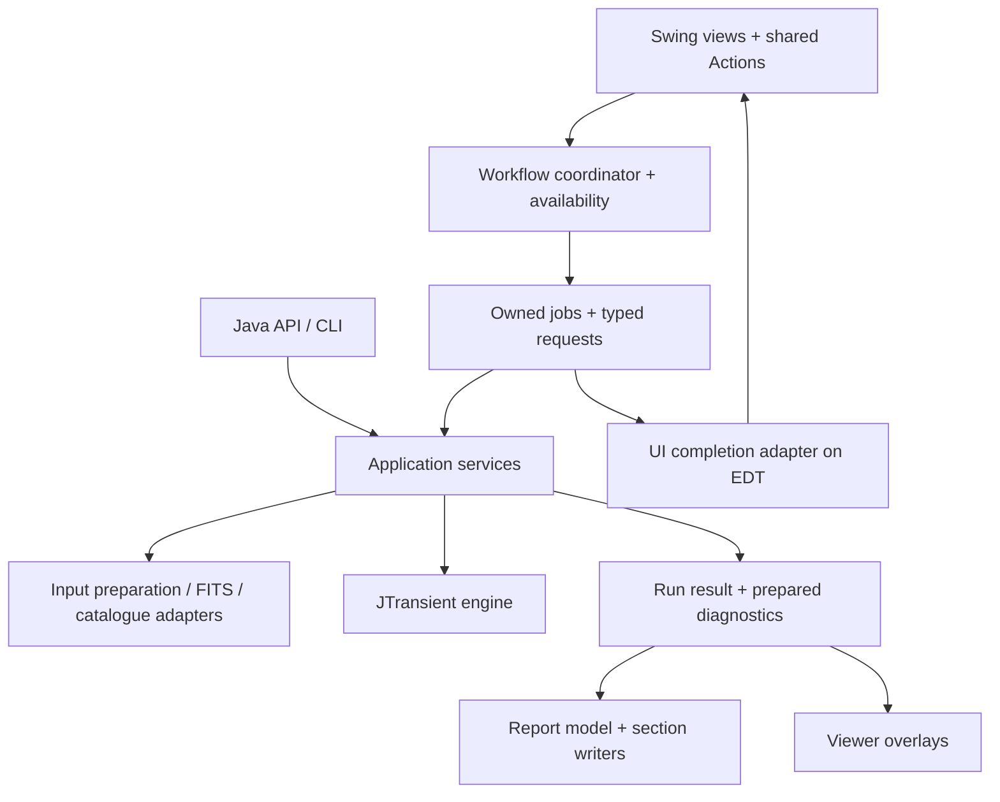

# Design improvements and feature plan

The single active plan for SpacePixels application design, GUI improvements and refactoring. The [findings and priorities](#findings-and-priorities) table is the canonical backlog of **remaining work and open decisions**. Architecture steps explain how to deliver those items; engine dependencies and the delivery plan are views of the same backlog, not additional queues. [HIGH_LEVEL_DESIGN.md](HIGH_LEVEL_DESIGN.md) and [DEVELOPER.md](DEVELOPER.md) describe implemented behavior.

**Consistency review: 2026-10-22.** Reconciled against SpacePixels `f504364`, JTransient `6a410ad`, completion records and the current source/test inventory. D09–D13 still have applicable remaining work, but completed preferences, settings validation/persistence and existing viewer overlays must not be re-proposed. This is a documentation/source review, not a new runtime or full accessibility audit; it does not approve any proposed feature. See the [review record](docs/archive/design-improvements-completed-2026-10.md#plan-consistency-review-2026-10-22).

## Status and maintenance

**Proposed** means an idea awaiting a decision; **Accepted** records an explicit implementation decision; **In progress** means implementation has started; **Deferred** records a deliberate postponement; **Dropped** retires a superseded proposal. Priority is separate from authorization.

- **One work queue:** add/update status and priority only in the [canonical backlog](#findings-and-priorities). D IDs identify application design outcomes; F IDs identify feature proposals; S IDs retain architecture-review traceability. S14–S16 are implementation slices of D09/D10, not extra features. S13 is completed and archived. Engine JA IDs remain owned by the JTransient plan and appear here only as dependencies.
- **One owner per piece of work:** cross-references do not create a second implementation or override the owning item's status. In particular, deferred F02 belongs to D11, S14–S16 belong to D09/D10, and F09/F10 reuse D09/D11 contracts rather than inventing parallel result/progress systems.
- **When an item is done,** describe its behaviour in the manual, API or architecture documents, and move its record (decision, evidence and validation) to the archive. Do not bring completed items back into this plan.
- **After each feature implementation,** commit its implementation, tests and documentation, then push to the current branch's configured upstream. Add commit-body notes explaining the change, rationale and validation or remaining limitations; report the commit ID and any push failure. Preserve ignored local configuration and do not force-push.
- **Completed work:** [design work completed in October 2026](docs/archive/design-improvements-completed-2026-10.md) holds:
  - D01, D02, D03, D04, D05, D06, D07 and D08;
  - the architecture review with its finished steps, including S7, S8, S10, S12 and [S13](docs/archive/design-improvements-completed-2026-10.md#s13-explicit-gui-interactions-and-headless-processing-boundary-2026-10-22);
  - the EventBus decision, the basic F09 workflow, F08, [F11 API/CLI-only publication](docs/archive/design-improvements-completed-2026-10.md#f11-clarified-single-project-api-and-cli-publication-2026-10-22) and the coordinated JA-01 integration.

  Completed S1–S13 and D01–D08 are prerequisites to preserve, not unfinished tasks. Their historical acceptance notes do not reopen them.

  Older sources: [GUI review](docs/archive/gui-enhancements-2026-10.md), [refactor snapshot](docs/archive/refactor-2026-09.md), [completed task list](docs/archive/completed-tasks-2026-10.md) and [maintenance notes and regression evidence](docs/archive/maintenance-notes-2026-10-19.md). Their old priorities do not override this plan.

The open findings come from the 2026-10-18 review; its [assessment and scope](docs/archive/design-improvements-completed-2026-10.md#overall-assessment) are archived.

## What to preserve

- **The engine boundary.** SpacePixels prepares data, orchestrates work and presents results. JTransient owns detection. Do not move GUI workflow or FITS-file interaction into the engine.
- **The public API shape.** [SpacePixelsPipelineRequest](src/main/java/eu/startales/spacepixels/api/SpacePixelsPipelineRequest.java) defensively copies its detection configuration, and [DefaultSpacePixelsPipelineApi](src/main/java/eu/startales/spacepixels/api/DefaultSpacePixelsPipelineApi.java) uses shared preparation and pipeline services. Those are useful patterns for GUI run requests too.
- **The settings navigation.** [SettingsNavigator](src/main/java/eu/startales/spacepixels/gui/SettingsNavigator.java) already provides search, changed-only filtering and expert disclosure. Keep the maintainer's basic/expert/hidden classification and the preservation of hidden configuration fields.
- **The shared viewers.** [SequenceViewerFrame](src/main/java/eu/startales/spacepixels/gui/SequenceViewerFrame.java), [FrameView](src/main/java/eu/startales/spacepixels/gui/FrameView.java), [StretchControls](src/main/java/eu/startales/spacepixels/gui/StretchControls.java) and [ViewerSupport](src/main/java/eu/startales/spacepixels/gui/ViewerSupport.java) reuse display and interaction code. The sequence viewer rejects obsolete work by worker identity and target frame; viewers detach listeners and release displayed data. Extend these patterns rather than replacing them.
- **Report identities and export snapshots.** [ReportData](src/main/java/eu/startales/spacepixels/util/reporting/ReportData.java) centralises findings and frame selection. [ExportVisualizationSettings](src/main/java/eu/startales/spacepixels/util/reporting/ExportVisualizationSettings.java) captures export options. [AtomicReportFile](src/main/java/eu/startales/spacepixels/util/reporting/AtomicReportFile.java) publishes completed text files. These solve part of the problems below already.
- **Existing validation and testing.** Input preparation, WCS handling, catalogue matching, API execution and reporting have focused tests. The site configuration already gives inline validation feedback. The review calls for extending these strengths, not starting over.
- **The frame table without sorting.** The table has no row sorter, so a selected row indexes the model directly. If sorting or filtering is added:
  - convert view rows to model rows in every selected-file and solve-result path;
  - use file and session identity rather than a visible row number;
  - return numeric values and column classes before offering numeric sorting.

## Findings and priorities

**Canonical backlog.** Status belongs here; the detailed sections define scope/acceptance, the architecture mapping gives implementation slices, and the delivery plan gives dependencies. D09–D12 remain after completing D13. Priorities are unchanged; an unranked feature has not been promoted by appearing in this table.

| ID | Priority | Status | Remaining outcome | Delivery / relationship |
|---|---|---|---|---|
| D09 | Medium | Proposed | Prepared report diagnostics, one finding/category identity source and stable export context | S14–S16; supports D11 and F09 |
| D10 | Medium | Proposed remaining scope | Typed application setting bindings and explicit engine capabilities/compatibility; JA-01 rules and persistence foundations are complete | S14 options; JA-04/JA-08/JA-11 dependencies where relevant |
| D11 | Medium | Proposed; completed-run viewing direction agreed | Clear analysis scope, unified completed-result access and lightweight history/saved-result restoration | Extend existing session/overlays; reuse D09 identity/context; F02 remains deferred |
| D12 | Medium | Proposed | Shared visual defaults and content-driven/scalable layout | Independent small slices; coordinate progress layout with F10 |
| F01 | Unranked | Proposed; experiment first | Compare slow-mover thresholds with tuned frame thresholds on real data before deciding any change | JTransient SM-2 is deferred; existing calibrated master tuning is not pending |
| F02 | Unranked | Deferred | Richer header-derived session summary / multiple-night warning | Owned by D11; not a separate expensive pre-run quality table |
| F04 | Unranked | Proposed; explore design | MCP access to the existing headless pipeline, then explicitly scoped inspection capabilities | Reuse API and completed S13 headless service boundary |
| F05 | Unranked | Deferred | Revisit reduced Image Stretch preview sampling and small-star visibility | Existing 2400 px preview cap / full-size viewer remain; independent of completed D03 |
| F06 | Unranked | Proposed; Windows first | Native installer and optional runtime/bootstrap distribution | Release-pair gate JA-11; no Java-baseline change approved |
| F09 | Unranked | Proposed enhancement only | Cross-pass findings consolidation into a provenance-preserving super report | Basic iteration is complete; share saved evidence/identities with D09/D11 |
| F10 | Unranked | Proposed | Optional throttled progress-dialog imagery | Loading/report thumbnails first; deeper engine snapshots depend on a safe JA-09-compatible boundary |

“High” would mean before expanding the affected workflow, not authorization to implement several items together. F08, F11 and the original F09 workflow are completed and archived; ID gaps are intentional. F11's packaging does not certify the published dependency pair or imply a Central upload; JA-11 remains the release gate. The feature details below elaborate these same rows and do not define another status list.

### D09. Complete the distinction between measurements and report presentation

**Evidence.** [DetectionReportGenerator](src/main/java/eu/startales/spacepixels/util/reporting/DetectionReportGenerator.java) already delegates sections, snapshots display settings, constructs `ReportData` and atomically publishes HTML. But [NightEquipment](src/main/java/eu/startales/spacepixels/util/reporting/NightEquipment.java) and [FieldDepth](src/main/java/eu/startales/spacepixels/util/reporting/FieldDepth.java) calculate diagnostics from frames during report export. `SessionCatalogue` loads catalogue state lazily from the session folder. `ReportData`, section writers, maps, CSVs and the report-selection dialog still contain some separate category/label rules.

**Proposal.** Keep section writers, but prepare a read-only report model once: stable finding IDs, accepted candidates, included categories, rejected frames, coordinates, catalogue snapshot and optional session diagnostics. Extend `ReportData`; do not introduce a competing identity system. A small category descriptor can provide the label, colour, prefix, count, inclusion option and anchor rule for the dialog, legends and maps. Existing report consistency checks are useful protection when consolidating these rules.

Separate diagnostic measurement services from HTML emission when the next diagnostic feature needs it. Their FITS/session orchestration can remain in SpacePixels; moving them into JTransient is not implied. Carry explicit diagnostic states such as unavailable, failed and measured instead of making every failure indistinguishable from an empty result. Keep browser lookup enrichment separate from detection confidence and preserve current offline exports.

Capture resolved catalogue/correction/export context at a documented point. Current export snapshots and field checks already help; the concern is completing reproducibility across a full run, not claiming every report changes midway. Keep live rendering defaults out of new APIs: pass options rather than changing process-wide statics.

**Acceptance.** HTML, JSON, maps and CSVs agree on IDs, numbering, counts and exclusions. Re-rendering an existing prepared result with different presentation options does not re-run detection or silently recompute diagnostics against newer catalogue state. Do not retain all raw frames forever merely to enable a later re-export; define what a lightweight saved result supports.

### D10. Describe settings and engine compatibility once, with typed boundaries

**Current evidence / remaining scope.** `DetectionConfigurationPanel` still describes/binds a field in UI construction, copies it in `applySettingsToMemory`, loads it in `updateSpinnersFromConfig` and maintains separate saved/core/tuned lists. Optional capability helpers use field-name reflection. Shared numeric rules/metadata now belong to JTransient, and profile/application/visualization I/O plus ordered background writes are already separate classes. The remaining finding is typed application binding/capability integration, not another rules service or persistence extraction. Preserve hidden DTO fields and defensive snapshots; arbitrary unknown JSON keys are a different concern (Gson ignores them, migration compares key sets).

**Proposal.** Introduce typed setting definitions incrementally for an existing page: stable ID, title, unit, description, basic/expert visibility, typed getter/setter and validation. Use the same identity for search, changed markers and validation messages. Preserve shared button models between Overview and detail pages. Keep “changed from saved” distinct from “set by Auto-Tune”. Do not turn all engine fields into a generated form or add hidden rows back.

Make side effects clear in new method names. `ImageProcessing.getInstance()` constructs a new processor rather than returning a singleton; a name such as `openProcessor` would convey the actual operation. Preserve compatibility wrappers where public callers depend on existing names; this is gradual clarity work, not a mass rename.

If supporting several engine versions is a real requirement, isolate capability/reflection handling in one adapter and expose unsupported capabilities clearly. Otherwise prefer a pinned compile-time contract over silently ignoring a missing setting. A composite build can use unpublished engine changes; release validation must check an explicit supported SpacePixels/JTransient pair before distribution. Do not treat a local composite compile as proof that a published-dependency build works.

[AutoTunerRunner](src/main/java/eu/startales/spacepixels/util/AutoTunerRunner.java) temporarily changes a legacy engine static, and the API documents a concurrency restriction. Keep that restriction visible in application admission policy. An eventual engine-instance option would be a separate JTransient proposal, not a GUI-only refactor.

**Completed from D05 / JA-01 (2026-10-22): one set of rules.** GUI, profiles, API and iterative requests consume JTransient `DetectionConfigRules`; it owns all 107 field definitions and numeric relationships. Issues/adjustments identify rule/stage/fields, direction and old/new values. SpacePixels keeps parsing/focus, binding, titles and English messages; the deprecated adapter contains no duplicate numeric definitions. Preview Frame uses the existing shared models. See the [completion record](docs/archive/design-improvements-completed-2026-10.md#ja-01-shared-settings-rules-and-review-integration-2026-10-22).

The [field and dependency review](docs/detection-settings-rule-review.md#implementation-decisions-ja-01-2026-10-22) now records implemented decisions: advisory quality-grow, geometric jitter/jump, photometry cap and limited-amplitude findings; explicit reviewed alignment; shared effective pixel geometry; and preservation of independent image thresholds, sentinels and accepted finite profiles. Rhythm/jump remains a legacy GUI policy, not an engine rejection rule. Typed setting bindings, capability handling, richer dataset-readiness feedback and published-pair release validation remain D10/JA-11 work.

**Acceptance.** Moving a setting between existing sections does not require editing unrelated string/index lists. UI and API validation use the intended shared rules, hidden values survive, unsupported settings are not falsely shown as applied, and release builds test the dependency pair they distribute.

### D11. Make the main window a clear analysis workspace

**Current evidence / remaining scope.** The workflow strip, primary action, status explanations, selected-frame preview and active-settings readout already exist. Application-owned ASTAP/site preferences are available before import, survive session replacement, and are backed by `ApplicationSettings`, not a nullable processor; D06/D08 delivered that work. Image Stretch and Detection Settings remain session-dependent, while independent iterative configuration is available before import. **Open last report**, cached track overlays in Blink and cached variable-candidate overlays in Blink/Preview also exist. There is still no general run-history/result-restoration workflow, unified all-category completed-run inspection or output-folder action. The normal import warning still uses a frame-count threshold; blink already has a dimension-aware memory estimate.

**Proposal.** Keep the four workflow groups, but make their roles clearer:

- **Current session:** folder display name, frame count, dimensions, mono/colour, timing readiness and solved status in one compact summary. Use text as well as colour. Do not display observing-site details unnecessarily.
- **Preferences:** preserve the implemented pre-import ASTAP/site settings and stable application ownership. Improve explanations for session-dependent actions where needed; do not reopen D06 or make Detection Settings available before import merely by toggling a tab.
- **Analysis plan:** show which analyses are enabled and what frames they use. Blink uses the selected frames; Preview opens the sequence at the selected frame; Auto-Tune uses a sufficiently large selection or falls back to the imported sequence; a normal run uses the whole sequence. Make these differences and the Auto-Tune fallback visible before starting.
- **Run:** consider “Run analysis” or an adjacent explanation when variable stars and diagnostics are included under “Detect Moving Targets”. Keep the familiar wording until a deliberate UI wording decision is made. Clearly distinguish analyses to compute from categories to include in the report; omitting a report category need not disable a filter used by detection.
- **Results:** next to **Open last report**, add an Open output folder action and a compact local run history. Record when, which session, which profile and the outcome. Do not hold full-resolution frame arrays in run-history entries.

#### View detections from a completed run (agreed direction, 2026-10-21; proposed)

Add **View detections from last run** beside **Open last report**, with access from Blink, Preview Frame and Manual Transient Inspection. Display that run's measured positions over the original FITS pixels without running extraction, the star mask or linking again. Show which run is in view and keep its findings separate from the current settings. Trying new thresholds remains an explicit Preview/re-run operation; editing settings must not silently replace or recompute a saved overlay.

**Already available:** `TrackOverlay` and `VariableStarOverlay` retain lightweight last-run display data, and Blink/Preview consume the supported categories without recomputing them. They are not a full saved-run replay model; variable overlays intentionally do not retain light-curve arrays, and Manual Transient Inspection still starts its own transient-analysis operation.

Deliver the remaining work in two steps:

1. Extend/reuse those lightweight overlays through a unified completed-run entry point, adding the missing category/measurement/association data and read-only inspection mode. Retain report labels, confidence and flags; include light curves only through an explicit bounded contract. Do not rebuild existing track/variable overlay support. Read original frames on demand instead of keeping full-resolution arrays alive.
2. Restore a compatible saved run after reimport or restart. Extend the existing versioned `report-data.json`/run metadata rather than introduce a competing results summary. Today's JSON is a findings summary with representative positions and frame numbers, not a complete replay record. Save the per-frame evidence, input identities (relative file names, dimensions, timestamps and suitable identity checks), rejection information, effective settings and resolved catalogue/WCS provenance needed by the supported viewers. Preserve the report's V/T/ST/A identifiers and anchors.

Validate the selected run against the imported dataset before attaching overlays. Missing or changed frames and older summary-only exports should explain their limits; never substitute a fresh detection silently. A completed run may support viewing even when the current settings differ. Keep exports shareable without private absolute paths or observing-site details. This is read-only result viewing, not a promise to reproduce every processing stage from JSON alone.

Acceptance: compare the displayed markers and light curves with the original completed run in all three viewers; reopen after restart; confirm that changed settings do not alter saved findings and viewing starts no engine job; exercise different datasets with identical file names, missing/changed frames, rejected frames and old JSON versions. Check bounded memory and preserved links/labels. Coordinate this with D06 session ownership, D09 prepared report data and F04 agent services.

Use image dimensions and a conservative estimate of stage buffers to recommend normal versus iterative processing. Reuse the blink preflight pattern; do not label an estimate an exact peak-memory guarantee. Show progress stage and elapsed time; use counts when available, and avoid invented ETA precision.

A useful larger idea is a small, persistent **session workspace** connecting frames, settings and completed results. It can remain a single-session desktop app; it does not require a database, project-file format or dockable-window framework.

**Acceptance.** A new user can tell what will be analysed, which steps are optional, why an action is unavailable, where output goes and how to reopen the result. Cancelling/skipping a report is not presented as a failed detection. Validate these choices with a short task-based usability pass rather than assuming new labels are automatically better.

### D12. Use shared visual rules and content-driven layout

**Current evidence.** [DetectionConfigurationPanel.addSettingRow](src/main/java/eu/startales/spacepixels/gui/DetectionConfigurationPanel.java) still fixes a description panel to `480 × 85` for preferred, minimum and maximum size. Several controls use explicit dimensions/font sizes, and enabled help often uses `Label.disabledForeground`. `ProcessingProgressDialog` chooses a stable width when first packed, with a 420 px minimum, and uses an unwrapped status label; long messages/larger fonts need layout verification rather than a claim that every dialog is exactly 420 px wide. The workflow already wraps and `WindowPlacement` is screen-aware. D12 remains applicable, but clipping/contrast/scaling claims require the acceptance checks below.

**Proposal.** Define a small set of application UI defaults: body/help/section typography, spacing, content widths and semantic status colours. Use relative typography and scale custom dimensions with the supported FlatLaf/JDK mechanisms; prefer measured text and wrapping to fixed description heights. FlatLaf's [customisation guide](https://www.formdev.com/flatlaf/how-to-customize/) supports application-specific defaults, and its [scaling guidance](https://www.formdev.com/flatlaf/properties-files/#scaled-values) distinguishes scaled UI values. This is not a recommendation to use newer APIs unavailable in the pinned FlatLaf version.

Keep the existing dark theme and restrained primary-action emphasis. Make enabled help text readable rather than visually identical to disabled controls; measure contrast before calling it a standards failure. Use standard text/buttons and consistent spacing before adding decorative icons. Charts may keep domain-specific colours, with consistent labels and legends across the app and reports.

**Acceptance.** Inspect the empty and loaded main window, core/expert settings, configuration and viewers at representative small/large windows, 100/150/200% scale and a larger base font. Long descriptions and error messages wrap, primary actions remain visible and the workflow strip does not consume the usable frame/table area. Existing screenshots are context, not evidence that these tests have passed.

### D13. Keyboard access and viewer focus

Implemented on 2026-10-22; see the [completion record and desktop-test limitations](docs/archive/design-improvements-completed-2026-10.md#d13-keyboard-controls-and-viewer-focus-2026-10-22). Labels, accessible state and native button actions are shared; viewer keys follow image focus while controls remain reachable by Tab. A full assistive-technology/keyboard-only workflow audit remains a usability validation task, not a claim established by the focused tests.

## Proposed architecture: a few clear boundaries

The following is a target/dependency map, not a second work list or a claim that all boxes are missing. Jobs, session ownership, commands, shared preparation, explicit GUI interactions and most completion adapters already follow it. The remaining gaps are the D09/D10 run/result boundaries. Do not create a package/interface for every box; UI completion stays on the Swing side.

- **Views** build components and show state. The main panel stops being the place that decides job policy, rewrites FITS and owns catalogue fetching.
- **Workflow coordinator** handles user intent, session handover, admission and outcomes. It has no dependence on individual button enabled flags.
- **Application services** take explicit inputs and options and return data. They do not show Swing dialogs or reach through `ApplicationWindow` for logging/configuration. Keep concrete services unless a seam needs substituting in tests or has multiple implementations.
- **Adapters** contain file formats, solver/network calls, persistence and interactive preparation decisions. The GUI and API supply different decision policies to shared operations.
- **Presentation** consumes a stable result. Existing report writers and shared viewer components stay in use.

The pattern is close to a modest **model–view–presenter** arrangement: a state model and testable workflow/presenter between Swing widgets and services. Use plain Java constructor injection, typed requests, `Action`s and explicit completion callbacks. A service locator, a second global event bus, deep inheritance tree or mandatory DI/reactive framework would add machinery without resolving the ownership questions.

## Open steps from the architecture review

The [architecture adoption review](docs/archive/design-improvements-completed-2026-10.md#architecture-adoption-review) and [class/path inventory](docs/architecture-review.md) describe the checkouts reviewed on 2026-10-20, not today's missing features. S1–S13 are complete. The following maps surviving step IDs to the canonical backlog; it does not authorize work or duplicate status.

| Step | Backlog owner | Already delivered | Remaining implementation / acceptance |
|---|---|---|---|
| S14 | D09, D10 | Config snapshots, export snapshots, explicit report `AppConfig` parameters, API candidate-frame limit and iterative request context exist | Complete run-wide capture and explicit site/render/tuning/report context for standard/API/CLI paths; remove remaining home/default/static reads during work. Report diagnostics still read the active global tuning limit; legacy tuning/debug statics require JA-04 before their restriction can be removed. Verify independent runs retain their own context. |
| S15 | D09 | `ReportData`, report consistency tests and cached viewer labels exist | Make category/identity descriptors authoritative across writers, maps, JSON, inclusion UI and overlays instead of parallel counters/prefix rules. Preserve T/ST/A/V anchors, filenames, counts and filtering. |
| S16 | D09 | Section writers and some optional-failure fallbacks exist | Prepare `FieldDepth`, `NightEquipment` and catalogue/correction snapshots before rendering, with measured/unavailable/failed states and a consistent optional-section failure policy. Re-export must reuse prepared values, not newer live state; inject failures and compare real measurements. |

Stage C is complete, including S13's explicit interaction adapters, service-owned loggers and recursive `util` dependency check. S14–S16 are D09/D10 slices; D11–D13 and F items are distinct outcomes, not missing architecture-review step numbers.

**Constraints.**
- Preserve public entry points, formats, detection measurements and current viewer/report behavior unless a separately agreed feature changes them.
- Protect extracted service boundaries with dependency tests. Do not ban headless image rendering merely because its types live in `java.awt`.
- Keep one reviewable slice per change; do not count code movement as completing an outcome without its acceptance checks.

## Engine changes that need SpacePixels work

Pending items of the [JTransient plan](../JTransient/DESIGN-IMPROVEMENTS.md) that SpacePixels must follow with its own change. JA-01's shared-rules integration is [completed](docs/archive/design-improvements-completed-2026-10.md#ja-01-shared-settings-rules-and-review-integration-2026-10-22); JA-02/JA-03 remain partially implemented. The completed local cancellation integration is recorded in the [D04 archive](docs/archive/design-improvements-completed-2026-10.md#d04-engine-cancellation-and-viewer-lifecycle-2026-10-21).
- **Order.** Only changes to an engine contract require engine-first delivery; application-only typed bindings, layout and accessibility need not wait. Use the local siblings configured in `AGENTS.md`. Cancellation and JA-01 currently use the unreleased `1.0.5` source API. Before distribution, publish/declare the supplying release and validate the supported published pair (JA-11); local success is not that certification.
- **Compatibility.** Preserve existing engine entry points and saved data formats. New application integrations must name the engine release that supplies them before distribution; local composite validation is not published-pair validation.
- **Checking.** Engine changes affecting processing or numerical results require paired reference-data comparisons with the same profile. Pure documentation changes use source/link checks; wiring/presentation changes additionally exercise their interaction boundary. Do not claim real-data validation from a local composite compile.

| JTransient item | SpacePixels work | Belongs to |
|---|---|---|
| JA-02 execution and resource ownership | One operation per engine and joined shutdown are already integrated. Adapt to a future shared executor/resource budget if adopted. The GUI coordinator admits one foreground job per window; it is not a JVM-wide budget for independent API callers or engine instances. | Future service integration; preserve completed D02/D04/S13 |
| JA-03 structured failure context | Cancellation/outcome handling is integrated. If the engine adds stage/frame context, carry it through service/job failures and API/GUI explanations without losing causes or treating cancellation as failure. | Error presentation; D09/S16 where diagnostics are involved |
| JA-04 tuning options and diagnostics per operation | `AutoTunerRunner` stops changing the static `JTransientAutoTuner.AUTO_TUNE_SAMPLE_SIZE`. Remove the API's rule against concurrent legacy auto-tunes in one JVM ([API.md](API.md)) only once both sides support it. `DebugOutput.applyToEngine` moves from the engine's static debug switches to a per-run diagnostic sink | D10, S14 |
| JA-05 frame identity | The report reads the engine's `frameIndex` in several places: `CatalogueComparisonWriter`, `ClaudePerspectiveSectionWriter`, and the rejected frames in `StarMaskExplorerFrame`. When the engine names the retained position and the original sequence index separately, update each reader and compare the reports | D09 |
| JA-06 tracking responsibilities | No API change intended; SpacePixels runs the real-data regression on each slice | — |
| JA-07 public models and shared buffers | Many consumers use nested `SourceExtractor.DetectedObject` and `TrackLinker.Track`; inventory the actual callers for each adopted contract rather than relying on historical file counts. Preserve compatibility names/object identity and the read-only ownership of arrays shared with report export; introduce copying only where the agreed contract requires it. | D09, D11 |
| JA-08 tuning measurement, policy and presentation | Adapt Overview, `AutoTuneChartDialog` and `AutoTuneSessionStore` when measurement/result contracts change; preserve saved `auto_tune.json`. Detached JA-01 tuning fallbacks are already integrated and are not pending work. | D10 |
| JA-09 progress and stage outcomes | Existing percentage mappings and telemetry remain supported. Adapt to agreed structured stage events/outcomes, keeping disabled/unavailable/completed-empty distinct. Safe imagery for later F10 phases is an additional explicit observer contract, not text-message parsing. | D09/S16, D11, F10; preserve completed D04 |
| JA-10 reference provenance | Basic F09 already removed cross-pass master reuse. Review remaining Test Star Mask/reference consumers only when adopting a prepared-reference contract; do not reintroduce caching merely to exercise it. | D09 |
| JA-11 release contract | Declare the supported SpacePixels/JTransient pair and Java baseline. Bump `build.gradle` to the release that brings each slice above | releases |
| SM-2 (deferred) | F01, the slow-mover sigma following the tuned per-frame sigma, waits for the empirical maximum-stack comparison | F01 |

Algorithm-only proposals such as XC-3, PT-5 and VS items remain subject to their JTransient status/decision. They need application code only if an adopted contract changes; processing changes still use SpacePixels reference-data comparisons. Listing them here does not reactivate deferred work.

## Common patterns that fit this codebase

| Pattern | Concrete use here | Limit |
|---|---|---|
| Command | A shared Swing `Action` starts a typed operation from a button, shortcut or menu. | A local one-off listener does not need a command hierarchy. |
| Model–view–presenter | Availability, validation and workflow transitions can be tested independently of component layout. | Avoid replacing the panel with an equally large presenter. |
| Immutable request / result | Capture settings and identities once; return a typed outcome and stable report model. | Share large read-only image data by ownership contract rather than deep-copying it. |
| Strategy / adapter | GUI preparation questions and API preparation policy choose how to handle the same conversion facts. | Introduce an interface where behaviour really varies, not for every concrete helper. |
| Observer | Notify views about session/catalogue/settings changes through explicit, scoped subscriptions. | Subscriptions need an owner, detach path and stated delivery thread. |
| Composition and focused reuse | Keep shared stretch, drawing, navigation and report helpers behind their existing views. | Do not force every viewer or report section into a large inheritance framework. |
| Resource ownership | A job or viewer owns its engine, worker, listener subscription and buffers, and releases them predictably. | A cancelled future is not proof that its underlying operation has terminated. |

## State and resource ownership to make explicit

| Scope | Owned state | Lifetime / rule |
|---|---|---|
| Application | User-level configuration, startup defaults, supported integrations, job resources | Loaded independently of a dataset; save failures are visible. |
| Session | Session ID, frame metadata, current selection, catalogue/correction, session caches and last-result references | Replaced on a successful handover; stale results cannot attach to its successor. |
| Run | Click-time config and export options, input identities, resolved context, diagnostics, outcome and artifact paths | Stable for reproducibility; does not read live controls during work. |
| Viewer | Current frame, zoom, playback state, listeners and owned display buffers | Explicitly detached/released on close; shared stretch models retain intentional semantics. |
| Report lookup | Provider request, report identity and enrichment cache | Independent of detection verdict; bounded work and existing target/path validation remain. |

**Current versus future:** application/session/viewer ownership above is largely implemented by D02/D04/D06/D08. The remaining run-wide capture is S14, and richer retained/persisted results belong to D09/D11. A saved-run record should include a schema version, supported build identifiers, input identities, effective settings, catalogue/correction provenance, analysis/export inclusion and artifacts. Some of this already exists in `detection_config.json`, versioned `report-data.json`, iterative `run-data.json` and per-pass manifests; extend those rather than writing a conflicting summary. Avoid storing private absolute paths or observing-site data in a shareable manifest by default. A reproducibility record is distinct from retaining all image buffers or promising replay from data that is no longer available.

`ApplicationWindow` already starts/stops the localhost lookup proxy; preserve that application-scoped lifetime rather than reopening an ownership task. If a feature expands lookup/server work, define its I/O/cache limits explicitly and preserve provider/target/path validation and atomic caching. This is an implementation guardrail, not an additional queue item or a newly established security defect.

## Delivery plan

This is the dependency/order view of the canonical backlog, not another set of findings. Completed foundations stay closed; the remaining scopes below are proposals unless their backlog row records a decision.

| Track | Current position | Remaining work / dependencies |
|---|---|---|
| A: focused correctness | Complete | Preserve D01/D03/D05 and the completed failure-handling slices; do not repeat them. |
| B: workflow foundation | Complete | D02/D04/D07 and the implemented job/cancellation/viewer lifecycle remain the baseline, not a claim that every future engine resource/failure contract is finished. |
| C: session/service boundary | Complete | D06/D08, S7/S8/S10/S12/S13 and basic F09 are delivered. Preserve explicit interaction injection and the headless service boundary; there is no new session-model rewrite. |
| D: run/results/settings | Remaining outcome proposals; JA-01 rules foundation complete | D09 via S14–S16, D10 typed bindings/capabilities and D11 completed-result/history work. S14 can improve application snapshots now; removing engine statics waits for JA-04. S16 builds on a stable run/identity contract. |
| Cross-cutting usability | D12 remaining; D13 implemented | Independent wrapping and scaling fixes can ship alongside D without completing every report refactor. |
| Feature track | Per F-row status | F03/F07 are completed. F04 can reuse the completed headless API/CLI artifact; F09 consolidation shares D09/D11 persisted evidence; F10 starts with existing thumbnails/assets before any engine observer extension. F01/F02/F05 keep their experiment/deferred decisions. |
| Release gate | Before distribution of the changed dependency pair | JA-11 published-pair/Java contract validation applies to the next release, not only after all features, including F11's headless artifact. F06 must decide installer/runtime policy against that contract. |

**Suggested next architecture slice:** the application-side S14 run-context slice under D09/D10, building on the completed S13 boundary without waiting to remove engine statics. A typed-binding page in D10 or independent D12/D13 work can proceed separately; this is ordering guidance, not approval to implement them all.

Within D09, establish the missing run context (S14), make existing IDs/categories authoritative (S15), then prepare diagnostics/failure states against that contract (S16). Independent pieces may overlap. Build D11's remaining in-memory result access on existing overlays before designing persistent restoration; share the evidence format with F09 rather than implementing two stores. F02's richer summary/multiple-night warning stays deferred even if other D11 work proceeds.

Add one adapter/command or contract slice at a time. Keep public APIs/formats compatible, and record any intentional scientific or user-visible change explicitly.

## Verification strategy

The current suite includes `JobCoordinatorTest`, `CommandAvailabilityTest`, session/storage/preparation and report-consistency tests, `SettingsNavigatorSnapshotTest`, shared-rules/profile tests and opt-in GUI mechanics coverage. Do not reuse the 2026-10-19 'no dedicated tests' observation as current evidence. Newly extracted state/binding/workflow seams should have focused tests; the entire panel need not be constructed to test a policy.

| Behaviour | Verification that would justify the change |
|---|---|
| Job ownership | Deterministic fake jobs: duplicate start, A finishes after B, late progress, session replaced, ordinary failure, export declined. |
| Settings | Invalid typed values, dependent limits, non-finite profile/API inputs, hidden-value round trips, migration, defaults/revert and failed-save dirty state. |
| Actions and table | Same enabled reason/action across button, shortcut and menu; correct model-row conversion if sorting is introduced. |
| EDT responsiveness | Slow fake storage/service with a responsive UI heartbeat; UI mutations happen on the EDT. Do not use fragile timing thresholds as the only proof. |
| Viewer lifecycle/access | Actual focused key events, editing versus navigation, listener counts and released frame references after close. |
| Report refactors | Same engine results, IDs, counts, CSV values, rejected frames and assets for equivalent options; offline browser checks for changed interactions. |
| Release compatibility | Compile/test the supported engine pair, plus opt-in local composites; do not assume an unpublished engine change is available from Maven Central. |
| GUI mechanics | [GUI mechanics tests](#gui-mechanics-tests): drive the real window by the visible text of its controls. Check that actions, saving and cancellation work. Do not compare detection results. |

For behavioural changes, follow the maintainer's real-data comparison method. Anything affecting detection, preparation or numeric diagnostics needs the relevant before/after datasets and one engine fix at a time. A pure wiring/presentation change should demonstrate unchanged processing inputs and outputs and exercise its GUI/interaction boundary. Do not rewrite user settings during verification; use an isolated JVM home and preserve or isolate Java preferences.

## GUI mechanics tests

The accepted scope remains interaction mechanics, not detection-result correctness. Use synthetic/disposable inputs, a scratch `user.home`, restored Java preferences and actual focused key events for keyboard claims. Numerical results belong to headless/reference-data comparisons.

**Harness:** `src/test/java/eu/startales/spacepixels/gui/mechanics/`, existing JUnit 4 / `tokyo.northside:assertj-swing-junit:4.0.0-beta-3`. `gradlew.bat guiMechanicsTest` is opt-in, requires a desktop, moves the mouse and runs serially; ordinary `test` excludes it. Match showing controls by visible text rather than adding component names for tests. Some service/storage cases install synthetic input through the public import path instead of driving the chooser; tests claiming chooser behavior must exercise the chooser.

| Existing source coverage | What it covers |
|---|---|
| `WindowMechanicsTest`, `StretchMechanicsTest`, `ViewerMechanicsTest` | Main-window controls/import/save/Blink stop, stretch controls/export, Preview/Blink stepping and annotations |
| `SettingsMechanicsTest`, `SharedSettingsRulesMechanicsTest` | Pages, invalid text, Revert/Save, rule-review Keep/Align, hidden preferences and six legacy pair directions |
| `SessionMechanicsTest`, `SessionIoMechanicsTest` | Pre-import application preferences, unsaved edits across imports, viewer/catalogue handover and responsive metadata I/O |
| `SettingsIoMechanicsTest` | Delayed/failed writes, correct dirty baselines/retry and close draining without freezing |
| `ViewerLifecycleMechanicsTest`, `IterativeDetectionMechanicsTest` | Closed/hidden viewer cancellation/listener release; independent directory planning and preserving an open session/unsaved settings |
| `ReportPromptMechanicsTest` | Extracted report dialog acceptance/refusal and report-only checkboxes; real float-import conversion refusal preserves the open session |
| `AstrometryAccountMechanicsTest` | Astrometry.net account before any import: Anonymous/My API key, the key saved in the background and kept across reopening and while Anonymous is chosen. **Check** is not clicked, so nothing reaches Astrometry.net; the tab has two **Check** buttons (ASTAP and the account) |

This is a source inventory, not a claim that every case was rerun during this documentation review. Prior executed results live in the completion records. The original draft/testing review is [archived](docs/archive/design-improvements-completed-2026-10.md#gui-mechanics-planning-snapshot-2026-10-22).

**Remaining interaction coverage to consider with the owning change:** real settings search/Load Defaults, solver availability wiring, catalogue-fetch cancellation, Cancel visibility/activation for cancellable versus non-cancellable jobs, completed-detection Show tracks, focused numeric editing versus viewer keys, and report-link/Copy details clipboard restoration. Iterative configuration is already covered; do not keep the old 'iterative frame-limit question' as a missing feature/test for the retired workflow. Unit availability tests already exist; add only missing wiring/policy cases.

`JobKind` defines cancellation policy: WCS writeback and Blink are non-cancellable through the generic progress dialog; Blink has its own loading/Stop paths. GUI close-box tests must respect those distinctions. Use deterministic job hooks/latches for short-run cancellation rather than fragile timing alone; a visual mechanics test does not establish engine shutdown/resource guarantees.

## Changes to avoid

- A wholesale Swing-to-JavaFX/web rewrite to solve lifecycle and state problems.
- Splitting every long class or moving all `util` files before extracting a real responsibility.
- A single giant controller replacing a single giant panel.
- Generic jobs with untyped results, a global EDT EventBus wrapper, or assuming interruption instantly stops computation.
- Making every domain object observable or giving every one-off callback its own interface.
- Reintroducing hidden settings, silently changing thresholds, or tying engine acceptance to a report checkbox.
- Keeping large image buffers in session history to make later rendering convenient.
- Replacing the current viewer focus rules without testing real keyboard focus and editing.

## Consolidated feature work

Feature statuses and ownership are in the [canonical backlog](#findings-and-priorities); this section only supplies detailed scopes. F01 is an experiment proposal tied to deferred JTransient SM-2; F02's extended summary is deferred within D11; F05 retains the current `GeneratePreviewsTask.MAX_PREVIEW_SIDE = 2400` behavior unless its deferred sampling proposal is reopened. F03, F08 and basic F09 are completed, not missing rows.

For F01, compare the maximum-stack noise distribution and recovery on real data before relating slow-mover thresholds to tuned frame thresholds; do not silently change legacy tuning. For deferred F05, compare averaging or full-resolution preview rendering for small-star visibility and memory cost; Show full size already supplies full-resolution inspection.

Run history/result restoration belongs to D11. Engine stage outcomes belong to JA-09 with D09/S16 integration, not to a second progress protocol in F10. The retired drift-grown void-band concern stays dropped; session data areas replaced it.

### MCP agent services (F04)

The maintainer wants AI agents to operate SpacePixels through an MCP server, beginning with capabilities similar to the existing [Java API](API.md). This is an exploratory proposal; the server interface, transport and packaging remain to be designed.

- **First scope: full dataset analysis.** Accept a folder of aligned frames and a detection profile/configuration, with supported preparation, Auto-Tune and report options. Reuse `SpacePixelsPipelineApi` and its request/result contracts. Return the effective settings, a structured result summary and the report/export locations. Provide a way for the agent or user to access the HTML report and its associated assets, rather than assuming a server-local path is readable by every client.
- **Long-running work.** Explore separate start, status/progress and result/report operations so an agent can follow a pipeline run. Reuse the ownership and outcome work in D02/D04; cancellation behavior must reflect what the underlying processing can actually stop.
- **Possible extension: single-frame extraction.** Let an agent select a frame and specify detection sigma, grow sigma, minimum pixels or a profile, then inspect structured detections and an annotated preview. This is extraction on that frame, before the dataset's stationary-star veto.
- **Possible extension: session-aware transient inspection.** Given a complete dataset, configuration and a selected frame, expose the transients remaining after the session's quality selection, median reference, star mask and filtering, with positions and a preview/overlay. Reuse prepared session context where appropriate. Keep this operation distinct from running extraction on the selected frame alone; the surrounding dataset changes which sources count as transients.

Use headless application services, with the existing public API as the starting boundary. The lower-level inspection operations need an explicit application contract; they are not currently methods on `SpacePixelsPipelineApi` and should not be exposed by driving `ApplicationWindow`. Reuse `report-data.json` and existing run metadata where sufficient, adding a shared result contract only when a concrete use case needs it. The earlier external agent-services proposal is background context, not a checked-in specification.

Before implementation, decide the initial client/local-file workflow, supported settings and defaults, job/session lifetime, result/artifact access and how much lower-level inspection belongs in the first version. A first acceptance exercise would have an agent submit a folder/profile, follow the run and retrieve the same findings and report as an equivalent Java API call. Single-frame operations would need comparisons with the corresponding extraction and session-inspection paths.

### Native platform installers (F06)

Explore a native installer for SpacePixels, starting on Windows. The goal is a normal install, launch, upgrade and uninstall experience. Other platforms can follow after the Windows approach is established.

Decide the Windows package format (for example, EXE or MSI), whether to bundle a Java runtime, installation scope/location, shortcuts, signing and how new releases update an existing installation. Keep user settings and datasets separate from application files so upgrades preserve them and uninstall behavior is explicit. Consider how the desktop application, CLI and a future MCP server would be distributed or selected during installation; this does not require delivering all three in the first installer.

Compare packaging options against the existing Gradle distribution and publishing workflow before selecting tooling. Validate a proposed installer on a clean Windows environment: install, launch, run a small analysis and open its report, upgrade from a previous version, and uninstall while preserving saved profiles and observing data. These are exploration criteria, not a claim that a native installer or bundled runtime already exists.

**Related bootstrap idea:** investigate optional launcher guidance for installing a suitable OpenJDK through native package managers on Windows/macOS/Linux. Temurin 25 was suggested as a candidate, not adopted as the project baseline. Current development uses Java 21; verify package identifiers, platform support, licensing and runtime compatibility when this proposal is taken up. Do not install software silently or treat an unverified package-manager command as a shipped bootstrap feature.

### Combined FITS preparation (F07)

Completed on 2026-10-22; see the [implementation and validation record](docs/archive/design-improvements-completed-2026-10.md#f07-combined-compressed-fits-preparation-2026-10-22). The manual and high-level design describe the combined import behavior. Real compressed observing data remains a release smoke check; no `.fz` samples were found under this machine's `C:\astrodata\Subs`.

### Directory-based iterative detection (F09)

The basic directory-based workflow is implemented: independent ordinary runs with Start/Increase/Maximum planning, fixed manual settings or one-time Auto-Tune, and an index of per-pass reports. The manual-setting reminder replaces the proposed dedicated sample-import workflow. Implementation decisions and validation are recorded in the [F09 completion record](docs/archive/design-improvements-completed-2026-10.md#f09-directory-based-iterative-detection-2026-10-22); current behavior belongs in the manual and developer/architecture guides.

**Proposed enhancement: a consolidated “super report”.** Read the completed pass reports and saved run metadata, identify findings that refer to the same physical object or event, and present one combined finding with the best available information from its contributing runs. Keep the individual reports and their original identities accessible.

- **Associate findings across passes.** Use shared input identities, timestamps, sky/pixel positions, motion and category-specific evidence. Report-local T/ST/A/V IDs alone are insufficient. Handle split/merged tracks, missing WCS, ambiguous matches and incompatible datasets explicitly; preserve disagreements instead of forcing a merge.
- **Combine evidence with provenance.** A finding may have its strongest detection in one pass, a longer track in another, and better astrometry, photometry, crops or animations elsewhere. Define how to select or combine each measurement, and link it to its source pass and report anchor. Repeated use of the same frames is correlated evidence, not an independent confirmation or an automatic confidence increase.
- **Present a useful combined view.** Show distinct consolidated findings, contributing passes and their frame counts, coverage and confidence/measurement limitations. Provide the best supported visualizations and direct links to all source reports. Treat combined counts separately from per-pass counts.
- **Persist enough evidence.** The implemented `run-data.json` and per-pass input manifests capture settings, outcomes, selected filenames, dimensions, exposure and timestamps. Today's `report-data.json` is still a findings summary, not a complete per-frame replay record. Determine and version the additional per-frame positions, associations, quality flags, catalogue/WCS provenance or light-curve evidence needed before promising consolidation of every category. Coordinate with D09/D11 instead of introducing another identity or replay format.
- **Support partial runs and bounded memory.** Consolidate usable completed outputs after cancellation or pass failure, explain omissions, and work from saved measurements and on-demand images without retaining every run's pixel buffers.

**Acceptance for the enhancement.** Exercise one finding seen in several passes, distinct nearby objects, split tracks, conflicting measurements, changed/missing inputs, different fields with matching filenames, missing WCS and older summary-only reports. Verify that chosen measurements remain traceable, ambiguous associations remain visible, unique counts are justified, and individual reports stay unchanged. Cross-pass consolidation is not part of the completed basic workflow; its matching and evidence-selection policies need a separate implementation decision.

### Live detection preview (F10)

**Idea.** Make waiting more engaging with a small “Live view” or “Observatory window” showing a representative image from the work actually under way. Refresh roughly every 3–5 seconds when a useful new snapshot is available, not on every frame or progress event. This is a proposed future feature, not an implementation commitment or a replacement for the final report.

**Preferred placement.** Start with a collapsible area inside the existing `ProcessingProgressDialog`, rather than a second splash window that steals focus or covers controls. Explore a thumbnail around 240–320 logical pixels on its long side, with a short stage/caption line. Keep progress, status and Cancel visible; avoid repeated dialog resizing. Offer Hide/Show preview and retain the preference. Use readable text and accessible descriptions, not colour alone, and avoid flashing or continuous animation.

**Possible content by phase, only when already available:**

- **Loading/preparation:** an appropriately stretched source-frame thumbnail, optionally with frame number or observation time. Show a neutral waiting state until real pixels are available.
- **Reference and masking:** a reduced master/reference image or a star-mask view, with a plain explanation such as “Building the stationary-sky reference”. Do not suggest the reference is finished while it is still being built.
- **Extraction and linking:** a crop of an interesting source, streak or emerging track, with a restrained marker. Label it “Provisional candidate” or “Sample extraction”; an extracted source is not necessarily a surviving detection, and later filtering can reject it.
- **Report generation:** reuse a crop or track visualization as the report produces it. Show “Latest preview from …” if the image belongs to an earlier stage; the current textual progress remains authoritative. No detections, disabled analyses and stages without imagery must remain understandable without manufactured discoveries or unrelated pictures.

**A little creative polish.** Consider an optional small field-of-view inset marking where a crop came from. A short two/three-frame motion strip could later make moving sources or streaks more intuitive; a miniature light curve could serve variable-star analysis if those measurements are already available. These are follow-ups, not prerequisites for the first static-thumbnail version. Prefer real astronomical data over decorative random images, a simulated radar sweep or an invented discovery counter. The preview is illustrative, not a claim to show every finding, the strongest finding or the current full analysis state.

**Normal and iterative runs.** Build on the shared standard-run path so the same component can serve both workflows. For iteration, display the pass number and subset frame count; clear or explicitly retire the previous pass's image. If shown during the one-time Auto-Tune, identify it as a tuning sample, not an iterative detection result. Do not attach another directory's preview to the open session or change its selection, overlays or report reference.

**Technical boundary and cost.** The current engine progress callback carries percentages and text, not image snapshots. Do not infer stages or objects by parsing those messages, or promise live extraction crops without a safe engine integration. Reuse available loading/report assets first; explore an explicit optional, GUI-independent preview/diagnostic observer at safe engine stages in coordination with JA-09 and D09. SpacePixels owns stretching and Swing presentation. Pass bounded, detached thumbnails/crops or safe copied data, not mutable in-flight engine objects or retained full-resolution frame buffers. Rendering must not change scientific pixels, thresholds or exported visualization settings.

Throttle before expensive snapshot/crop work, render off the EDT and keep only the displayed image and at most the newest pending update. Prefer existing pipeline buffers and produced report assets over extra FITS reads, extraction passes or disk exports. Drop stale updates by job/session/pass identity and snapshot order; cancel/release preview work and listeners when hidden, cancelled, completed or superseded. A slow or failed preview must be skipped, never fail detection, delay cancellation or queue work indefinitely. Headless/API runs and disabled previews should incur no preview-generation work.

**Delivery and open decisions.** First prototype the small progress-dialog layout with real source thumbnails and already-produced report images; decide default visibility, size, cadence and stretch policy after using it on short and long runs. Add live reference/extraction/streak samples only where explicit safe snapshots are available. Do not expand the first version into an interactive viewer, saved-results store or the F09 super report.

**Acceptance.** Compare findings and report measurements with preview enabled and disabled; measure wall time and peak memory on representative large frames and set an acceptable overhead budget before release. Exercise no detections, rejected candidates, missing imagery, long stages, short runs, slow rendering and preview failures. Verify responsive Cancel, bounded queues/buffers, correct provisional/stale captions and no updates after completion. Check iterative pass transitions, cancellation/restart and different source directories, including a run while another session remains open. Confirm hiding/disabling stops preview work, headless runs do not produce previews, and text/progress remain usable with keyboard navigation and larger fonts.

## Refactor scope retained from the earlier plan

- **Settings (D10):** reuse extracted persistence/background storage and engine rules; work on typed config/widget/visualization bindings and explicit capabilities. Split page builders only when those boundaries help. Preserve profile formats, hidden values, shared models, migration backups and defaults/revert/auto-apply semantics.
- **Input preparation:** preserve completed S12/S13/F07 shared preparation, interactive versus API policy and output naming. WCS writeback already has a task/service boundary and JPlateSolve owns unsuccessful-solve cleanup; do not re-propose those as missing. Preserve explicit interaction injection and service-owned loggers.
- **Reporting (D09):** extract image assets, maps or iterative index helpers when relevant feature work needs them. Preserve stable finding identities, filenames, CSV data and lookup/live-render behavior. `DetectionReportAstrometry` already delegates its query/URL/HTML helpers; it is not a standing extraction project.
- **Main panel (D11):** preserve the implemented session owner, application preferences, jobs, shared actions and explicit UI interaction adapters from D02/D06/D07/S13. Extract only a remaining result/workflow or UI-decision responsibility justified by the owning outcome; a panel's size is not an extraction order or a reason to rebuild session state.
- **Cohesive renderers:** leave `CreativeTributeRenderer` and target section writers intact unless feature work exposes an independent responsibility. No target line counts or mass static-helper replacement are proposed.

Verification follows the strategy above and [AGENTS.md](AGENTS.md). Import changes cover ready mono FITS, compressed files, signed/scaled and 32-bit conversions, color, XISF, exposure groups and negative-value policy in both GUI and headless modes. Settings changes cover load/save, failed saves, defaults/revert, migration, hidden values, previews and both tuners. Report changes compare equivalent standard/iterative bundles, CSVs, identities, crops/GIFs and offline/live lookup behavior against a baseline. Use disposable settings and inputs.
