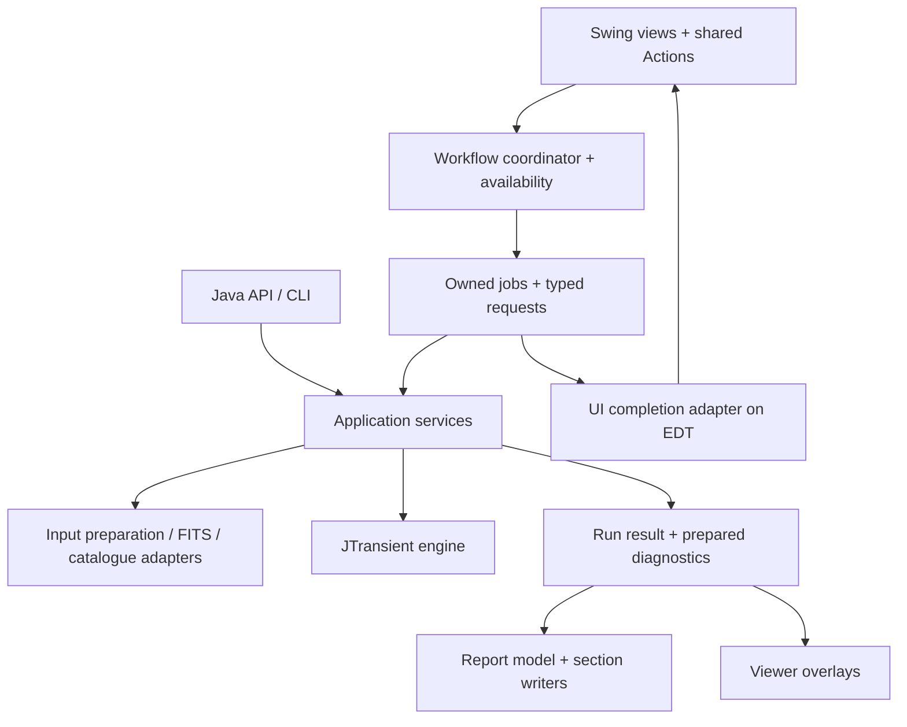

# Design improvements and feature plan

Reviewed against the source tree on 2026-10-19. This is the single active plan for SpacePixels application design, GUI improvements and refactoring. [HIGH_LEVEL_DESIGN.md](HIGH_LEVEL_DESIGN.md) describes implemented architecture. The D01–D13 findings originated in the 2026-10-18 review at `bf8c687`; their cited mechanisms were checked again during consolidation. No fault-injection or real-data run was performed for this documentation change.

## Status and maintenance

**Proposed** means an idea awaiting a decision; **Accepted** records an explicit implementation decision; **In progress** means implementation has started; **Deferred** records a deliberate postponement; **Implemented** means the feature exists; **Dropped** retires a superseded proposal. Priority is separate from authorization. None of D01–D13 has been promoted to Accepted by this documentation cleanup.

Use the findings table and detailed acceptance criteria below as the work queue. Add unique feature proposals to the additional-work table; do not maintain a separate TODO or refactor list. Update a status with its decision or implementation evidence. Current behavioral documentation belongs in the manual/API/architecture references; archive detailed investigations once their useful conclusions have been transferred.

Historical sources: [GUI review](docs/archive/gui-enhancements-2026-10.md), [refactor snapshot](docs/archive/refactor-2026-09.md), [completed task list](docs/archive/completed-tasks-2026-10.md), and [maintenance notes and regression evidence](docs/archive/maintenance-notes-2026-10-19.md). Their old priorities, line counts, machine bootstrap commands and session-specific dirty-file lists do not override this plan.

## Overall assessment

The application has a good foundation: Swing with FlatLaf, a separate detection engine, a usable Java API, shared image viewers, and report section writers. The next improvement should make **ownership, state and failure handling explicit**. Replacing Swing or reorganising every package would deliver less value than making a job, a settings edit and an imported session behave consistently.

The most valuable work is, in order:

1. Protect files during replacement and settings saves.
2. Prevent obsolete previews and overlapping jobs from changing the current UI.
3. Give long operations a clear lifecycle, honest cancellation and reliable cleanup.
4. Validate settings into snapshots, and derive command availability from application state.
5. Improve keyboard access, layout scaling and the distinction between application preferences, the current session and a completed run.

These are engineering priorities, not findings that every possible failure has already occurred. The evidence below distinguishes code that is present from consequences inferred from it.

## Review scope and limits

Reviewed startup and import, workflow buttons and table selection, background tasks and events, preview rendering, frame viewers, settings and persistence, the API and CLI boundary, processing services, report generation and live lookup support. Existing manual screenshots were inspected for visual context; some predate the latest control placements. Source references name methods so the findings remain useful when line numbers change.

**Coverage clarification (2026-10-20).** This is a broad review of subsystems and important execution paths. It is not a completed class-by-class audit against the proposed architecture, and there is no exhaustive inventory of the changes needed to reach it. D01–D13 identify evidenced problems and useful next steps; they are not proof that every remaining dependency and ownership issue has been found. The [architecture adoption review](#architecture-adoption-review) below completed that inventory on 2026-10-20.

This was a source and architecture review, with primary documentation checked for Swing, FlatLaf and Guava. It was **not** a fresh interactive usability study, fault-injection run, accessibility audit or performance benchmark. Statements about races and I/O failures describe reachable design risks inferred from the code; their frequency has not been measured. No application code, user settings, FITS files or JTransient algorithms were changed by this review. M81 false-positive detection remains a separate investigation.

## What to preserve

- **The engine boundary.** SpacePixels prepares data, orchestrates work and presents results. JTransient owns detection. Do not move GUI workflow or FITS-file interaction into the engine.
- **The public API shape.** [SpacePixelsPipelineRequest](src/main/java/eu/startales/spacepixels/api/SpacePixelsPipelineRequest.java) defensively copies its detection configuration, and [DefaultSpacePixelsPipelineApi](src/main/java/eu/startales/spacepixels/api/DefaultSpacePixelsPipelineApi.java) uses shared preparation and pipeline services. Those are useful patterns for GUI run requests too.
- **The settings navigation.** [SettingsNavigator](src/main/java/eu/startales/spacepixels/gui/SettingsNavigator.java) already provides search, changed-only filtering and expert disclosure. Keep the maintainer's basic/expert/hidden classification and the preservation of hidden configuration fields.
- **The shared viewers.** [SequenceViewerFrame](src/main/java/eu/startales/spacepixels/gui/SequenceViewerFrame.java), [FrameView](src/main/java/eu/startales/spacepixels/gui/FrameView.java), [StretchControls](src/main/java/eu/startales/spacepixels/gui/StretchControls.java) and [ViewerSupport](src/main/java/eu/startales/spacepixels/gui/ViewerSupport.java) reuse display and interaction code. The sequence viewer rejects obsolete work by worker identity and target frame; viewers detach listeners and release displayed data. Extend these patterns rather than replacing them.
- **Report identities and export snapshots.** [ReportData](src/main/java/eu/startales/spacepixels/util/reporting/ReportData.java) centralises findings and frame selection. [ExportVisualizationSettings](src/main/java/eu/startales/spacepixels/util/reporting/ExportVisualizationSettings.java) captures export options. [AtomicReportFile](src/main/java/eu/startales/spacepixels/util/reporting/AtomicReportFile.java) publishes completed text files. These solve part of the problems below already.
- **Existing validation and testing.** Input preparation, WCS handling, catalogue matching, API execution and reporting have focused tests. The site configuration already gives inline validation feedback. The review calls for extending these strengths, not starting over.

## Findings and priorities

| ID | Priority | Status | Improvement | First useful result |
|---|---|---|---|---|
| D01 | High | Implemented | Safe publication of FITS files and settings | A failed replacement preserves the previous file; a failed save remains visibly unsaved. |
| D02 | High | In progress (every job admitted by the coordinator, 2026-10-20) | Job ownership and resource admission | A command acquires its job slot before the worker starts; only that job can finish it. |
| D03 | High | Implemented | Preview results belong to a request | A previous frame or stretch cannot overwrite the current preview. |
| D04 | High | In progress (S1, S11, typed outcomes for every job) | Explicit cancellation, outcomes and cleanup | Cancelling does not mean exiting; every ordinary terminal path releases its resources. |
| D05 | High | Implemented; Preview Frame question open | Validate settings and capture run snapshots | Invalid editor text cannot silently run with an older value. |
| D06 | Medium | Proposed | Application, session and viewer ownership | State is scoped to the session it describes, and global preferences can be edited before import. |
| D07 | Medium | Proposed | Shared actions and derived availability | Button, shortcut and context menu execute the same command under the same conditions. |
| D08 | Medium | In progress (WCS write, 2026-10-20) | Keep slow work off the EDT | Accepting a WCS write does not perform the file rewrite on the UI thread. |
| D09 | Medium | Proposed | Complete the analysis/report separation | Display changes reuse prepared diagnostics and stable finding identities. |
| D10 | Medium | Proposed | Typed settings metadata and engine integration | A setting's identity and rules are not maintained in several unrelated lists. |
| D11 | Medium | Proposed | A clearer analysis workflow and persistent results | Users see what will run and can reopen its results without another detection. |
| D12 | Medium | Proposed | Shared visual rules and adaptable layout | Longer descriptions and larger fonts fit without fixed-height clipping. |
| D13 | Medium | Proposed | Keyboard and assistive-technology access | Visible links, settings inputs and viewer controls are reachable and named. |

“High” means to address before expanding the affected workflow. It does not mean undertaking all high-priority items in one change.

### D01. Treat file replacement as a shared application responsibility

**Implemented (2026-10-19).**
- **One helper.** `util.StagedFile` writes into a unique temporary file beside the target and replaces the target in one atomic move. It falls back to keeping a backup when an atomic move is unavailable, and removes the temporary file on failure.
- **Where it is used:**
  - the plate-solve WCS write, which also reads the copy back first to check the image size and that its data is complete;
  - the settings files (`SpacePixelsSettingsFiles` stages both files before replacing either, and names the file that failed);
  - the application config and profile migration;
  - the session files (Auto-Tune results, plate correction, sky catalogue), report text files, the lookup cache, and converted, decompressed and prepared FITS copies.
- **Settings Save** marks the settings saved only after both files are replaced.
- **Tests** inject failures while writing, during replacement (a folder in the target's place, and on Windows a frame held open), on either settings file, in the non-atomic fallback, and for a truncated FITS copy.
- **Real data:** a WCS write on a copy of a klangwolke-2 frame (121 MB) left the pixels identical and kept the other header cards. A klangwolke-2 batch run wrote the same `report-data.json` findings as before.

The original review follows.

**Evidence.** [PlateSolveService.updateFitsHeaderWithWCS](src/main/java/eu/startales/spacepixels/util/PlateSolveService.java) writes `<original>.tmp`, deletes the original, then calls `renameTo`. If deletion succeeds but renaming fails, the original path is gone. A temporary replacement may remain, so this is not proof that all image data has been destroyed, but recovery is now manual. The temporary filename is also fixed rather than unique.

[DetectionConfigurationPanel.savePersistedSettings](src/main/java/eu/startales/spacepixels/gui/DetectionConfigurationPanel.java) opens both settings files with `FileWriter` before writing either. Opening the second file can fail after the first has already been truncated. A later write or close can fail too. The saved-state marker is updated inside the try block before both resources have finished closing. [SpacePixelsAppConfigIO.write](src/main/java/eu/startales/spacepixels/config/SpacePixelsAppConfigIO.java) also writes directly to its destination. These failure paths were not exercised on user files.

**Proposal.** Extract a small file-publication helper from the pattern already used by `AtomicReportFile`: unique temporary file beside the target, complete and close the write, validate as appropriate, then replace. Prefer an atomic move where supported. Specify a recovery/backup strategy when it is unavailable; a regular replacement fallback is not automatically crash-safe. Never deliberately remove the only original before publishing its replacement.

Stage both settings serialisations before replacing either, and mark the editor saved only after the selected publication policy succeeds. **Two individually atomic file moves are not a two-file transaction.** Either provide rollback/recovery for a partially completed pair or expose which file failed and retain an unsaved state. Keep the current profile formats and migration backups; combining all preferences into a new format is not necessary for this fix.

**Acceptance.** With disposable fixtures, inject failure before replacement, during replacement and on the second settings file. Verify the previous FITS path remains readable, recovery files have an intentional policy, and the UI does not claim a failed save succeeded. This is SpacePixels work; it needs no detection-engine change.

### D02. Give every background job an owner and an identity

**Evidence.** [MainApplicationPanel](src/main/java/eu/startales/spacepixels/gui/MainApplicationPanel.java) starts work from listeners, then reacts to a started event posted by the worker. The lock is therefore acquired asynchronously after submission. `lockUI` stores enabled flags recursively; another lock clears that snapshot, and a finish event calls `unlockUI` without checking which job owns the lock. `EngineProgressUpdateEvent` carries only a percentage and message. `DetectionFinishedEvent` mixes report, quick-preview and count fields; inspection and star-mask work use it to borrow detection's progress handling.

The current modal dialog prevents many user interactions once it is visible. That reduces exposure, but does not establish a synchronous admission rule or make overlapping lifecycle events safe. Sky fetching has its own indicator and does not post this generic progress event, so the earlier example of sky-fetch percentages directly moving the modal bar was too broad.

**Proposal.** Add a small application-owned job coordinator. On the EDT, validate the command and reserve its resource slot **before** launching a worker. Record a job ID, session ID, job kind, stage, progress and terminal outcome. Ignore updates from obsolete IDs. Model heavy image processing separately from bounded network work; decide explicitly whether catalogue fitting, preview loading and full detection may overlap given memory use. Do not put all work into one unrestricted executor, or queue many full-resolution previews.

Use typed outcomes such as completed report, imported session, tuned settings, cancelled and failed. An `Object result`, several nullable fields or `JobFinished<T>` subscriptions on Guava would weaken this: Guava does not support parameterised subscription types. A typed job handle can return its result directly, with an adapter for existing UI lifecycle messages.

**Acceptance.** Starting the same command twice admits only the permitted work. A late progress/finish event from job A cannot unlock job B, change B's status or apply A's result to a new session. Tests should assert this without constructing the entire main window.

### D03. Extend the viewer's “latest request wins” rule to stretch previews

**Implemented (2026-10-19).**
- **One render at a time.** `gui.StretchPreviewRenderer` renders the Image Stretch previews on one `SwingWorker`, as `SequenceViewerFrame.prepareCurrent` prepares frames.
  - A request carries the session (`ImageProcessing`), the frame's file and the stretch.
  - A request made during a render waits, replacing any request already waiting.
  - A result is shown only if its request is still the newest.
  - Before, every change started its own thread that read a whole frame, and every result was shown in the order the threads finished.
- **What makes a result stale:**
  - any change of frame or stretch, already before the 250 ms debounce fires;
  - hiding the tab;
  - another import, which also removes the previews of the previous session.

  While a render is due, the frame line ends in "rendering…". Once a result is shown, the label and the images describe the same request. With no frame selected, the previews are removed.
- **Event removed.** `GeneratePreviewsTask` returns the two images and now closes the frame on failure too. `PreviewGenerationFinishedEvent` is gone.
- **Tests:** `StretchPreviewRendererTest` holds an earlier render until a later request is made. It checks that:
  - only the later request's images and both histograms are shown;
  - waiting requests are replaced;
  - a cancelled render is not shown;
  - one render runs at a time.
- **Window harness**, on four klangwolke-2 frames copied to a scratch folder. It made two frame changes and two stretch changes while previews rendered, hid the tab during a render, and imported again. Each time:
  - the shown images and both histograms were identical to a direct render of the selected frame with the current stretch;
  - the frame label named that frame.
- **Not done:**
  - an abandoned render is not interrupted; it finishes its read and is dropped;
  - preview sampling (F05) is unchanged.

The original review follows.

**Evidence.** [StretchPanel.executePreviewTask](src/main/java/eu/startales/spacepixels/gui/StretchPanel.java) starts `GeneratePreviewsTask` after a debounce timer. Debouncing already exists and should stay. However, `PreviewGenerationFinishedEvent` (since removed) has images and success only: no session, frame, stretch parameters or request number. `onPreviewGenerationFinished` accepts every result.

**Consequence inferred from the code.** If request A is still loading when B starts, and A finishes last, A can replace B's images while the frame label or controls describe B. Debouncing limits starts close together; it cannot order jobs already running. There is also no per-preview worker handle to limit in-flight full-frame reads.

**Proposal.** Capture a preview request containing session ID, file identity, stretch snapshot and increasing generation. Allow one in-flight render with at most the newest pending request. Apply a result only if its generation is still current; invalidate it on session changes and disposal. Use cancellation when the underlying read supports it, but keep the identity check even after requesting cancellation. `SequenceViewerFrame.prepareCurrent` is an existing local model for worker/target checks, rather than another framework to introduce.

**Acceptance.** Force A to finish after B and verify the visible image, histogram and frame label all describe B. Include rapid parameter edits, import of another session and closing the view. This requires no JTransient algorithm change.

### D04. Make cancellation, failure and resource cleanup explicit

**Evidence.** [ProcessingProgressDialog](src/main/java/eu/startales/spacepixels/gui/ProcessingProgressDialog.java) is modal, fixed-size, and its close action exits the application after confirmation. Blink and sky fetching have separate cancellation mechanisms. Declining report generation after detection is represented as failure in [DetectionTask](src/main/java/eu/startales/spacepixels/tasks/DetectionTask.java), even though detection completed.

There are inconsistent error paths too. [ManualTransientInspectionTask](src/main/java/eu/startales/spacepixels/tasks/ManualTransientInspectionTask.java) calls `engine.shutdown()` only after a successful `detectTransients`; its catch logs an OOM without rethrowing it despite the comment about a global handler. [StarMaskStackTask](src/main/java/eu/startales/spacepixels/tasks/StarMaskStackTask.java) does shut down in `finally`, but its OOM branch logs without posting a terminal event or forwarding the error. Consequently, those paths can leave progress handling unfinished; an uncaught handler cannot handle an error swallowed by a catch. This was established from the branches, not by inducing OOM in the running application.

**Proposal.** Use a common job runner for ordinary start/progress/outcome handling and resource cleanup. Put engine shutdown and file closure in `finally`/try-with-resources. Have one fatal-error policy instead of copying JVM exit timers into individual tasks; after a genuine OOM, do not promise the session can safely continue. Distinguish detection succeeded/report skipped, user cancellation, partial export and actual failure.

A Cancel control should request cancellation, show a stopping state and retain resource ownership until work actually ends. For a stage that cannot stop safely, say it will stop after that stage. `Future.cancel` alone does not prove that engine computation or blocking I/O stopped. [SwingWorker's contract](https://docs.oracle.com/en/java/javase/21/docs/api/java.desktop/javax/swing/SwingWorker.html) supplies worker/EDT completion mechanics; application and engine code still need a cooperative policy. If JTransient needs a new cancellation contract, discuss that engine change separately before implementing it.

**Acceptance.** Fail each ordinary stage, decline export, request cancellation, and close a viewer while it prepares data. Verify one terminal outcome, resource release and a correct command state. Test fatal-policy routing through an injected policy rather than exhausting real memory. Keep a “Details / Copy error” path for diagnostics and a persistent result link after success.

### D05. Build a validated settings snapshot instead of reading a mutable panel

**Implemented (2026-10-19), in the settings tab.**
- **One step for saves and runs.** `DetectionConfigurationPanel.checkedSettings(...)` is behind Save, Detect Moving Targets, Detect Iteratively, Manual Transient Inspection, Preview Frame, Auto-Tune and Test Star Mask. It returns a copy of the session `DetectionConfig`, hidden settings included, so later edits cannot change a run. `getJTransientConfig` is gone.
- **Invalid text is visible and stops saves and runs.**
  - `CheckedNumberEditor` takes only text that is one complete number within the setting's range. Before, "4,5" was read as 4, and "4.5" in a whole-number field as 4.
  - Other text stays when the field loses focus; before, it silently went back to the previous value. The field is outlined in red, and the footer says what to enter.
  - A refused save or run names itself, brings the tab forward and puts the cursor into the field. A setting hidden by a filter or by the expert switch is found with a search for its title.
  - A setting whose feature is switched off does not count.
- **Pairs in one place.** `config.DetectionSettingsRules` defines the six ordered pairs and the check for finite numbers. The tab moves the same setting as before when an edit crosses a pair, now only in `applySettingsToMemory` (the spinner listeners are gone), and says so in the footer, for example "Grow Sigma lowered to 4.0 (cannot be above Detection Sigma)".
- **Tests:** `DetectionSettingsRulesTest` and `CheckedNumberEditorTest`.
- **Window harness**, on a copy of the maintainer's profile. Its 43 checks cover refused saves and runs, focus, filters and expert settings, Revert, a NaN in a hidden setting, and a run's copy against later edits. Compared with the previous code:
  - the settings a run receives were byte-identical;
  - all 75 number fields were identical in value, type and text.
- **Not done:** profile loading and the API do not apply `DetectionSettingsRules` yet; they stay unchanged for now. Save keeps its name.
- **Fixed afterwards:** a value with more decimals than its field showed was kept rounded; 4.25 typed where the field showed 5.5 became 4.2. The field first showed the new value with its old number of decimals, and the auto-apply committed that text back. This predated D05. A field now shows every decimal of its value.
- **Open question: Preview Frame.** It keeps the settings it was opened with, and clicking Preview Frame again picks up changes. Before D05, a frame stepped to in an open Preview Frame used the settings of that moment. The alternative is to take a fresh checked copy at each frame step, so an open preview follows edits. Undecided (maintainer, 2026-10-19).

The original review follows.

**Evidence.** [DetectionConfigurationPanel.commitSpinners](src/main/java/eu/startales/spacepixels/gui/DetectionConfigurationPanel.java) catches and ignores `commitEdit` failures. `applySettingsToMemory` changes the live config field by field and logs a broad exception. `getJTransientConfig` returns that same mutable object. Detection and Auto-Tune tasks retain that reference at construction, whereas manual inspection clones it. Standard detection does clone the effective config later; this is useful, but happens after loading, rather than defining one uniform click-time boundary.

Invalid text can therefore be rejected by the editor while a Save or Run path continues using the previous model value. Constraints are also implemented in spinner listeners and normalisation code, while callers of the API do not use those widgets. This is a validation/feedback weakness, not evidence that the engine receives every invalid edit.

**Proposal.** Read the editor into a draft; commit and validate it; then create the run snapshot or update the session settings as one operation. Return structured validation errors, focus the relevant input, and explain any automatic adjustment. Reuse applicable validation in the API and profile-loading boundary, with mode-specific policy where needed. Reject non-finite values and inconsistent pairs explicitly rather than relying only on spinner bounds.

Preserve auto-apply for valid edits and the current hidden-field behaviour. Build on a clone of the loaded configuration; do not rebuild it from visible rows and lose hidden values. All long tasks should receive the same kind of click-time config snapshot, frame identities and export choices. Prefer “Save as startup defaults” wording where that is what Save does; saving is not the step that first activates the current values.

**Acceptance.** Invalid typed input prevents Save/Run with an inline explanation. Editing the UI after a run starts cannot change that run. Revert, defaults, migration, auto-tuned values and hidden fields retain their current documented semantics. Validation that changes detection decisions needs the appropriate real-data comparison and maintainer discussion.

### D06. Separate application preferences, the session and individual viewers

**Evidence.** [ApplicationWindow](src/main/java/eu/startales/spacepixels/gui/ApplicationWindow.java) owns an `ImageProcessing` for the current folder. [SkyCatalogueModel](src/main/java/eu/startales/spacepixels/gui/SkyCatalogueModel.java) is process-wide. `MainApplicationPanel` owns selection, sky jobs and a preview window; `DetectionConfigurationPanel` owns a master-stack cache; viewers own other frames and listeners. [ImageProcessing](src/main/java/eu/startales/spacepixels/util/ImageProcessing.java) reloads the user-level `AppConfig` for each instance. `SpacePixelsDetectionProfileIO` also retains an active Auto-Tune frame limit in static state.

Existing session guards deserve credit: sky completion checks worker identity; restore checks the saved field and correction key; overlays check coverage; viewer cleanup detaches listeners. Do not describe these as absent or assume every import currently mixes catalogues. The remaining concern is scattered ownership and dependence on a single process-wide current session, especially for tests or future multiple windows.

**Proposal.** Load application preferences once, independently of importing a folder. Give the window a current session containing an ID, metadata references, selection model, catalogue/correction state, last-result references and session-scoped caches. Replace it only after a successful import handover. Use explicit outcomes for cancelled imports: `FitsImportTask` currently reports an empty successful import when the mixed-exposure choice is cancelled, which can clear the prior session through `ApplicationWindow.clearImportedDataset`.

Pass the session or an immutable session snapshot to viewers/services. Treat large frame buffers as owned resources, not data to deep-copy into every snapshot. An old viewer may keep its old session intentionally, but must not silently adopt the new session's catalogue. Retain field/solution guards after removing the singleton.

**Acceptance.** Open A, begin background work, import B, then let A finish: B stays unchanged. Failed or cancelled import preserves the agreed previous-session behaviour. Closing a viewer releases listeners and owned buffers. Two test sessions cannot change each other's catalogue or tuning preferences. Do not add multi-window UI merely to justify this refactor.

### D07. Derive availability from state and use real command actions

**Evidence.** [MainApplicationPanel](src/main/java/eu/startales/spacepixels/gui/MainApplicationPanel.java) keeps enable rules in `lockUI`/`unlockUI`, selection listeners, workflow refresh, import handlers and helper methods. A saved component-state map records what happened to be enabled rather than why. The main Auto-Tune button follows another button's enabled property. Shortcuts call `button.doClick()`, and the table menu copies button checks. These controls are partly synchronised already, but the button hierarchy is serving as the application model.

**Proposal.** Calculate a small immutable availability model from session facts, valid settings, selection and job ownership. Each entry contains an enabled flag and reason. Apply it to shared `Action` objects for commands that have several entry points. The action dispatches a typed request; it does not discover its policy by walking Swing components. Oracle's [Action contract](https://docs.oracle.com/en/java/javase/21/docs/api/java.desktop/javax/swing/Action.html) explicitly supports sharing command properties and enabled state across controls; it does not imply every local listener needs a command class.

Keep the useful disabled-button explanations, generated from the same availability result. Remove numeric tab-index assumptions as affected code is touched; address the tab/component by identity. Avoid a state machine containing every possible UI combination: a session lifecycle plus independently computed capabilities is sufficient initially.

**Table enhancement constraint.** The current table has no installed row sorter, so its direct selected-row-to-model indexing is not an existing sorting bug. If sorting/filtering is added, convert view rows to model rows in all selected-file and solve-result paths, and use file/session identity in events instead of a saved visible row number. Return numeric values and column classes before offering numeric sorting.

**Acceptance.** Button, shortcut and menu have identical availability and behaviour after imports, colour conversion, selection changes, errors and job completion. A late event cannot re-enable a prohibited operation. Preserve the current workflow policy first; relaxing locks is a separate product decision.

### D08. Keep UI access on the EDT and slow work off it

**Evidence.** `MainApplicationPanel.onSolveFinished` enters the EDT with `invokeLater`, asks permission, then directly calls `updateFitsHeaderWithWCS`, refreshes metadata and cleans solve artifacts there. The service rewrites the FITS file and can download referenced WCS header data through `loadWcsHeaderCardsFromReference`. `restoreSkyCatalogue`, called while applying an imported table model, reads catalogue/correction files on the EDT. Config writes and ASTAP-directory scans also run from UI callbacks. These can be small on local storage, but their duration is not bounded by the GUI code.

The reverse boundary also needs attention: `FitsImportTask.run` calls `ImageProcessing.getFitsfileInformation` on its worker, and that method directly opens compression/format confirmation dialogs. Other helpers correctly bridge to Swing, but there is no consistent rule that prevents a processing method from touching GUI components on a worker thread.

**Proposal.** Ask the question on the EDT, submit the accepted write as a job, and update table/state from its completion. Load the session's saved catalogue/correction as part of background session preparation, while preserving field checks. Separate a fast edit from potentially slow persistence. The rule is about slow operations, not banning every trivial local read. Swing's [threading contract](https://docs.oracle.com/en/java/javase/21/docs/api/java.desktop/javax/swing/SwingWorker.html) puts UI access on the EDT and lengthy work elsewhere.

Move GUI prompts out of the processing facade into an explicit preparation-decision adapter. `DetectionInputPreparation` already gives the API a policy-driven path. Retain differences between headless refusal/automatic preparation and interactive questions; share the underlying facts and conversions.

**Acceptance.** A deliberately slow disposable file store does not stop repainting or keyboard navigation while a header write or metadata restore runs. Import questions are created and handled on the EDT. Completion returns to the correct session/file, and errors release the command lock. A modal dialog's nested event loop is not itself proof of a deadlock; avoid using modality as the lifecycle mechanism.

### D09. Complete the distinction between measurements and report presentation

**Evidence.** [DetectionReportGenerator](src/main/java/eu/startales/spacepixels/util/reporting/DetectionReportGenerator.java) already delegates sections, snapshots display settings, constructs `ReportData` and atomically publishes HTML. But [NightEquipment](src/main/java/eu/startales/spacepixels/util/reporting/NightEquipment.java) and [FieldDepth](src/main/java/eu/startales/spacepixels/util/reporting/FieldDepth.java) calculate diagnostics from frames during report export. `SessionCatalogue` loads catalogue state lazily from the session folder. `ReportData`, section writers, maps, CSVs and the report-selection dialog still contain some separate category/label rules.

**Proposal.** Keep section writers, but prepare a read-only report model once: stable finding IDs, accepted candidates, included categories, rejected frames, coordinates, catalogue snapshot and optional session diagnostics. Extend `ReportData`; do not introduce a competing identity system. A small category descriptor can provide the label, colour, prefix, count, inclusion option and anchor rule for the dialog, legends and maps. Existing report consistency checks are useful protection when consolidating these rules.

Separate diagnostic measurement services from HTML emission when the next diagnostic feature needs it. Their FITS/session orchestration can remain in SpacePixels; moving them into JTransient is not implied. Carry explicit diagnostic states such as unavailable, failed and measured instead of making every failure indistinguishable from an empty result. Keep browser lookup enrichment separate from detection confidence and preserve current offline exports.

Capture resolved catalogue/correction/export context at a documented point. Current export snapshots and field checks already help; the concern is completing reproducibility across a full run, not claiming every report changes midway. Keep live rendering defaults out of new APIs: pass options rather than changing process-wide statics.

**Acceptance.** HTML, JSON, maps and CSVs agree on IDs, numbering, counts and exclusions. Re-rendering an existing prepared result with different presentation options does not re-run detection or silently recompute diagnostics against newer catalogue state. Do not retain all raw frames forever merely to enable a later re-export; define what a lightweight saved result supports.

### D10. Describe settings and engine compatibility once, with typed boundaries

**Evidence.** `DetectionConfigurationPanel` describes a field in its UI construction, copies it in `applySettingsToMemory`, loads it in `updateSpinnersFromConfig`, normalises dependencies and maintains separate saved/core/tuned lists. Optional reflection helpers accept engine field names as strings. Loaded hidden `DetectionConfig` fields survive applying the visible controls, and the API already clones request configuration; both behaviours should remain. This is distinct from preserving arbitrary unknown JSON keys: Gson ignores those, and migration compares the key sets.

**Proposal.** Introduce typed setting definitions incrementally for an existing page: stable ID, title, unit, description, basic/expert visibility, typed getter/setter and validation. Use the same identity for search, changed markers and validation messages. Preserve shared button models between Overview and detail pages. Keep “changed from saved” distinct from “set by Auto-Tune”. Do not turn all engine fields into a generated form or add hidden rows back.

Make side effects clear in new method names. `getJTransientConfig()` currently commits editors and applies changes, while `ImageProcessing.getInstance()` constructs a new processor rather than returning a singleton. A name such as `captureValidatedSettings` or `openProcessor` would convey the actual operation. Preserve compatibility wrappers where public callers depend on existing names; this is gradual clarity work, not a mass rename.

If supporting several engine versions is a real requirement, isolate capability/reflection handling in one adapter and expose unsupported capabilities clearly. Otherwise prefer a pinned compile-time contract over silently ignoring a missing setting. A composite build can use unpublished engine changes; release validation must check an explicit supported SpacePixels/JTransient pair before distribution. Do not treat a local composite compile as proof that a published-dependency build works.

[AutoTunerRunner](src/main/java/eu/startales/spacepixels/util/AutoTunerRunner.java) temporarily changes a legacy engine static, and the API documents a concurrency restriction. Keep that restriction visible in application admission policy. An eventual engine-instance option would be a separate JTransient proposal, not a GUI-only refactor.

**Acceptance.** Moving a setting between existing sections does not require editing unrelated string/index lists. UI and API validation use the intended shared rules, hidden values survive, unsupported settings are not falsely shown as applied, and release builds test the dependency pair they distribute.

### D11. Make the main window a clear analysis workspace

**Evidence.** The numbered workflow strip, primary action, status explanations, selected-frame preview and active-settings readout already improve orientation. However, application preferences live behind imported-session availability: `ApplicationWindow` disables configuration/settings tabs at startup, and `ConfigurationPanel.config()` reaches them through `ImageProcessing`. A completed report is offered by a one-time dialog; the main panel has no persistent completed-run list. The large-dataset warning uses a frame-count threshold, while blink already has a dimension-aware memory estimate.

**Proposal.** Keep the four workflow groups, but make their roles clearer:

- **Current session:** folder display name, frame count, dimensions, mono/colour, timing readiness and solved status in one compact summary. Use text as well as colour. Do not display observing-site details unnecessarily.
- **Preferences:** allow ASTAP and site defaults to be configured before import. Dataset-dependent actions stay disabled with a reason. This follows D06; it is not just enabling a tab while its backing processor is null.
- **Analysis plan:** show which analyses are enabled and what frames they use. Blink uses the selected frames; Preview opens the sequence at the selected frame; Auto-Tune uses a sufficiently large selection or falls back to the imported sequence; a normal run uses the whole sequence. Make these differences and the Auto-Tune fallback visible before starting.
- **Run:** consider “Run analysis” or an adjacent explanation when variable stars and diagnostics are included under “Detect Moving Targets”. Keep the familiar wording until a deliberate UI wording decision is made. Clearly distinguish analyses to compute from categories to include in the report; omitting a report category need not disable a filter used by detection.
- **Results:** keep an Open report / Open output folder action and a compact local run history. Record when, which session, which profile and the outcome. Do not hold full-resolution frame arrays in run-history entries.

Use image dimensions and a conservative estimate of stage buffers to recommend normal versus iterative processing. Reuse the blink preflight pattern; do not label an estimate an exact peak-memory guarantee. Show progress stage and elapsed time; use counts when available, and avoid invented ETA precision.

A useful larger idea is a small, persistent **session workspace** connecting frames, settings and completed results. It can remain a single-session desktop app; it does not require a database, project-file format or dockable-window framework.

**Acceptance.** A new user can tell what will be analysed, which steps are optional, why an action is unavailable, where output goes and how to reopen the result. Cancelling/skipping a report is not presented as a failed detection. Validate these choices with a short task-based usability pass rather than assuming new labels are automatically better.

### D12. Use shared visual rules and content-driven layout

**Evidence.** [DetectionConfigurationPanel.addSettingRow](src/main/java/eu/startales/spacepixels/gui/DetectionConfigurationPanel.java) fixes a description panel to `480 × 85` for preferred, minimum and maximum size. Several controls use explicit dimensions and absolute derived font sizes. Explanatory text frequently uses `Label.disabledForeground` even while it is active content. `ProcessingProgressDialog` is fixed at `400 × 90`. The main workflow does already wrap and `WindowPlacement` restores a screen-aware window; preserve those improvements.

**Proposal.** Define a small set of application UI defaults: body/help/section typography, spacing, content widths and semantic status colours. Use relative typography and scale custom dimensions with the supported FlatLaf/JDK mechanisms; prefer measured text and wrapping to fixed description heights. FlatLaf's [customisation guide](https://www.formdev.com/flatlaf/how-to-customize/) supports application-specific defaults, and its [scaling guidance](https://www.formdev.com/flatlaf/properties-files/#scaled-values) distinguishes scaled UI values. This is not a recommendation to use newer APIs unavailable in the pinned FlatLaf version.

Keep the existing dark theme and restrained primary-action emphasis. Make enabled help text readable rather than visually identical to disabled controls; measure contrast before calling it a standards failure. Use standard text/buttons and consistent spacing before adding decorative icons. Charts may keep domain-specific colours, with consistent labels and legends across the app and reports.

**Acceptance.** Inspect the empty and loaded main window, core/expert settings, configuration and viewers at representative small/large windows, 100/150/200% scale and a larger base font. Long descriptions and error messages wrap, primary actions remain visible and the workflow strip does not consume the usable frame/table area. Existing screenshots are context, not evidence that these tests have passed.

### D13. Restore keyboard access without breaking viewer navigation

**Evidence.** `AutoTuneOverviewPanel.addAnalysis` makes “Settings ›” a `JLabel` with a mouse listener. The manual/update links and ASTAP download link use similar mouse-driven labels. Settings labels are not associated with their input through `setLabelFor`. [SettingRow](src/main/java/eu/startales/spacepixels/gui/SettingRow.java) makes its reset button non-focusable. `ViewerSupport.removeFocus` recursively removes focusability to stop controls consuming Space and arrow keys. That last choice solved a real viewer interaction problem, but also removes ordinary keyboard access to controls.

**Proposal.** Use link-styled buttons/actions for interactive text, with accessible names and keyboard activation. Associate labels with editors, supply units and descriptions, and make changed state available beyond colour. Provide a keyboard path to reset a setting. Audit `FrameView`'s custom accessible context if it is to expose more than an image, including useful frame/status text and selected-overlay information.

For viewers, scope stepping/playback shortcuts to the image-navigation context while allowing deliberate Tab navigation into controls. Do not simply set everything focusable and reintroduce the Space/arrow bug. Editing a numeric value or operating a combo box must not step the sequence. Oracle's [Swing accessibility guidance](https://docs.oracle.com/javase/tutorial/uiswing/misc/access.html) specifically covers label associations, accessible descriptions and keyboard alternatives.

**Acceptance.** Complete import, settings search/edit/reset, Auto-Tune, preview navigation and result opening using the keyboard. Drive actual key events to the focus owner in viewer tests, as the maintainer's existing harness guidance requires. Check the accessible names of inputs and link controls; do not claim a full screen-reader audit from a source search alone.

## Proposed architecture: a few clear boundaries

The following is a target flow of requests and results, not a requirement to create a package or interface for every box. The UI completion adapter lives on the Swing side; the worker and application services do not acquire a dependency on Swing by returning results to it.

- **Views** build components and show state. The main panel stops being the place that decides job policy, rewrites FITS and owns catalogue fetching.
- **Workflow coordinator** handles user intent, session handover, admission and outcomes. It has no dependence on individual button enabled flags.
- **Application services** take explicit inputs and options and return data. They do not show Swing dialogs or reach through `ApplicationWindow` for logging/configuration. Keep concrete services unless a seam needs substituting in tests or has multiple implementations.
- **Adapters** contain file formats, solver/network calls, persistence and interactive preparation decisions. The GUI and API supply different decision policies to shared operations.
- **Presentation** consumes a stable result. Existing report writers and shared viewer components stay in use.

The pattern is close to a modest **model–view–presenter** arrangement: a state model and testable workflow/presenter between Swing widgets and services. Use plain Java constructor injection, typed requests, `Action`s and explicit completion callbacks. A service locator, a second global event bus, deep inheritance tree or mandatory DI/reactive framework would add machinery without resolving the ownership questions.

### Architecture adoption review

**Next step (2026-10-20).** The maintainer wants to move SpacePixels toward this architecture. Before any code changes for it, review the whole codebase and work out the steps that lead there. D01–D13 came from a broad review, not a class-by-class one, so they are a starting point, not the full list.

**Scope.**
- **Packages:** every production package, including the build wiring and the relevant tests:
  - `api`, `config`, `events`, `gui`, `tasks`, `tools`;
  - `util`, including `util.reporting` and `util.skycatalog`.
- **Out of scope:** JTransient and JPlateSolve are external contracts; their internals are not part of this review.
- **Paths to follow through the GUI, the API and the CLI:**
  - import and conversion;
  - plate solve, and catalogue fetch and correction;
  - preview and inspection;
  - Auto-Tune;
  - standard and iterative detection;
  - report and lookup.
- **Outcomes to follow:** cancellation, failure, session replacement and closing, as well as success. Searching the imports helps with the inventory, but it does not show that a path behaves correctly.

**What to record.**
- **Per subsystem:**
  - what it does now, and where its boundary should be;
  - which way its dependencies actually point;
  - who owns its state and resources, and which thread it runs on.
- **Per class:** **retain**, **move responsibility**, **adapt boundary** or **investigate**, with the reason. Propose a change only where the code conflicts with the target.

**Result.** The class inventory, the traced paths and the evidence are kept in [docs/architecture-review.md](docs/architecture-review.md). The steps they lead to are listed below. Each step has:
- a delivery stage;
- what must stay compatible;
- how the step will be verified;
- a link to D01–D13 where those already cover the work.

Record what the review did not cover and any deliberate exceptions. The review is complete when every production class and every entry path is accounted for.

**Progress.**

| Part | Packages | Status |
|---|---|---|
| 1. Workflow core | `gui`, `tasks`, `events` | Done 2026-10-20 |
| 2. Services and boundaries | `util`, `api`, `tools`, `config` | Done 2026-10-20 |
| 3. Presentation | `util.reporting`, `util.skycatalog` | Done 2026-10-20 |

**The review is complete (2026-10-20).** All 166 production classes are accounted for:
- 114 are retained;
- the 18 event classes retire with the bus;
- 34 change.

The coverage limits and the deliberate exceptions are listed in the [review summary](docs/architecture-review.md#review-summary).

**Steps from the review.** The review has the details. They are proposals; none is accepted yet.

| Step | Stage | Work | Covers |
|---|---|---|---|
| S1 | A | **Done 2026-10-20 (`01d983e`).** Every job ends with a finished event or the out-of-memory exit; before, some failures left the UI locked. | D04 (new evidence) |
| S2 | B | **Done for every job, 2026-10-20** (`54e32b6` to `23acc9b`). A job coordinator: admission before the worker starts, and job and session identity. Session identity is a placeholder until S7 | D02 |
| S3 | B | **Done 2026-10-20**, with S2: every job returns a `JobOutcome` (completed, declined or failed). Typed outcomes per job kind | D04 |
| S4 | B | Shared actions and availability: one Detect action; tabs and solve results addressed by identity. Solve results are matched by file since the plate-solve slice (2026-10-20) | D07 |
| S5 | B | **Done 2026-10-20 (`01d983e`, with S1).** Use `BatchStretchTask` instead of its inline copy | — |
| S6 | B–C | No GUI in `tasks`: their own logger and out-of-memory policy, and results returned instead of windows and dialogs opened | new |
| S7 | C | A session object, and the application config loaded once | D06, D11 |
| S8 | C | The WCS write and session-folder I/O off the EDT. **The WCS write is done (2026-10-20)**: it runs as a job. The session-folder reads and writes (sky catalogue and correction on import, Auto-Tune results, the correction switch) are still on the EDT | D08 |
| S9 | B–C | **Done 2026-10-20 (`23acc9b`)**: all 18 events, the bus and the Guava dependency are removed. Jobs report through the coordinator; a new session reaches the panels through the window's session listeners | EventBus decision |
| S10 | C | Split `ImageProcessing`: its session part into the session object, with batch operations and import as their own services. Keep it as a facade, and remove its dead methods | D06 |
| S11 | A–B | **Done 2026-10-20 (`d255b68`), the message fix.** Report failures as failures. Before, a report-export failure said "aborted by user due to high track count", a failed iterative pass was still listed, and an Astrometry.net failure showed two dialogs. Typed outcomes follow with S3 | D04 (new evidence) |
| S12 | C | One preparation flow for the GUI and the API, with the GUI's questions asked on the EDT. Typed import outcomes are done: since `74bbded` a declined import keeps the open session. The questions are still asked from the import worker | D08, D06, F07 |
| S13 | B–C | No `gui` and no Swing in `util` | new |
| S14 | D | An explicit run context: the site, rendering options and Auto-Tune frame limit go with the run, instead of coming from the home folder and static fields | D09, D10 |
| S15 | D | One source of finding labels and categories. Today T1, ST1, A1… are computed in seven places that agree only by walking the tracks in the same order | D09 |
| S16 | D | Prepared diagnostics with explicit states (*measured*, *unavailable*, *failed*), and one failure policy for optional report sections. Today a failed field-depth measurement reads as "not measured", and other section failures abort the report | D09 |

S1 and S11 were the small correctness fixes that needed nothing else first; both are done.

**Known starting points.**
- `ApplicationWindow` owns the shared event bus.
- Task classes post the lifecycle and progress events, and some also build Swing views.
- `ImageProcessing` still asks import questions in Swing dialogs and logs through `ApplicationWindow.logger`.
- The existing findings that cover parts of the work:
  - D02/D04: the job lifecycle;
  - D06/D08: the session and interactive preparation;
  - D09/D10: the report and settings contracts.

**Constraints.**
- Preserve the public API, the settings formats, the detection measurements and the current viewer and report behaviour, unless a separately agreed feature changes them.
- Once a boundary is extracted, protect it with a dependency rule that tests can check, such as "application services do not depend on Swing or `gui`".

### Guava EventBus: keep or replace?

**Implemented (2026-10-20).** The maintainer chose option 2 after the architecture review. The bus and Guava were removed the same day, in `23acc9b`, when the last job moved to the coordinator.

**Accepted (2026-10-20): option 2, retire it gradually.** In practice this meant:
- no separate migration project;
- no new events on the bus;
- each event is removed when its workflow gets a typed job handle or a session notification (S9);
- Guava is removed with the last event.

The question and the evidence follow.

The maintainer asked whether SpacePixels should keep Guava's `EventBus` or move to something else.

**Current use (2026-10-20).**
- **The bus:** `ApplicationWindow` owns one synchronous bus.
- **The events:** 18 event classes in `events`. They carry the start, progress and end of import, conversion, stretch, blink, plate solve, Auto-Tune and detection, plus the blink window's close.
- **Publishers:** 13 classes post these events: the task classes, `BlinkFrame`, `MainApplicationPanel` and `DetectionConfigurationPanel`.
- **Subscribers:** 24 `@Subscribe` methods in four GUI classes receive them: `ApplicationWindow`, `MainApplicationPanel`, `DetectionConfigurationPanel` and `StretchPanel`. All four are registered for the window's lifetime, and each method moves its work to the EDT itself.
- **The dependency:** Guava is used for nothing else, so retiring the bus would also remove the dependency.

**Evidence from part 1 of the review (2026-10-20).**
- 14 of the 18 events have a single subscriber, `MainApplicationPanel`. They carry one job's start, progress and end.
- Only two kinds of message have several listeners:
  - "the session changed" (import, 4 subscribers);
  - "tuning started or ended" (2 subscribers).
- Each use has a natural replacement in the target design:
  - the job messages: a job handle (D02/D04);
  - the session change: a notification from the session model (D06);
  - the tuning state: job state.

This supports option 2. See [the review](docs/architecture-review.md#the-event-bus-in-part-1).

**For keeping it.**
- It works, and it is small and contained.
- The problems in D02 and D04 do not come from the bus itself:
  - the events carry no job or session identity;
  - the UI lock is taken after the worker has started.

  Replacing the bus alone fixes neither problem.

**For replacing it.**
- Guava's own [guidance](https://github.com/google/guava/wiki/EventBusExplained#avoid-eventbus) advises against using it. Its reasons that matter here:
  - who posts an event and who receives it is not visible in the code;
  - a subscription cannot be generic (no `JobFinished<T>`);
  - the delivery thread cannot be controlled;
  - an exception in a subscriber is only logged and never reaches the poster.
- Typed job handles (D02/D04) would return results and failures directly to whoever started the job.

**Options.**
1. **Keep it as it is.**
2. **Retire it gradually.** When D02/D04 give a workflow a typed job handle, its progress and outcome go through that handle, and its events are removed. Guava goes when the last event does.
3. **Replace it with another event-bus library.** This keeps the same hidden coupling, so it gains little.

**Suggestion made before the decision.** Option 2:
- no separate migration project;
- no new events on the bus in the meantime;
- plain Java (listener interfaces, `SwingWorker`, `PropertyChangeSupport`) covers what remains, so no new library is needed.

To ground the decision, the review should list every publisher, subscriber and registration, including inline workers.

### S2 and S3, first slice: a job coordinator for the detection jobs

**Implemented (2026-10-20), in `54e32b6`, `f945ad8`, `281246f` and `953f3cf`.** The maintainer accepted the design and checks the four buttons in the GUI. Later slices moved the other jobs, all on 2026-10-20:
- Convert to Mono and Batch Stretch;
- Plate Solve;
- Auto-Tune;
- Blink;
- Import.

Every job now runs under the coordinator.

**Scope.** The four jobs that share the detection lock, progress dialog and finished event today:
- Detect Moving Targets;
- Detect Iteratively;
- Manual Transient Inspection;
- the star-mask stack behind Test Star Mask.

The other jobs (import, plate solve, Blink, Auto-Tune, Convert to Mono, Batch Stretch) stay on the bus for now and move one at a time later.

**New types**, in a new package `eu.startales.spacepixels.jobs` with no Swing or `gui` dependency:

| Type | Role |
|---|---|
| `Job<R>` | The work. `run(JobContext)` runs on the worker and returns a `JobOutcome<R>` |
| `JobContext` | What a running job may use: `progress(percent, message)` and its `JobHandle` |
| `JobOutcome<R>` | A sealed type: `Completed(R result)`, `Declined(String reason)` (the user said no, such as the report-size question) or `Failed(String reason, Throwable cause)` |
| `JobHandle` | The job's identity: a number, its `JobKind` and the session it was started for. Until S7 brings a session object, the session is the `ImageProcessing` instance |
| `JobKind` | `DETECTION`, `ITERATIVE_DETECTION`, `TRANSIENT_INSPECTION`, `STAR_MASK_STACK`; more kinds later |
| `JobCoordinator` | Admits, starts and finishes jobs. It is called on the UI thread and given two executors: one for the worker, one for the UI thread (`EventQueue::invokeLater` in the application, a direct executor in tests) |

**How a job runs:**
1. **Admission,** on the EDT, before any thread starts. The coordinator refuses the job, with a reason, when another coordinated job is running or when the window is locked by a job still on the bus. This is today's policy; only the timing changes.
2. **Locking:** an admitted job tells its busy listener at once. `MainApplicationPanel` implements that listener: it locks the window and shows the progress dialog. Today this waits for the worker's start event.
3. **Progress:** reaches the dialog on the EDT, and only while that job is the current one.
4. **Ending:** the coordinator turns the job's outcome into one call of the job's outcome handler, on the EDT. It then releases the lock. A thrown exception or `Error` becomes `Failed` with the reason. Running out of memory is thrown on the worker thread, as S1 established.

| Job | Its outcome handler, at the place that started it |
|---|---|
| Detection | `Completed(report file)` asks whether to open the report. `Declined` and `Failed` show today's messages |
| Iterative | Same, with the results folder. The frame-limit question moves from the worker to the button, before admission |
| Inspection | The job returns its frames and transients; the handler opens `TransientInspectionFrame`. The task no longer opens windows or takes the `StretchPanel` (part of S6) |
| Star-mask stack | The handler fills the master-stack cache and opens the explorer, as the callback does today |

**What is removed:**
- `DetectionStartedEvent` and `DetectionFinishedEvent`, with their bus subscribers. Only these four jobs use them, and this is the first retirement under S9.
- The four unused fields of the finished event go with it.

`EngineProgressUpdateEvent` stays for the jobs still on the bus.

**Ownership:**
- `ApplicationWindow` creates the coordinator.
- `MainApplicationPanel` and `DetectionConfigurationPanel` reach it through the window, as they reach each other today. S4 and S7 change that later.

**Compatibility.** Nothing visible changes, apart from the admission timing:
- the same progress dialog, questions, messages, report prompt and windows;
- the same detection output;
- the API and CLI are unaffected.

**Verification:**
- **Coordinator tests,** with a controllable worker executor and a direct UI executor:
  - a second job is refused while the first runs;
  - the lock is taken before the worker starts;
  - each outcome is delivered once, on the UI executor;
  - progress arriving after the outcome is ignored;
  - an exception and an `Error` both become `Failed`;
  - out of memory leaves the worker thread.
- **Job tests:** the four jobs adapted from `TaskFailureEventsTest`, asserting outcomes instead of events.
- **Full test suite,** and klangwolke-1 with identical `report-data.json`.
- **A GUI check** of the four buttons on a small dataset.

**Delivery, in four commits:**
1. The `jobs` package and its tests, with no users yet.
2. The star-mask stack and inspection on the coordinator.
3. Detection and iterative detection on the coordinator.
4. Remove the two events, and update the architecture and plan documents.

### Common patterns that fit this codebase

| Pattern | Concrete use here | Limit |
|---|---|---|
| Command | A shared Swing `Action` starts a typed operation from a button, shortcut or menu. | A local one-off listener does not need a command hierarchy. |
| Model–view–presenter | Availability, validation and workflow transitions can be tested independently of component layout. | Avoid replacing the panel with an equally large presenter. |
| Immutable request / result | Capture settings and identities once; return a typed outcome and stable report model. | Share large read-only image data by ownership contract rather than deep-copying it. |
| Strategy / adapter | GUI preparation questions and API preparation policy choose how to handle the same conversion facts. | Introduce an interface where behaviour really varies, not for every concrete helper. |
| Observer | Notify views about session/catalogue/settings changes through explicit, scoped subscriptions. | Subscriptions need an owner, detach path and stated delivery thread. |
| Composition and focused reuse | Keep shared stretch, drawing, navigation and report helpers behind their existing views. | Do not force every viewer or report section into a large inheritance framework. |
| Resource ownership | A job or viewer owns its engine, worker, listener subscription and buffers, and releases them predictably. | A cancelled future is not proof that its underlying operation has terminated. |

## State and resource ownership to make explicit

| Scope | Owned state | Lifetime / rule |
|---|---|---|
| Application | User-level configuration, startup defaults, supported integrations, job resources | Loaded independently of a dataset; save failures are visible. |
| Session | Session ID, frame metadata, current selection, catalogue/correction, session caches and last-result references | Replaced on a successful handover; stale results cannot attach to its successor. |
| Run | Click-time config and export options, input identities, resolved context, diagnostics, outcome and artifact paths | Stable for reproducibility; does not read live controls during work. |
| Viewer | Current frame, zoom, playback state, listeners and owned display buffers | Explicitly detached/released on close; shared stretch models retain intentional semantics. |
| Report lookup | Provider request, report identity and enrichment cache | Independent of detection verdict; bounded work and existing target/path validation remain. |

A future run record should include a schema version, supported application/engine build identifiers, original/prepared input identities, effective settings, resolved catalogue/correction identity, analysis/export inclusion and artifact manifest. Some of this exists already in `detection_config.json`, `report-data.json` and report metadata; extend those rather than writing a conflicting summary. Avoid storing private absolute paths or observing-site data in a shareable manifest by default. A reproducibility record is distinct from retaining all image buffers or promising replay from data that is no longer available.

The localhost lookup proxy's lifecycle can remain application-scoped. Give it an explicit owner and a bounded I/O policy when expanding it, rather than starting services merely by constructing UI views. Its existing provider/target/path validation and atomic cache work should be preserved; this review did not establish a new security defect there.

## Delivery plan

| Stage | Work | Why this order |
|---|---|---|
| Architecture review | Done 2026-10-20: steps S1–S16 above, mapped to the stages below. The EventBus question was decided the same day: retire it gradually | Makes the remaining scope explicit before the architecture work grows. Focused correctness fixes need not wait. |
| A: focused correctness | D01 file publication; D03 preview identity; D05 invalid-editor feedback | Small, concrete failure modes; do not wait for a broad architecture migration. |
| B: workflow foundation | D02 ownership/admission and D04 outcomes/cleanup for detection, inspection and star-mask jobs; then D07 actions | Makes lifecycle explicit before replacing UI locking. |
| C: session boundary | D06 application preferences/session handover; D08 background WCS write and metadata restoration | Reduces UI/service coupling and protects session transitions. |
| D: presentation and polish | D09 prepared report data; D10 one page of typed settings bindings; D11 results/readiness; D12/D13 layout and access | Builds on explicit state; accessibility fixes that are independent can start earlier. |

Reusing `BatchStretchTask` instead of the duplicate inline worker is a useful small change within Stage B, not the main architectural solution. Add one adapter/command at a time and keep the public API and file formats compatible. Do not combine the file-safety fix, an EventBus change and a settings redesign in one commit.

## Verification strategy

The existing automated suite covers important data and report paths, and there are GUI tests for several components. The source tree checked on 2026-10-19 has no dedicated `MainApplicationPanel`, `SettingsNavigator` or `SettingRow` test class. Make newly extracted state and workflow logic easy to test without reflection into large panels or opening the whole application.

| Behaviour | Verification that would justify the change |
|---|---|
| File publication | Fault-injected writes/replacements using disposable FITS and config fixtures; previous files remain usable and failure is visible. |
| Job ownership | Deterministic fake jobs: duplicate start, A finishes after B, late progress, session replaced, ordinary failure, export declined. |
| Preview identity | Controlled out-of-order completion; assert frame, image, histogram and parameter version agree. |
| Settings | Invalid typed values, dependent limits, non-finite profile/API inputs, hidden-value round trips, migration, defaults/revert and failed-save dirty state. |
| Actions and table | Same enabled reason/action across button, shortcut and menu; correct model-row conversion if sorting is introduced. |
| EDT responsiveness | Slow fake storage/service with a responsive UI heartbeat; UI mutations happen on the EDT. Do not use fragile timing thresholds as the only proof. |
| Viewer lifecycle/access | Actual focused key events, editing versus navigation, listener counts and released frame references after close. |
| Report refactors | Same engine results, IDs, counts, CSV values, rejected frames and assets for equivalent options; offline browser checks for changed interactions. |
| Release compatibility | Compile/test the supported engine pair, plus opt-in local composites; do not assume an unpublished engine change is available from Maven Central. |
| GUI mechanics | [GUI mechanics tests](#gui-mechanics-tests): drive the real window by the visible text of its controls. Check that actions, saving and cancellation work. Do not compare detection results. |

For behavioural changes, follow the maintainer's real-data comparison method. Anything affecting detection, preparation or numeric diagnostics needs the relevant before/after datasets and one engine fix at a time. A pure wiring/presentation change should demonstrate unchanged processing inputs and outputs and exercise its GUI/interaction boundary. Do not rewrite user settings during verification; use an isolated JVM home and preserve or isolate Java preferences.

## GUI mechanics tests

**Accepted (2026-10-20).** The suite checks the mechanics of the window: every control can be used, settings can be changed and saved, runs can be started, and a load can be cancelled. It does not check detection results. Those stay on `batchDetect` and the real-data tests.

**Driver.** AssertJ Swing on the existing JUnit 4, dependency `tokyo.northside:assertj-swing-junit:4.0.0-beta-3` (Apache 2.0; the maintained Java 21 fork). If that beta misbehaves, `org.assertj:assertj-swing-junit:3.17.1` has the same API. Jemmy, image search and recorders are not used.

**Lookup is the visible text.** Tests match a showing button or label by the words the user sees, such as `Import Aligned Frames…` or `Detection Sigma`. No `setName` is added for the suite. AssertJ's `button(String)` finds a component name, so the tests do not use it for a caption. When two controls share a caption (`Save`, `Detect Moving Targets`), only the one on the selected tab is showing, and the matcher requires that.

**Where it lives.** The tests and their support are in `src/test/java/eu/startales/spacepixels/gui/mechanics/`. `build.gradle` holds the test dependency and the `guiMechanicsTest` task. Run `./gradlew guiMechanicsTest`. That task is not part of `./gradlew test`: it needs a desktop, it moves the mouse, and it runs one test at a time. `./gradlew test` excludes this package and opens no window. The mechanics task runs again even when the classes have not changed, prints each case name, and brings the window to the front of the main display.

**Isolation.** Each test sets `user.home` to a scratch folder before the window is created, and restores it afterwards. Java preferences are not in that folder. The test exports `/eu/startales/spacepixels` (the window placement, the stretch, the blink speed, the auto-tune profile and `showExpertSettings`) and restores that node after the window is gone. The frame's close operation is set to dispose, so closing it does not exit the JVM. The modal **Processing...** dialog's close box exits the application; the suite must not click it.

**Data.** Synthetic frames from `SyntheticDatasetFactory`. The reference datasets are not opened. The folder chooser is the real one: the test clicks **Import Aligned Frames…**, selects the synthetic folder and approves the chooser. The approve button's own caption follows the operating-system language, so the test uses the chooser's approve action rather than that caption.

**First tests drafted.** `WindowMechanicsTest` covers four cases:

- Before any import, the workflow buttons are present, detection and blink are unavailable, and the prepare line says `No frames imported`.
- Importing a synthetic monochrome sequence enables the other tabs and shows `Monochrome` with the frame count. The status line then reads `Imported N file(s)` (the session install replaces the job's own `Import finished` text).
- Changing **Detection Sigma**, pressing **Save**, and opening the window again shows the saved value.
- **Blink Selected** can be stopped with **Cancel** on the loading card or **Stop Blinking**, and the status line says `Blinking stopped`.

`./gradlew guiMechanicsTest` passed these four on 2026-10-20, on synthetic frames, in about 14 seconds.

**Still to draft.** The remaining buttons and viewers; search, expert rows, Revert and Load Defaults; the stretch tab; plate-solve availability; cancelling the sky-catalogue fetch; the iterative frame-limit question. Auto-Tune has no Cancel control. Its progress uses the **Processing...** dialog, and closing that dialog exits the application, so a cancel test for Auto-Tune waits until a real cancel control exists.

## Changes to avoid

- A wholesale Swing-to-JavaFX/web rewrite to solve lifecycle and state problems.
- Splitting every long class or moving all `util` files before extracting a real responsibility.
- A single giant controller replacing a single giant panel.
- Generic jobs with untyped results, a global EDT EventBus wrapper, or assuming interruption instantly stops computation.
- Making every domain object observable or giving every one-off callback its own interface.
- Reintroducing hidden settings, silently changing thresholds, or tying engine acceptance to a report checkbox.
- Keeping large image buffers in session history to make later rendering convenient.
- Replacing the current viewer focus rules without testing real keyboard focus and editing.

The first implementation should be a small, reviewable correction with a measurable acceptance condition. Safe file publication and preview result identity are the strongest starting points; they improve reliability now and do not depend on the larger restructuring.

## Consolidated feature work

| ID | Status | Remaining work and acceptance boundary |
|---|---|---|
| F01 | Proposed; experiment first | Test whether slow-mover sigma should follow tuned per-frame sigma. Compare manually on real datasets before proposing an engine change; account for the different maximum-stack noise distribution (JTransient SM-2). Calibrated master sigma/grow/min-pixel tuning already exists, so that part of the old TODO is complete. Do not silently change legacy tuning. |
| F02 | Deferred | A compact header-derived session summary and a possible multiple-night warning. Fold this into D11; do not restore the original proposal for an expensive pre-run quality-analysis table without a new decision. Frame QC and numerical rejection reasons already appear in the report. |
| F03 | Proposed | Viewer label controls: a Faintest magnitude limit and a Names switch, with persistent viewer preferences. First establish whether star marks or variable names cause the clutter; variables may need an independent limit. Keep current density thinning. |
| F04 | Proposed; explore design | An MCP server for AI agents: run the existing pipeline on a folder with a profile/settings, retrieve results and access the report, then explore single-frame extraction and session-aware transient inspection. See [MCP agent services](#mcp-agent-services-f04). |
| F05 | Deferred | Image Stretch preview sampling remains reduced to at most 2400 px on its long side; Show full size provides full-resolution inspection. If revisited, compare averaging or full-resolution rendering for small-star visibility and memory cost. This is separate from D03 request ordering. |
| F06 | Proposed; Windows first | Explore native platform installers, starting with a native Windows installer. Decide packaging, Java runtime distribution, installation/update behavior and release validation before implementation. See [native platform installers](#native-platform-installers-f06). |
| F07 | Proposed | Prepare compressed 32-bit FITS (`.fz`) directly as uncompressed unsigned 16-bit FITS in one import operation, avoiding an intermediate uncompressed 32-bit directory and a second conversion/import step. See [combined FITS preparation](#combined-fits-preparation-f07). |
| F08 | Proposed | Improve the variable-candidate field image: prefer matched/catalogue star names and show compact, transparent light-curve overlays containing only the curve and delta magnitude, without axes or axis labels. See [variable-star field image](#variable-star-field-image-f08). |
| F09 | Proposed; frame-selection policy to confirm | Make Detect Iteratively choose a directory and orchestrate ordinary pipeline runs with identical settings and different input subsets, followed by an index of the reports. See [directory-based iterative detection](#directory-based-iterative-detection-f09). |

Results summaries/run history and stage-aware progress are covered by D11 and D04. Their detailed information should live there rather than become competing feature entries. The old drift-grown void-band concern is Dropped: those settings and the old border mechanism were replaced by session data areas.

### MCP agent services (F04)

The maintainer wants AI agents to operate SpacePixels through an MCP server, beginning with capabilities similar to the existing [Java API](API.md). This is an exploratory proposal; the server interface, transport and packaging remain to be designed.

- **First scope: full dataset analysis.** Accept a folder of aligned frames and a detection profile/configuration, with supported preparation, Auto-Tune and report options. Reuse `SpacePixelsPipelineApi` and its request/result contracts. Return the effective settings, a structured result summary and the report/export locations. Provide a way for the agent or user to access the HTML report and its associated assets, rather than assuming a server-local path is readable by every client.
- **Long-running work.** Explore separate start, status/progress and result/report operations so an agent can follow a pipeline run. Reuse the ownership and outcome work in D02/D04; cancellation behavior must reflect what the underlying processing can actually stop.
- **Possible extension: single-frame extraction.** Let an agent select a frame and specify detection sigma, grow sigma, minimum pixels or a profile, then inspect structured detections and an annotated preview. This is extraction on that frame, before the dataset's stationary-star veto.
- **Possible extension: session-aware transient inspection.** Given a complete dataset, configuration and a selected frame, expose the transients remaining after the session's quality selection, median reference, star mask and filtering, with positions and a preview/overlay. Reuse prepared session context where appropriate. Keep this operation distinct from running extraction on the selected frame alone; the surrounding dataset changes which sources count as transients.

Use headless application services, with the existing public API as the starting boundary. The lower-level inspection operations need an explicit application contract; they are not currently methods on `SpacePixelsPipelineApi` and should not be exposed by driving `ApplicationWindow`. Reuse `report-data.json` and existing run metadata where sufficient, adding a shared result contract only when a concrete use case needs it. The earlier external agent-services proposal is background context, not a checked-in specification.

Before implementation, decide the initial client/local-file workflow, supported settings and defaults, job/session lifetime, result/artifact access and how much lower-level inspection belongs in the first version. A first acceptance exercise would have an agent submit a folder/profile, follow the run and retrieve the same findings and report as an equivalent Java API call. Single-frame operations would need comparisons with the corresponding extraction and session-inspection paths.

### Native platform installers (F06)

Explore a native installer for SpacePixels, starting on Windows. The goal is a normal install, launch, upgrade and uninstall experience. Other platforms can follow after the Windows approach is established.

Decide the Windows package format (for example, EXE or MSI), whether to bundle a Java runtime, installation scope/location, shortcuts, signing and how new releases update an existing installation. Keep user settings and datasets separate from application files so upgrades preserve them and uninstall behavior is explicit. Consider how the desktop application, CLI and a future MCP server would be distributed or selected during installation; this does not require delivering all three in the first installer.

Compare packaging options against the existing Gradle distribution and publishing workflow before selecting tooling. Validate a proposed installer on a clean Windows environment: install, launch, run a small analysis and open its report, upgrade from a previous version, and uninstall while preserving saved profiles and observing data. These are exploration criteria, not a claim that a native installer or bundled runtime already exists.

### Combined FITS preparation (F07)

When a compressed FITS sequence contains 32-bit images, importing it should offer one preparation operation that decompresses and converts directly to uncompressed unsigned 16-bit output, then loads that output. The current GUI compression gate in `ImageProcessing.getFitsfileInformation()` first calls `batchDecompress` and redirects import to an `_uncompressed` directory; the later format gate can then require another conversion and import. This creates an unnecessary intermediate 32-bit sequence and repeated user steps.

Inspect the image HDU's actual sample format during preparation and normalize its decompressed pixels before writing the final files. Reuse the existing conversion rules and the headless `DetectionInputPreparation` path, which already reads the image HDU and writes normalized 16-bit output. Connect this with the shared GUI/API preparation work in D08 rather than adding another independent conversion policy.

Preserve sequence validation before conversion, header/WCS and timing metadata, the sequence-wide negative-value offset or clipping choice, zero registration padding, and `SPOFFSET`. Keep the existing mono/color output behavior and original compressed files. Already-ready compressed unsigned 16-bit data should only need decompression, with no unnecessary rescaling. The headless refusal mode must continue to reject inputs requiring preparation.

Acceptance: import representative compressed 32-bit integer and floating-point sequences, including negative pixels, through one preparation flow; load the final detection-ready directory without creating an intermediate uncompressed 32-bit sequence. Compare output pixels and relevant headers with the existing decompression-then-conversion path, check compressed 16-bit controls and color handling, and verify that GUI and API preparation apply the same rules. Detection results should match for equivalent prepared pixels and settings.

### Variable-star field image (F08)

Improve the overall **Variable candidates across the field** image and its full-size version, generated by `VariableStarMapWriter`:

- Label a candidate with its actual star name from an available match or catalogue entry. Use the V identifier as the display fallback when no unambiguous name exists, and retain stable candidate IDs for report links and data associations.
- Simplify the small light curves beside the stars: show the curve and a compact delta-magnitude annotation, with no axes, tick labels, grid or axis names. Use the existing definition of observed variation for the delta-magnitude summary, with the unit shown as mag.
- Use transparent or lightly translucent backgrounds and compact placement so the overlays reveal the sky beneath them and obscure as few nearby objects as possible. Keep the star name, curve and delta magnitude readable on both bright and dark sky backgrounds.
- Preserve brighter-up orientation, the current usable-measurement selection and gaps for flagged/missing observations. This is a presentation change; it must not change photometry, candidate confidence or matching decisions.

Acceptance: compare matched and unnamed candidates, long names and crowded fields in both embedded and full-size images. Verify that names refer to the correct candidates, curves and delta magnitudes agree with the existing measurements, and the image remains readable offline while showing substantially more of the underlying sky.

### Directory-based iterative detection (F09)

Make **Detect Iteratively** a directory-based sequence of ordinary runs. Choosing the source folder should not require first importing it into the main window or replace an already imported session. Capture one validated detection configuration and the export settings for the whole operation.

The current `IterativeDetectionPipelineService` is a specialised path: it builds a shared global master stack, supplies it to each pass, disables variable-star analysis, and exports against the full sequence. The proposed replacement delegates each pass to the same standard processing/report flow used by a normal run, with only the input file list changing. Each pass builds its own master and retains the configured analyses and their normal readiness checks. This changes results relative to the old iterative method and must be evaluated explicitly.

Use a small planner to produce ordered subsets, a sequential runner to call the standard service, and an index writer to link their outputs. The standard service already accepts `FitsFileInformation[]`, so temporary input folders or copies of FITS files should be unnecessary. Validate directory metadata through the shared input rules, load only the current subset's pixels, use local frame indices and subset metadata throughout detection and export, and release its buffers before the next pass. Preserve original filenames and timestamps in each report.

Write a separate output folder per pass and an index with frame count, observing span, outcome, detection counts and report links. Show failed, cancelled or declined passes accurately and retain completed reports. Run admission, progress and cancellation belong to the existing job coordinator. Keep public compatibility entry points where callers need them; no JTransient algorithm change is proposed.

**Open selection decision.** The recommended initial policy preserves the current aim: progressively larger, time-spaced subsets across the sequence, subject to a frame limit. Consecutive batches, possibly overlapping, answer a different sampling need. Confirm the intended policy and exact pass sizes before replacing the implementation; expose the planned passes before starting. Do not silently retune settings between passes.

**Acceptance.** For a given subset, compare its measurements, rejections, enabled analyses and report data against an independent normal run on exactly those files with the same configuration. Check first/last frames, incomplete final pass sizes, gaps and absent timestamps, metadata/preparation failures, cancellation and export failure. Report frame counts, quality-control denominators, images and photometry must refer only to the pass's inputs. Verify bounded memory across passes and that the current GUI session remains intact. Separately document the differences from the old shared-master/photometry-disabled method.

## Refactor scope retained from the earlier plan

- **Settings (D01, D05, D10):** extract persistence and compatibility handling, then validated config/widget and visualization bindings. Split page builders only after those boundaries are useful. Preserve profile formats, hidden values, shared Overview/detail models, migration backups, defaults/revert and auto-apply semantics.
- **Input preparation (D06, D08):** share discovery/validation, metadata and conversion facts between GUI and headless paths; keep interactive decisions separate from API policy. Extract WCS writeback and solve-artifact cleanup as their own boundary. Keep `ImageProcessing` as a compatibility facade, preserve output-directory naming and avoid combining this with preview/stretch changes.
- **Reporting (D09):** extract image assets, maps or iterative index helpers when relevant feature work needs them. Preserve stable finding identities, filenames, CSV data and lookup/live-render behavior. `DetectionReportAstrometry` already delegates its query/URL/HTML helpers; it is not a standing extraction project.
- **Main panel (D02, D07):** move ownership, command policy and state into tested seams before moving listeners into controllers. A component's size does not determine the extraction order.
- **Cohesive renderers:** leave `CreativeTributeRenderer` and target section writers intact unless feature work exposes an independent responsibility. No target line counts or mass static-helper replacement are proposed.

Verification follows the strategy above and [AGENTS.md](AGENTS.md). Import changes cover ready mono FITS, compressed files, signed/scaled and 32-bit conversions, color, XISF, exposure groups and negative-value policy in both GUI and headless modes. Settings changes cover load/save, failed saves, defaults/revert, migration, hidden values, previews and both tuners. Report changes compare equivalent standard/iterative bundles, CSVs, identities, crops/GIFs and offline/live lookup behavior against a baseline. Use disposable settings and inputs.

## Completed work removed from the queue

The workflow strip, primary detection action, disabled-reason tooltips, frame context menu and common shortcuts are implemented. So are the Overview with calibrated-profile choices, analysis switches, settings navigation/search, saved-value markers, expert disclosure, auto-apply and explicit Save/Revert/Defaults.

The completed task list also covers report legends and layer guidance, variable-star overlays/maps, compact sky orientation, common-motion explanations, the persistent finding-browser placement, numerical frame-rejection reasons and the updated Signal Weave section. These are maintained as current behavior in the source/user documentation, not scheduled again here. Historical screenshots and mock-up numbers are not acceptance targets for new changes.
