# SpacePixels User Manual

<sub><i>Many thanks to Klangwolke at Cloudynights and Duncan Warren for providing some of the test data used in this manual.</i></sub>

SpacePixels finds what moves or changes in your astrophotography sessions: asteroids, comets, satellites, flashes and variable stars. You give it the aligned sub-exposures of a session, and it gives you an HTML report with every object it found, with crops, animations, maps and buttons that look the objects up in JPL, SkyBoT and other catalogues.

This manual walks through the everyday workflows with screenshots from real sessions. For the detailed meaning of every setting, hover the setting in the program: each one has a description. Watch the [latest video tutorial](https://youtu.be/LhA1izPFql0) or the [earlier tutorial](https://youtu.be/7XBdYh0Wn7A). The detection engine is documented in the [JTransient repository](https://github.com/ppissias/JTransient).

<a href="https://youtu.be/LhA1izPFql0" target="_blank" rel="noopener noreferrer">
  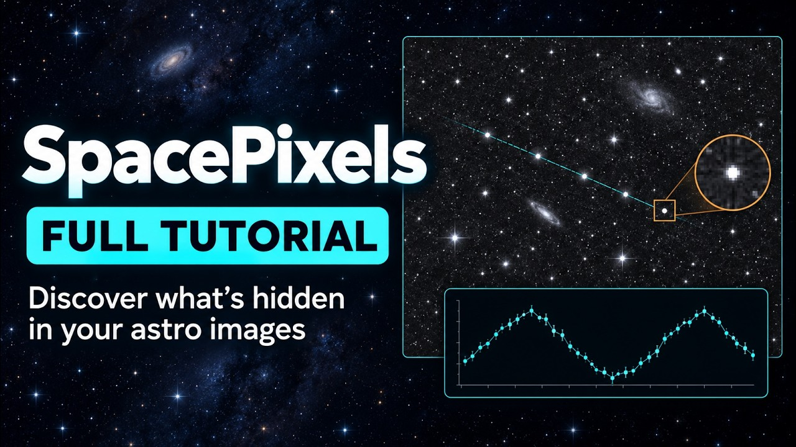
</a>

## Contents

1. [Before you start](#1-before-you-start)
2. [The main window](#2-the-main-window)
3. [Workflow: find moving objects in a session](#3-workflow-find-moving-objects-in-a-session)
4. [Reading the report](#4-reading-the-report)
5. [Identifying objects](#5-identifying-objects)
6. [Examples from real sessions](#6-examples-from-real-sessions)
7. [Other tools](#7-other-tools)
8. [Detection settings in brief](#8-detection-settings-in-brief)
9. [Tips and troubleshooting](#9-tips-and-troubleshooting)

---

## 1. Before you start

### Your data

The input to SpacePixels is the same input files for your stacking software: the aligned  + calibrated dataset.
But SpacePixels is the opposite of a stacker: it looks for what changes between your frames. It works best with:

- **aligned (registered) sub-exposures**, so the stars stay in the same place in every frame;
- **calibrated** frames (darks and flats), although uncalibrated data also works, with more noise detections;
- frames from **one session and one camera setup**, all with the same size and exposure time;
- **timestamps** in the FITS headers (`DATE-OBS`), so speeds and object identification work.
- **unprocessed** data (i.e. just raw images, calibrated and aligned)


Supported files: FITS (`.fit`, `.fits`, `.fts`), compressed FITS (`.fz`) and XISF, 16 or 32 bit, monochrome or colour. SpacePixels offers to convert what the detection needs (decompression, standard unsigned 16 bit, monochrome) when you import. Keep one sequence per folder: all files in a folder must have the same type, bit depth, size, layout and exposure time, and either all frames have timestamps or none. When the exposure times differ, for example 20 frames of 60 s and 2 of 120 s, import names the odd frames and offers to import only the largest set: it copies those frames into a subfolder such as `_exposure_60s` and imports that, and your folder stays as it is. Exposures within 2 % of each other count as the same, because many cameras record the measured exposure (60.0, 60.1 and 60.2 s).

Compressed 32-bit and signed/scaled 16-bit FITS offer **Combined FITS Preparation**: decompression and conversion write the final unsigned 16-bit files directly, preserving the compressed originals. Mono output goes in `_16bit_converted`; colour input produces `_16bit_mono` and `_16bit_color`. There is no intermediate uncompressed 32-bit folder. The existing negative-value choice applies once to the whole sequence, and the completion prompt can load the final mono folder. Compressed images already in standard unsigned 16-bit format only need decompression into `_uncompressed`.

A typical source is the folder of registered frames that your stacking program writes before it stacks them (for example the `r_*.fit` files of Siril or the registered frames of PixInsight).

With Deep Sky Stacker, open Stacking Settings and choose **Standard Mode** on the **Result** tab. The registered frames then keep a dark border where a frame was shifted which is useful for the analysis done by SpacePixels. On the **Intermediate Files** tab, tick **Create a registered/calibrated file for each light frame**, choose **FITS Files**, and leave **Compress FITS files** unticked. Import the folder of those frames. Screenshots of both settings are on the [Deep Sky Stacker export settings](https://github.com/ppissias/SpacePixels/wiki/Deep-Sky-Stacker-export-settings) page of the project wiki.

### Installing

1. Install Java 21 or newer.
2. Download the latest release from [SpacePixels Releases](https://github.com/ppissias/SpacePixels/releases) and unpack it.
3. Start `StartSpacePixels.bat` (Windows) or `./StartSpacePixels` (Linux, macOS).

SpacePixels may use up to 80 % of the computer's memory. 8 GB of RAM is enough for typical cameras; very large sensors (60 MPix and more) with 30 or more frames need about 16 GB. When a newer release exists, a blue **New version** button appears at the top right of the window, next to **User Manual**; click it to open the releases page.

### Optional: plate solving

To get sky coordinates and identify objects, SpacePixels needs **one plate-solved frame** of the session. Many capture and stacking programs already write the solution (WCS) into the FITS headers; the file table then says `Yes` under **Solved**. Otherwise SpacePixels can solve a frame with [ASTAP](https://www.hnsky.org/astap.htm) (local, free; install it with a star database such as D50) or with Astrometry.net (online, no installation).

---

## 2. The main window

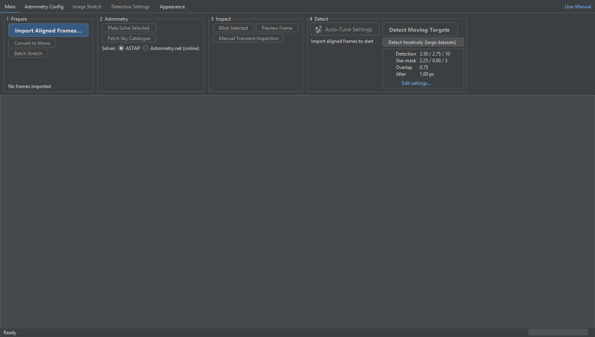

The window has four tabs:

| Tab | What it is for |
|---|---|
| **Main** | importing frames and running the tools, in four groups from left to right: **1 Prepare**, **2 Astrometry**, **3 Inspect**, **4 Detect** |
| **Astrometry Config** | the plate solver and your observing site |
| **Image Stretch** | how frames are displayed in the viewers |
| **Detection Settings** | Auto-Tune and every detection setting |

**Astrometry Config** is available before import, so you can choose ASTAP and enter your observing site first. Unsaved valid defaults stay in use when another folder is imported; importing does not save or discard them. **Image Stretch** and **Detection Settings** open once frames are imported. A colour dataset shows a persistent information notice: you can blink, stretch, convert to mono and use astrometry. **Preview Frame**, **Manual Transient Inspection**, **Auto-Tune** and detection (including variable-star photometry) require monochrome frames. Use **Convert to Mono**, then import the new mono folder. **1 Prepare**, **2 Astrometry** and **3 Inspect** each have a status line underneath that tells you what is ready and what is missing; when a button is greyed out, its tooltip says why.

**Detect** is split in two. On the left, **Auto-Tune Settings** has a short note under it: which settings are in use, and, after this folder has a saved auto-tune, when that auto-tune was run. On the right are **Detect Moving Targets**, **Detect Iteratively**, and a small box with the detection settings now in use: detection and star-mask sigma, grow and minimum pixels, the mask overlap, and the star jitter. **Edit settings…** at the bottom of that box opens Detection Settings.

The **User Manual** link at the right end of the tab bar opens this manual in your browser.

---

## 3. Workflow: find moving objects in a session

This is the main use of SpacePixels: **import → Auto-Tune → Detect → read the report**. The screenshots come from a session of 33 two-minute frames of a 61-megapixel camera.

### Step 1: import the frames

Click **Import Aligned Frames…** (the highlighted button in **1 Prepare**) and choose the folder, or simply drag the folder onto the window.

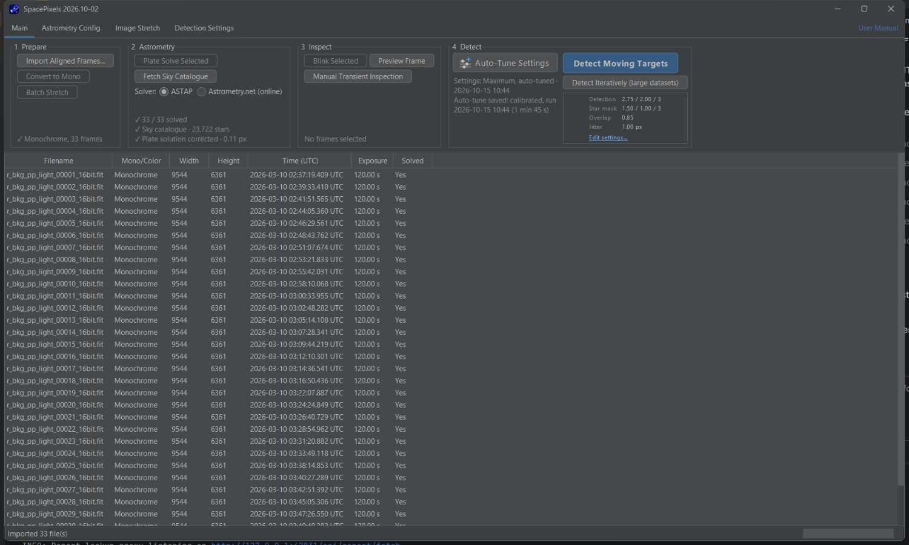

The table lists every frame with its size, time, exposure and whether it is plate-solved. The status lines confirm what SpacePixels found: here *Monochrome, 33 frames* and *33 / 33 solved*. If this folder already has a saved auto-tune, the note under **Auto-Tune Settings** names the profile and when it was run, and the box on the right shows those detection settings. If the frames are in colour, click **Convert to Mono** first; if they are compressed, XISF, 32 bit or signed 16 bit, SpacePixels offers the conversion during import.

### Step 2 (optional): plate-solve one frame

If **Solved** says `No`, select one frame and click **Plate Solve Selected** in **2 Astrometry**. One frame is enough, because the frames are aligned. Set up the solver on the **Astrometry Config** tab:

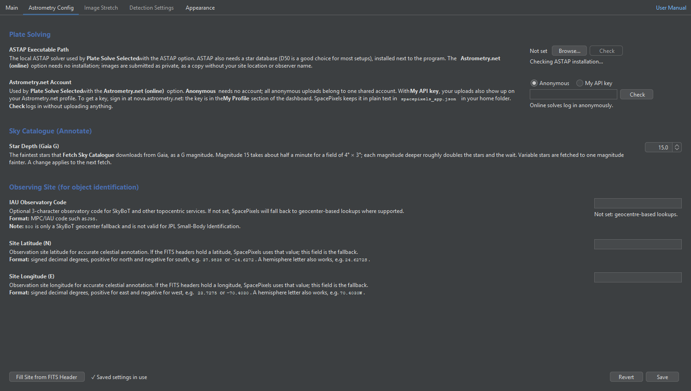

- **ASTAP Executable Path**: choose `astap.exe` (or the ASTAP program on Linux and macOS) and click **Check**. Or pick **Astrometry.net (online)** under the Plate Solve button, which needs nothing installed.
- **Astrometry.net Account**: **Anonymous** (the default) needs no account. To solve with your own account, choose **My API key** and paste your key: sign in at [nova.astrometry.net](https://nova.astrometry.net) and find it in the **My Profile** section of the dashboard. Your uploads then also show up on your Astrometry.net profile. **Check** logs in without uploading anything. The choice and the key are saved at once, the key in plain text in `spacepixels_app.json` in your home folder. Either way, images are submitted as private. Anonymous uploads all belong to one Astrometry.net account shared by every anonymous user, so SpacePixels uploads a copy of the frame without your site location (`SITELAT`, `SITELONG`, elevation and similar header cards) or the observer and site names; the frame on disk is not changed and the solve is the same.
- **Observing Site**: your latitude and longitude, or your IAU observatory code, make the object identification exact for your location. When the FITS headers contain the site (as here), SpacePixels uses them; **Fill Site from FITS Header** copies them into the fields.
- **Sky Catalogue (Annotate)**: how faint the stars are that **Fetch Sky Catalogue** downloads (**Star Depth**, see [Annotate](#annotate-stars-deep-sky-objects-and-variable-stars)).

ASTAP checks run in the background and show **Checking ASTAP installation...** while inspecting the program and nearby star databases. Selecting a different executable supersedes an older check without freezing the window. Application-default saves also run in the background; a failed save leaves the valid settings in use, with a warning so you can retry.

Without a plate solution everything still works except sky coordinates and the identification buttons. With one, **Fetch Sky Catalogue** in **2 Astrometry** downloads the stars, deep-sky objects and variable stars of the field, which the viewers can then draw on your frames (see [Annotate](#annotate-stars-deep-sky-objects-and-variable-stars)).

### Step 3: Auto-Tune

Open **Detection Settings** (or click **Edit settings…** in **4 Detect**). The **Overview** page is where you start:

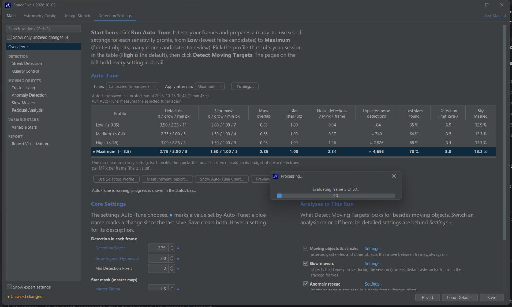

Click **Run Auto-Tune**, or **Auto-Tune Settings** on the Main tab (or press **Ctrl+T**), which opens this page and starts the run with the tuner and profile chosen here. It measures your own frames: how sharp the stars are, how much the stars jitter, how many noise detections each setting produces and how faint a test star each setting still finds. This takes from a few seconds to a few minutes (here 1 min 45 s for 33 × 61 MPix). While it runs, the button reads **Tuning…** and a progress window shows the frame it is on. **Preview Frame** on this page opens the same preview as **Preview Frame** on the Main tab.

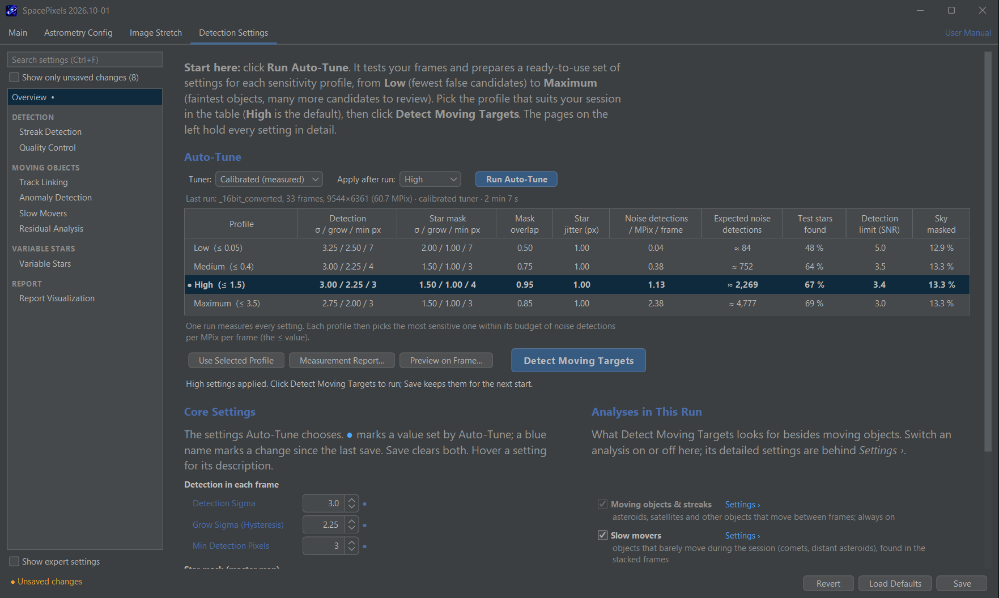

**Preview Frame** is directly below **Min Detection Pixels** in **Detection in each frame**, before the **Star mask (master map)** group. The two groups have divider lines, so the preview stays with the per-frame settings it uses.

The table shows a ready set of settings for each **sensitivity profile**:

| Profile | Use it when |
|---|---|
| **Low** | you want very few false candidates: bright objects only, a short report |
| **Medium** | a clean report that still reaches fairly faint objects |
| **High** (default) | the usual choice: close to the noise level, with a manageable number of candidates to review |
| **Maximum** | you search for one faint object, or have a small sensor: the faintest objects, with many more candidates |

The columns tell you what to expect: **Expected noise detections** is about how many false single detections the session will produce (most are rejected later because they do not form a track), **Test stars found** and **Detection limit (SNR)** say how faint the profile reaches, and **Sky masked** is how much of the sky is covered by the star mask (objects crossing bright stars there are not detected).

The profile chosen in **Apply after run** (High by default) is applied as soon as the run finishes; SpacePixels remembers your choice. To switch, select another row and click **Use Selected Profile**. The changed settings are marked with a blue name and a dot, and **Save** keeps them for the next start.

**Show Auto-Tune Chart…** draws, for the profile you pick, the false detections against the share of test stars found (the budget is the vertical line, and the marked point is the setting that was chosen) and the recovery of test stars by brightness for that setting. In the picture the selected profile is Maximum, the one last chosen in **Apply after run**.

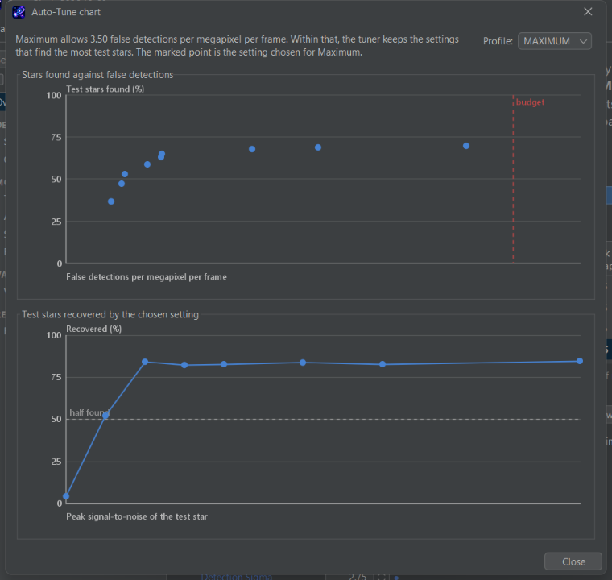

The result is also written next to the frames, as `auto_tune.json`, in the same way as the sky catalogue. The file keeps the chosen settings and this chart, not every combination the tuner tried. An older, much larger file is rewritten in this smaller form the next time that folder is imported. Importing that folder again shows when the calibrated tuner and the legacy tuner last ran (each is kept on its own). The profile in **Apply after run** is selected from the saved calibrated result when that result has it, so detection can use it without measuring again. **Run Auto-Tune**, **Auto-Tune Settings** and **Ctrl+T** always measure again and replace the saved result of the tuner you run. A legacy result is applied on import only when the **Tuner** box is set to Legacy and its profile matches the one that was tuned; otherwise the row is there and **Use Selected Profile** applies it.

The **Legacy** tuner sets only the per-frame detection settings, the mask overlap and the star jitter; it keeps your star mask settings and does not measure noise rates. Its table shows just those columns, and only those settings get the dot.

### Step 4: detect

Click **Detect Moving Targets**, on the Overview or on the Main tab (or press **Ctrl+D**). A progress window shows each stage.

**Cancel** in the progress window (or closing it) requests that the run stop; the status bar says it was cancelled after its workers finish cleanup. This works for the detection runs, Manual Transient Inspection, Test Star Mask, Auto-Tune, import, Convert to Mono, Batch Stretch and Plate Solve.
- **A run that doesn't stop.** If it hasn't stopped after a while, the button offers to exit SpacePixels instead.
- **What can't be cancelled:**
  - Writing the plate solution into a frame must finish, so the file is not left half written.
- **Plate Solve:** progress shows the solver phase and elapsed seconds. Cancel stops the local ASTAP process, or interrupts the local Astrometry.net request and stops polling. A remote job already accepted by Astrometry.net may continue on its server. The total solve budgets are 2 minutes for ASTAP and 15 minutes for Astrometry.net, followed by cleanup. Failed or cancelled ASTAP runs restore pre-existing solver sidecars; the source FITS file is unchanged.
- **How fast it stops:** detection and Auto-Tune check cancellation inside their computation, without waiting for the next progress message. Report writing checks between sections and items. Reading an individual large FITS file or another operation already in progress can still delay stopping; resources remain owned until that work and its cleanup finish.
- **What a cancelled run leaves:**
  - A cancelled detection removes the report folder it was writing.
  - A cancelled iterative run keeps the passes it finished, with an index page that says the run was cancelled, and removes the pass it was writing. When no pass had finished, it also removes the converted copy of the frames it made for the run.
  - Convert to Mono and Batch Stretch keep the frames converted or stretched so far.

SpacePixels checks the quality of every frame (blank, blurred or failed frames are left out), builds a star mask from the median of the frames, finds everything that is not a star in each frame, links the detections into tracks, and writes the report with crops and animations of every object. When it finishes, it offers to open the report:

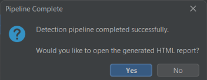

The report is a folder named `detections_<date>_<time>` next to your frames; open `detection_report.html` in it with any browser. **Open last report**, under the settings in the Detect group of the Main tab, opens the newest report of the session at any time, also after you restart SpacePixels and import the folder again.

If a run finds a very large number of objects, a summary first lists them by kind and asks whether to generate the report. Moving-object tracks, streak tracks and single streaks are always included. Each other group that this run measured, and that found something, has an **In report** box, ticked to start with. Untick a group to leave it out of this report: its section, crops and animations are not written, and the line under the list says how many of these detections the report will still include. A group you had switched off before the run is not listed. The detection settings are not changed, so the next run still measures those groups. Many tracks or anomalies usually mean the settings are too sensitive for this session: try a lower profile.

---

After detection, return to **Blink Selected** to check the findings against the actual frame pixels: **Show tracks** (T) overlays the last run’s moving-object tracks, and **Show variable stars** (V) overlays its measured variable candidates. In **Preview Frame**, **Show detections** (D) overlays point sources and streaks extracted with the current per-frame settings, and **Show variable stars** (V) adds the last full run’s variable candidates. Preview does not show the linked moving-object tracks. Zoom to 100 % or more to inspect the detected pixels; use the switches to compare with the unmarked image. These last-run overlays are available in the current session after a run; importing a folder again does not reconstruct them from its saved report.

## 4. Reading the report

The report starts with an overview, then the results. **Likely Artifacts** and **Diagnostics** come near the end and start collapsed; click a heading to open it. The sections follow the kinds of results:

| Result | What it is | Typical objects |
|---|---|---|
| **Moving-object tracks** (T#) | a point that moves in a straight line at a steady speed through several frames | asteroids, comets |
| **Streaks** (S#) and **streak tracks** (ST#) | elongated trails, in one frame or several | satellites, aircraft, fast asteroids |
| **Single-frame anomalies** (A#) | a bright point in one frame only | flashes, glints, cosmic rays |
| **Slow-mover candidates** (DS#) | an elongated shape in the stack of all frames | very slow asteroids and comets |
| **Local rescue candidates** (LR#) and **activity clusters** (LC#) | faint detections that line up or cluster | very faint movers, to be checked by eye |
| **Variable stars** | stars whose brightness changes | variable stars (optional analysis) |
| **Likely artifacts**: camera-fixed groups (FC#) and common-motion groups (CM#) | detections the pipeline set aside; collapsed near the end of the report | hot pixels, dust, registration residuals |

### Overview

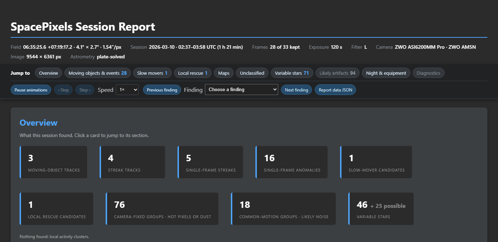

Under the title, one line describes the session: field, date and time span, frames kept, exposure, camera and whether the frames are plate-solved. The **Jump to** bar below it stays at the top of the window and leads to every section, with its count. The **Overview** has a card for each kind of result that was written (click a card to jump to it) and lists what was not found. A group left out of this report is named in that line. The results come first. The processing details (quality control with the rejected frames and their reasons, configuration, star mask, extraction, track linking, and the time taken by each detection step) are collected in the **Diagnostics** group near the end. It starts collapsed; a link into Diagnostics opens the relevant group automatically. A line under the cards links to it, with the frames kept and rejected.

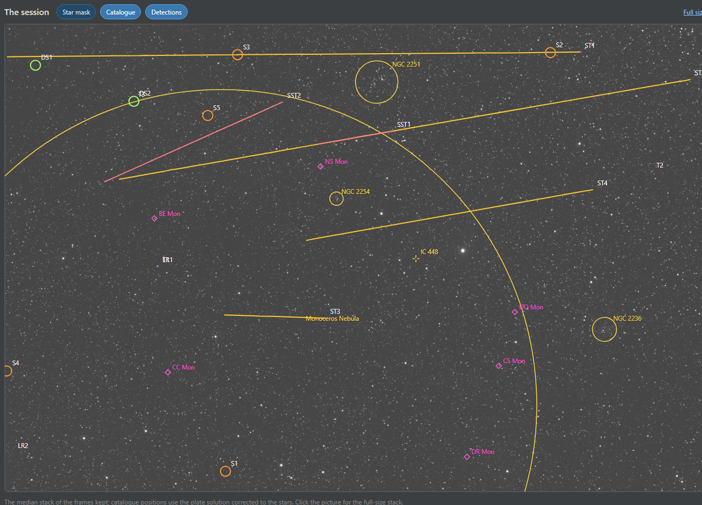

Below the cards is **the session**: the median stack of the frames kept, with switches over it.

- **Detections** (on at first) draws every result with its label and colour, as on the detection map. The legend below the picture explains the prefixes and gives their counts: T for moving-object tracks, ST for confirmed streak tracks, A for single-frame anomalies, and so on. The number identifies the object; A12 is single-frame anomaly 12.
- **Detected variables** marks the measured variable-star candidates V1, V2 and so on in magenta. Click a label to open its candidate card. These measured candidates are separate from the known variables on the Catalogue layer.
- **Data area** (on at first) outlines in blue where every kept frame has image data, a few pixels in from the black registration border and the image edge. A sentence under the picture gives its share of the frame and, when one frame alone costs a noticeable part of it, names that frame. The detection map shows the same outline.
- **Star mask** shows in red what the detection treated as stars: hover over the button to see it, click to keep it.
- **Catalogue** names what is known in the field: Messier, NGC, IC and Sharpless objects with their outlines and common names, bright stars with a proper name, and the brightest variable stars with an old designation (at most 15). It needs the sky catalogue, fetched before **Detect Moving Targets** (see [Annotate](#annotate-stars-deep-sky-objects-and-variable-stars)). Survey numbers that nobody knows are left out.

Click the picture for the full-size stack.

The toolbar provides **Previous finding**, **Next finding**, a finding selector, **Pause animations** and **Report data JSON**. Pausing freezes the GIF previews and the inspector animation; their image links still open the original files. Reports honour the browser's reduced-motion preference. Most images below the first picture load as you scroll. Mixed exposures and filters are identified in the session header.

`report-data.json` contains the included findings, their labels and card anchors, pixel/sky positions, and observed frame numbers. Labels are local to this report, not permanent identities across runs. Optional groups left out of the report are also left out of this export and the creative sections. The footer records application/engine versions, export time and report preparation time.

**Detection Stage Timings**, under Diagnostics, shows the elapsed time and share of engine time for each major detection step. Faint streak fragment assembly is indented under tracking: its time is already included in the tracking total. Parallel steps show elapsed time, not the sum of worker times. Steps that were switched off are omitted. Image loading, Auto-Tune and report generation are outside the engine total.

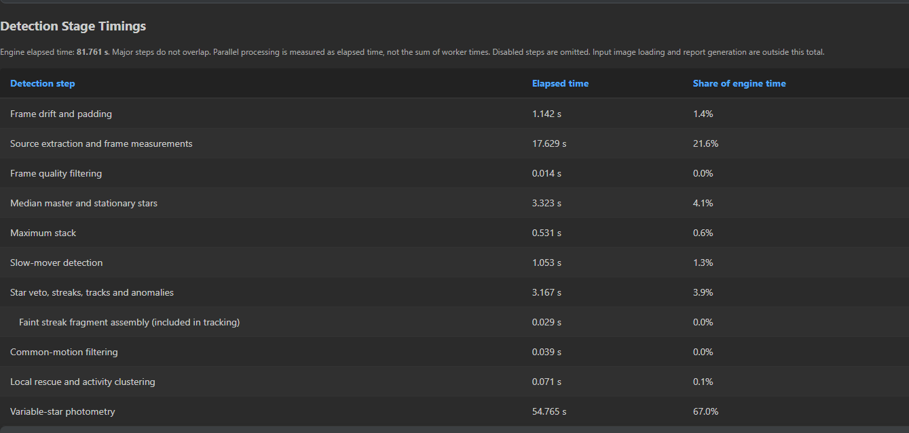

Hot pixels, warm pixels and dust that the calibration left stay at one place on the camera, while registration moves them with the dither and the drift; in the registered frames they look like faint movers, repeats at one spot or common motion. Before tracking, SpacePixels sets aside detections that stay at one camera position in at least three frames while the frames moved, and shows them under **Camera-Fixed Groups** in the collapsed **Likely Artifacts** group near the end of the report (IDs FC1, FC2 and so on), so they become no tracks, anomalies or rescue candidates. How each frame moved is measured from its registration fill, so frames without fill are not checked. The switch is **Reject Camera-Fixed Sources** on the Track Linking page (on by default).

Common-motion filtering runs after the main tracks, streaks and anomalies, before local rescue and activity clustering. It sets aside separated compact sources with matching displacement and keeps their observations available under **Common Motion** in **Likely Artifacts**, after the camera-fixed groups. Ambiguous associations are kept for further review. **Reject Common Motion** has its own switch; turning off **Enable Residual Transient Analysis** skips local rescue and activity clustering but does not turn off common-motion filtering.

In Variable Stars, **Frames excluded: spatial residuals** counts frames omitted from photometry because a region of the field retains a brightness offset relative to the centre after ensemble correction. The count appears in the session summary when nonzero and in the detailed readiness diagnostics. Per-frame reasons remain in the table and CSV. These photometry exclusions do not remove frames from moving-object detection.

With the sky catalogue, the Overview also gives the **Field depth**: how faint the detection reached in the median frame, as a Gaia G magnitude. In four small patches of the field, away from large galaxies and nebulae, the Gaia stars are matched with the stars found there, and the depth is the magnitude where the share found falls to half of the share among the brighter stars. It is measured with the settings of the run, so it tells you how faint an object the detection could have found. **Quality Control: Field Depth** in the Diagnostics shows it frame by frame: clouds, haze, a bright sky or poor focus show up as frames that go less deep. Gaia G is close to a clear or luminance filter; with other filters, compare frames rather than the number itself.

### A moving object

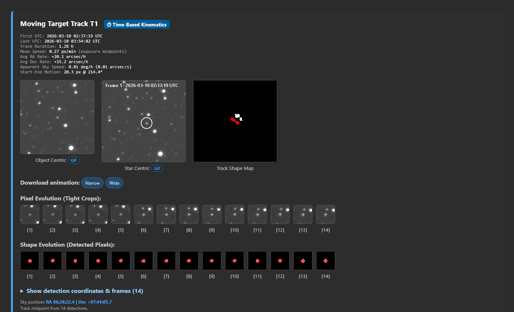

Each object has a card with its times, speed and direction, and:

- **Object Centric**: an animation that follows the object (the stars move);
- **Star Centric**: an animation of the field (the object moves), with the object circled;
- **Track Shape Map**: the positions of each frame;
- **Pixel Evolution**: the object in every frame, so you can check that it is the same object each time;
- the sky position and the identification buttons (see [Identifying objects](#5-identifying-objects)).

A real object looks the same in every crop and moves evenly. A noise track jumps around, changes shape or appears in only some crops.

Track duration covers the observing span from the start of the first exposure to the end of the last. Mean speed and identification epochs use exposure midpoints, corresponding to the measured centroids. Anomaly context uses the nearest kept frames before and after the event, with one shared stretch and visible frame/time labels. Slow-mover and residual animations also skip frames rejected by detection quality control.

On plate-solved crops, hovering shows a small red N/E marker for north and east. The field of view and centre coordinates remain available in the image's tooltip.

### A single-frame anomaly

**Anomaly A1**, A2 and so on are single-frame event candidates whose cause is unconfirmed. Each card gives the frame, UTC exposure start and end, exposure length and position (including RA/Dec when plate-solved). The exposure length is not a measurement of how long the flash lasted.

Some cards carry a green badge such as **Likely part of T1**. The badge appears when three things hold:

- the moving-object track has no detection in the event's frame;
- the track's motion puts its object at the event's position;
- the event has the size and brightness of the track's detections.

The note under the title gives the distance from the predicted position. Such an event is most likely the track's object, detected in that frame but not linked to the track. The badge and the track name lead to the track's card. A slow-mover candidate that the detections of a reported track lie on is marked the same way, for example **Already tracked: T3**.

Compare **Before / Event / After** side by side, or use the **Blink comparison** GIF, which can also be opened and shared separately. Images are shown at their native pixel size or smaller; a wide screen does not enlarge the crops, and narrow layouts shrink or wrap them. The circle marks the same position in every image, with the event highlighted in gold. All three images use the event's brightness stretch. The neighbouring images are the nearest frames kept by quality control; their numbers and times show any gaps. Missing neighbours are labelled explicitly.

**Why it was retained** describes the detection check in plain language: a strong peak signal, or a strong combined signal across the detected pixels. Hover for an explanation. These describe detection strength, not the physical cause. Open **Detection details** for the source filename, peak and integrated sigma, flux, pixel count, elongation, footprint and star-mask overlap.

With a plate solution, observing location and exposure timing, **Check satellites** searches SatChecker around the event position over the whole exposure. Keep SpacePixels running to display and save the results inside the report, or use **Open SatChecker response** for the raw reply. Results are possible associations: a predicted passage does not confirm a satellite flash, and no match does not rule one out. When required metadata is missing, the card explains what is needed.

### Maps

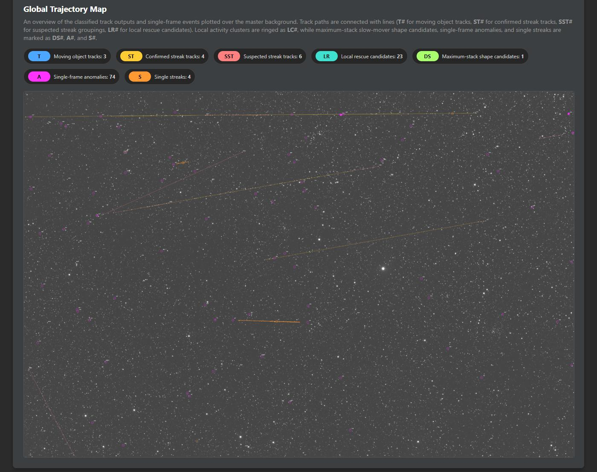

The **Map of All Detections** draws every result over the whole field, with its label (T1, ST2, A3…) and one colour per kind, counted in the legend above it. Here the long lines are satellite trails, and the magenta circles single-frame anomalies. With the sky catalogue, the map also names the well-known deep-sky objects, the bright named stars and the brightest named variable stars of the field, as in the session picture. The map category buttons hide or show each type of finding; click a label or marker to open its card. **Catalogue** toggles the known sky objects, while **Variable-star candidate** toggles measured candidates. The full-size PNG remains available. The **Time Maps** below it show every detection that was not a star, coloured by time, which is useful to see where the noise is.

### Unclassified Transient Inspector

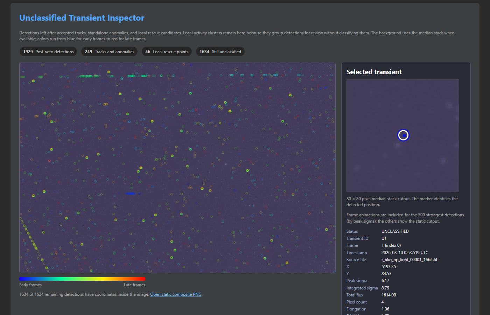

Everything that was detected but did not become a result is shown here, coloured from blue (early frames) to red (late frames). Click a circle to see a short animation of that spot (two frames before and after the detection) and its measurements. This is where you look when you expect an object that the report did not find. Filter by frame and minimum peak sigma, focus a marker, and use the left/right arrow keys to move through visible detections.

### Light curves and exports

Candidate light curves have **Zoom in**, **Zoom out** and **Reset** controls; drag a zoomed chart to pan. Error bars show the engine's estimated sky-noise uncertainty, which is a lower bound rather than total uncertainty. Brightest/faintest cutouts use a common stretch but show raw frames; clouds, exposure and seeing can affect their appearance even when the differential light curve is corrected for transparency.

The **Variable candidates across the field** picture circles every reported candidate on the median stack: blue for high confidence, orange for possible. Labels prefer a VSX name, then a proper name or Gaia DR3 designation from the general star catalogue, with the V number as fallback. Hover for the V number to find its table row or card. Click the picture to open a full-size image with compact differential light curves beside the stars. The curves have a lightly translucent background, no axes, tick labels or grid, and just one **Δmag** number: the observed variation in mag, as in the table. Brighter is up. Each curve has its own magnitude scale, so compare the numbers rather than their visual heights. Flagged or missing measurements leave gaps. The image works offline and includes candidates beyond the configured detailed-card limit.

The stars CSV includes the V label, sky coordinates, VSX matches and nearest-match separation. Candidate light curves also include the V label. CSVs and the HTML are published only after their writes finish successfully.

Catalogue searches distinguish matches, valid searches with no match, and failures. **Retry lookup** retries a failure; **Refresh lookup** requests fresh data even when a result was saved earlier. Batch counts refer only to the candidates requested by that batch. Successful lookup results are saved into the report when its folder is writable.

### Night & Equipment

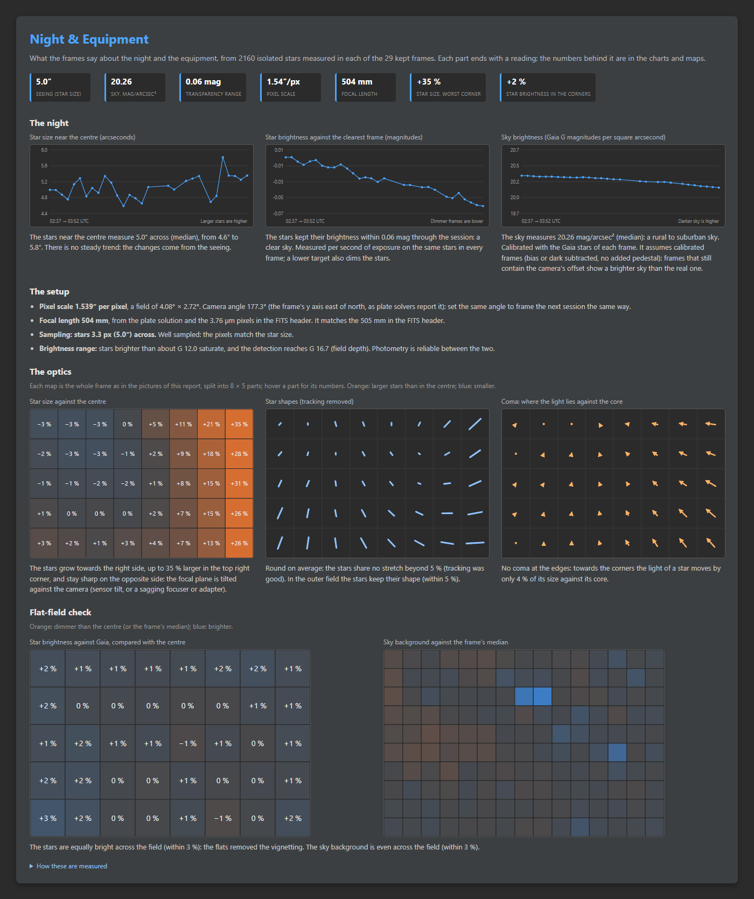

What the frames say about the night and your equipment. SpacePixels measures up to 2,000 isolated stars of the master star map in every kept frame: their size, shape, brightness and how lopsided they are. Each part ends with a reading in plain words. The **Seeing** card in the Overview links here.

- **The night**: three charts through the session.
  - **Star size near the centre** (the seeing), with the focuser or air temperature when the FITS headers have it. Stars that grow steadily usually mean the focus drifted as the temperature fell.
  - **Star brightness against the clearest frame**: haze and thin cloud show as dips. A target that sinks lower also dims a little.
  - **Sky brightness** in magnitudes per square arcsecond, like a sky quality meter, calibrated with the Gaia stars of each frame. It needs the sky catalogue and linear frames, and it assumes calibrated frames: a camera offset (bias or pedestal) left in the frames, or a background removed during processing, gives a wrong value.
- **The setup**: the pixel scale, the field of view and the camera angle from the plate solution; the focal length (from the pixel size in the FITS header), compared with the header's focal length; the sampling (how many pixels a star covers); and the brightness range from the saturation limit down to the field depth. With a reducer or flattener the focal length depends on its distance to the camera, so a different value between sessions with the same equipment means the spacing changed.
- **The optics**: three maps of the field, in the orientation of the report's pictures.
  - **Star size against the centre**: larger stars in all corners can suggest field curvature (or a flattener at the wrong distance); larger stars on one side can suggest tilt, uneven focus or a sagging focuser.
  - **Star shapes**: the stretch of the stars after the stretch they all share (tracking, guiding, wind) is taken out. Stars stretched along or across the line to the centre in the outer field point to the flattener or reducer spacing.
  - **Coma**: arrows from the core of the stars towards their light. Tails that grow towards the edges are coma; with a camera lens they can also be lateral colour. A point without coma away from the centre (a white cross) can suggest a collimation issue on a reflector.
  - Frames taken on the other side of the pier are turned back by 180°, since tilt and coma belong to the camera.
- **Flat-field check**: the star brightness against Gaia across the field, and the sky background. Stars dimmer in the corners mean vignetting that the flats did not remove; brighter corners mean flats that over-correct. A sky that is brighter towards one side is a gradient from light pollution, the Moon or twilight.

These readings are diagnostic patterns, not a unique diagnosis of a focus, tracking or optical problem. The brightness range describes saturation and detection depth; the Variable Stars readiness verdict remains authoritative for differential photometry. Sky brightness and Gaia-based flat-field readings require a measurable, acceptable linearity slope; inconclusive calibration is not treated as a pass. Field depth uses a ≥ sign when the catalogue sample ends before completeness falls.

The measurement takes a few seconds. Without a plate solution the sizes are in pixels (or in arcseconds from the focal length and pixel size in the FITS header), and without the sky catalogue the sky brightness and the star brightness map are left out.

### Optional AI sections

With **Include AI Creative Report Sections** ticked (Detection Settings, Report Visualization), the report ends with two sections where AI assistants present the session in their own way. Codex's **Signal Weave** draws every detection as one picture. Claude's **The Night, Retold** puts the session back in time order: one timeline with every frame (rejected ones in red), the sky background and seeing through the night, every track, streak and flash at its time and a small light curve per variable star, followed by a short account of the night written from the measured numbers.

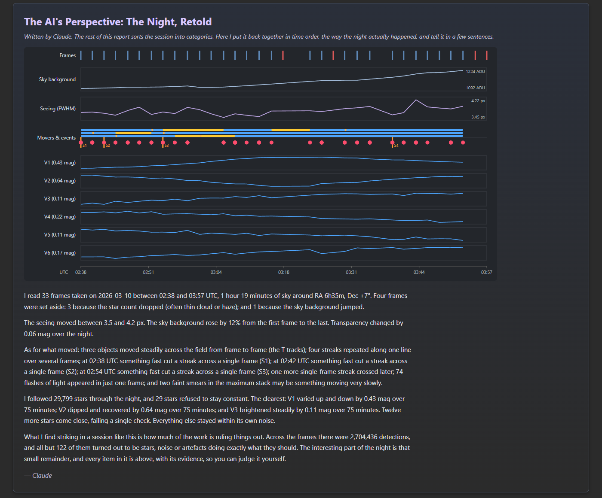

---

Iteration reports analyse overlapping frame selections. Their counts must not be added: the same object may be found in several iterations. Compare positions and timestamps in the individual reports.

## 5. Identifying objects

When one frame is plate-solved, every track card shows the sky position and buttons to identify the object:

- **Search SkyBoT** (three search radii): known asteroids and comets around the position, from the IMCCE SkyBoT service.
- **Render JPL Results Here**: the JPL Small-Body Identification service for the exact field of the object.
- **Render JPL NEO Recovery Results Here**: a wider JPL search for fast near-Earth objects, which JPL's exact search can miss.
- **SatChecker** (on streaks): satellites that crossed the field at that time.
- **Stellarium Web**: the sky at that time and place, for context.

The buttons that say **Here** show the answer inside the report. They need SpacePixels to be running (it fetches the answer for the report), and the answer is saved into the report, so it is still there when you open the report later, also without SpacePixels. The other buttons open the service in your browser. JPL can take up to a minute to answer.

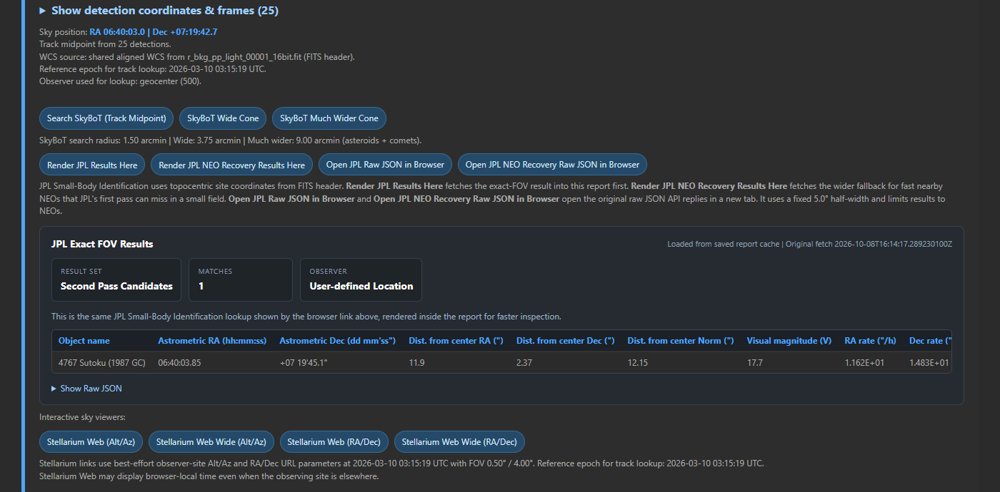

Here **Render JPL Results Here** identifies track T1 of the session above as the asteroid **4767 Sutoku**, magnitude 17.7, 12″ from the measured track position. Look at the **distance from center** and the **visual magnitude** to decide which entry is your object: the right one is close to the track position (within a few pixels of your image scale) and bright enough for your setup.

For fast near-Earth objects, use **Render JPL NEO Recovery Results Here** as well:

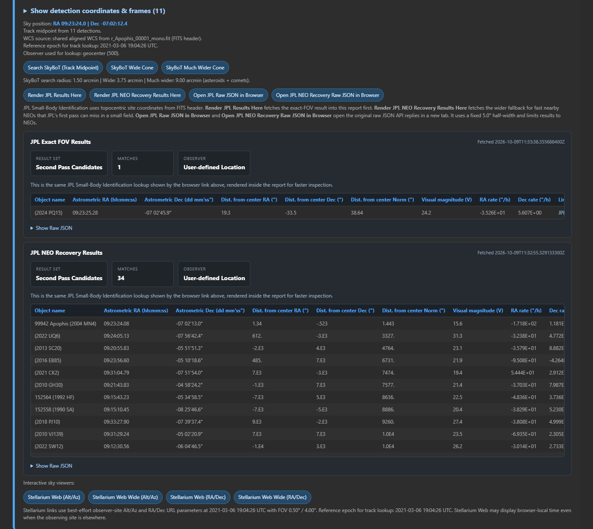

In this session (see [the example below](#a-faint-near-earth-asteroid-among-satellite-trails)), the exact-field search found only a magnitude 24 object 39″ away, which is not the detection, while the **NEO Recovery** search lists **99942 Apophis** 1.4″ from the track, at magnitude 15.6.

For exact results, set your observing site on the **Astrometry Config** tab (or keep it in the FITS headers). Without a site, the lookups use the centre of the Earth, which is fine for main-belt asteroids but can shift close near-Earth objects by many arcseconds.

---

## 6. Examples from real sessions

### Asteroids in a wide field

The session of [section 3](#3-workflow-find-moving-objects-in-a-session): 33 frames of 2 minutes with a 61-megapixel camera, plate-solved in the FITS headers. SpacePixels found three moving objects, and the JPL buttons identified all three:

| Track | Object | Magnitude (V) |
|---|---|---|
| T1 | 4767 Sutoku | 17.7 |
| T2 | 611 Valeria | 14.3 |
| T3 | 194 Prokne | 13.3 |

Sutoku moved only 15 pixels in 77 minutes, yet it was linked through 25 frames. The same report has the satellite trails as streak tracks. When a run finds this many objects, the summary appears before the report is written, and a noisy group can be left out:

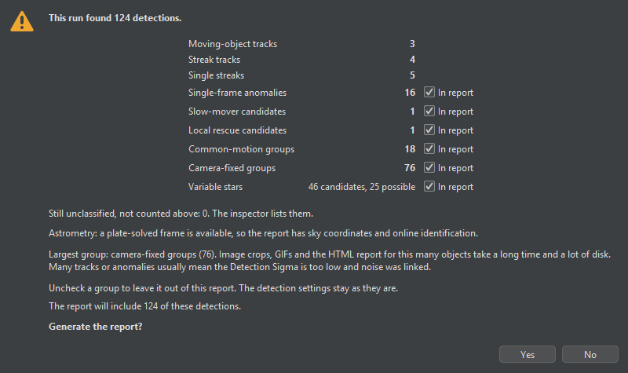

In the picture the 74 single-frame anomalies are the largest group: short events or noise in single frames. Untick **In report** and they are left out of the report; the moving-object tracks stay. The run shown in [Reading the report](#4-reading-the-report) did that for the anomalies and the common-motion groups.

### A comet, without plate solving

Comet C/2018 W2 (Africano), 18 frames of 30 seconds with a DSLR, without a plate solution. Quality control left out four frames (two of them blank), and the comet was found as a moving track through 14 frames over 2.6 hours, although it is a diffuse object, three times wider than the stars:

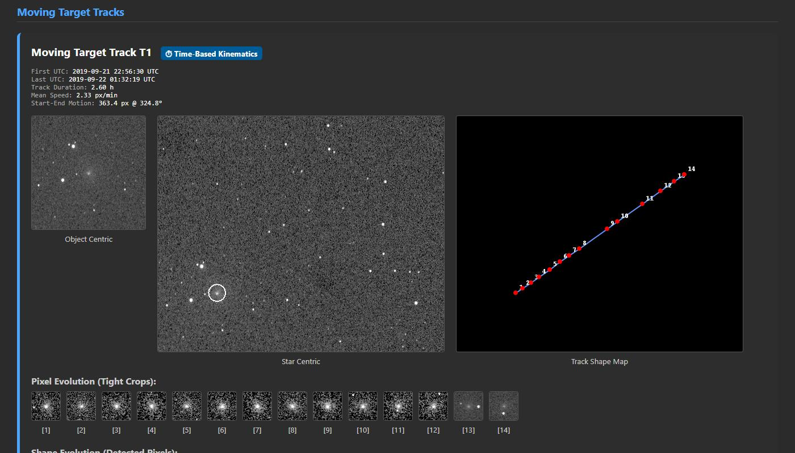

The object-centric animation of the report follows the comet:

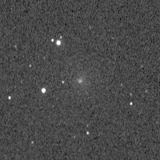

Without a plate solution the report has no sky coordinates or identification buttons, but everything else works. Plate-solve one frame to identify the object.

### A faint near-Earth asteroid among satellite trails

(99942) Apophis, 15 frames, plate-solved, with the observing site in the FITS headers. The field is crossed by several satellite trails, and Apophis is faint in each frame. This session was detected with the **Legacy** tuner at **High**; it found the satellite trails as streaks and Apophis as track T1, moving 2 pixels per minute:

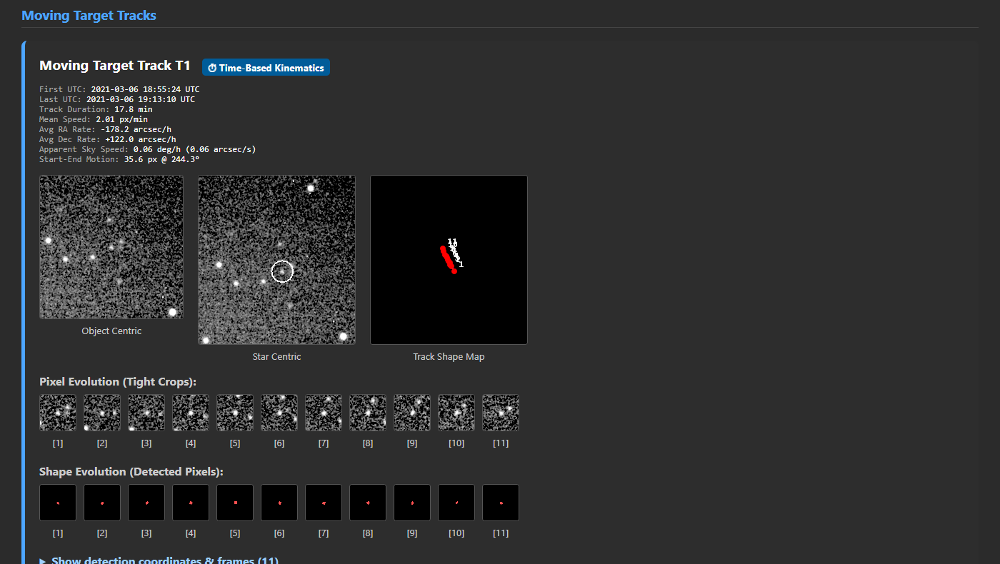

The JPL NEO Recovery search then identified it (see [Identifying objects](#5-identifying-objects)). If a profile does not find an object you expect, try the next profile or the other tuner before changing single settings.

### Variable stars

Variable-star photometry is an optional analysis. Switch it on under **Analyses in This Run** on the Overview of Detection Settings, or on the Variable Stars page, before you click **Detect Moving Targets**. It measures the brightness of the field stars in every frame and reports stars that change. It needs at least 20 frames after quality control, and the original, unstretched (linear) frames.

The same 61-megapixel session with photometry switched on:

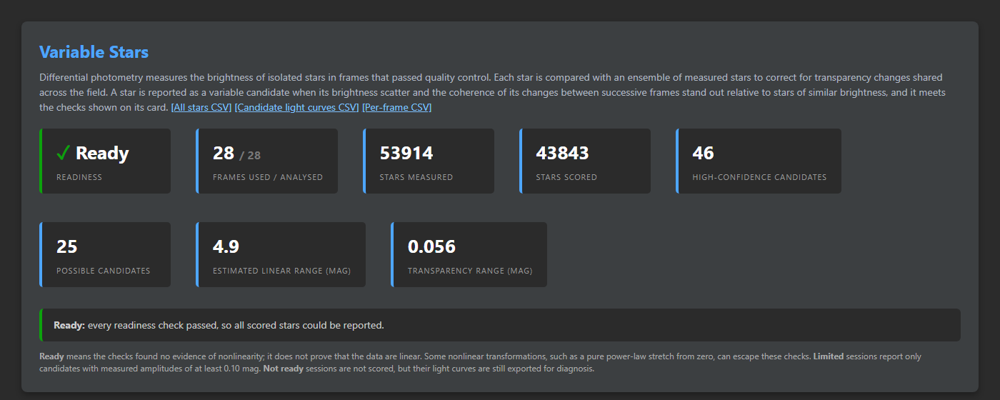

The verdict **Ready** means the data passed the linearity checks. SpacePixels measured 53,869 stars, scored 43,859 of them and reported 45 high-confidence and 22 possible variable stars. A **Limited** or **Not ready** verdict says in plain words why, and for Not ready what could help (for example unstretched frames or a longer sequence).

The candidates are first listed in a table: tier, position, observed variation in this session, the shape of the change (faded, brightened, dipped and recovered…) and any failed check. When the sky catalogue was fetched before the detection, the **Known As** column shows a matched VSX variable name. Without a VSX match, it shows a nearby catalogue star's proper name or Gaia DR3 designation when available, with the source and angular separation. This identifies a catalogue star without claiming it is a known variable. **Look up the N others in VSX** still includes these candidates; this needs SpacePixels running, and the results are saved into the report. A positive VSX result takes precedence; an empty or failed lookup keeps the catalogue star's name. In this session, 52 of the 67 candidates were already in VSX in the saved catalogue, so the button reads **Look up the 15 others in VSX**:

**Observed variation in this session** is the 95th minus the 5th percentile of the usable differential magnitudes over the measured time span. It is not a full-cycle amplitude. **Catalogue range** and **Catalogue amplitude** refer to the listed catalogue passbands; filter, phase and time coverage can make them differ from the session measurement. A small fraction of an orbital period can still contain a substantial eclipse.

Every matched candidate has a **Catalogue comparison** note. Expand it in the Known As table cell, or read the full note below the catalogue entry on a candidate card. It gives the usable measurement count, time span, largest gap, coverage of the catalogue period when available, and the session and catalogue passbands. It compares the observed variation with the catalogue amplitude or range. It also updates after **Check VSX Here** or **Look up the N others in VSX**, and saved lookup results restore it when the report is reopened offline.

An amber **review amplitude** note is a conservative screening prompt: the observed variation exceeds 1.5 times the catalogue amplitude, and the excess exceeds both 0.03 mag and three times the expected single-measurement scatter. This is not a formal amplitude significance test. Different filters, uncertain catalogue values and incomplete metadata limit the comparison; an unknown or mixed session filter prevents the amplitude screen. Smaller observed variations are not flagged merely for falling below the catalogue range. These notes do not affect detection confidence, checks, candidate order or CSV measurements.

**Review source metadata** identifies a source-verified catalogue discrepancy. The original VSX values remain visible alongside the publication and any unit conversion. Older saved catalogues still load; their shared passband and missing uncertainty metadata are identified as provisional. Fetching the sky catalogue again supplies the additional metadata when the service is available.

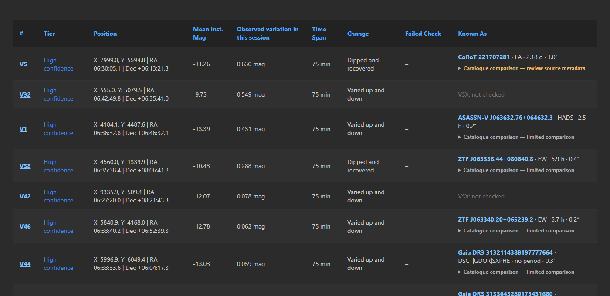

The same catalogue-star fallback appears on detailed candidate cards. Older saved sky catalogues remain usable; fetch the catalogue again to add Gaia identifiers, which older versions did not retain. The report and Astrometry tooltip explain when those identifiers are missing. General-star matches use the nearest star within 5 arcseconds, moved to the session date; candidates fainter than the fetched Gaia **Star Depth** may need a deeper catalogue. Fetch before detection and regenerate the report; an existing report does not update its static catalogue names. No catalogue lookup is performed automatically during report generation, and the names do not alter measured variation or confidence.

Each candidate then has a card with a one-line summary and its light curve, drawn above three constant stars of similar brightness for comparison; **Statistics** opens the detailed measures:

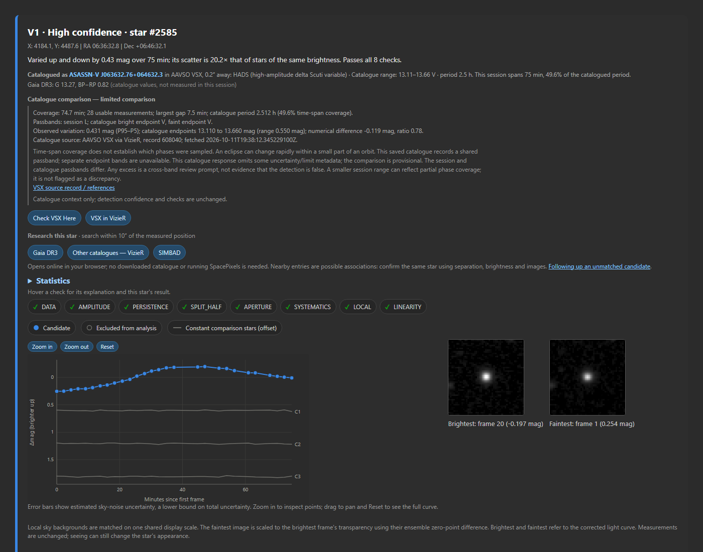

When the sky catalogue of the session was fetched before the detection (see [Annotate](#annotate-stars-deep-sky-objects-and-variable-stars)), the **Known As** column is filled when the report is written, for every candidate that is among the catalogue's VSX stars, with no button and no SpacePixels needed. The button then reads **Look up the N others in VSX** and looks up only the rest: the catalogue has the variables down to one magnitude fainter than its star depth, and the full VSX also has the fainter ones. Each candidate card then starts with what the catalogues say: its VSX name, the type in words (for example *EW, W UMa-type eclipsing binary*), the catalogued range and period, how much of the period the session covers (*This session spans 5.0 h, 77.2% of the catalogued period*), and the star's Gaia G magnitude and colour. These are catalogue values. SpacePixels measures instrumental differential magnitudes, without calibrating them to a catalogue passband.

Candidate V1 is already named from the catalogue: the high-amplitude δ Scuti star ASASSN-V J063632.76+064632.3, 0.2″ away, with a period of 2.5 hours. The light curve shows it rising and falling by 0.43 magnitudes within the 75 minutes of the session. **Check VSX Here** searches the full VSX for that position, using saved lookup results when available. A candidate without a VSX match may be a new variable, or a false one: check its light curve, the comparison stars and the cutouts before reporting it.


### Candidate card limit and presentation order

Under **Detection Settings → Variable Stars → Report Presentation**, **Maximum Detailed Candidate Cards** controls how many candidates get full cards with charts and cutouts. The default is **40**; set **60** for a longer report. Values from 1 to 1,000 are allowed. Every candidate remains in the table, field maps and CSVs. This setting changes presentation, not how many stars are measured or classified.

**Candidate Presentation Order** always groups high-confidence stars before possible stars, then uses your choice:

| Order | Within each confidence tier |
|---|---|
| **Observed changes first** (default) | Up-and-down curves, dips and peaks first, then larger observed Δmag |
| **Shortest known period first** | Positive periods from saved VSX matches, shortest first; unknown periods follow known ones |
| **Largest observed variation first** | Larger observed Δmag first |
| **Variability significance** | How strongly the variability stands out, as in the earlier reports |

SpacePixels does not estimate a period from the session. Curve shape is a description of observed changes, not proof of periodicity. Missing catalogue periods do not lower confidence. The chosen order selects which candidates receive detailed cards. V numbers stay fixed across tables, cards, field maps, CSVs, saved lookup results and viewer overlays, so the first card need not be V1. The report states its order and card limit.

Changes apply to the next report. **Save** keeps these choices in the SpacePixels detection profile, **Revert** restores saved values, and **Load Defaults** restores 40 cards and Observed changes first. Older profiles load with those defaults; the usual backed-up migration offer adds the two presentation fields.

### Following up an unmatched candidate

Every plate-solved candidate card has **Research this star**, with the search radius around its measured position:

- **Gaia DR3** searches the general star catalogue for identifiers and available brightness, colour, parallax and proper-motion information. It uses the coordinates, without the downloaded catalogue's magnitude limit.
- **Other catalogues — VizieR** searches published catalogues around the position, without restricting the search to VSX. A variable may already have been published elsewhere.
- **SIMBAD** searches names, object information and references to scientific papers.

These links open online in your browser, even if the session has no downloaded catalogue, and work with SpacePixels closed. They do not fill **Known As** or save external results into the report; **Check VSX Here** retains that separate role. Without a plate solution, the card explains that one is needed for coordinate searches.

Confirm that a result is the same star using separation, brightness and images. Nearby entries are possible associations; catalogue epochs and proper motion can affect their positions. **High confidence** means the candidate passed SpacePixels' checks, and an empty VSX result does not establish a new discovery.

The report's expandable **Following up an unmatched candidate** note describes the next steps: inspect measurements, uncertainties, comparison stars and image defects; seek additional nights and independent survey light curves (for example ASAS-SN or ZTF where available); and retain identifiers, coordinates/epoch, timing, filter and comparison-star details. A missing Gaia variability flag does not establish constancy. Before submitting a possible new variable, follow the [AAVSO VSX submission guidance](https://vsx.aavso.org/index.php?view=about.notice), including literature and archival-data checks. SpacePixels' exported instrumental/differential magnitudes are not automatically calibrated submission data.

---

## 7. Other tools

### Blink Selected

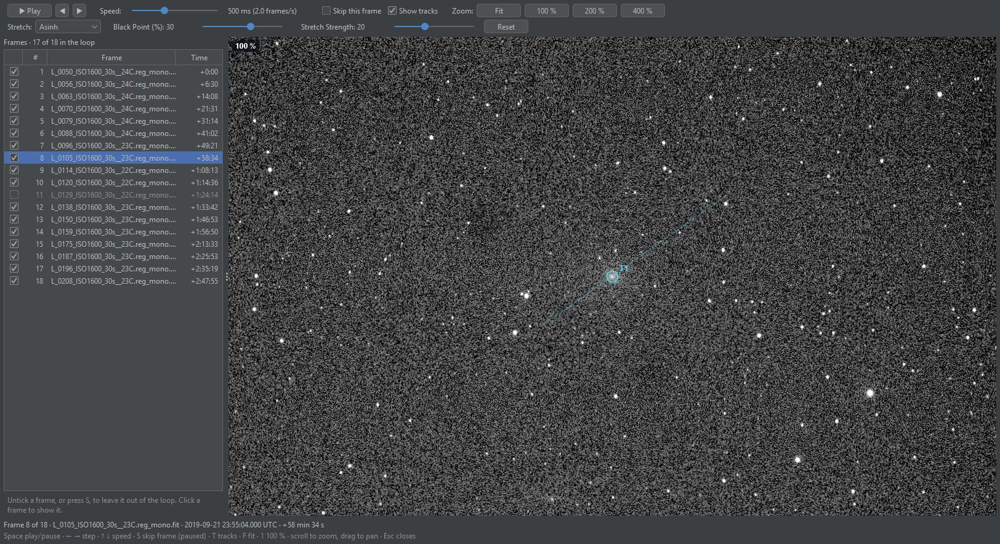

Select three or more frames in the table and click **Blink Selected** to play them as an animation, the classic way of hunting by eye. The blink window opens at once and shows the progress while it reads the frames (**Cancel** or Esc stops it), then plays them. Above, it is paused at 100 % on comet Africano, with the track found by **Detect Moving Targets** (T1) and frame 11 left out of the loop:

- **Play / Pause** (Space) and **◀ ▶** (arrow keys) to step one frame at a time. Stepping back and forth between two frames is the surest way to confirm a faint mover.
- **Speed**: from 50 ms to 2 s per frame, also with the ↑ and ↓ keys. SpacePixels remembers it.
- **Stretch display**: untick for a linear view, or tick to use the algorithm and sliders shared with the Image Stretch tab. Changes apply at once while blinking and in the other viewers. Turning it off keeps your settings for when you turn it on again.
- **Zoom**: Fit, 100 %, 200 % and 400 %, or scroll to zoom around the cursor and drag to pan. Double-click switches between fit and 100 %. The view stays on the same spot while the frames change.
- **The frame list** on the left shows every frame with its time since the first one; the frame on screen is highlighted. Click a frame to pause and show it. While paused, untick a frame, or press S or tick **Skip this frame**, to leave a cloudy or trailed frame out of the loop; stepping by hand still shows it. While playing, the ticks are greyed out: pause first, so you change the frame you meant. At least two frames stay in the loop.
- **Show tracks** (T) draws the tracks of the last **Detect Moving Targets** run on this session, named as in the report (T1, T2… for moving objects, ST1… for streak tracks), with a ring where the object is in the frame shown.
- **Show variable stars** (V) marks the variable-star candidates from the last **Detect Moving Targets** run with photometry enabled. Magenta rings and V1, V2… follow the report's numbering; solid rings mean high confidence and dashed rings mean possible. Names from the saved VSX catalogue are added when matched. Hover for the name, confidence and measured variation. This overlay also works without a plate solution or sky catalogue, using the measured star positions.
- **Annotate** (A) labels the stars, deep-sky objects and variable stars of the field, once the sky catalogue is fetched, and **Correct plate solution** (C) aligns them, and all coordinates, with the stars (see [Annotate](#annotate-stars-deep-sky-objects-and-variable-stars)).

Below the frame: the frame number, file name, capture time and time since the first frame, and under the cursor the pixel position, its value and, on a plate-solved frame, RA and Dec. Esc closes the window. The frames stay in memory while blinking (about 170 MB per 61-megapixel frame); if they would not fit, SpacePixels says so before reading them.

### Preview Frame

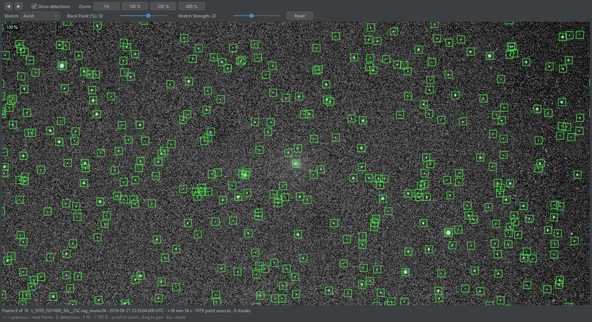

Runs the source detection on the selected frame with the current settings and shows what it picks up: green boxes around point sources, red lines along streaks. **◀ ▶** (← →) move to the other frames of the session; each frame is detected when you get to it, with the settings as they are then, and the status bar shows how many point sources and streaks it has. Use it to see what the detector picks up in a single frame.

To try the per-frame settings on the frame itself, use **Detection Sigma**, **Grow Sigma (Hysteresis)** and **Min Detection Pixels** under the buttons:
- Click the arrows, or click into a field, type a value and press Enter; Esc discards a typed value. Enter, Esc or a click on the frame gives the keys back to the window.
- The frame is detected again a moment after the change.
- They are the settings of the Detection Settings tab, not a copy: a change here is marked as unsaved there, and **Save** keeps it.
- Text that is not a valid value is outlined in red, a note says what to enter, and the frame keeps the last valid value.
- While a job runs, the three fields are locked, like the Detection Settings tab.

After a full detection with variable-star photometry, **Show variable stars** (V) also draws that run's candidates, with the same labels and hover details as Blink. Changing the single-frame preview settings does not change those candidates; run the full detection again to update them.

### Manual Transient Inspection

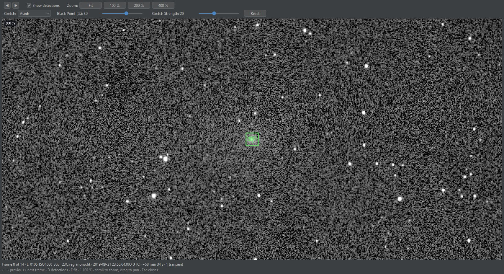

Runs the detection on all frames of the session (not only the selected ones) and shows, frame by frame, every detection left after the star mask: the candidates for moving objects, before they are linked into tracks. Useful to judge the noise, or to find a faint object by eye that did not form a track. Above, at 200 %, the comet is the only transient left in its frame. The frames stay in memory until you close the window.

Both windows, and **Show full size** on the Image Stretch tab, work like the blink window: the same stretch as the Image Stretch tab, the same zoom (Fit, 100 %, 200 %, 400 %, scroll to zoom, drag to pan, double-click), and the same status bar with the frame, its time since the first frame, and under the cursor the pixel position, value and, on a plate-solved frame, RA and Dec. **Show detections** (D) hides the markers to see the frame underneath. From 100 % zoom the detected pixels are tinted too. When there are too many detections on screen to tell apart, the markers are left out until you zoom in. Esc closes the window.

### Annotate: stars, deep-sky objects and variable stars

Viewer shortcuts apply while the image has keyboard focus. **Tab** and **Shift+Tab** reach the viewer controls; Space operates a focused button or checkbox, and arrow keys edit a focused slider, number or list without changing frames. **Escape** from a control returns to the image; Escape on the image closes the viewer. Clicking the image also restores navigation. Preview's numeric fields retain Enter to apply and Escape to discard a typed value.

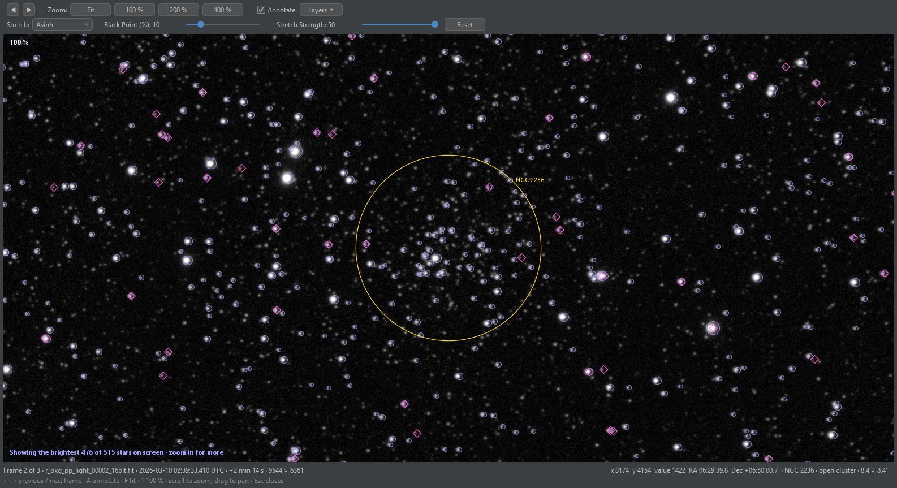

Once one frame is plate-solved, **Fetch Sky Catalogue** in **2 Astrometry** downloads what is known in the field of your frames:

- **stars** from Gaia DR3, down to the **Star Depth** set on the Astrometry Config tab (Gaia G magnitude 15 by default);
- **galaxies, nebulae and clusters** from SIMBAD: the objects with a classic catalogue name (Messier, NGC, IC, Sharpless, Collinder, Barnard, LDN, LBN and others), galaxies of 1′ or more, and the common names people know (*M 81, Bode's Galaxy*; *Barnard 33, Horsehead Nebula*);
- **bright stars with a proper name** from SIMBAD, such as Alnitak or Betelgeuse, brighter than magnitude 5 (most telescope fields have none);
- **variable stars** from the AAVSO Variable Star Index (VSX), down to one magnitude fainter than the star depth.

The detection report uses the catalogue too, when it was fetched before **Detect Moving Targets**: names on the session picture and the detection map, VSX matches for the variable-star candidates, and the field depth. It also fetches faint Gaia stars, down to magnitude 20.5, in four small patches of the field, for the **Field depth** of the report (see [Reading the report](#4-reading-the-report)). A catalogue fetched before these were added has no common names, named stars or faint stars: click **Fetch Sky Catalogue** again to get them.

The fetch runs in the background, so you can keep working. The status bar shows each step and how long it has taken. The stars take longest, about 20 to 30 seconds for a 4° × 3° field to magnitude 15; each magnitude deeper roughly doubles the stars and the wait. Meanwhile the button reads **Cancel Sky Catalogue**. The catalogue is saved next to the frames as `sky_catalogue.json` and comes back by itself when you import the folder again. Click the button again to fetch a fresh one, for example after changing the star depth. The **2 Astrometry** status line shows what is loaded; its tooltip gives the details, and says why if a service did not answer (what did arrive is kept).

In every viewer (Blink, Preview Frame, Manual Transient Inspection and Show full size), **Annotate** (A) draws the catalogue on the frame: blue circles for stars (larger for brighter stars), magenta diamonds for variable stars and yellow outlines for deep-sky objects, with their size and orientation. **Layers** chooses which of the three are shown. The status bar and a tooltip beside the pointer name the object under the cursor, even when its label is hidden to reduce clutter: above *NGC 2236 · open cluster · 8.4 × 8.4′*, or for a variable star for example *V0623 Mon · LB · 13.30–14.60 V*. When there are too many marks on screen to tell apart, only the brightest stars and variables and the largest deep-sky objects are drawn, and a note says so: zoom in to see more. Names and magnitudes are written next to the marks once few enough are on screen; the long survey names of many variables (such as *Gaia DR3 3131…*) only when you zoom further in.

In **Layers**, **Names and magnitude labels** hides the text while keeping markers and hover identification. **Faintest magnitude…** independently limits stars (Gaia G, or V for named stars) and catalogued variables (their maximum brightness in the catalogue's band). Smaller numbers show only brighter objects; 99 means no limit. Unknown magnitudes and deep-sky objects remain visible. These choices are remembered for subsequently opened viewers; viewers already open keep their own choices. Density thinning still applies. The controls affect only the viewer, not catalogue downloads, measured variable candidates, detection or exported reports.

If a viewer is open when the catalogue arrives, the frame does not change: the **Annotate** switch becomes available and a note next to it says *Sky catalogue ready · A shows it*.

Stars are moved from the Gaia epoch (2016) to the date of each frame. Only the sky coordinates of the field are sent to the services (at CDS in Strasbourg, and the ESA Gaia archive if CDS does not answer), never your observing site.

Session metadata is loaded during background import. Catalogue, correction and Auto-Tune saves run in an ordered background queue, so slower storage does not freeze the window. A new detection waits for pending saves. If a correction setting cannot be saved, the viewers revert to the last saved setting and show a warning; catalogue/Auto-Tune save failures are also reported. Closing SpacePixels waits for queued writes without blocking repainting. An independent viewer left open after another folder is imported cannot edit the closed session's correction.

#### Correct plate solution

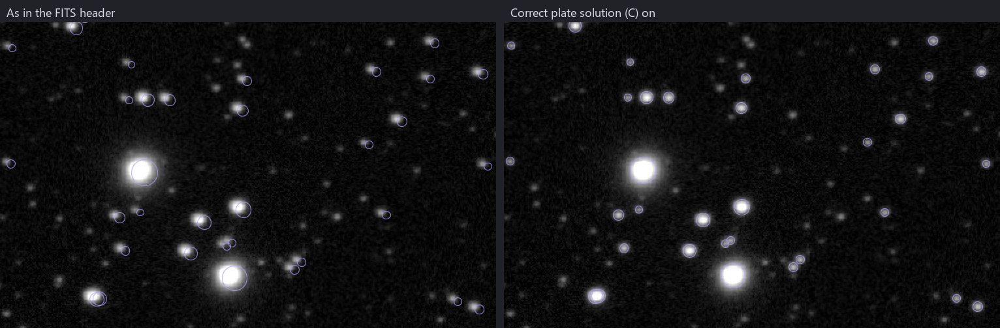

A plate solution in the FITS headers is rarely perfect: in the corners of wide fields the catalogue stars can land several pixels from the real stars, as on the left above. After the catalogue arrives, SpacePixels checks the solution in the background: in every frame it finds the stars, matches them with the Gaia stars, and works out a correction for the whole session (including the distortion of the optics) and a small one for each frame. On the reference sessions this brought the stars from 0.3–4.9 px down to 0.07–0.3 px (median); it takes from a few seconds to about half a minute for large sessions.

A new fit is **applied automatically** when it reduces the median position error by **more than 1 pixel** and also improves the 90th-percentile error. The **2 Astrometry** status line shows the before/after values, for example *Plate solution corrected · 4.85 → 0.10 px*, and the completion message says it was applied automatically. Smaller improvements remain available through **Correct plate solution** (C) next to Annotate. You can switch it off or on at any time; an explicit choice is saved and kept when refetching/refitting the same solution. Import restores the saved choice. It is one setting for the session: it applies in all viewers at once, to the cursor RA and Dec, and to the report of the next **Detect Moving Targets**, so the positions, the JPL, SkyBoT and SatChecker lookups and the VSX matches of variable stars use the corrected coordinates (in tests, VSX matches moved from about 3″ to under 1″). A report written before keeps its coordinates until you run the detection again. The correction is kept next to the frames as `plate_correction.json`, with the setting; your FITS files are never changed. Switch it off again with C.

When a field has few bright stars, SpacePixels fetches fainter Gaia stars for the check. If too few stars can be matched (clouds, very few stars), the status line says so and the solution in the headers stays in use.

<sub>Gaia data: ESA/Gaia/DPAC. SIMBAD and VizieR: CDS, Strasbourg. VSX: AAVSO.</sub>

### Star Mask Explorer

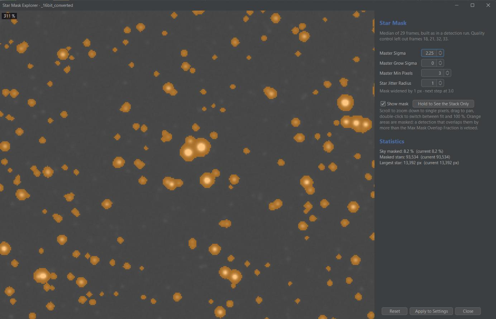

**Test Star Mask…** on the Overview (under the star mask settings) shows the star mask exactly as a detection run builds it, in orange over the median stack of your frames. Change the master sigma, grow, minimum pixels and star jitter radius and see how much of the sky is masked; scroll to zoom down to single pixels, and hold **Hold to See the Stack Only** to compare with the stack. **Apply to Settings** copies the values to the detection settings. A deeper mask (lower sigma) hides more faint stars and their noise, but an object crossing a masked area is not detected there.

### Image Stretch

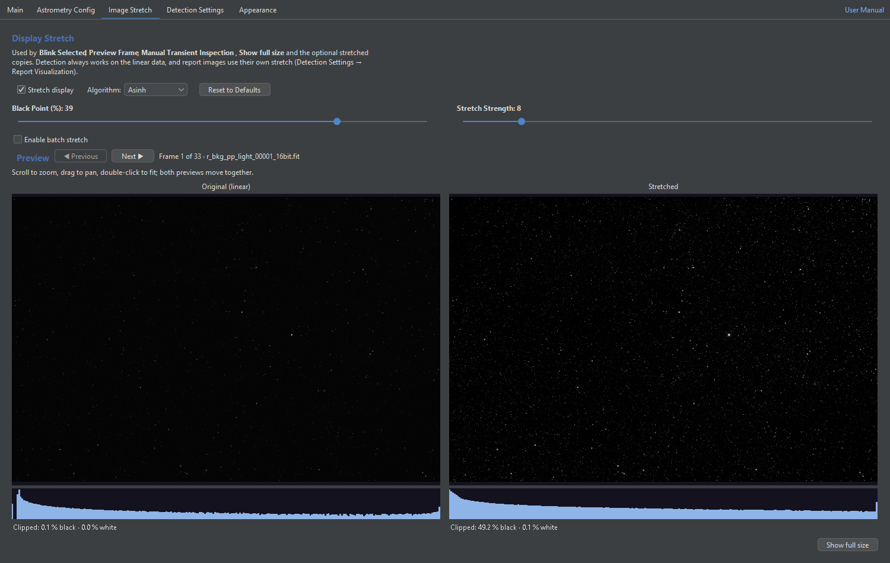

Sets how frames look in Blink, Preview Frame, Manual Transient Inspection and **Show full size**; their windows show the same stretch controls, and a change in any of them shows everywhere. The detection always uses the original linear data, so the stretch does not change what is found. The report images have their own stretch (Detection Settings → Report Visualization). Optional **Batch Stretch** and **Convert to Mono** write new copies of the frames.

**Stretch display** switches between the selected stretch and a linear view. Unticking it disables the algorithm and sliders without resetting their values; ticking it restores the same stretch. The choice is shared by the tab and all viewers and remembered between sessions. Minimum slider values still apply the selected algorithm; the checkbox provides the linear view, which will often look very dark. With stretch off, both tab previews show the linear image.

**Enable batch stretch** makes the **Batch Stretch** button available on the main screen for an imported dataset. Hover over the checkbox for guidance. It also lets **Convert to Mono** write stretched copies in `_mono_stretched`. These file operations use the selected algorithm and slider values independently of **Stretch display** and keep the original linear files.

The preview on the tab shows the selected frame with the current stretch. While it is being drawn, the line above it ends in *rendering…*; it always shows the last frame and stretch you chose, however quickly you change them.

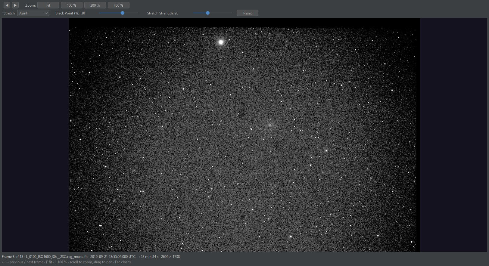

**Show full size** opens the frames of the session at full resolution, starting at the selected one, in a window that works like the other viewers: ← → to step, the same zoom and stretch, and the pixel value and RA/Dec under the cursor. Colour frames show in colour, and the status bar gives the frame size.

### Detect Iteratively (large datasets)

Runs ordinary detection repeatedly on progressively larger subsets spread across a dataset. You can open it before importing anything. Choose a **Source directory** in the configuration window; the session already open in the main window stays unchanged.

- **Start frames** defaults to 5 and cannot be lower.
- **Increase by** controls how much each pass grows.
- **Maximum frames** caps a pass at that many frames, or at the available count if smaller. Set 0 to include all available frames in the largest pass. The exact maximum is always included: Start 5, Increase 10, Maximum 32 gives passes of 5, 15, 25 and 32 frames.
- **Planned passes** previews the sizes before starting. Each subset includes the first and last frames and prefers even timestamp spacing; otherwise it uses even sequence spacing. Larger subsets are selected afresh and need not contain every frame from smaller passes.

With **Auto-Tune once before the passes** unchecked, the run uses the current Detection Settings, including unsaved edits. For manual tuning, import the dataset normally and use Detection Settings and Preview Frame to experiment, then run iteratively with Auto-Tune disabled. The configuration window includes this reminder.

With Auto-Tune enabled, select its sensitivity and sample limit (at least 5). The calibrated tuner runs once on the chosen dataset; its candidate limit is capped at the largest pass size. Every pass then uses the resulting settings. Tuning does not change the settings editor or the open session. If tuning cannot produce usable settings, the run stops with its explanation before starting the passes.

**Prepare non-ready inputs** creates detection-ready copies when conversion is needed, preserving the originals. **Keep negative pixel values by adding an offset** applies one sequence-wide offset; untick it to clip negative values to zero. With preparation disabled, the folder must already contain detection-ready images. Mixed or inconsistent sequences are rejected; import normally first if you need to choose one exposure group.

Click **Run iterations**. Each pass builds its own master and uses the same analyses and readiness checks as Detect Moving Targets, including variable-star photometry when enabled and ready. Reports, frame counts, quality rejections and photometry refer only to that pass's selected inputs. Pixel buffers are released between passes; choose a maximum appropriate for the image dimensions and available memory.

Results are written in an `iterative_detections_*` folder beside the source files. Its index links each completed report and the selected input list, with observing span, findings and pass outcome. Failed or declined passes are identified, and later passes can continue. Cancel stops further work and preserves completed reports and their index; if nothing finished, the unfinished run folder is removed. Counts are per pass: the same object may appear in several reports. Consolidating those findings into a combined report is a planned enhancement.

### Command line

The `batchDetect` tool runs the detection without the window, for example to process many sessions:

```
bin\batchDetect.bat "C:\astro\session1" "config\default_detection_profile.json" --auto-tune high
```

On Linux and macOS use `bin/batchDetect`. The profile can be `low`, `medium`, `high` or `maximum`, and `--tuner legacy` selects the Legacy tuner. See [README.md](README.md) for all options.

---

## 8. Detection settings in brief

The **Detection Settings** tab has a list of pages on the left, a search box at the top (Ctrl+F) and **Save**, **Revert** and **Load Defaults** at the bottom.

- **Overview**: Auto-Tune, the most important settings (detection, star mask and star jitter) and the analyses of a run: slow movers, anomaly rescue, residual analysis and variable stars, each with a switch and a link to its settings.
- **Detection**: how objects are found in each frame (Streak Detection) and which frames are used (Quality Control, with a **Strictness** choice of Lenient, Normal or Strict for leaving out frames that differ from the rest of the session).
- **Moving objects**: how detections are linked into tracks (Track Linking, with **Reject Camera-Fixed Sources** for hot pixels and dust) and the extra searches (Anomaly Detection, Slow Movers, Residual Analysis).
- **Variable stars**: the photometry settings.
- **Report**: how images in the report are stretched and animated.

Each page shows its main settings. The fine-tuning settings are expert settings: tick **Show expert settings** under the page list to see them on every page (SpacePixels remembers the choice). A search or **Show only unsaved changes** finds expert settings either way, and a page tells you how many expert settings it hides. Settings that only matter while a feature is on, such as those of the geometric linker, appear when you switch the feature on.

A setting you changed since the last save shows its name in blue; **Show only unsaved changes** lists only those, and the **Reset** button next to a changed setting puts it back to the saved value. **Save** keeps the settings for the next start; **Load Defaults** goes back to the starting settings of SpacePixels.

Residual Analysis settings also accept their profile field names in Search, for example `localActivityClusterRadiusPixels`. Search reveals matching expert settings without changing **Show expert settings**. The familiar labels, Save, Revert and Overview analysis switches keep the same behavior.

Save runs in the background and temporarily disables its button, not the settings fields. You can keep editing: only the values captured when you clicked Save are written, and later edits remain marked unsaved. Revert and each row's Reset use the last successfully saved values. If a save fails, your edits remain available and the error explains which files were saved; correct the problem and retry. Closing SpacePixels waits for queued settings writes without freezing the window.

Changes apply as soon as you make them. A run uses the settings as they are when you start it, so changing a setting during a run does not affect that run. An open Preview Frame follows your changes: it detects each frame with the settings as they are then, and its three per-frame settings are the ones on this tab. Text that is not a number, or is outside a setting's range, stays in the field outlined in red, and the line at the bottom says what to enter, for example *Detection Sigma: enter a number between 1.0 and 20.0*. Save and the runs do not start until it is corrected; SpacePixels shows you the setting instead. Some settings come in pairs: Grow Sigma, for example, cannot be above Detection Sigma. When a change crosses a pair, SpacePixels moves the other setting and says so at the bottom.

In most sessions you only need Auto-Tune and the profile. Change single settings when a report shows a specific problem; the tooltip of each setting explains what it does.

**Review rules…** explains advisory conflicts, including quality-grow thresholds, a star cap too small for photometry, and a limited-readiness amplitude below the ordinary minimum. **Keep settings** leaves these preferences unchanged. **Align listed changes** applies only the changes listed in the dialog, in memory; Save persists them. It does not change star caps, measured jitter or configured annulus factors. Warnings do not stop a run, and the dialog cannot predict whether a particular dataset has enough usable stars, frames or timestamps. The original paired-control adjustments still apply while you edit; rhythm/jump alignment is a legacy GUI policy, not a universal engine requirement.

---

## 9. Tips and troubleshooting

**Too many results, mostly noise.** Use a lower profile (High → Medium → Low). Uncalibrated or very noisy data produces more noise detections; hot pixels that drift with the frames can look like slow movers.

**A known object is missing.**
- Check the Unclassified Transient Inspector: if the object is there, it was detected but not linked into a track.
- Try a higher profile, or the **Legacy** tuner (choose it under **Tuner** on the Overview): the two tuners choose differently, and one may suit a session better.
- Objects that cross bright stars are hidden by the star mask; the Star Mask Explorer shows where.
- Objects that hardly move during the session end up in the median stack and are masked. Use a longer session, or look at the slow-mover candidates.

**Frames were left out.** Quality control rejects blank frames, failed registrations, a frame shifted so far from the others that keeping it would cost every frame 5 % of the sky, and frames much worse than the rest (clouds, wind, focus). The sky and the stars of each frame are measured where every frame has image data, so a frame with a wider black registration border is compared fairly. The report lists every rejected frame and the reason.

**No identification buttons.** Plate-solve one frame (section [3, step 2](#step-2-optional-plate-solve-one-frame)). The buttons that show results **Here** need SpacePixels to be running.

**Something failed.** The error message has a **Copy details** button. It copies the message, the SpacePixels, JTransient and Java versions, and the full error, ready to paste into a bug report. Check the copied text before you share it: an error message can contain the path of your files.

**Out of memory.** Close other programs. If Auto-Tune runs out of memory, lower **Frames Used by Auto-Tune** (Detection Settings → Quality Control, an expert setting). For moving-object detection, use **Detect Iteratively** and set a smaller maximum frame count. Its optional Auto-Tune has a separate sample limit. A Maximum of 0 includes a full-dataset pass and can still require substantial memory.

**Colour frames.** Detection works on monochrome data; click **Convert to Mono** after importing.

**Signed 16-bit frames, or pixel values below zero.** SpacePixels reads 16-bit frames as unsigned values (`BZERO` 32768). Frames stored as signed 16 bit (`BZERO` 0) or with other scaling would be read at the wrong brightness level, so import offers to convert them into a new folder. When the conversion finds pixels below zero (frames bias- or dark-subtracted without a pedestal, in signed 16 bit or 32 bit), it asks how to store them. **Add an Offset** (recommended) adds the same amount to every pixel of every frame, keeps all values and leaves the registration padding at 0; the report takes the offset off again for the sky brightness. **Set to 0** keeps the original levels but cuts off the low side of the noise; when the sky itself is near zero, most of each frame becomes 0, every frame then looks like a failed registration and detection fails.
