# SpacePixels User Manual

<sub><i>Many thanks to Klangwolke at Cloudynights and Duncan Warren for providing some of the test data used in this manual.</i></sub>

SpacePixels searches your astrophotography exposures for moving objects and brightness changes. Give it a sequence of aligned sub-exposures to obtain an HTML report with candidate tracks, crops, animations, maps and optional variable-star light curves. Catalogue searches help investigate candidates; a detection or catalogue association is not, by itself, a confirmed discovery.

This manual walks through the everyday workflows with screenshots from real sessions. For the detailed meaning of every setting, hover the setting in the program: each one has a description. Watch the [latest video tutorial](https://youtu.be/LhA1izPFql0) or the [earlier tutorial](https://youtu.be/7XBdYh0Wn7A). The detection engine is documented in the [JTransient repository](https://github.com/ppissias/JTransient).

<a href="https://youtu.be/LhA1izPFql0" target="_blank" rel="noopener noreferrer">
  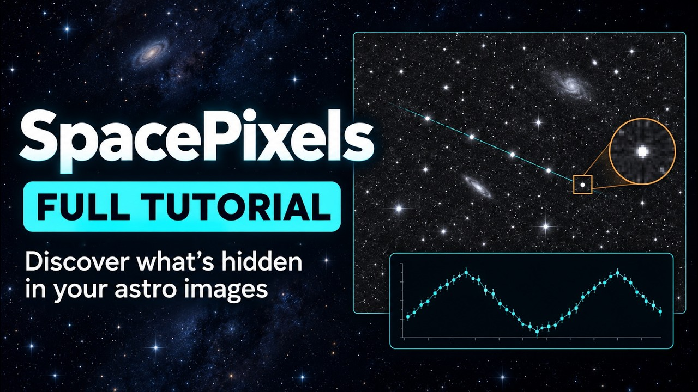
</a>

## Contents

1. [Before you start](#1-before-you-start): [install](#installing), [choose your data](#your-data)
2. [The main window](#2-the-main-window)
3. [Workflow: find moving objects in a session](#3-workflow-find-moving-objects-in-a-session)
4. [Reading the report](#4-reading-the-report)
5. [Identifying objects](#5-identifying-objects)
6. [Examples from real sessions](#6-examples-from-real-sessions)
7. [Other tools](#7-other-tools): [prepare exposures](#preparing-an-observing-session), [faint movers](#faint-movers-experimental), [variable stars](#variable-stars), [Blink](#blink-selected), [iterative detection](#detect-iteratively-large-datasets), [command line](#command-line)
8. [Detection settings in brief](#8-detection-settings-in-brief)
9. [Tips and troubleshooting](#9-tips-and-troubleshooting)

[Annex: What to avoid when preparing data](#annex-what-to-avoid-when-preparing-data) · [Annex: Preparing data with Siril](#annex-preparing-data-with-siril) · [Annex: Local Stellarium integration](#annex-local-stellarium-integration) · [Annex: Scientific references and algorithms](#annex-scientific-references-and-algorithms)

---

## 1. Before you start

### Installing

**Windows x64 installer:** download `SpacePixels-<installer-version>.exe` from [SpacePixels Releases](https://github.com/ppissias/SpacePixels/releases) and run it. It includes its own Java 21 runtime; Java and WiX do not need to be installed on your computer. Setup installs for your Windows account, lets you choose the folder, and offers Start menu and desktop shortcuts. Repair and uninstall use that same folder. A later release suggests that folder on its folder page; you can still choose another. Start **SpacePixels** from a shortcut or the installed `SpacePixels.exe`.

The installer is unsigned, so Windows may show a SmartScreen notice. For an installer downloaded from the project's release page, **More info → Run anyway** proceeds. A new release is installed by running its installer; close SpacePixels first. Uninstall it through Windows **Installed apps**. Upgrades and uninstall leave settings in your home folder and your image datasets in place.

**ZIP/TAR distribution (Windows, Linux and macOS):** install Java 21 or newer, download and unpack the archive, then start `StartSpacePixels.bat` (Windows) or `./StartSpacePixels` (Linux, macOS). These archives use your installed Java. Download the application archive under **Assets**, not GitHub’s **Source code** archive, and extract the whole folder before launching. In PowerShell, run `.\StartSpacePixels.bat` from that folder.

The Windows installer also includes `spacepixels-batch.exe` for command-line analysis and `injectStars.exe` for adding artificial moving stars to test images. The example detection profile is `app/config/default_detection_profile.json` under the installation folder; the archive's profile is `config/default_detection_profile.json`.

The launchers allow Java’s heap to grow to 80 % of the memory available to the JVM; the process and operating system also need memory. Memory needs depend on image size, frame count and enabled analyses. As a guide, a tested 33-frame, 61-megapixel session needed about 11 GB of Java heap on a 16 GB computer; start with a smaller sequence if memory is limited. When a newer release exists, a blue **New version** button appears at the top right of the window, next to **User Manual**; click it to open the releases page.

### Your data

Use the individual calibrated, registered exposures that you would otherwise combine into a stacked image. SpacePixels compares those exposures to find changes. Prepare:

- **aligned (registered) sub-exposures**, so the stars stay in the same place in every frame;
- **calibrated** frames (darks and flats), although uncalibrated data also works, with more noise detections;
- frames from **one session and one camera setup**, all with the same size and exposure time;
- **timestamps** in the FITS headers (`DATE-OBS`), so speeds and object identification work;
- **linear, unstretched** image values; do not apply denoising, star removal or a nonlinear stretch before detection;
- **zero-filled registration borders** retained around shifted frames; do not crop all frames to their common overlap.

See [Annex: What to avoid when preparing data](#annex-what-to-avoid-when-preparing-data) for operations to leave out during calibration and registration.

Detection needs at least three usable frames after quality control. Auto-Tune requires at least four input frames; variable-star photometry requires at least 20 after quality control and additional readiness checks.


Supported input includes 16-bit integer and 32-bit integer/floating FITS (`.fit`, `.fits`, `.fts`), tile-compressed FITS (`.fz`) and supported monochrome/RGB XISF. XISF supports unsigned 8/16/32/64-bit and floating 32/64-bit samples; unsupported containers or codecs are rejected. SpacePixels offers to convert what the detection needs (decompression, standard unsigned 16 bit, monochrome) when you import. Keep one sequence per folder: all files in a folder must have the same filename extension (case-insensitive), bit depth, sample scaling, size, layout, compression state and exposure time, and either all frames have timestamps or none. When the exposure times differ, for example 20 frames of 60 s and 2 of 120 s, import names the odd frames and offers to import only the largest set: it copies those frames into a subfolder such as `_exposure_60s` and imports that, and your folder stays as it is. Exposures within 2 % of each other, with a minimum tolerance of 0.1 s, count as the same, because many cameras record the measured exposure (60.0, 60.1 and 60.2 s).

Compressed 32-bit and signed/scaled 16-bit FITS offer **Combined FITS Preparation**: decompression and conversion write the final unsigned 16-bit files directly, preserving the compressed originals. Mono output goes in `_16bit_converted`; colour input produces `_16bit_mono` and `_16bit_color`. There is no intermediate uncompressed 32-bit folder. The existing negative-value choice applies once to the whole sequence, and the completion prompt can load the final mono folder. Compressed images already in standard unsigned 16-bit format only need decompression into `_uncompressed`.

SpacePixels samples the first, middle and last frames for unusually sharp hot pixels and a consistent shift of the stars. At import and before **Detect Moving Targets** or **Detect Iteratively**, suspicious data opens a warning with **Cancel (Recommended)** and **Proceed Anyway**. Cancel keeps the existing session; a detection declined at pre-flight creates no report. These sample checks do not certify every frame: missing stars alone do not prove bad alignment, and you should still use calibrated, registered inputs.

A typical source is the folder of registered frames that your stacking program writes before it stacks them (for example the `r_*.fit` files of Siril or the registered frames of PixInsight).

If the exposures still need preparation, **Prepare Frames…** can run a separately installed Siril on private copies and then import the resulting sequence. See [Preparing an observing session](#preparing-an-observing-session).

With Deep Sky Stacker, open Stacking Settings and choose **Standard Mode** on the **Result** tab. The registered frames then keep a dark border where a frame was shifted which is useful for the analysis done by SpacePixels. On the **Intermediate Files** tab, tick **Create a registered/calibrated file for each light frame**, choose **FITS Files**, and leave **Compress FITS files** unticked. Import the folder of those frames. Screenshots of both settings are on the [Deep Sky Stacker export settings](https://github.com/ppissias/SpacePixels/wiki/Deep-Sky-Stacker-export-settings) page of the project wiki.

### Optional: plate solving

To get sky coordinates and identify objects, SpacePixels needs **one plate-solved frame** of the session. Many capture and stacking programs already write the solution (WCS) into the FITS headers; the file table then says `Yes` under **Solved**. Otherwise SpacePixels can solve a frame with [ASTAP](https://www.hnsky.org/astap.htm) (local, free; install it with a star database such as D50) or with Astrometry.net (online, no installation).

---

## 2. The main window

At larger display scales or text sizes, controls wrap onto more rows. If the main workflow area or the Star Mask Explorer sidebar needs more height, scroll within that area; the main frame table stays visible. Tab brings the focused control into view. The wide Auto-Tune results table scrolls horizontally within the Overview page.

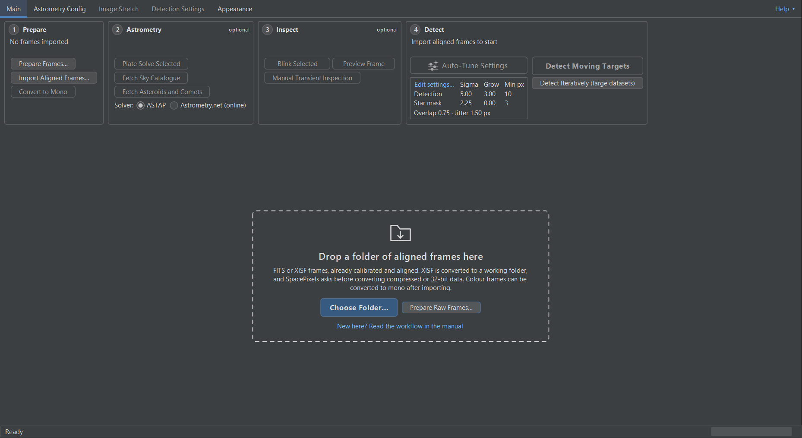

The window has five tabs:

| Tab | What it is for |
|---|---|
| **Main** | importing frames and running the tools, in four groups from left to right: **1 Prepare**, **2 Astrometry**, **3 Inspect**, **4 Detect** |
| **Astrometry Config** | the plate solver and your observing site |
| **Image Stretch** | how frames are displayed in the viewers |
| **Detection Settings** | Auto-Tune and every detection setting |
| **Appearance** | desktop colours, interface size and an optional custom style file |

**Astrometry Config** is available before import, so you can choose ASTAP and enter your observing site first. Unsaved valid defaults stay in use when another folder is imported; importing does not save or discard them. **Image Stretch** and **Detection Settings** open once frames are imported. After importing a colour dataset, SpacePixels offers to convert it to linear monochrome copies. **Yes** starts conversion; afterwards, the usual prompt lets you import the new mono folder. **No** leaves the colour dataset open, with a persistent information notice: you can blink, stretch, convert to mono and use astrometry. **Preview Frame**, **Manual Transient Inspection**, **Auto-Tune** and detection (including variable-star photometry) require monochrome frames. **Convert to Mono** remains available under **1 Prepare** if you want to convert later. **1 Prepare**, **2 Astrometry** and **3 Inspect** each have a status line underneath that tells you what is ready and what is missing; when a button is greyed out, its tooltip says why.

**Detect** is split in two. On the left, **Auto-Tune Settings** has a short note under it: which settings are in use, and, after this folder has a saved auto-tune, when that auto-tune was run. On the right are **Detect Moving Targets**, **Detect Iteratively**, and a small box with the detection settings now in use: detection and star-mask sigma, grow and minimum pixels, the mask overlap, and the star jitter. **Edit settings…** at the bottom of that box opens Detection Settings.

The **User Manual** link at the right end of the tab bar opens this manual in your browser.

### Frame quality control

Before detection, **3 Inspect → Run quality control** checks **every imported monochrome frame**, regardless of the table selection, with the same quality settings and rejection rules as the detection engine. It measures registration coverage, stars, FWHM, elongation and sky/noise without running stacks, tracking or photometry. You can cancel it from the progress window.

The frame table brings **Quality**, **FWHM (px)**, **Stars**, **Elongation** and **QC reason** beside the filename. **Would keep** rows have a light green tint; **Would reject** rows have a light red tint. Every imported frame remains listed and selected frames stay selected; this check does not remove files or alter the input for a later detection run. That run evaluates quality again using its captured settings.

Select one frame and click **Quality details…** for the full reason, measurements and session limits, including bright-star elongation, reference-star counts, sky median/noise and common image area. Missing evidence is shown as unavailable. The registration edge-fit RMS describes padding geometry, not residual alignment of stars. With too few frames, statistical session limits may be unavailable; registration/coverage exclusions still apply. If fewer than three frames would remain, detection would stop after QC.

Results belong to the open session. Changing detection settings marks them **Stale** and removes the verdict tint until you rerun QC (or restore the captured settings). Importing another session clears them. A cancelled or failed check preserves the last completed result.

### Appearance and readable text

Open **Appearance**, which is available before importing frames. Choose **Dark**, **High contrast dark** (white text and clear borders on a near-black background), or **Light**. **Interface size (%)** ranges from 100 to 300 and enlarges text and controls together. It applies in addition to operating-system display scaling and any launcher scaling option.

**Theme** and **Interface Size** have separate bordered sections. **Custom style (advanced)** sits beside them, or below them when the window is narrow.

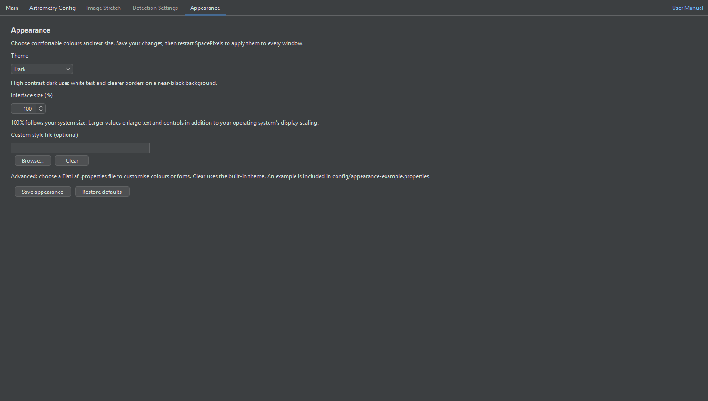

Click **Save appearance**, then choose **Restart now** or **Later**. Restart now waits for any running task and pending saves before reopening SpacePixels automatically. Later keeps the current appearance until you next start the application. The selected size and colours are applied before any windows open. **Restore defaults** selects Dark at 100% and clears the custom style file; click Save and restart to keep that choice. The preferences are saved independently as `spacepixels_appearance.json` in your home folder. Image zoom, image stretch and the HTML report retain their separate presentation controls.

Hover over **Browse…**, **Clear**, **Save appearance** or **Restore defaults** for a description of the action.

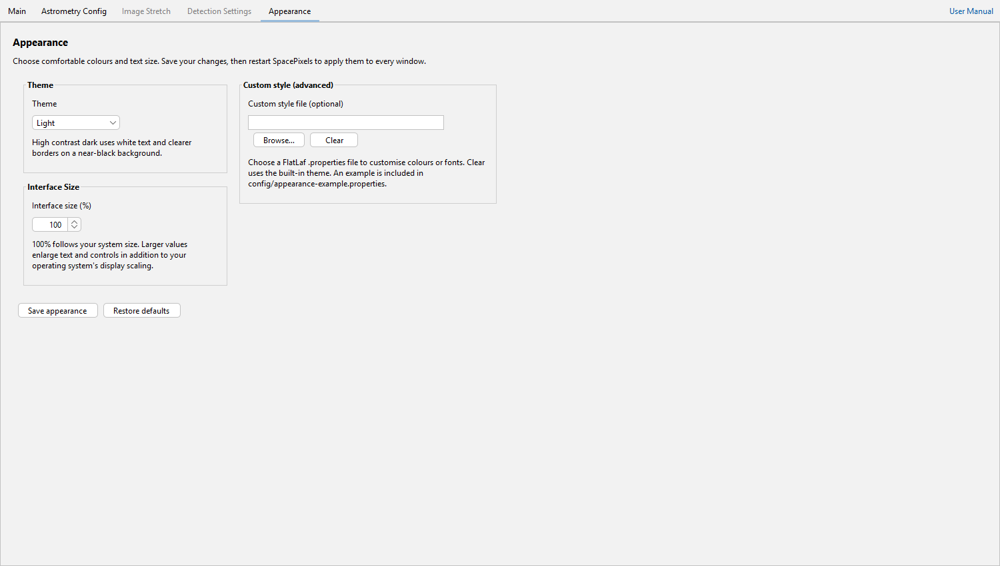

Appearance inputs keep compact widths that fit their values and options. Viewer and configuration windows have minimum sizes based on their controls and the current font size. On a display too small for all controls at once, scroll or Tab through the control area to reach the rest.

For an editable stylesheet, copy `config/appearance-example.properties` from the archive (or `app/config/appearance-example.properties` from the Windows installation) to a writable location, edit it, and select it with **Browse…**. After you choose a file, SpacePixels offers **Save and restart** to apply it, or **Keep editing** to leave the selection in the form without saving. Restart follows a successful save and waits for running work. The example is intended for Dark or High contrast dark. The UTF-8 file uses FlatLaf properties such as `@background`, `@foreground`, `SpacePixels.helpForeground`, `SpacePixels.linkForeground` and `defaultFont`; unspecified values come from the selected theme. Save and restart after editing the file. **Clear** removes the override when you next save. If the file cannot be read, startup uses the selected built-in theme and explains the problem on Appearance; a failed save keeps the previous preferences.

---

## 3. Workflow: find moving objects in a session

This is the main use of SpacePixels: **import → Auto-Tune → Detect → read the report**. The screenshots come from a session of 33 two-minute frames of a 61-megapixel camera. They illustrate several runs of that session, so finding numbers and counts can differ with the settings and software version.

### Step 1: import the frames

Click **Import Aligned Frames…** (the highlighted button in **1 Prepare**) and choose the folder, or simply drag the folder onto the window.

For exposures that still need calibration or alignment, use **Prepare Frames…** immediately above that button.

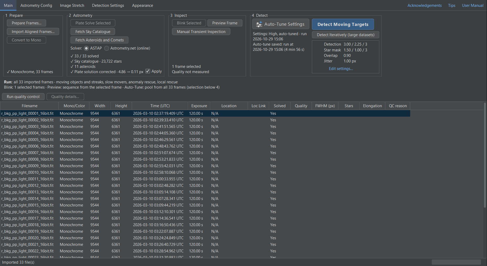

The table lists every frame with its size, time, exposure and whether it is plate-solved. The status lines confirm what SpacePixels found: here *Monochrome, 33 frames* and *33 / 33 solved*. If this folder already has a saved auto-tune, the note under **Auto-Tune Settings** names the profile and when it was run, and the box on the right shows those detection settings. If the frames are in colour, accept the post-import conversion offer or click **Convert to Mono** later; if they are compressed, XISF, 32 bit or signed 16 bit, SpacePixels offers the format conversion during import. SpacePixels also inspects the frames for uncalibrated hot-pixel density and star alignment; if frames lack calibration or registration, a warning dialog prompts you to cancel (recommended) or proceed anyway.

The **Run** line below the workflow groups lists the configured analyses and makes their frame scope explicit. Normal detection uses the whole imported sequence; Blink uses the selection; Preview opens the sequence from the selected frame (or the first). Auto-Tune uses a selection of at least four frames, otherwise the whole imported sequence; its candidate-frame limit still applies. Variable-star photometry must also pass its runtime readiness checks. Report-category choices affect exported presentation, while these analysis switches control computation. **Open output folder**, beside **Open last report**, opens the completed report's directory; it never starts detection.

### Step 2 (optional): plate-solve one frame

If **Solved** says `No`, select one frame and click **Plate Solve Selected** in **2 Astrometry**. One frame is enough, because the frames are aligned. Set up the solver on the **Astrometry Config** tab:

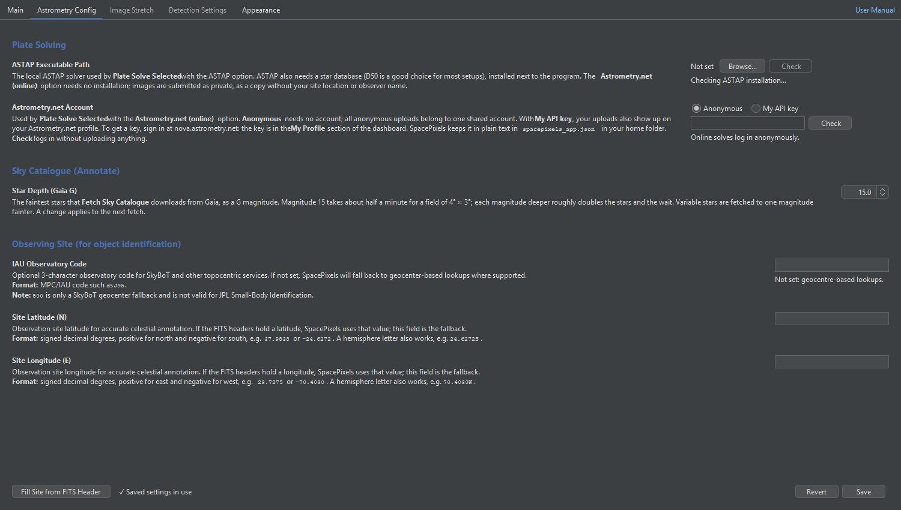

- **ASTAP Executable Path**: choose `astap.exe` (or the ASTAP program on Linux and macOS) and click **Check**. Or pick **Astrometry.net (online)** under the Plate Solve button, which needs nothing installed.
- **Astrometry.net Account**: **Anonymous** (the default) needs no account. To solve with your own account, choose **My API key** and paste your key: sign in at [nova.astrometry.net](https://nova.astrometry.net) and find it in the **My Profile** section of the dashboard. Your uploads then also show up on your Astrometry.net profile. **Check** logs in without uploading anything. The choice and the key are saved at once, the key in plain text in `spacepixels_app.json` in your home folder. Either way, images are submitted as private. Anonymous uploads all belong to one Astrometry.net account shared by every anonymous user, so SpacePixels uploads a copy of the frame without your site location (`SITELAT`, `SITELONG`, elevation and similar header cards) or the observer and site names; the frame on disk is not changed and the solve is the same.
- **Observing Site**: your latitude and longitude, or your IAU observatory code, make the object identification exact for your location. When the FITS headers contain the site, SpacePixels uses them; **Fill Site from FITS Header** copies them into the fields.
- **Sky Catalogue (Annotate)**: how faint the stars are that **Fetch Sky Catalogue** downloads (**Star Depth**, see [Annotate](#annotate-stars-deep-sky-objects-and-variable-stars)), and how faint the asteroids and comets are that **Fetch Asteroids and Comets** asks for (**Asteroid and Comet Depth**, see [Known asteroids and comets](#known-asteroids-and-comets)).

ASTAP checks run in the background and show **Checking ASTAP installation...** while inspecting the program and nearby star databases. Selecting a different executable supersedes an older check without freezing the window. Application-default saves also run in the background; a failed save leaves the valid settings in use, with a warning so you can retry.

After a successful solve, SpacePixels offers to write the WCS solution into the frame. This preserves all image pixels, tile compression and additional FITS extensions, and verifies the complete updated file and WCS before replacing the original. Whole-file archives such as `.fits.gz` must be decompressed before import. Closing SpacePixels during a solve waits for solver cleanup; an accepted header write finishes before exit.

Both backends use blind solving: SpacePixels does not pass a position, search radius or optical scale to restrict the search. ASTAP searches the whole sky with automatic scale selection and writes no unused annotated JPEG; any older JPEG alongside the frame is preserved. Custom solving is outside the current scope.

Without a plate solution you can still detect, blink and inspect objects in pixel coordinates. Sky-coordinate overlays, coordinate-based catalogue searches and some calibrated diagnostics require astrometry. With one, **Fetch Sky Catalogue** in **2 Astrometry** downloads the stars, deep-sky objects and variable stars of the field, and **Fetch Asteroids and Comets** asks JPL which known asteroids and comets cross it; the viewers can then draw both on your frames (see [Annotate](#annotate-stars-deep-sky-objects-and-variable-stars) and [Known asteroids and comets](#known-asteroids-and-comets)).

### Step 3: Auto-Tune

Open **Detection Settings** (or click **Edit settings…** in **4 Detect**). The **Overview** page is where you start:

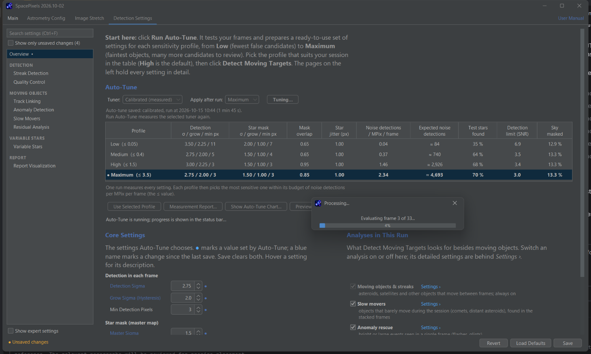

Click **Run Auto-Tune**, or **Auto-Tune Settings** on the Main tab (or press **Ctrl+T**), which opens this page and starts the calibrated tuner with the sensitivity profile chosen here. It measures your own frames: how sharp the stars are, how much the stars jitter, how many noise detections each setting produces and how faint a test star each setting still finds. This takes from a few seconds to a few minutes. While it runs, the button reads **Tuning…** and the progress window shows a **Live view**, updated at most every three seconds. It shows the current frame, sampled regions, reference crops, trial star masks and artificial-star recovery as those measurements become available. Pink marks the star mask; artificial stars are cyan before testing, green when recovered and orange when missed or vetoed. Regional pictures show a central detail so the markers remain visible. The caption identifies the trial settings and distinguishes extraction before the mask veto from recovery after it. Some trials deliberately recover fewer stars; these are tests, not discovered objects or a steadily improving result. Short phases may finish between pictures. **Hide picture** also stops the work of making pictures and shares its saved choice with detection. **Preview Frame** on this page opens the same preview as **Preview Frame** on the Main tab.

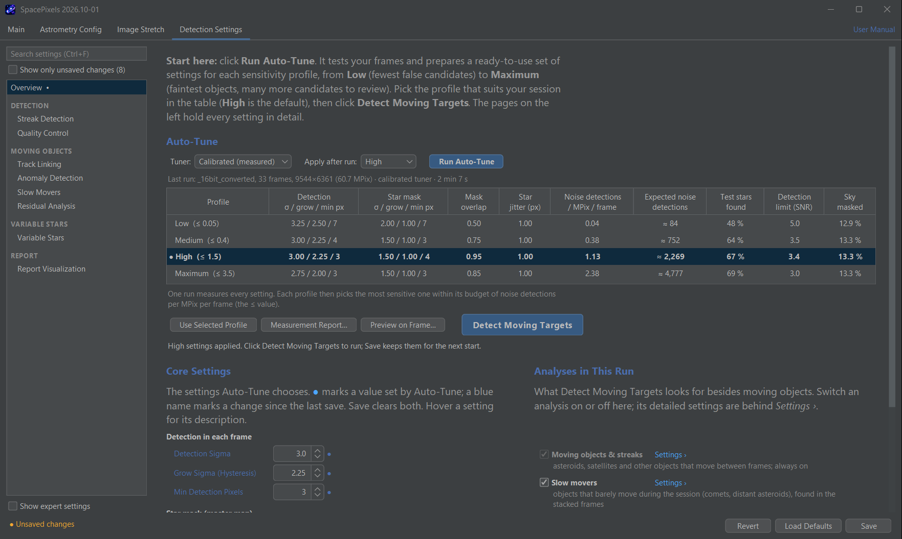

**Preview Frame** is directly below **Min Detection Pixels** in **Detection in each frame**, before the **Star mask (master map)** group. The two groups have divider lines, so the preview stays with the per-frame settings it uses.

The table shows a ready set of settings for each **sensitivity profile**:

| Profile | Use it when |
|---|---|
| **Low** | you want very few false candidates: bright objects only, a short report |
| **Medium** | a clean report that still reaches fairly faint objects |
| **High** (default) | the usual choice: close to the noise level, with a manageable number of candidates to review |
| **Maximum** | you search for one faint object, or have a small sensor: the faintest objects, with many more candidates |

The columns tell you what to expect: **Expected noise detections** is about how many false single detections the session will produce (most are rejected later because they do not form a track), **Test stars found** and **Detection limit (SNR)** say how faint the profile reaches, and **Sky masked** is how much of the sky is covered by the star mask (objects crossing bright stars there are not detected).

The profile chosen in **Apply after run** (High by default) is applied as soon as the run finishes; SpacePixels remembers your choice. To switch, select another row and click **Use Selected Profile**. The changed settings are marked with a blue name and a dot, and **Save** keeps them for the next start.

**Show Auto-Tune Chart…** draws, for the profile you pick, the false detections against the share of test stars found (the budget is the vertical line, and the marked point is the setting that was chosen) and the recovery of test stars by brightness for that setting. In the picture the selected profile is Maximum, the one last chosen in **Apply after run**.

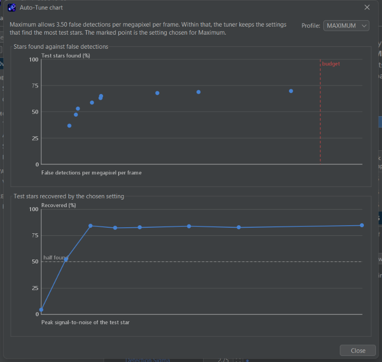

The result is also written next to the frames, as `auto_tune.json`, in the same way as the sky catalogue. The file keeps the chosen settings and this chart, not every combination the tuner tried. An older, much larger file is rewritten in this smaller form the next time that folder is imported. Importing that folder again shows when Auto-Tune last ran. The profile in **Apply after run** is selected from the saved result when that result has it, so detection can use it without measuring again. **Run Auto-Tune**, **Auto-Tune Settings** and **Ctrl+T** always measure again and replace the saved result.

### Step 4: detect

Click **Detect Moving Targets**, on the Overview or on the Main tab (or press **Ctrl+D**). A progress window shows each stage.

Below the progress bar, the **Live view** shows a small picture of the work under way. A new picture appears at most once every 3 seconds, including when the stage changes. A short stage may show nothing, and the last picture stays until a new one is allowed. Nothing is repeated in a loop.

- a frame as it loads, with its number and observation time;
- during source extraction, the frame just processed, with detected sources ringed;
- the stationary-sky reference (the median of the kept frames) once the detection has built it;
- one picture from the running stage: a slow-mover candidate, the star mask or a track found so far, a local-rescue candidate, or photometry measurements. During photometry the view cycles through sampled stars and can show a variable-star crop beside its current light curve; a candidate and its curve can also appear when photometry finishes. Candidates are marked **provisional**: later stages and your report choices can still leave a finding out. The caption gives the counts so far, and a stage that finds nothing says so;
- the report's pictures, such as the track map and object crops, as they are written.

During **Faint-mover search**, the view shows a bounded crop of an example input frame, the active tile and a trial-motion line. The line is a search hypothesis, not a retained candidate. Updates share the three-second picture limit. Progress text reports estimated work within the phase and completed tiles, including while one tile is still searching. Completion, a skipped search and time-limited partial coverage have distinct messages.

The text above the picture is the progress. **Hide picture** removes the view and the work of making its pictures, and SpacePixels remembers the choice. **Detect Iteratively** shows the same view, including its optional Auto-Tune, clears it at the start of each pass and names the pass in the caption. The pictures are copies for display only: the tuned settings, detection results and report are the same with the view shown or hidden.

**Cancel** in the progress window (or closing it) requests that the run stop; the status bar says it was cancelled after its workers finish cleanup. This works for the detection runs, Manual Transient Inspection, Test Star Mask, Auto-Tune, import, Convert to Mono, Batch Stretch and Plate Solve.
- **A run that doesn't stop.** If it hasn't stopped after a while, the button offers to exit SpacePixels instead.
- **What can't be cancelled:**
  - Writing the plate solution into a frame must finish, so the file is not left half written.
- **Plate Solve:** progress shows the solver phase and elapsed seconds. Cancel stops the local ASTAP process, or interrupts the local Astrometry.net request and stops polling. A remote job already accepted by Astrometry.net may continue on its server. The total solve budgets are 2 minutes for ASTAP and 15 minutes for Astrometry.net, followed by cleanup. Failed or cancelled ASTAP runs restore pre-existing solver sidecars; the source FITS file is unchanged.
- **How fast it stops:** detection and Auto-Tune check cancellation inside their computation, without waiting for the next progress message. Report writing checks between sections and items. Reading an individual large FITS file or another operation already in progress can still delay stopping; resources remain owned until that work and its cleanup finish.
- **What a cancelled run leaves:**
  - A cancelled detection removes the report folder it was writing.
  - A cancelled iterative run keeps the passes it finished, with an index page that says the run was cancelled, and removes the pass it was writing. When no pass had finished, it also removes the converted copy of the frames it made for the run.
  - Convert to Mono and Batch Stretch keep the frames converted or stretched so far.

SpacePixels checks the quality of every frame (blank, blurred or failed frames are left out), builds a star mask from the median of the frames, extracts candidate transient sources in each frame, links the detections into tracks, and writes the report with crops and animations of the included findings. When it finishes, it offers to open the report:

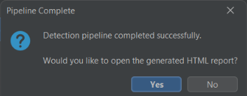

The report is a folder named `detections_<date>_<time>` next to your frames; open `detection_report.html` in it with any browser. **Open last report**, under the settings in the Detect group of the Main tab, opens the newest report of the session at any time, also after you restart SpacePixels and import the folder again.

Inside the report folder, `detection_report.html`, `report-data.json` and `detection_config.json` (the settings of the run) are at the top, and the pictures are in folders: `field` for the pictures of the whole field, one folder for each kind of result (`moving_targets`, `streak_tracks`, `single_streaks`, `anomalies`, `slow_movers`, `local_rescue`, `local_activity`, `variable_stars`, `camera_fixed` and `common_motion`), `unclassified_frames` for the Unclassified Transient Inspector, `diagnostics` for the pictures of the Diagnostics, and `enhanced_stack` for the [enhanced stack](#overview) as a FITS file. The photometry CSV files are in `variable_stars`. A folder is there only when its kind of result has pictures. The file names say what a picture shows, so a copied picture still makes sense on its own. To keep or send a report, copy the whole folder. Reports written by earlier versions keep their own layout and still open.

If a run finds a very large number of objects, a summary first lists them by kind and asks whether to generate the report. Moving-object tracks, streak tracks and single streaks are always included. Each other group that this run measured, and that found something, has an **In report** box, ticked to start with. Untick a group to leave it out of this report: its section, crops and animations are not written, and the line under the list says how many of these detections the report will still include. A group you had switched off before the run is not listed. The detection settings are not changed, so the next run still measures those groups. Many tracks or anomalies usually mean the settings are too sensitive for this session: try a lower profile.

---

After detection, return to **Blink Selected** to check the findings against the actual frame pixels: the side panel's **Report findings** shows the last run's tracks (T), variable candidates (V) and other findings. In **Preview Frame**, **Show detections** (D) overlays point sources and streaks extracted with the current per-frame settings, and the side panel adds the last full run's findings. **Manual Transient Inspection** shows the run's tracks (T) too. Zoom to 100 % or more to inspect the detected pixels; use the eye switches to compare with the unmarked image. These last-run overlays are available in the current session after a run; importing a folder again does not reconstruct them from its saved report.

## 4. Reading the report

The report starts with an overview, then the results. **Likely Artifacts** and **Diagnostics** come near the end and start collapsed; click a heading to open it. The sections follow the kinds of results:

| Result | What it is | Typical objects |
|---|---|---|
| **Moving-object tracks** (T#) | a point that moves in a straight line at a steady speed through several frames | asteroids, comets |
| **Streaks** (S#) and **streak tracks** (ST#) | elongated trails, in one frame or several | satellites, aircraft, fast asteroids |
| **Single-frame anomalies** (A#) | a bright point in one frame only | flashes, glints, cosmic rays |
| **Slow-mover candidates** (DS#) | an elongated shape in the stack of all frames | very slow asteroids and comets |
| **Faint mover candidates** (FM#) | weak signals added along trial motions through the frames | unverified faint point-like movers (experimental, optional) |
| **Local rescue candidates** (LR#) and **activity clusters** (LC#) | faint detections that line up or cluster | very faint movers, to be checked by eye |
| **Variable stars** | stars whose brightness changes | variable stars (optional analysis) |
| **Likely artifacts**: camera-fixed groups (FC#) and common-motion groups (CM#) | detections the pipeline set aside; collapsed near the end of the report | hot pixels, dust, registration residuals |

### Overview

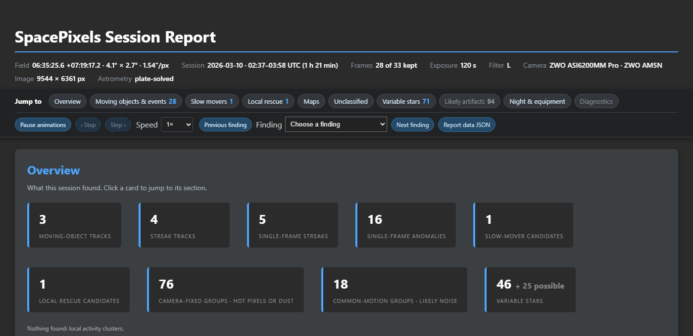

Under the title, one line describes the session: field, date and time span, frames kept, exposure, camera and whether the frames are plate-solved. The **Jump to** bar below it stays at the top of the window and leads to every section, with its count. The **Overview** has a card for each kind of result that was written (click a card to jump to it) and lists what was not found. A group left out of this report is named in that line. The results come first. The processing details (quality control with the rejected frames and their reasons, configuration, star mask, extraction, track linking, and the time taken by each detection step) are collected in the **Diagnostics** group near the end. It starts collapsed; a link into Diagnostics opens the relevant group automatically. A line under the cards links to it, with the frames kept and rejected.

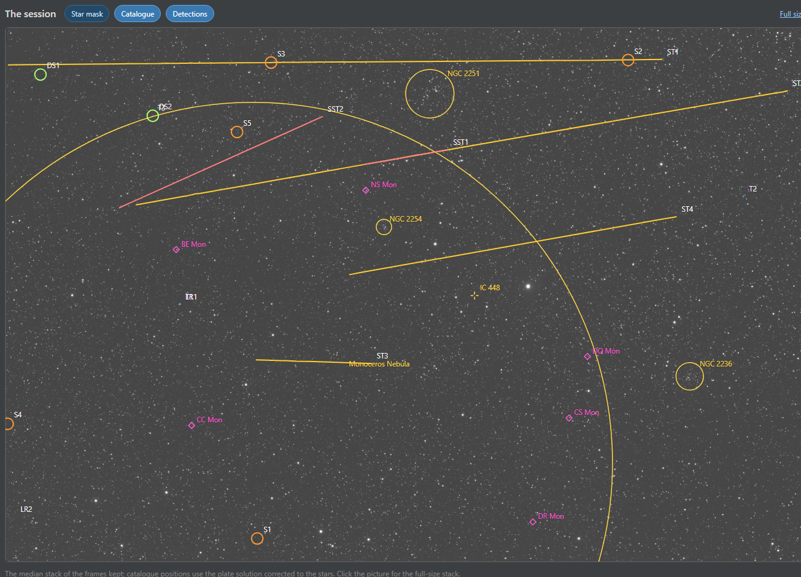

Below the cards is **the session**: the enhanced stack of the frames kept (their median stack when **Enhanced Stack** is off), with switches over it.

The session and **Map of All Detections** use translucent annotations so the sky remains visible through the labels and markers. Category colours, symbols and clickable identifiers stay the same. Variable-candidate field maps also use translucent annotations and smaller labels.

- **Detections** (on at first) draws every result with its label and colour, as on the detection map. The legend below the picture explains the prefixes and gives their counts: T for moving-object tracks, ST for confirmed streak tracks, A for single-frame anomalies, and so on. The number identifies the object; A12 is single-frame anomaly 12.
- **Detected variables** marks the measured variable-star candidates V1, V2 and so on in magenta. Click a label to open its candidate card. These measured candidates are separate from the known variables on the Catalogue layer.
- **Data area** (on at first) outlines in blue where every kept frame has image data, a few pixels in from the black registration border and the image edge. A sentence under the picture gives its share of the frame and, when one frame alone costs a noticeable part of it, names that frame. The detection map shows the same outline.
- **Star mask** shows in red what the detection treated as stars: hover over the button to see it, click to keep it.
- **Catalogue** names what is known in the field: Messier, NGC, IC and Sharpless objects with their outlines and common names, bright stars with a proper name, and the brightest variable stars with an old designation (at most 15). It needs the sky catalogue, fetched before **Detect Moving Targets** (see [Annotate](#annotate-stars-deep-sky-objects-and-variable-stars)). Survey numbers that nobody knows are left out.

Click the picture for the full-size stack.

**Enhanced stack.** With **Enhanced Stack** on (Detection Settings → Report, on by default), the report combines the frames kept into a less noisy picture than their median: a mean that leaves out hot pixels, satellite trails and other values that stand out in one frame, and gives noisier frames less weight. It shows fainter detail with less noise. It is the picture under the session, the Map of All Detections, the footprint and cluster time maps, the variable-candidate map and the Unclassified Transient Inspector, in the report and in their full-size files. These pictures use an automatic asinh stretch: it lifts faint structure just above the sky, such as dust, faint galaxies and faint stars, and compresses bright stars instead of clipping them. Its strength is set so that the sky is drawn at about 15 % of white, whatever the sky level and the brightness range of the session; the Auto Stretch settings do not change it. The detection itself still compares each frame with the median stack: the Diagnostics show that median stack, and the cutouts of the findings show the frames. The enhanced stack is also saved as a 32-bit floating-point FITS file, `enhanced_stack/enhanced_stack.fits`, linear and in the units of the frames, for processing in other programs. Its header gives the target, the instrument, the start and end of the frames, their number and total exposure and the plate solution, but not the observing site; pixels that no frame covers are NaN (not a number). The file needs about 4 bytes per pixel, about 240 MB for 61-megapixel frames, and building it took about 10 seconds for 28 such frames. Switch it off to save that disk space and time; the report then shows the median stack.

The toolbar provides **Pause animations**, **‹ Step** and **Step ›** (active while paused to step frame by frame), an interactive **Speed** control (from 0.25× to 4×, with the SpacePixels GIF Blink Speed setting as the default 1× starting speed), **Previous finding**, **Next finding**, a finding selector, and **Report data JSON**. Animations are rendered dynamically from image frame sheets, allowing immediate speed adjustment of all animations at once without reloading the page. Pausing freezes playback and enables frame stepping. Each animation also includes a dedicated **GIF** badge link to download or open the standalone GIF. Reports honour the browser's reduced-motion preference. Most images below the first picture load as you scroll. Mixed exposures and filters are identified in the session header.

**Faint streaks.** Detect Moving Targets also searches every frame a second time for streaks too faint for the normal detection, on a copy smoothed to the size of the stars (the **Faint Streak Search** setting, on by default). Such a trail is often visible by eye along its length although none of its pixels stands out. The streaks it finds extend or join the normal streak tracks or appear as new streaks; normal streaks keep their tracks. Their cards say **Found by the faint-streak search**, or **Includes N detections from the faint-streak search** for a track that also has normal detections, and each such detection's figures are marked as measured on the smoothed frame: its peak sigma is not comparable with that of a normal detection. A streak found this way in only one frame needs no peak sigma, so look at it before relying on it. Anomalies on such a streak's path become part of it, as on any streak.

`report-data.json` contains the included findings, their labels and card anchors, pixel/sky positions, and observed frame numbers; a streak finding with detections from the faint-streak search also gives their number (`faintSearchDetections`). Labels are local to this report, not permanent identities across runs. Optional groups left out of the report are also left out of this export. The footer records application/engine versions, export time and report preparation time.

**Detection Stage Timings**, under Diagnostics, shows the elapsed time and share of engine time for each major detection step. Faint streak fragment assembly is indented under tracking: its time is already included in the tracking total. **Faint streak search** is a step of its own; the **Faint Streak Search** table below it gives the smoothing width and how many streak-shaped objects the search found, how many the star mask removed, how many were the same trail as a normal streak, and how many ended in streaks. Parallel steps show elapsed time, not the sum of worker times. Steps that were switched off are omitted. Image loading, Auto-Tune and report generation are outside the engine total.

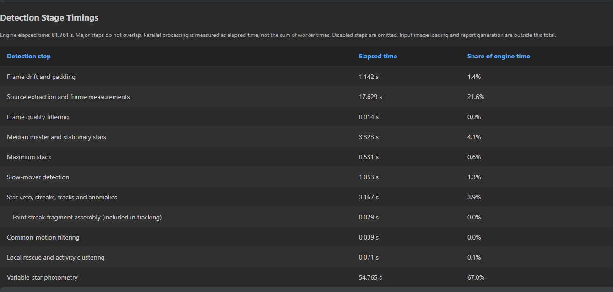

Hot pixels, warm pixels and dust that the calibration left stay at one place on the camera, while registration moves them with the dither and the drift; in the registered frames they look like faint movers, repeats at one spot or common motion. Before tracking, SpacePixels sets aside detections that stay at one camera position in at least three frames while the frames moved, and shows them under **Camera-Fixed Groups** in the collapsed **Likely Artifacts** group near the end of the report (IDs FC1, FC2 and so on), so they become no tracks, anomalies or rescue candidates. How each frame moved is measured from its registration fill, so frames without fill are not checked. A slow asteroid can also stay at one camera position for several frames when the frames moved little; a group whose positions follow a straight path on the sky much better than on the camera is therefore kept for tracking. The switch is **Reject Camera-Fixed Sources** on the Track Linking page (on by default).

Common-motion filtering runs after the main tracks, streaks and anomalies, before local rescue and activity clustering. It sets aside separated compact sources with matching displacement and keeps their observations available under **Common Motion** in **Likely Artifacts**, after the camera-fixed groups. Ambiguous associations are kept for further review. **Reject Common Motion** has its own switch; turning off **Enable Residual Transient Analysis** skips local rescue and activity clustering but does not turn off common-motion filtering.

In Variable Stars, **Frames excluded: spatial residuals** counts frames omitted from photometry because a region of the field retains a brightness offset relative to the centre after ensemble correction. The count appears in the session summary when nonzero and in the detailed readiness diagnostics. Per-frame reasons remain in the table and CSV. These photometry exclusions do not remove frames from moving-object detection.

The detailed readiness diagnostics also show the **Comparison-star fit**: the frame corrections (a transparency offset and a brightness gradient across the field) are fitted to the comparison stars in repeated rounds that down-weight variable stars, until the correction changes by less than 0.00001 mag between rounds. It reads *Finished after 6 rounds*, for example. When the fit, or a fit for one of the comparison apertures, reaches the limit of 15 rounds, the line is highlighted with the last change. The fit then keeps its last result; on the reference data its last change was at most 0.0003 mag. The verdict does not change.

With the sky catalogue, the Overview also gives the **Field depth**: how faint the detection reached in the median frame, as a Gaia G magnitude. In four small patches of the field, away from large galaxies and nebulae, the Gaia stars are matched with the stars found there, and the depth is the magnitude where the share found falls to half of the share among the brighter stars. It is measured with the settings of the run and estimates stationary point-source depth; it does not guarantee that a moving, trailed or variable object of that magnitude will be recovered. **Quality Control: Field Depth** in the Diagnostics shows it frame by frame: clouds, haze, a bright sky or poor focus show up as frames that go less deep. Gaia G is close to a clear or luminance filter; with other filters, compare frames rather than the number itself.

### A moving object

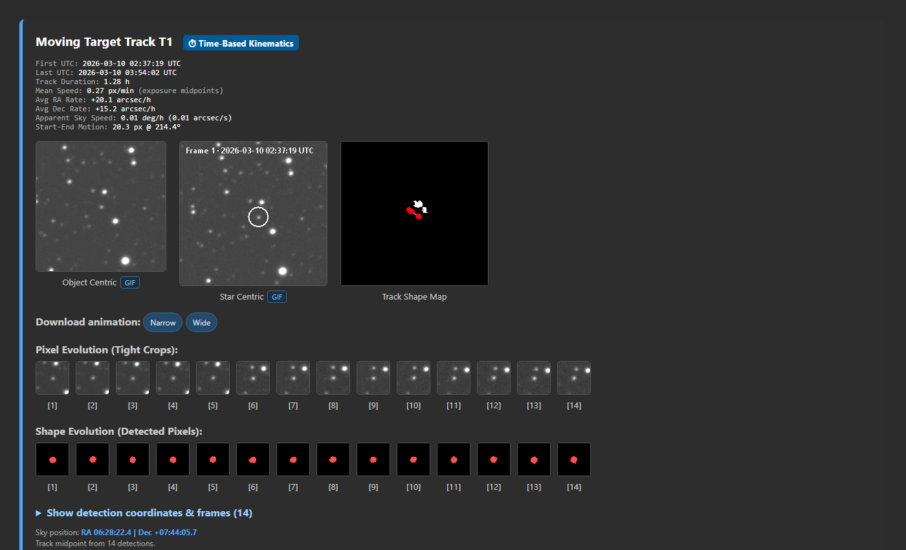

Each object has a card with its times, speed and direction, and:

- **Object Centric**: an animation that follows the object (the stars move);
- **Star Centric**: an animation of the field (the object moves), with the object circled;
- **Track Shape Map**: the positions of each frame;
- **Download animation**: clean star-centric animated GIFs without overlays (no highlight circle or frame label) available in **Narrow** (the star-centric crop) and **Wide** (twice that field, with at least 400 source pixels per side where the frame permits). Wide keeps the complete track and scales the picture proportionally to at most 1000 pixels per side;
- **Pixel Evolution**: the object in every frame, so you can check that it is the same object each time;
- the sky position and the identification buttons (see [Identifying objects](#5-identifying-objects)).

Consistent position changes and a similar image profile across several frames support a real track. Jumps, changing shapes and isolated appearances deserve closer inspection, although seeing, faint signal and masked stars can also interrupt a real object’s detections.

Track duration covers the observing span from the start of the first exposure to the end of the last. Mean speed and identification epochs use exposure midpoints, corresponding to the measured centroids. Track animations share one brightness stretch across their frames, discovered from the frames' sky medians and noise levels. Anomaly context uses the nearest kept frames before and after the event, with one shared stretch and visible frame/time labels. Slow-mover and residual animations also skip frames rejected by detection quality control.

On plate-solved crops, hovering shows a small red N/E marker for north and east. The field of view and centre coordinates remain available in the image's tooltip.

An ordinary track and a Local Rescue candidate can show reciprocal **Possible track continuation (review)** links. Each rescue centroid must agree with the measured track interpolated at that exposure's midpoint, within the displayed review tolerance, and its displacement must also agree. The comparison uses separate original frames and never extrapolates past the track's measured span. RMS, maximum separation and displacement difference are shown. Multiple plausible tracks stay linked; the findings, frame assignments and original animations remain separate. A nearby crossing or a short two-frame repeat still needs manual review.

### A single-frame anomaly

**Anomaly A1**, A2 and so on are single-frame event candidates whose cause is unconfirmed. Each card gives the frame, UTC exposure start and end, exposure length and position (including RA/Dec when plate-solved). The exposure length is not a measurement of how long the flash lasted.

Some cards carry a green badge such as **Likely part of T1**. The badge appears when three things hold:

- the moving-object track has no detection in the event's frame;
- the track's motion puts its object at the event's position;
- the event has the size and brightness of the track's detections.

The note under the title gives the distance from the predicted position. Such an event is most likely the track's object, detected in that frame but not linked to the track. The badge and the track name lead to the track's card. Slow-mover cards use the more cautious **Track overlap: T3**: a track near a stack footprint can be a crossing or a different nearby source. When available, the note compares actual aperture centroids and track detections on common original frames, with RMS/maximum separation. Repeated frame identities or conflicting capture times are excluded explicitly. Both findings remain visible; overlap alone does not establish identity.

Expand **Original-frame centroid drift (inspection)** on a slow-mover card to inspect supported positions, fitted drift in px/min, displacement over the supported span, fit residual, correlation and covered session span. The fit uses recorded capture timestamps; it is a descriptive trend rather than an exposure-midpoint astrometric velocity or motion confirmation. A star, seeing or registration trend inside the footprint can dominate the positions. Missing, repeated or decreasing timestamps, too few supported frames, or undefined correlation are shown explicitly. **Download positions CSV** exports one row per supported centroid in `slow_movers/slow_mover_<number>_positions.csv`, using one-based original and retained frame numbers, capture milliseconds (blank when unknown), X/Y pixels and aperture SNR. These measurements do not change detection gates or remove duplicate findings.

Compare **Before / Event / After** side by side, or use the **Blink comparison** GIF, which can also be opened and shared separately. Images are shown at their native pixel size or smaller; a wide screen does not enlarge the crops, and narrow layouts shrink or wrap them. The circle marks the same position in every image, with the event highlighted in gold. All three images use the event's brightness stretch. The neighbouring images are the nearest frames kept by quality control; their numbers and times show any gaps. Missing neighbours are labelled explicitly.

**Why it was retained** describes the detection check in plain language: a strong peak signal, or a strong combined signal across the detected pixels. Hover for an explanation. These describe detection strength, not the physical cause. Open **Detection details** for the source filename, peak and integrated sigma, flux, pixel count, elongation, footprint and star-mask overlap.

With a plate solution, observing location and exposure timing, **Check satellites** searches SatChecker around the event position over the whole exposure. Keep SpacePixels running to display and save the results inside the report, or use **Open SatChecker response** for the raw reply. Results are possible associations: a predicted passage does not confirm a satellite flash, and no match does not rule one out. When required metadata is missing, the card explains what is needed.

### Maps

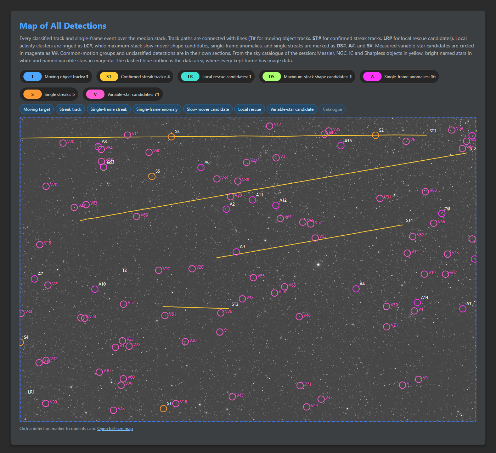

The **Map of All Detections** draws every result over the whole field, with its label (T1, ST2, A3…) and one colour per kind, counted in the legend above it. Here the long lines are satellite trails, and the magenta circles single-frame anomalies. With the sky catalogue, the map also names the well-known deep-sky objects, the bright named stars and the brightest named variable stars of the field, as in the session picture. The map category buttons hide or show each type of finding; click a label or marker to open its card. **Catalogue** toggles the known sky objects, while **Variable-star candidate** toggles measured candidates. The full-size PNG remains available. The **Time Maps** below it show every detection that was not a star, coloured by time, which is useful to see where the noise is.

### Unclassified Transient Inspector

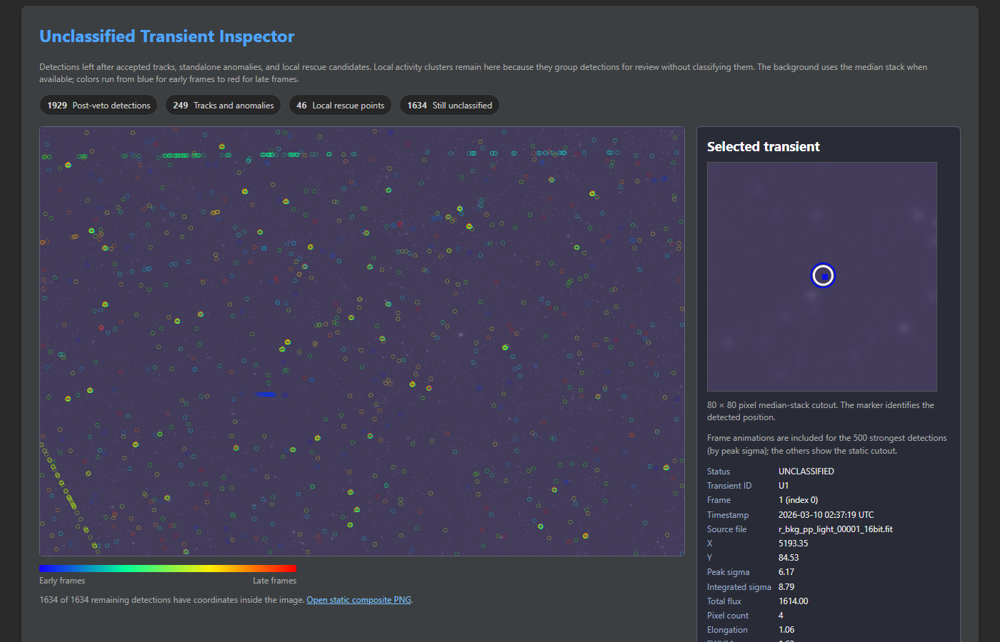

Everything that was detected but did not become a result is shown here, coloured from blue (early frames) to red (late frames). Click a circle to see a short animation of that spot (two frames before and after the detection) and its measurements. This is where you look when you expect an object that the report did not find. Filter by frame and minimum peak sigma, focus a marker, and use the left/right arrow keys to move through visible detections.

### Light curves and exports

Candidate light curves have **Zoom in**, **Zoom out** and **Reset** controls; drag a zoomed chart to pan. Error bars show the engine's estimated sky-noise uncertainty. Registration interpolates the frames, so neighbouring pixels share noise. The engine measures how much noisier this makes an aperture on blank sky in every frame, and the error bars include that. On the reference sessions the errors are 1.1 to 2.9 times what independent pixels would give. They remain a lower bound rather than the total uncertainty, because the star's own photon noise and the atmosphere are not included. The readiness diagnostics show the **Sky-noise factor** of the main aperture, and `photometry_frames.csv` gives each frame's factor in a final `sky_noise_factor` column. Faint stars are often measured in a smaller aperture than the main one, because it gives them less scatter; the light curve and its error bars both come from that aperture, which the card's **Measuring aperture** box names (for example 1.0× FWHM) with its radius in pixels. The radius follows each frame's measured FWHM, so it is given as a range. The **Readiness Checks** panel lists the aperture chosen for each brightness range. Brightest/faintest cutouts match their local sky backgrounds on one shared contrast scale. The faintest image is scaled by the ensemble zero-point difference to match the brightest frame's transparency, so the pictures compare the corrected brightness change. Seeing can still change star shapes. This display adjustment leaves measurements and light curves unchanged; the caption says when a transparency correction is unavailable.

The **Variable candidates across the field** picture circles every reported candidate on the stack of the session picture: blue for high confidence, orange for possible. Labels prefer a VSX name, then a proper name or Gaia DR3 designation from the general star catalogue, with the V number as fallback. Hover for the V number to find its table row or card. Click the picture to open a full-size image with compact differential light curves beside the stars. The curves have a lightly translucent background, no axes, tick labels or grid, and just one **Δmag** number: the observed variation in mag, as in the table. Brighter is up. Each curve has its own magnitude scale, so compare the numbers rather than their visual heights. Flagged or missing measurements leave gaps. The image works offline and includes candidates beyond the configured detailed-card limit.

The stars CSV includes the V label, sky coordinates, VSX matches and nearest-match separation. Candidate light curves also include the V label. Both include `aperture_fwhm_factor`, the measuring aperture in units of the FWHM; a light curve's `delta_mag` and `mag_error` come from that aperture. The Per-Frame Measurements table and `photometry_frames.csv` count each frame's flagged measurements by reason, including bad flux and contamination (a star shape spoiled by a hot pixel, cosmic ray or faint passing object). They count measurements, not stars, and one measurement can carry several flags. CSVs and the HTML are published only after their writes finish successfully.

Catalogue searches distinguish matches, valid searches with no match, and failures. **Retry lookup** retries a failure; **Refresh lookup** requests fresh data even when a result was saved earlier. Batch counts refer only to the candidates requested by that batch. Successful lookup results are saved into the report when its folder is writable.

### Night & Equipment

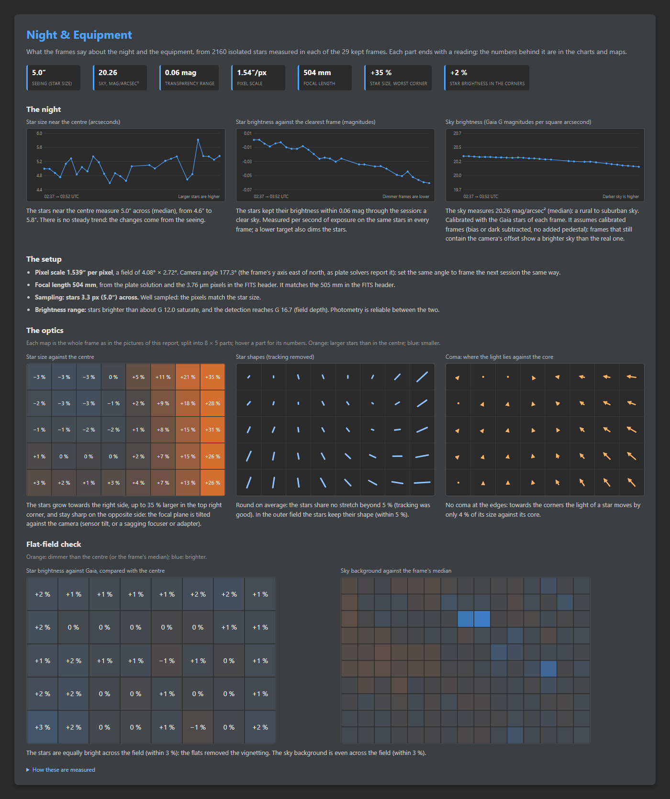

What the frames say about the night and your equipment. SpacePixels measures up to 2,000 isolated stars of the master star map in every kept frame: their size, shape, brightness and how lopsided they are. Each part ends with a reading in plain words. The **Seeing** card in the Overview links here.

- **The night**: three charts through the session.
  - **Star size near the centre** (the seeing), with the focuser or air temperature when the FITS headers have it. Stars that grow steadily usually mean the focus drifted as the temperature fell.
  - **Star brightness against the clearest frame**: haze and thin cloud show as dips. A target that sinks lower also dims a little.
  - **Sky brightness** in magnitudes per square arcsecond, like a sky quality meter, calibrated with the Gaia stars of each frame. It needs the sky catalogue and linear frames, and it assumes calibrated frames: a camera offset (bias or pedestal) left in the frames, or a background removed during processing, gives a wrong value.
- **The setup**: the pixel scale, the field of view and the camera angle from the plate solution; the focal length (from the pixel size in the FITS header), compared with the header's focal length; the sampling (how many pixels a star covers); and the brightness range from the saturation limit down to the field depth. With a reducer or flattener the focal length depends on its distance to the camera, so a different value between sessions with the same equipment means the spacing changed.
- **The optics**: three maps of the field, in the orientation of the report's pictures.
  - **Star size against the centre**: larger stars in all corners can suggest field curvature (or a flattener at the wrong distance); larger stars on one side can suggest tilt, uneven focus or a sagging focuser.
  - **Star shapes**: the stretch of the stars after the stretch they all share (tracking, guiding, wind) is taken out. Stars stretched along or across the line to the centre in the outer field point to the flattener or reducer spacing.
  - **Coma**: arrows from the core of the stars towards their light. Tails that grow towards the edges are coma; with a camera lens they can also be lateral colour. A point without coma away from the centre (a white cross) can suggest a collimation issue on a reflector.
  - Frames taken on the other side of the pier are turned back by 180°, since tilt and coma belong to the camera.
- **Flat-field check**: the star brightness against Gaia across the field, and the sky background. Stars dimmer in the corners mean vignetting that the flats did not remove; brighter corners mean flats that over-correct. A sky that is brighter towards one side is a gradient from light pollution, the Moon or twilight.

These readings are diagnostic patterns, not a unique diagnosis of a focus, tracking or optical problem. The brightness range describes saturation and detection depth; the Variable Stars readiness verdict remains authoritative for differential photometry. Sky brightness and Gaia-based flat-field readings require a measurable, acceptable linearity slope; inconclusive calibration is not treated as a pass. Field depth uses a ≥ sign when the catalogue sample ends before completeness falls.

The measurement takes a few seconds. Without a plate solution the sizes are in pixels (or in arcseconds from the focal length and pixel size in the FITS header), and without the sky catalogue the sky brightness and the star brightness map are left out.

---

Iteration reports analyse overlapping frame selections. Their counts must not be added: the same object may be found in several iterations. Compare positions and timestamps in the individual reports.

## 5. Identifying objects

When one frame is plate-solved, every track card shows the sky position and buttons to identify the object:

- **Search SkyBoT** (three search radii): known asteroids and comets around the position, from the IMCCE SkyBoT service.
- **Render JPL Results Here**: the JPL Small-Body Identification service for the exact field of the object.
- **Render JPL NEO Recovery Results Here**: a wider JPL search for fast near-Earth objects, which JPL's exact search can miss.
- **Compare track with satellites** (on streak tracks): searches the actual exposures, then compares the saved streak measurements with the predicted paths of the returned satellites.
- **Stellarium Web** and **Stellarium Local**: the sky at that time and place, for context (see [Annex: Local Stellarium integration](#annex-local-stellarium-integration)).

The buttons that say **Here** show the answer inside the report. They need SpacePixels to be running (it fetches the answer for the report), and the answer is saved into the report, so it is still there when you open the report later, also without SpacePixels. The other buttons open the service in your browser. JPL can take up to a minute to answer.

The satellite comparison shows distances in arcseconds and approximate image pixels, the independent exposures covered, direction differences and predicted versus centroid-based speed. Expand a candidate to see the observed centroids over its predicted exposure paths, per-exposure distances and the source and epoch of its orbital data. Every exposure has equal weight, however many fragments it contains. The centroid's time within a long exposure is unknown, so its speed is an estimate with an exposure-limited range. Missing trail sections do not have to fill the predicted path.

The closest returned fit supports an association; it does not confirm identity or give a confidence percentage. Search failures, incomplete predictions and sampling limits are shown explicitly. No returned candidate does not rule out a satellite. The comparison records coordinate assumptions, unknown observer height and the UTC/UT1 timing approximation, which matters particularly for fast satellites. It stops rather than transforming explicitly unsupported coordinate frames. **Cancel comparison** stops an active request; **Refresh lookup** retrieves new predictions. A comparison is limited to 16 search exposures, 12 returned candidates, 48 provider requests and five minutes, with any limit made visible. Two comparisons can run at once.

New reports save the measurements and observing location used by the comparison and cache the provider responses and results together, so reopening them uses their own coordinates and timing. Older reports retain their existing candidate-search buttons. **Open midpoint candidate search (raw JSON)** is a separate short search for inspection, not the full motion comparison. Historical orbit coverage varies by object; even an old observation can return candidates, and their trajectories still need to be checked.

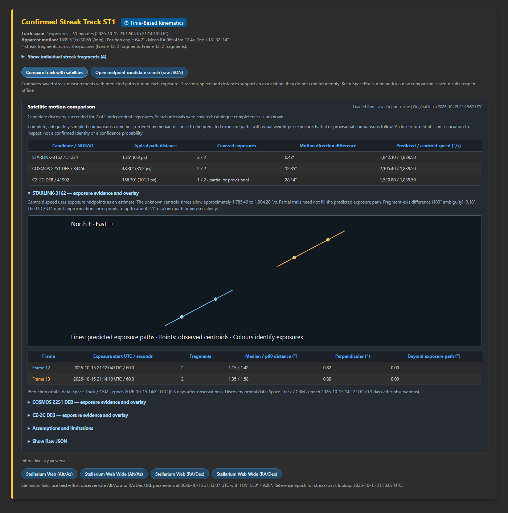

In this satellite comparison example, **Compare track with satellites** evaluates candidates from SatChecker against streak track ST1. The candidate table ranks **STARLINK-3162** (NORAD 51234) first with a median path distance of 1.25″ (0.8 px), a motion direction difference of only 0.42°, and predicted speed (1,842.10 ″/s) closely matching the measured centroid speed (1,839.50 ″/s). Expanding the candidate displays the tangent-plane trajectory overlay—predicted exposure paths as coloured lines and observed centroids as white-rimmed dots—along with per-exposure perpendicular residuals and orbital TLE provenance, confirming that the candidate closely fits the actual streak motion across both frames.

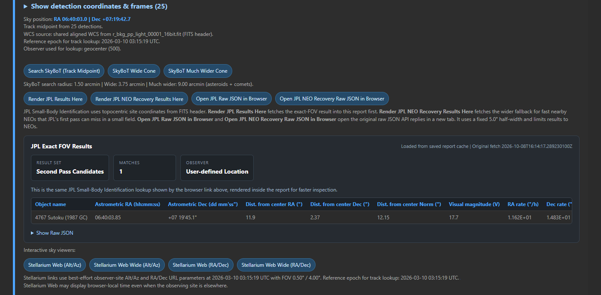

In this identification example, **Render JPL Results Here** identifies track T1 as the asteroid **4767 Sutoku**, magnitude 17.7, 12″ from the measured track position. Look at the **distance from center** and the **visual magnitude** to decide which entry is your object: the right one is close to the track position (within a few pixels of your image scale) and bright enough for your setup.

For fast near-Earth objects, use **Render JPL NEO Recovery Results Here** as well:

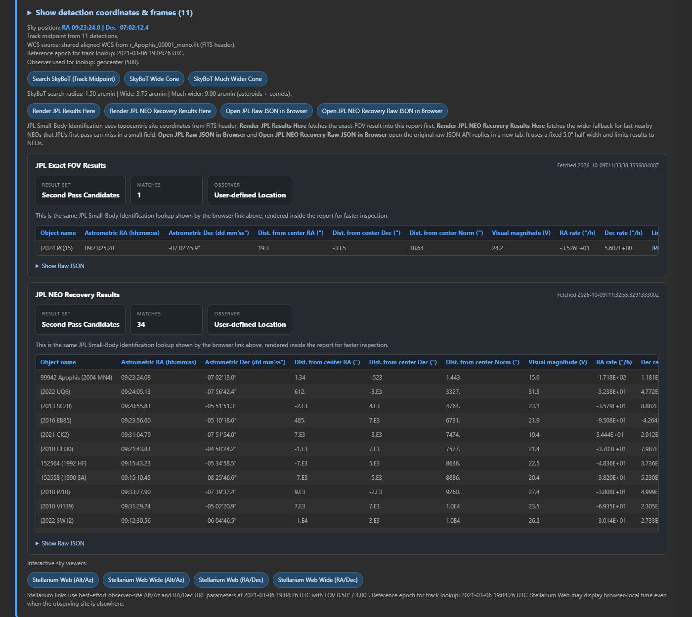

In this session (see [the example below](#a-faint-near-earth-asteroid-among-satellite-trails)), the exact-field search found only a magnitude 24 object 39″ away, which is not the detection, while the **NEO Recovery** search lists **99942 Apophis** 1.4″ from the track, at magnitude 15.6.

For exact results, set your observing site on the **Astrometry Config** tab (or keep it in the FITS headers). Without a site, the lookups use the centre of the Earth, which may be adequate for a broad main-belt search but is less accurate than the observing location, especially for nearby objects.

---

## 6. Examples from real sessions

### Asteroids in a wide field

The session of [section 3](#3-workflow-find-moving-objects-in-a-session): 33 frames of 2 minutes with a 61-megapixel camera, plate-solved in the FITS headers. In one run, SpacePixels found three moving objects, and the JPL buttons identified all three. These track numbers belong to that run:

| Track | Object | Magnitude (V) |
|---|---|---|
| T1 | 4767 Sutoku | 17.7 |
| T2 | 611 Valeria | 14.3 |
| T3 | 194 Prokne | 13.3 |

Sutoku moved only 15 pixels in 77 minutes, yet it was linked through 25 frames. The same report has the satellite trails as streak tracks. When a run finds this many objects, the summary appears before the report is written, and a noisy group can be left out:

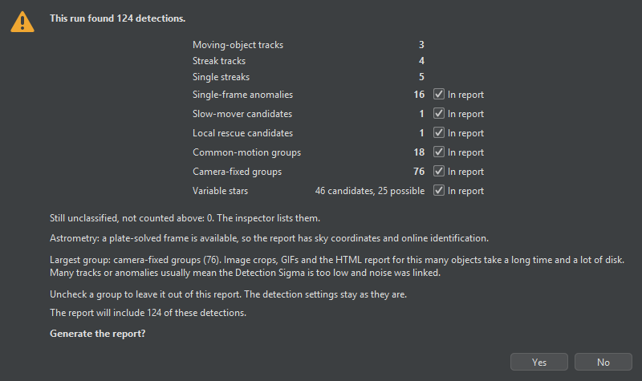

The picture shows the current report choices, including camera-fixed groups and variable stars. Untick **In report** beside an optional group to leave it out of that report; moving-object tracks stay included. These choices change the export, not the detections or settings.

### A comet, without plate solving

Comet C/2018 W2 (Africano), 18 frames of 30 seconds with a DSLR, without a plate solution. Quality control left out four frames (two of them blank), and the comet was found as a moving track through 14 frames over 2.6 hours, although it is a diffuse object, three times wider than the stars:

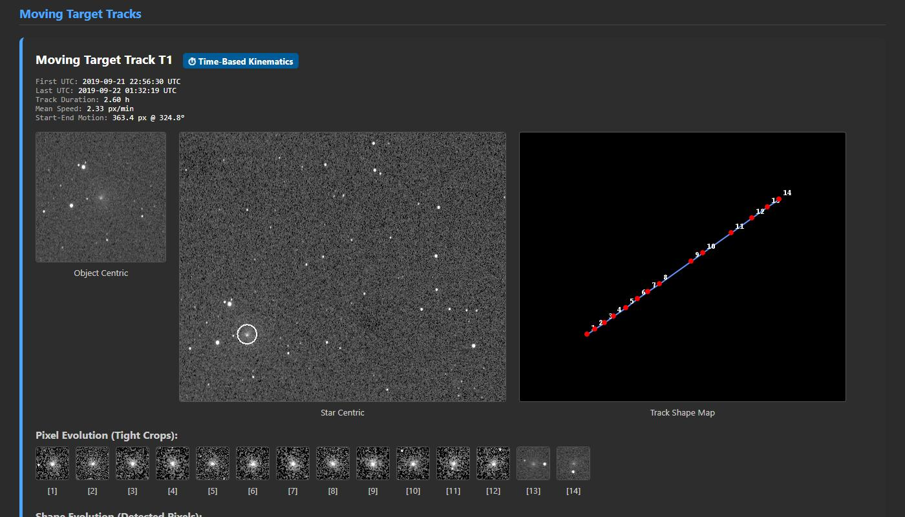

The object-centric animation of the report follows the comet:

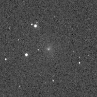

Without a plate solution this report still shows the moving track and animations, but has no sky coordinates or coordinate-based identification buttons. Plate-solve one frame to identify the object.

### A faint near-Earth asteroid among satellite trails

(99942) Apophis, 15 frames, plate-solved, with the observing site in the FITS headers. The field is crossed by several satellite trails, and Apophis is faint in each frame. This session was detected with the score-based tuner SpacePixels had until October 2026, at **High**; it found the satellite trails as streaks and Apophis as track T1, moving 2 pixels per minute. With today's Auto-Tune, use **Maximum** for this session: a deeper star mask at the lower profiles hides Apophis where it passes faint stars.

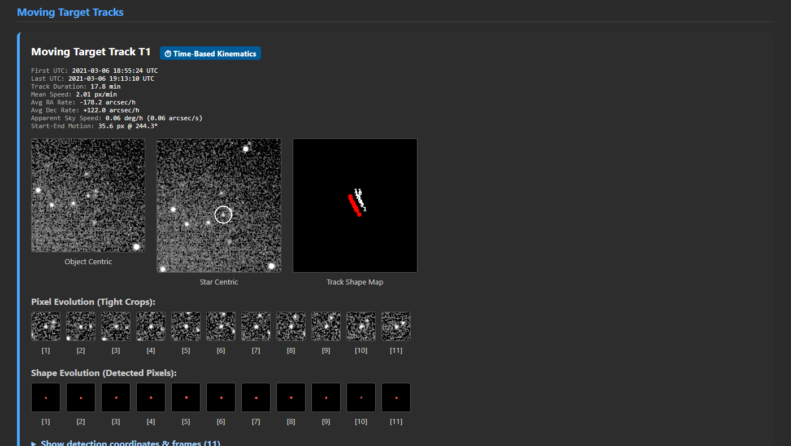

The JPL NEO Recovery search then identified it (see [Identifying objects](#5-identifying-objects)). If a profile does not find an object you expect, try the next sensitivity profile before changing individual settings.

## 7. Other tools

### Preparing an observing session

Click **Prepare Frames…**, above **Import Aligned Frames…** in **1 Prepare**. It opens a separate window; a dataset does not need to be imported first. The fixed Siril options, and why each one is used, are explained in [Annex: Preparing data with Siril](#annex-preparing-data-with-siril).

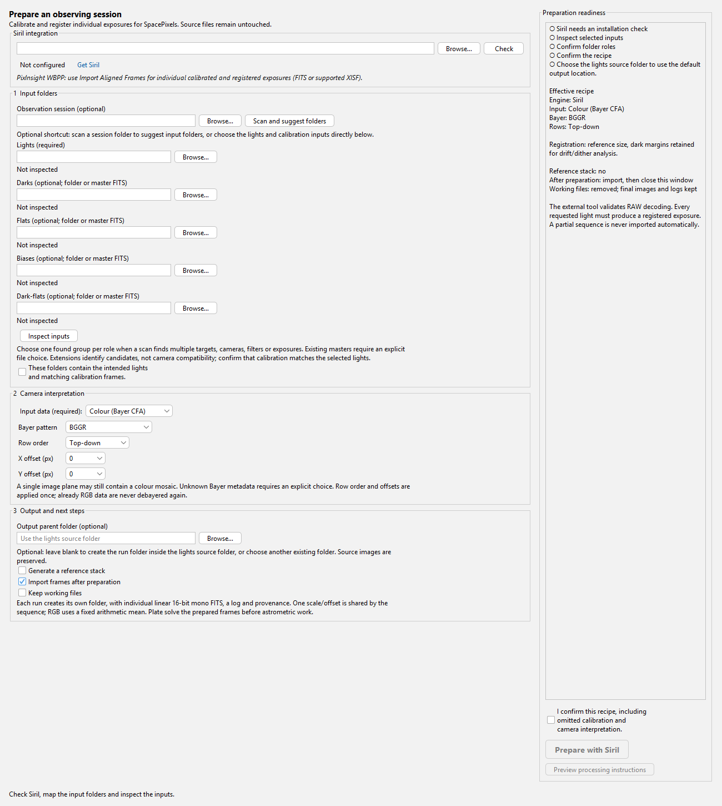

1. **Check Siril.** Browse to the Siril installation folder, or select the `siril-cli` executable (`siril-cli.exe` on Windows). Siril 1.4.0 or newer is required. **Check** identifies the program and checks its version without processing images. Successful selections are saved as application preferences; opening the preparation window automatically checks a configured path. Use **Check** to repeat the check when needed.
2. **Choose inputs.** Select the light-exposure folder and any matching darks, flats, biases or dark-flats. After the lights folder is chosen, **Browse** for the other inputs opens in the folder that contains those lights, so the neighbouring calibration folders are listed. If an observation-session folder is selected, **Browse** opens there instead. A path already filled in stays the starting point when its own **Browse** button is used again. A calibration role accepts either a folder of exposures or an existing master FITS file. The optional session scan suggests input groups using the [folder-scanning rules below](#how-the-session-scan-finds-image-groups). Use the **Found** choices when several groups are listed, selecting one group per role and checking that calibration matches the chosen lights. Missing calibration roles remain omitted. Click **Inspect inputs**, then confirm the mapping. If a folder mixes different kinds of image, inspection asks before anything is copied. A clear majority, such as raw exposures beside one stacked FITS file, can be kept and the other files left out. When two groups are similarly sized, choose which group to keep. Cancel leaves the folder unchanged. The same question applies to lights, darks, flats, biases and dark-flats. A master selected as a single file is not questioned. Small exposure differences, such as 30.0–30.5 s, stay in one group. The excluded names remain in the readiness summary and in `preparation.json`.
3. **Choose camera interpretation.** Select **Monochrome**, **Colour (Bayer CFA)**, or **Already debayered RGB**. For CFA, **From file metadata (recommended)** uses the decoded file's Bayer information. Alternatively, search for a camera preset or choose **Custom** and review the Bayer pattern. Type part of the camera name; the list shows the matching models, the nominal pattern and the usual row order. Current CMOS cameras use top-down. The SBIG ST-2000XCM and STF-8300C use bottom-up. Canon, Nikon and Sony RAW shortcuts still take both from the file. Presets supply nominal manufacturer patterns; capture software, cropping or flipping can change the correct interpretation for your files. Canon, Nikon and Sony RAW shortcuts use decoded metadata rather than a fixed pattern. **Show advanced de-bayer options** reveals row order and X/Y phase offsets. Row order affects which pixels Siril treats as red, green and blue; it is not just a display flip. If row-order metadata is missing, select the correct order explicitly here. Inspection says so for FITS lights and does not enable preparation until Top-down or Bottom-up is selected. Raw files are not blocked for a missing card, because Siril records their orientation during conversion. Collapsing advanced options keeps their values, which remain visible in the readiness summary. Unknown patterns are never assumed to be RGGB.
4. **Choose output and follow-up.** The output parent folder is optional: leave it blank to create the run folder inside the lights source folder, or select another existing folder. The readiness panel shows the effective destination. Optionally import the results automatically and create a separate reference stack. **Keep working files** is unchecked by default: copied inputs, converted frames and calibration masters are removed after processing. Enable it to retain those files for inspection. Final aligned frames, any requested stack, scripts, configuration, manifest and log are kept. After a successful automatic import, the preparation window closes and a message confirms that the new dataset is ready. If import is disabled, the completed output remains available in this window.
5. **Review and run.** The readiness panel stays visible beside the scrolling form and lists the effective choices, including omitted dark subtraction or uncalibrated flats. Confirm the recipe, then click **Prepare with Siril**. **Preview processing instructions** shows the generated recipe without running it.

Preparation copies the inputs into a new `spacepixels_prepared_…` run folder. It normalizes legacy dotted observation times and quoted site coordinates on working FITS copies before Siril can discard them, and checks metadata preservation. Final exposures use a single linear scale/offset for the whole sequence and a fixed RGB arithmetic mean; they are unsigned 16-bit monochrome FITS. The original images are unchanged. Plate solve the prepared frames before astrometric analysis: source WCS is not reused after registration.

Lights, darks, dark-flats, and flats that are calibrated with dark-flats use the same exposure grouping as ordinary import. The full range may differ by up to 2% of the shortest exposure, with a minimum tolerance of 0.1 s. This accepts small camera-reported variations, such as 30.0–30.5 s or a 30.3 s master dark beside 30.1 s lights, without changing the recorded exposure values. A dark must fall in the same group as the whole light range, and a dark-flat must fall in the same group as the whole flat range. Genuinely different exposure groups are rejected. Flat exposures may differ when no dark-flat is used, because the flat master is multiplicatively normalized. Dark optimization remains disabled.

Registration keeps a canvas the size of the reference frame, including the dark margins left when exposures shift or rotate: **current** framing in Siril. These margins remain at zero during conversion, including when an offset preserves negative image values. SpacePixels uses them to measure drift/dither and identify valid image coverage. Keep them when preparing data externally too; do not crop the sequence to its common overlap.

The progress dialog streams Siril output while scripts run, including file counts, stage messages and tool percentages. It shows elapsed time and how long ago output last arrived; you can select/copy the text and scroll back while processing continues. The displayed text is bounded; the full `preparation.log` stays on disk.

Each run gets a dated folder such as `spacepixels_prepared_20261028_201500`; a numbered suffix avoids collisions. The final input sequence is in `aligned/`; a requested reference stack is kept separately in `reference/`. The run folder also contains `preparation.log`, generated instructions, `siril.cfg` and `preparation.json` with source mappings, settings and outcome. These are local working records and can contain private paths or observing metadata. Failed/cancelled runs are marked accordingly; their logs and metadata remain, while working-file retention follows the checkbox. Siril may exclude exposures that cannot be registered. SpacePixels continues with the retained frames when at least three have valid source associations; the completion message reports the counts and the manifest lists exclusions. Failed or unvalidated output is never imported automatically. Cleanup removes only owned working trees after Siril has stopped, never the source files. Cancel stops the owned external processes before the processing slot is released; closing the preparation window also cancels its preparation and prevents automatic follow-up.

FITS, Siril and XISF conversions use one linear scale across the sequence, preserving ordinary negative values with a common offset and keeping registration margins at zero. For normalized values outside the accepted `[-0.5,1.5]` headroom, one dialog reports the range, counts, percentages and affected frames. **Clip extremes** limits only those values; **Preserve all values** keeps them with reduced 16-bit precision; **Cancel** leaves the original files unchanged. The selected transform and outlier counts are recorded in the output headers. Trying another conversion policy creates a new directory and preserves earlier results.

For **PixInsight WBPP**, use ordinary **Import Aligned Frames…** on one compatible folder of individual calibrated **and registered** exposures, using FITS or supported XISF. A calibration-only intermediate still needs star registration. No PixInsight installation or separate import workflow is required.

#### How the session scan finds image groups

**Scan and suggest folders** uses folder names and image filename extensions to help fill the input roles. It does not read image pixels or camera metadata to decide which frames belong together.

- **Search area.** It examines the selected session folder and up to four folder levels below it, without following symbolic links. Every new scan clears the previous input mapping, including roles with no new match; an explicit output-folder selection is kept.
- **Role names.** Matching ignores case and treats spaces, hyphens and underscores as separators. Common role names can appear at the start or end of a folder name; compact filter labels and numbers are also recognized. Examples:

  | Role | Example folder names |
  |---|---|
  | Lights | `light`, `lights`, `light M13`, `andromeda_lights`, `lightB`, `light1` |
  | Darks | `dark`, `darks`, `dark 180s ISO800` |
  | Flats | `flat`, `flats`, `andromeda_flats`, `flatB` |
  | Biases | `bias`, `biases`, `offsets`, `session_bias` |
  | Dark-flats | `darkflats`, `dark-flat 0.1s`, `flatdarks` |

- **Nested groups.** A child folder inherits its parent's recognized role unless its own name specifies another role. For example, `camera/lights/Blue` and `camera/lights/Green` become two separate lights groups. Likewise, `flats/0.10` and `flats/0.15` become separate flat groups. Each group's count includes only image candidates directly inside that folder. Empty containers are skipped, and files from different folders are never merged.
- **Candidate files.** Recognized extensions include FITS (also compressed FITS), XISF, TIFF and supported RAW filename families such as CR2, CR3, CRW, NEF, ARW and DNG. Other files are ignored. Recognizing an extension does not guarantee that the external tool can decode the file.
- **Previous outputs.** Known processing folders are skipped, including `siril`, `_siril`, `iris`, registered/aligned/calibrated/processed folders, `reg`, and SpacePixels preparation/detection output folders. This also covers names such as `light-aligned` and `light-calibrated-pproc`.
- **Calibration masters.** Files named as masters, such as `master_bias.fit`, are offered as explicit FITS-file choices. A calibration folder containing a named master is not offered as a folder of exposures; manually selecting such a folder is also rejected during inspection. Master recognition uses filenames, so unfamiliar or unlabelled masters need your own verification.
- **Automatic selection.** Exactly one discovered exposure folder for a role is filled in automatically. Several groups remain unselected until you choose one through **Found**. A master always requires an explicit choice, even if it is the only result. Unrecognized target-only names such as `M81`, or groups beyond the search depth, can still be selected with **Browse…**.

The scan does not split images within one folder by filter, exposure, camera or target, and choosing `lightB` does not automatically choose `flatB`. Keep different groups in separate folders and confirm the calibration match yourself. **Inspect inputs** requires at least three lights, at least two exposures for each selected calibration folder, or one explicitly selected master FITS file. Camera interpretation, decoding and the later preparation checks remain necessary.

### Faint movers (experimental)

Turn on **Search for faint movers** on the **Faint Movers (experimental)** page of Detection Settings, or use its switch under **Analyses in This Run** on Overview. It is off by default. This additional digital-tracking search adds weak signals along trial motions; known-object positions never seed the search. Auto-Tune preserves its five settings.

| Setting | Meaning | Default |
|---|---|---|
| **Slowest motion** | Rate in arcsec/min when WCS and timing are available; estimated before the run, with a floor of 2 FWHM/session | Rate corresponding to 2 FWHM/session |
| **Fastest motion** | Upper rate in arcsec/min with WCS, otherwise px/min; must exceed the slowest rate | Field equivalent of the saved 1 px/min default |
| **Minimum score** | Higher is stricter; an empirical score, not calibrated significance | 8 |
| **Time limit (minutes)** | Additional search-time budget, checked cooperatively; profiles store seconds | 10 min |

The page estimates additional time and memory from imported frame metadata, an assumed 2.5 px FWHM and the speed range. It is approximate: quality control, seeing and the computer change the actual work. Increasing the maximum speed roughly squares its cost. At least eight kept frames with usable capture times are required. Gaps over two hours separate sessions; only the session with the most kept frames is searched. Resource limits can skip a search, and the time limit can leave partial coverage. The report states the reason or the frames, speed range, searched pixels and completed tile count; an empty or partial search does not establish that the field contains no movers.

The report lists **FM1, FM2, …** separately from ordinary tracks, with reference position and time, motion, sky speed and position angle when WCS is available, whole/half-session scores, and stationary/camera-fixed comparisons. Missing evidence is shown as **N/A**. Each card has a 31 × 31 pixel PSF-filtered shift stack in score units and a source-frame blink at shared display levels. Finding navigation and the detection maps use the same FM identifiers, marking the fitted reference positions. The dashed path and exposure-midpoint markers are fitted positions, not independent detections. JSON and `faint_movers/faint_movers.csv` export the evidence and fitted coordinates at the original searched frame numbers.

Each card's review controls provide **Normal (report settings)**, **Strong asinh** and **Adjustable asinh** source displays. Normal is the default and uses the run's captured black/white stretch preferences; the enhancements use native source intensities rather than stretching an already clipped GIF. Strong uses sky −2σ / +6σ and asinh strength 5; Adjustable exposes both levels and the strength. The displayed levels stay fixed across that candidate's frames. The caption shows the levels and current clipping, so aggressive stretches can be judged alongside the noise and artifacts they reveal. **Zoom**, **Fitted path** and **Motion-centred** work on both source and residual views. Source/residual panning is linked, and zoom centres their viewports. Motion-centred uses the fitted path and bilinear resampling; the default keeps registered coordinates fixed. The frame slider and step buttons show the original frame number and exposure midpoint. Source and residual views share one frame index and the report's Pause/Step/Speed controls. A source GIF remains available for offline viewing without the interactive controls.

When available, the adjacent **residual blink** uses JTransient's static-reference subtraction, local background/noise normalisation, clipping, masks and PSF filtering. It is processed evidence, not a second independent detection. Expand **First / second half stacks** to compare time-ordered halves on the same display scale as the whole stack. **Signal and mask support** shows actual rounded scoring-path samples and the centre-mask test; an unmasked centre does not establish a detection or a flux measurement. These samples precede the subpixel position refinement. Half scores are maxima within the central refinement area, with each half's support normalisation. JSON exports the sample evidence under `review.pathSamples`; four appended CSV columns contain its scoring x/y, centre-unmasked flag and processed residual signal. Unavailable evidence leaves these columns blank.

Review pixels are bounded: at most 128 searched frames, 256 pixels per side and a 64 MiB engine review budget prioritising stronger search peaks. The report has a separate 96 MiB native-pixel budget and loads interactive assets as their cards approach the viewport. Limits can omit review pixels while preserving a candidate and its scores; the card explains why. A partial search remains partial even if all of its retained candidates have complete review images. Keep the report folder together when copying it; the controls work without a network connection, and existing reports retain their original presentation.

Both motion controls show **arcsec/min** using the first usable field-centre WCS scale. Without WCS they use **px/min**; without usable session timing the minimum remains **FWHM/session**. The pre-run lower rate uses the largest imported session and an assumed 2.5 px FWHM, and is labelled as an estimate. The minimum cannot be set below 2 FWHM/session; legacy values outside the displayed bounds remain visible for correction. The profile still stores relative minimum displacement and a pixel-rate maximum, so changing display units or saving an unchanged rounded value preserves the exact setting. The completed report shows the actual retained-frame/seeing domain in pixel rates and its field-centre angular equivalent. Detailed settings pages share a compact input column, with Reset beside its input; visualization sliders sit below their number fields.

Saved **Known Asteroids & Comets** predictions from the same field are captured when the run starts. Every searched exposure midpoint is compared with the fitted path: each position must agree within two FWHM, and the fitted predicted motion within 0.1 px/min. All compatible names are retained. The overview and candidate details show the fitted-frame count, RMS, maximum separation and rate difference. These are positions evaluated from one model, unlike a track's separate measured centroids; agreement does not establish identity or confidence. Missing full-time prediction coverage and incomplete fetches are explicit. The report shows the saved fetch's magnitude limit; no match does not establish a new object. Detection starts no network fetch.

Compatible names appear as **Possible identification** (or explicitly ambiguous identifications), with JPL object-detail links, while the candidate remains **Unverified**. Each FM card also offers the same SkyBoT, JPL and Stellarium identification controls as a moving-object track, using the fitted reference position at its reference UTC epoch. These online position searches do not apply the saved catalogue fetch's magnitude limit; provider coverage can still be incomplete.

**Zoom** starts at **Fit**, which enlarges each crop to fill its panel; **2× Fit** and **4× Fit** enlarge that view further. **Native pixels (1:1)** displays one image pixel per CSS pixel in the source, residual and stack panels. The whole-session and half-session stacks contain only 31 × 31 pixels, so they appear small in Native pixels. Zoom changes the display scale, not the amount of surrounding sky captured in the cutouts.

In **Blink Selected** and **Preview Frame**, the **Faint movers** layer of the side panel draws the last run's fitted paths and positions only on frames included in its search. The overlays stay with that imported session and contain no image buffers. Use its eye to inspect the unmarked pixels. These are experimental, unverified candidates: bright-star residuals can still survive, and the initial score calibration does not promise the same false-candidate rate in every dataset.

### Variable stars

Variable-star photometry is an optional analysis. Switch it on under **Analyses in This Run** on the Overview of Detection Settings, or on the Variable Stars page, before you click **Detect Moving Targets**. It measures the brightness of the field stars in every frame and reports stars that change. It needs at least 20 frames after quality control, and the original, unstretched (linear) frames.

SpacePixels uses JTransient's forced multi-aperture photometry. Its flux-error estimate includes the sky-background and finite-annulus terms discussed by [Howell (1989)](#annex-scientific-references-and-algorithms), with an empirical blank-sky correction for correlated noise. Relative frame transparency is fitted with the star-magnitude plus frame-zero-point model of inhomogeneous ensemble photometry ([Honeycutt 1992](#annex-scientific-references-and-algorithms)); Cauchy iteratively reweighted least squares and spatial transparency planes are JTransient extensions. Variability is evaluated using excess scatter and an adaptation of the [Stetson (1996)](#annex-scientific-references-and-algorithms) $J$ index over consecutive usable measurements, with a noise estimate from local magnitude neighbours, followed by consistency gates (aperture consistency, persistence, split-half stability, and systematic driver responses).

**Initial settings.** Keep the default 50 comparison stars nearest in brightness for the noise model, a 100-pixel radius for the separate nearby-star check, score threshold 5 and persistence of 5 frames. The amplitude floors are 0.05 mag for Ready data and 0.10 mag for Limited data; the empirical-noise requirement also applies. Auto-Tune preserves these choices. A lower amplitude floor can promote a Possible candidate without adding a measurement or establishing that it is real, so review the light curve and failed checks before changing it.

The same 61-megapixel session with photometry switched on:

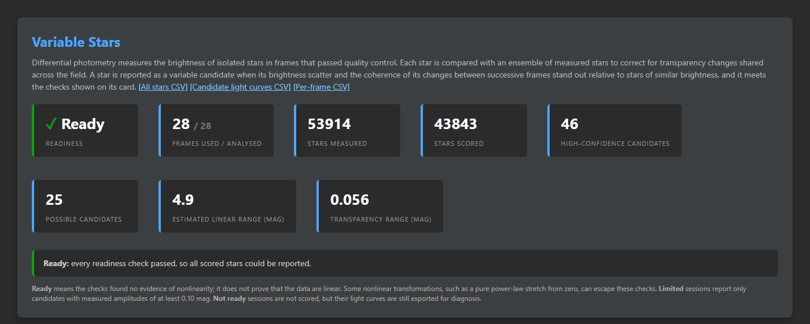

The verdict **Ready** means the data passed the photometry readiness checks; it does not confirm that every reported candidate is astrophysical. In the pictured run, SpacePixels measured 53,914 stars, scored 43,843 of them and reported 46 high-confidence and 25 possible variable stars. A **Limited** or **Not ready** verdict says in plain words why, and for Not ready what could help (for example unstretched frames or a longer sequence).

**Star peaks removed before registration.** Some processing removes hot pixels before registration: it replaces a pixel that stands far above its neighbours with their level. When stars are only about two pixels wide, a star centred on a pixel looks just like a hot pixel and loses the light of its brightest pixel. After a dither, other stars are hit, so the light curves show brief fadings that last one pointing. SpacePixels compares those fadings with the star's own image in nearby pointings. When the lost light sits in the brightest pixel in far more fadings than brightenings, the session is affected. A readiness message then says so, and those measurements are shown as flagged points ("star peak removed before registration") and left out of the variability scores. The readiness diagnostics show the counts, and the Per-Frame Measurements table and `photometry_frames.csv` (final `peak_removed` column) count the flagged measurements per frame. Processing the frames without hot-pixel removal, or only with it before stars are this sharp, keeps those measurements.

Photometry looks for changes that last. A brightening or fading must persist for about five consecutive frames to be reported with high confidence; briefer dips and flares are at most possible. A deviation in a single frame is removed like a cosmic ray or hot pixel, and so are two such deviations on either side of a frame where the star could not be measured. Variation that repeats within three or four frames is not found.

The candidates are first listed in a table: tier, position, observed variation in this session, the shape of the change (faded, brightened, dipped and recovered…) and any failed check. When the sky catalogue was fetched before the detection, the **Known As** column shows a matched VSX variable name. Without a VSX match, it shows a nearby catalogue star's proper name or Gaia DR3 designation when available, with the source and angular separation. This identifies a catalogue star without claiming it is a known variable. **Look up the N others in VSX** still includes these candidates; this needs SpacePixels running, and the results are saved into the report. A positive VSX result takes precedence; an empty or failed lookup keeps the catalogue star's name. The button counts the candidates still without a VSX match.

**Observed variation in this session** is the 95th minus the 5th percentile of the usable differential magnitudes over the measured time span. It is not a full-cycle amplitude. **Catalogue range** and **Catalogue amplitude** refer to the listed catalogue passbands; filter, phase and time coverage can make them differ from the session measurement. A small fraction of an orbital period can still contain a substantial eclipse.

Every matched candidate has a **Catalogue comparison** note. Expand it in the Known As table cell, or read the full note below the catalogue entry on a candidate card. It gives the usable measurement count, time span, largest gap, coverage of the catalogue period when available, and the session and catalogue passbands. It compares the observed variation with the catalogue amplitude or range. It also updates after **Check VSX Here** or **Look up the N others in VSX**, and saved lookup results restore it when the report is reopened offline.

An amber **review amplitude** note is a conservative screening prompt: the observed variation exceeds 1.5 times the catalogue amplitude, and the excess exceeds both 0.03 mag and three times the expected single-measurement scatter. This is not a formal amplitude significance test. Different filters, uncertain catalogue values and incomplete metadata limit the comparison; an unknown or mixed session filter prevents the amplitude screen. Smaller observed variations are not flagged merely for falling below the catalogue range. These notes do not affect detection confidence, checks, candidate order or CSV measurements.

**Review source metadata** identifies a source-verified catalogue discrepancy. The original VSX values remain visible alongside the publication and any unit conversion. Older saved catalogues still load; their shared passband and missing uncertainty metadata are identified as provisional. Fetching the sky catalogue again supplies the additional metadata when the service is available.

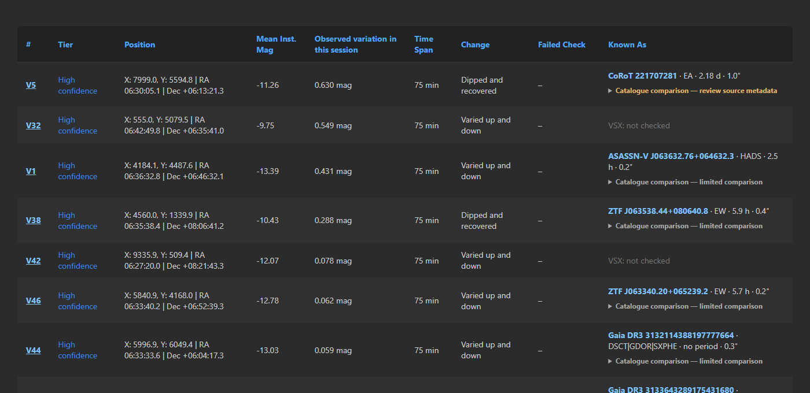

The same catalogue-star fallback appears on detailed candidate cards. Older saved sky catalogues remain usable; fetch the catalogue again to add Gaia identifiers, which older versions did not retain. The report and Astrometry tooltip explain when those identifiers are missing. General-star matches use the nearest star within 5 arcseconds, moved to the session date; candidates fainter than the fetched Gaia **Star Depth** may need a deeper catalogue. Fetch before detection and regenerate the report; an existing report does not update its static catalogue names. No catalogue lookup is performed automatically during report generation, and the names do not alter measured variation or confidence.

Each candidate then has a card with a one-line summary and its light curve, drawn above three constant stars of similar brightness for comparison; **Statistics** opens the detailed measures:

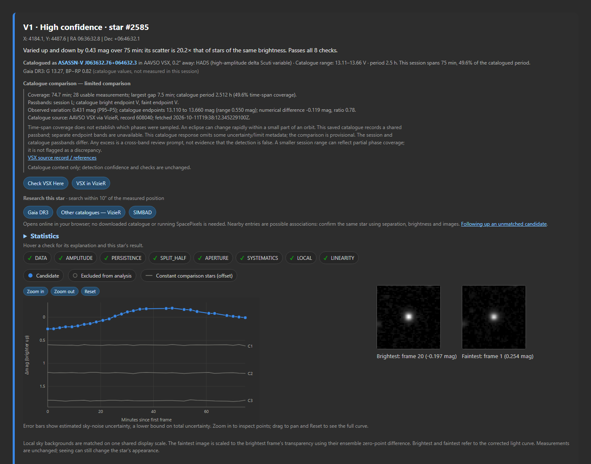

When the sky catalogue of the session was fetched before the detection (see [Annotate](#annotate-stars-deep-sky-objects-and-variable-stars)), the **Known As** column is filled when the report is written, for every candidate that is among the catalogue's VSX stars, with no button and no SpacePixels needed. The button then reads **Look up the N others in VSX** and looks up only the rest: the catalogue has the variables down to one magnitude fainter than its star depth, and the full VSX also has the fainter ones. Each candidate card then starts with what the catalogues say: its VSX name, the type in words (for example *EW, W UMa-type eclipsing binary*), the catalogued range and period, how much of the period the session covers (*This session spans 5.0 h, 77.2% of the catalogued period*), and the star's Gaia G magnitude and colour. These are catalogue values. SpacePixels measures instrumental differential magnitudes, without calibrating them to a catalogue passband.

Candidate V1 is already named from the catalogue: the high-amplitude δ Scuti star ASASSN-V J063632.76+064632.3, 0.2″ away, with a period of 2.5 hours. The light curve shows it rising and falling by 0.43 magnitudes within the 75 minutes of the session. **Check VSX Here** searches the full VSX for that position, using saved lookup results when available. A candidate without a VSX match may be a new variable, or a false one: check its light curve, the comparison stars and the cutouts before reporting it.


#### Candidate card limit and presentation order

Under **Detection Settings → Variable Stars → Report Presentation**, **Maximum Detailed Candidate Cards** controls how many candidates get full cards with charts and cutouts. The default is **40**; set **60** for a longer report. Values from 1 to 1,000 are allowed. Every candidate remains in the table, field maps and CSVs. This setting changes presentation, not how many stars are measured or classified.

**Candidate Presentation Order** always groups high-confidence stars before possible stars, then uses your choice:

| Order | Within each confidence tier |
|---|---|
| **Observed changes first** (default) | Up-and-down curves, dips and peaks first, then larger observed Δmag |
| **Shortest known period first** | Positive periods from saved VSX matches, shortest first; unknown periods follow known ones |
| **Largest observed variation first** | Larger observed Δmag first |
| **Variability significance** | How strongly the variability stands out, as in the earlier reports |

SpacePixels does not estimate a period from the session. Curve shape is a description of observed changes, not proof of periodicity. Missing catalogue periods do not lower confidence. The chosen order selects which candidates receive detailed cards. V numbers stay fixed across tables, cards, field maps, CSVs, saved lookup results and viewer overlays, so the first card need not be V1. The report states its order and card limit.

Changes apply to the next report. **Save** keeps these choices in the SpacePixels detection profile, **Revert** restores saved values, and **Load Defaults** restores 40 cards and Observed changes first. Older profiles load with those defaults; the usual backed-up migration offer adds the two presentation fields.

#### Following up an unmatched candidate

Every plate-solved candidate card has **Research this star**, with the search radius around its measured position:

- **Gaia DR3** searches the general star catalogue for identifiers and available brightness, colour, parallax and proper-motion information. It uses the coordinates, without the downloaded catalogue's magnitude limit.
- **Other catalogues — VizieR** searches published catalogues around the position, without restricting the search to VSX. A variable may already have been published elsewhere.
- **SIMBAD** searches names, object information and references to scientific papers.

These links open online in your browser, even if the session has no downloaded catalogue, and work with SpacePixels closed. They do not fill **Known As** or save external results into the report; **Check VSX Here** retains that separate role. Without a plate solution, the card explains that one is needed for coordinate searches.

Confirm that a result is the same star using separation, brightness and images. Nearby entries are possible associations; catalogue epochs and proper motion can affect their positions. **High confidence** means the candidate passed SpacePixels' checks, and an empty VSX result does not establish a new discovery.

The report's expandable **Following up an unmatched candidate** note describes the next steps: inspect measurements, uncertainties, comparison stars and image defects; seek additional nights and independent survey light curves (for example ASAS-SN or ZTF where available); and retain identifiers, coordinates/epoch, timing, filter and comparison-star details. A missing Gaia variability flag does not establish constancy. Before submitting a possible new variable, follow the [AAVSO VSX submission guidance](https://vsx.aavso.org/index.php?view=about.notice), including literature and archival-data checks. SpacePixels' exported instrumental/differential magnitudes are not automatically calibrated submission data.

### Blink Selected

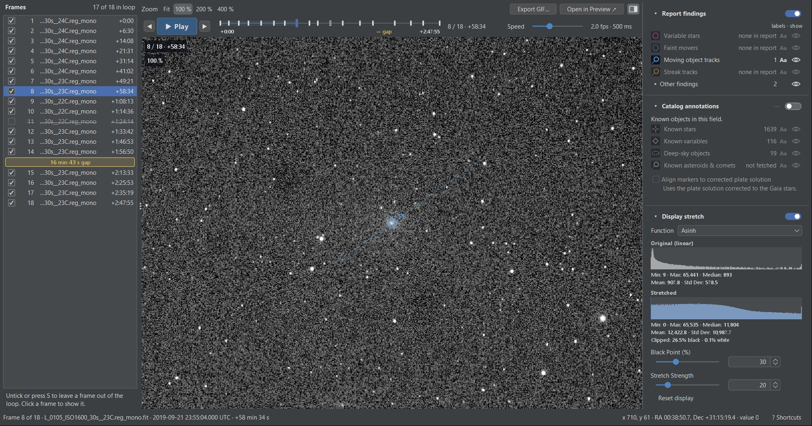

Select three or more frames in the table and click **Blink Selected** to play them as an animation, the classic way of hunting by eye. The blink window opens at once and shows the progress while it reads the frames (**Cancel** or Esc stops it), then plays them. Above, it is paused at 100 % on comet Africano, with the track found by **Detect Moving Targets** (T1) and frame 11 left out of the loop:

- **Play / Pause** (Space) and **◀ ▶** (arrow keys) to step one frame at a time. Stepping back and forth between two frames is the surest way to confirm a faint mover.
- **Speed**: from 50 ms to 2 s per frame, also with the ↑ and ↓ keys while playing. While paused, ↑ and ↓ step back and forward through the frames, as in the list. SpacePixels remembers the speed.
- **Display stretch** (side panel): switch it off for a linear view, or on to use the function and parameters shared with the Image Stretch tab. Changes apply at once while blinking and in the other viewers. Switching it off keeps your settings for when you switch it on again.
- **Export a GIF region**: click **Select GIF region** (G), drag a rectangle on the image, then right-click inside it and choose **Export animated GIF…** (Ctrl+E, or Command+E on macOS). Selecting pauses playback. The dimensions beside the controls are the exported screen pixels, including the display scale; the rectangle keeps its viewing size at any zoom. Untick the control, or press Esc, to return to ordinary drag-to-pan.
- **Zoom**: Fit, 100 %, 200 % and 400 %, or scroll to zoom around the cursor and drag to pan. Double-click switches between fit and 100 %. The view stays on the same spot while the frames change.
- **The frame list** on the left shows every frame with its time since the first one; the frame on screen is highlighted. Click a frame to pause and show it. While paused, untick a frame, or press S or tick **Skip this frame**, to leave a cloudy or trailed frame out of the loop; stepping by hand still shows it. While playing, the ticks are greyed out: pause first, so you change the frame you meant. At least two frames stay in the loop.
- **Tracks** (T, side panel) draws the latest run's or restored report's tracks, named as in the report (T1, T2… for moving objects, ST1… for streak tracks), with a ring at each measured position in the frame shown. Available findings are shown by default.
- **Variable stars** (V, side panel) marks the variable-star candidates from the last **Detect Moving Targets** run with photometry enabled. Magenta rings and V1, V2… follow the report's numbering; solid rings mean high confidence and dashed rings mean possible. Names from the saved VSX catalogue are added when matched. Hover for the name, confidence and measured variation. This overlay also works without a plate solution or sky catalogue, using the measured star positions.
- **Catalog annotations** (A, side panel) labels the stars, deep-sky objects and variable stars of the field, once the sky catalogue is fetched, and the known asteroids and comets where they are at each frame's time, once those are fetched. **Align markers to corrected plate solution** (C) aligns them, and all coordinates, with the stars (see [Annotate](#annotate-stars-deep-sky-objects-and-variable-stars) and [Known asteroids and comets](#known-asteroids-and-comets)).

**The side panel.** Blink, Preview Frame, Manual Transient Inspection and Show full size have a panel on the right with what is drawn on the frame. Drag its left edge to make it wider, or hide it with the panel button at the end of the toolbar; both are remembered. Its sections fold with the arrow beside their titles:

- **Report findings**: the latest run's or restored report's findings, one row per layer with its count. **Variable stars** (V), **Faint movers** and **Tracks** (T) have their own rows; **Other findings** unfolds into single streaks and anomalies (S, A), slow-mover candidates (DS), local rescue and activity (LR, LC), and camera-fixed and common-motion groups (FC, CM). The eye shows or hides a layer, and **Aa** its labels; hiding Other findings hides all its rows, which keep their own choices. A row that has nothing to show says why, for example *none in report*.
- **Catalog annotations** (A): the known objects of the field, once fetched. The switch in the header shows them; the rows choose **Known stars**, **Known variables**, **Deep-sky objects** and **Known asteroids & comets**, each with its count on the frame shown. The **⋯** menu holds **Faintest magnitude…**. **Align markers to corrected plate solution** (C) is here too.
- **Display stretch**: the switch, the function and its two parameters, each with a slider and a number field, shared with the Image Stretch tab. **Reset display** returns the parameters to the function's defaults.

The swatch beside each row looks like the marks it draws. Findings keep the colours of their report categories; everything already in a catalogue is drawn in off-white, so a white diamond inside a magenta ring reads as a detected variable that is already catalogued. The choices are shared by all viewers, so a layer hidden in Preview Frame is hidden in Blink too, and they are remembered.

Import restores findings from the newest compatible completed report, including individual iterative passes. Blink and Preview Frame show its tracks, variable stars, faint-mover fits and **Other findings** by default. The latter includes single-frame streaks/anomalies, slow-mover references, local rescue/activity and artifact groups, using the report's labels and colours. Measured markers appear only in their measured frames. Dashed squares labelled **ref** are stack or report reference positions, not per-frame detections. New reports store frame identities and full measured positions; older reports may only supply reference markers for tracks and omit variable-star hover details. The status names the restored report. Missing or incompatible report data does not prevent importing images. Restoring these layers does not rerun the full detection.

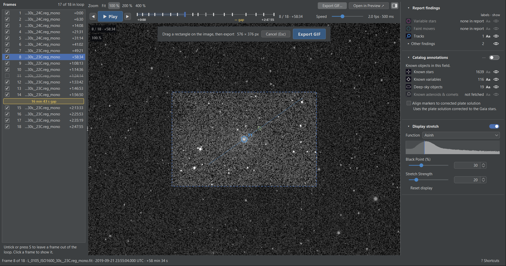

The exported GIF loops over the frames ticked in the frame list, in list order, using the current speed rounded to the nearest 10 ms (the GIF format's timing unit). It keeps the zoom, pan, stretch and enabled catalogue, track and variable-star overlays captured when export starts. The selection border, controls and cursor tooltip are omitted. GIF uses a limited colour palette, so colours may be quantized. **Cancel GIF export**, Esc, or closing Blink stops an unfinished export; an existing destination is replaced only after the new GIF is complete. The example above uses a synthetic field; its yellow rectangle is the selection guide.

Below the frame: the frame number, file name, capture time and time since the first frame, and under the cursor the pixel position, its value and, on a plate-solved frame, RA and Dec. Esc closes the window when no selection or export is active. The frames stay in memory while blinking (about 170 MB per 61-megapixel frame); if they would not fit, SpacePixels says so before reading them.

### Preview Frame

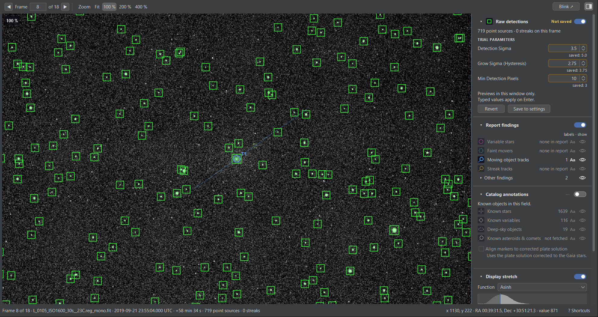

Runs the source detection on the selected frame with the current settings and shows what it picks up: green boxes around point sources, red lines along streaks. **◀ ▶** (← →) move to the other frames of the session; each frame is detected when you get to it, with the settings as they are then, and the status bar shows how many point sources and streaks it has. Use it to see what the detector picks up in a single frame.

To try the per-frame settings on the frame itself, use **Detection Sigma**, **Grow Sigma (Hysteresis)** and **Min Detection Pixels** under the buttons:
- Click the arrows, or click into a field, type a value and press Enter; Esc discards a typed value. Enter, Esc or a click on the frame gives the keys back to the window.
- The frame is detected again a moment after the change.
- These are trial values. **Apply to Settings** copies only the fields you edited to Detection Settings; changes made elsewhere to other fields are kept. Applied changes are unsaved until you use **Save** there. The usual rules keep paired thresholds in order.
- **Reset** restores the values from when the preview opened, without applying them. Closing discards unapplied trials; reopening starts with the current Detection Settings.
- Text that is not a valid value is outlined in red, a note says what to enter, and the frame keeps the last valid value.
- While a job runs, the fields, Reset and Apply are locked, like the Detection Settings tab.

After a full detection, the side panel's **Tracks** (T) draws that run's tracks as Blink does, and with variable-star photometry **Variable stars** (V) draws its candidates, with the same labels and hover details as Blink. They are the positions that run measured: changing the single-frame preview settings does not change them, and showing them detects nothing again. Run the full detection again to update them. A run that ends while Preview Frame is open makes its tracks available there at once.

Preview Frame shows the normal detection only; the faint-streak search runs in Detect Moving Targets.

### Manual Transient Inspection

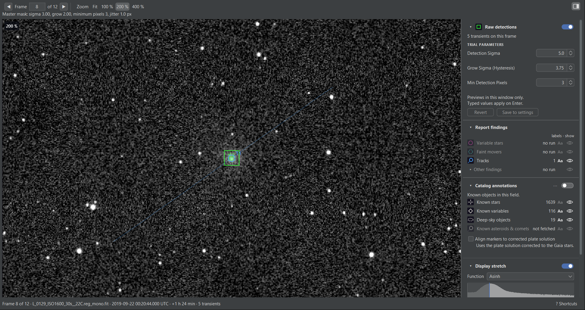

Runs the detection on all frames of the session (not only the selected ones) and shows, frame by frame, every detection left after the star mask: the candidates for moving objects, before they are linked into tracks. The three per-frame thresholds can be tried without rebuilding the master mask; only the frame on show is re-detected, and Apply to Settings copies the edited values. Edits to other per-frame extraction and filtering settings take effect when a frame is shown again. If the master settings change while the window is open, it says so and keeps the reference, including its jitter radius, until you reopen it. Useful to judge the noise, or to find a faint object by eye that did not form a track. Above, at 200 %, the comet is outlined using the current trial settings. The frames stay in memory until you close the window. After a full detection on the session, the side panel's **Tracks** (T) draws that run's tracks over these frames, as in Blink.

Manual Transient Inspection uses the normal detection only; the faint-streak search runs in Detect Moving Targets.

Both windows, and **Show full size** on the Image Stretch tab, work like the blink window: the same stretch as the Image Stretch tab, the same zoom (Fit, 100 %, 200 %, 400 %, scroll to zoom, drag to pan, double-click), and the same status bar with the frame, its time since the first frame, and under the cursor the pixel position, value and, on a plate-solved frame, RA and Dec. **Show detections** (D) hides the markers to see the frame underneath. From 100 % zoom the detected pixels are tinted too. When there are too many detections on screen to tell apart, the markers are left out until you zoom in. Esc closes the window.

### Annotate: stars, deep-sky objects and variable stars

Viewer shortcuts apply while the image has keyboard focus. **Tab** and **Shift+Tab** reach the viewer controls; Space operates a focused button or checkbox, and arrow keys edit a focused slider, number or list without changing frames. **Escape** from a control returns to the image; Escape on the image closes the viewer. Clicking the image also restores navigation. The previews' numeric fields use Enter to preview a typed value and Escape to discard unfinished text; Apply to Settings changes the session settings.

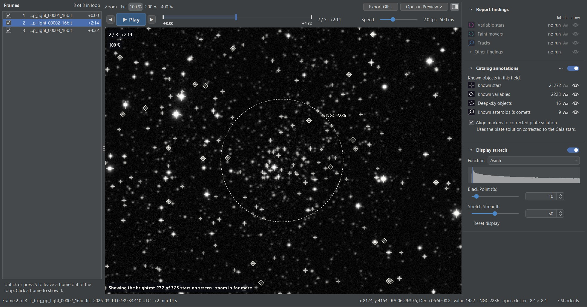

Once one frame is plate-solved, **Fetch Sky Catalogue** in **2 Astrometry** downloads what is known in the field of your frames:

- **stars** from Gaia DR3, down to the **Star Depth** set on the Astrometry Config tab (Gaia G magnitude 15 by default);
- **galaxies, nebulae and clusters** from SIMBAD: the objects with a classic catalogue name (Messier, NGC, IC, Sharpless, Collinder, Barnard, LDN, LBN and others), galaxies of 1′ or more, and the common names people know (*M 81, Bode's Galaxy*; *Barnard 33, Horsehead Nebula*);
- **bright stars with a proper name** from SIMBAD, such as Alnitak or Betelgeuse, brighter than magnitude 5 (most telescope fields have none);
- **variable stars** from the AAVSO Variable Star Index (VSX), down to one magnitude fainter than the star depth.

The detection report uses the catalogue too, when it was fetched before **Detect Moving Targets**: names on the session picture and the detection map, VSX matches for the variable-star candidates, and the field depth. It also fetches faint Gaia stars, down to magnitude 20.5, in four small patches of the field, for the **Field depth** of the report (see [Reading the report](#4-reading-the-report)). A catalogue fetched before these were added has no common names, named stars or faint stars: click **Fetch Sky Catalogue** again to get them.

The fetch runs in the background, so you can keep working. The status bar shows each step and how long it has taken. The stars take longest, about 20 to 30 seconds for a 4° × 3° field to magnitude 15; each magnitude deeper roughly doubles the stars and the wait. Meanwhile the button reads **Cancel Sky Catalogue**. The catalogue is saved next to the frames as `sky_catalogue.json` and comes back by itself when you import the folder again. Click the button again to fetch a fresh one, for example after changing the star depth. The **2 Astrometry** status line shows what is loaded; its tooltip gives the details, and says why if a service did not answer (what did arrive is kept).

In every viewer (Blink, Preview Frame, Manual Transient Inspection and Show full size), **Catalog annotations** (A) in the side panel draws the catalogue on the frame, all in off-white: crosses for stars (larger for brighter stars), diamonds for variable stars and dashed outlines for deep-sky objects, with their size and orientation. Its rows choose which of these are shown, and whether the asteroids and comets are (see [Known asteroids and comets](#known-asteroids-and-comets)). The status bar and a tooltip beside the pointer name the object under the cursor, even when its label is hidden to reduce clutter: above *NGC 2236 · open cluster · 8.4 × 8.4′*, or for a variable star for example *V0623 Mon · LB · 13.30–14.60 V*. When there are too many marks on screen to tell apart, only the brightest stars and variables and the largest deep-sky objects are drawn, and a note says so: zoom in to see more. Names and magnitudes are written next to the marks once few enough are on screen; the long survey names of many variables (such as *Gaia DR3 3131…*) only when you zoom further in.

Each row's **Aa** hides or shows its names and magnitudes while keeping the markers and hover identification; star labels are off by default. **Faintest magnitude…** in the section's **⋯** menu independently limits stars (Gaia G, or V for named stars) and catalogued variables (their maximum brightness in the catalogue's band). Smaller numbers show only brighter objects; 99 means no limit. Unknown magnitudes and deep-sky objects remain visible. The limits are remembered for subsequently opened viewers; viewers already open keep their own limits. Density thinning still applies. The controls affect only the viewer, not catalogue downloads, measured variable candidates, detection or exported reports.

If a viewer is open when the catalogue arrives, the frame does not change: the **Catalog annotations** switch becomes available and a note in the section says *Sky catalogue ready · A shows it*.

### Known asteroids and comets

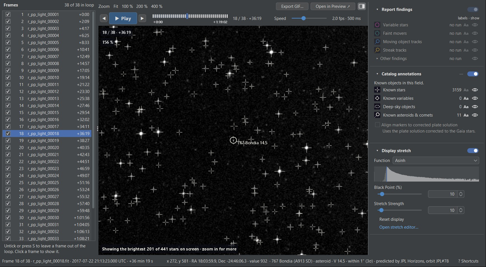

Once one frame is plate-solved, **Fetch Asteroids and Comets** in **2 Astrometry** asks NASA JPL which known asteroids and comets cross the field of your frames during the session, and where each one is at every frame's time. It sends JPL the field, the frame times and your observing site (or your IAU observatory code); the site comes from the FITS headers, or from the **Astrometry Config** tab when they have none. The frames need their capture times (`DATE-OBS`).

- JPL's field search finds the objects brighter than the **Asteroid and Comet Depth** on the Astrometry Config tab (V 19 by default; configurable from 8 to 23). To compare detections around magnitude 20.5 or fainter, select a sufficiently deep value and fetch again; changing the setting alone does not update saved predictions. For comets JPL predicts the total magnitude, which can be off by a magnitude or more. A second search looks for near-Earth objects up to 5° around the field: fast ones can cross the field during the night.
- JPL Horizons then gives each object that passes over the frame its position, predicted magnitude and position uncertainty every 10 minutes over the session (every 2 minutes for very fast ones). The viewers place the object at the middle of each exposure. Both services compute from today's orbits with the planets' pull included, so frames taken years ago are covered too, and objects discovered since are shown as well.
- The fetch runs in the background and usually takes from half a minute to a few minutes: JPL's field search is slow, more so for frames from many years ago and for a deep magnitude limit. Meanwhile the button reads **Cancel Asteroids and Comets**, and the status bar shows each step. The predictions are saved next to the frames as `solar_system.json` and come back by themselves when you import the folder again; they work without an internet connection from then on. Fetch again after changing the depth.

In every viewer, **Catalog annotations** (A) then draws each object in off-white: a ring where it is predicted at the middle of the exposure with its name and magnitude (*194 Prokne 13.3*), a short line for its motion during the exposure, and its whole path over the session as a faint dashed line, so you can see where it comes from and goes. When the prediction is uncertain by more than the ring, a dotted ellipse shows the 3-sigma uncertainty. The tooltip names the object, its predicted magnitude, the uncertainty and JPL's orbit solution. The **Known asteroids & comets** row switches them off. The objects move from frame to frame in Blink, and an exported Blink GIF keeps them.

These are predictions, not detections: an asteroid may be too faint to see, and a detected track is not identified just because a prediction is near it. On a plate-solved frame the predictions agree with detected known asteroids to well under a pixel when **Align markers to corrected plate solution** (C) is on; the FITS header solution alone can be several pixels off. If all known objects sit along their paths ahead of or behind the detections, the frame times are probably off, for example camera local time written as `DATE-OBS`.

Reports with saved predictions include **Known asteroids and comets in the field**. The table shows predicted magnitude ranges, sampled path coverage, kept frames with data, star-mask intersections, ordinary-track comparisons and the existing FM fitted-path comparisons. Predicted V or comet total magnitudes and the sampled stellar Gaia G field depth have different passbands and detection requirements. An object with no compatible reported finding is not a measured completeness failure: blends, masks, aperture coverage, rejected frames, disabled or truncated searches, catalogue limits and omitted report categories can matter.

The table includes objects predicted inside the image at one or more exposure midpoints across the session. The saved fetch also allows a 5% field border and extra time around the session, so its total can be larger than the in-field count. Entries without an in-field midpoint are omitted from the table; the complete inventory and comparison evidence remain in `report-data.json`. This sampled coverage does not test every instant within an exposure.

Each object has a **JPL object details** link built from its saved number or designation; opening it needs an internet connection, but generating the report needs no additional fetch. Finding badges open the corresponding report card, and expandable evidence keeps the measured distances and clock diagnostics available. Moving-object track cards show **Possible identification** with the compatible asteroid or comet names when position and motion agree at the recorded times. Competing names remain explicitly ambiguous; agreement that requires a trial time shift is shown only in the comparison table.

Ordinary-track comparisons require at least three actual centroids at known UTC exposure midpoints, positional agreement and agreeing rates. The displayed screen combines the supplied ephemeris 3-sigma RSS with an empirical pixel floor of the larger of one pixel and star jitter. Missing ephemeris uncertainty is labelled explicitly. Centroid and plate uncertainties and ephemeris covariance are not modelled, so these are review comparisons, not confirmed identities. All plausible matches stay visible, with their measured residuals saved in `report-data.json`.

When supplied ephemeris uncertainty is at least as large as the frame diagonal, the table says **Orbit too uncertain for comparison** and retains the supplied scale in its explanation. Such an uncertainty cannot distinguish ordinary tracks within this field and supplies neither a track identification nor a clock comparison. The predicted object remains in the inventory; its uncertainty is not replaced by an artificially precise value.

The table's **Clock check** considers along-path time offsets only when shifted positions can be checked inside the saved ephemeris samples. A common suggestion needs at least two independent, unambiguous objects with supplied uncertainties, agreeing offset signs and overlapping review intervals. Positive seconds mean **add** to the recorded capture time. The position-tolerance equivalent is not a statistical clock-error bar. WCS, centroid, observer-site or orbit errors can imitate a time offset; large offsets outside the saved prediction span cannot be checked. No frame timestamp is corrected automatically. [JPL documents the supplied formal 3-sigma quantities](https://ssd.jpl.nasa.gov/horizons/manual.html#observer-table).

New Horizons fetches save samples from fourteen hours before the first exposure to fourteen hours after the last, so the clock check can verify common local-time/UTC mistakes without extrapolation. Object discovery and the field-crossing test still use the observing span and its original motion margin; this does not search every possible field at every time offset. Refetch predictions to add the extended samples to an older cache. A field-search fallback without Horizons still has no supplied positional uncertainty and cannot establish the common-clock diagnostic.

A clock comparison also needs observed and predicted displacement greater than twice its positional review tolerance over the measured track. The report saves original midpoint times, trial prediction times, observed/predicted pixel positions and residuals for both the nominal and shifted comparison. Shifted RMS and maximum separation are shown beside the suggested offset. This is review evidence; the original timestamps stay intact.

Stars are moved from the Gaia epoch (2016) to the date of each frame. Only the sky coordinates of the field are sent to the services (at CDS in Strasbourg, and the ESA Gaia archive if CDS does not answer), never your observing site.

Session metadata is loaded during background import. Catalogue, correction and Auto-Tune saves run in an ordered background queue, so slower storage does not freeze the window. A detection uses the catalogue and correction as the window shows them when it starts, without waiting for a save. If the catalogue or the correction cannot be saved, for example because the dataset folder is read-only, it stays in use until SpacePixels closes, in the viewers and in the reports, and a warning says it was not saved; Auto-Tune save failures are also reported. Closing SpacePixels waits for queued writes without blocking repainting. Importing a new folder closes every open viewer for a fresh start.

#### Correct plate solution

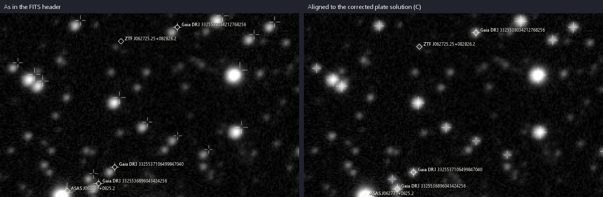

A plate solution in the FITS headers is rarely perfect: in the corners of wide fields the catalogue stars can land several pixels from the real stars, as on the left above. After the catalogue arrives, SpacePixels checks the solution in the background: in every frame it finds the stars, matches them with the Gaia stars, and works out a correction for the whole session (including the distortion of the optics) and a small one for each frame. On the reference sessions this brought the stars from 0.3–4.9 px down to 0.07–0.3 px (median); it takes from a few seconds to about half a minute for large sessions.

A new fit is **applied automatically** when it reduces the median position error by **more than 1 pixel** and also improves the 90th-percentile error. The **2 Astrometry** status line shows the before/after values, for example *Plate solution corrected · 4.85 → 0.10 px*, and the completion message says it was applied automatically. Use the compact **Apply** checkbox beside that status to switch an available correction on or off, or **Align markers to corrected plate solution** (C) in a viewer's Catalog annotations section. An explicit choice is saved and kept when refetching/refitting the same solution. Import restores the saved choice. It is one setting for the session: it applies in all viewers at once, to the cursor RA and Dec, and to the report of the next **Detect Moving Targets**, so the positions, the JPL, SkyBoT and SatChecker lookups and the VSX matches of variable stars use the corrected coordinates (in tests, VSX matches moved from about 3″ to under 1″). A report written before keeps its coordinates until you run the detection again. The correction is kept next to the frames as `plate_correction.json`, with the setting; your FITS files are never changed. If saving fails, the current choice stays active for this session and the status explains that it was not saved.

When a field has few bright stars, SpacePixels fetches fainter Gaia stars for the check. If too few stars can be matched (clouds, very few stars), the status line says so and the solution in the headers stays in use.

<sub>Gaia data: ESA/Gaia/DPAC. SIMBAD and VizieR: CDS, Strasbourg. VSX: AAVSO.</sub>

### Star Mask Explorer

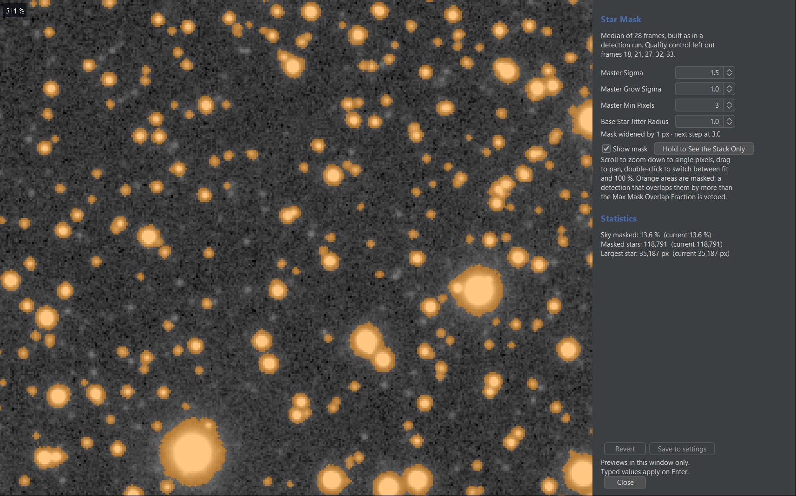

**Test Star Mask…** on the Overview (under the star mask settings) shows the star mask exactly as a detection run builds it, in orange over the median stack of your frames. Change the master sigma, grow, minimum pixels and star jitter radius and see how much of the sky is masked; scroll to zoom down to single pixels, and hold **Hold to See the Stack Only** to compare with the stack. **Apply to Settings** copies only the fields edited in this window; other current detection settings are kept. Enter previews a typed value and Escape discards unfinished text. Invalid text is explained beside the controls. Reset restores the opening trial values without applying them, and closing discards unapplied changes. The trial controls and Apply pause while an application job runs. A deeper mask (lower sigma) hides more faint stars and their noise, but an object crossing a masked area is not detected there.

### Image Stretch

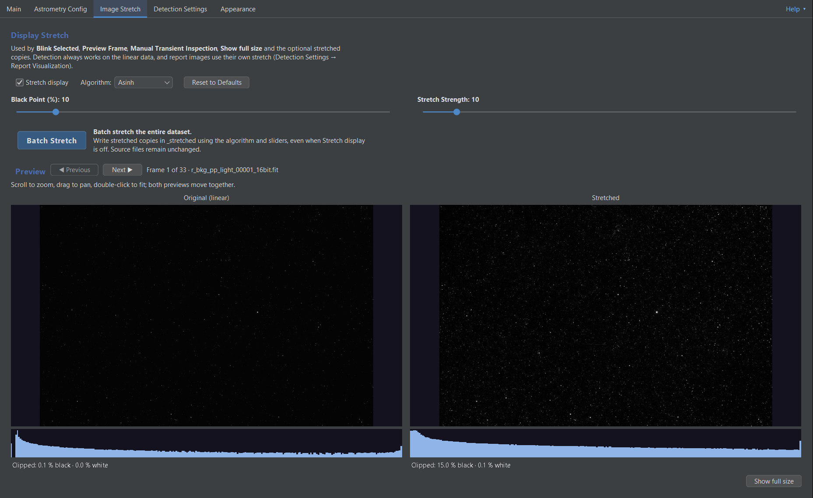

Sets how frames look in Blink, Preview Frame, Manual Transient Inspection and **Show full size**; their windows show the same stretch controls, and a change in any of them shows everywhere. The detection always uses the original linear data, so the stretch does not change what is found. The report images have their own stretch (Detection Settings → Report Visualization). Optional **Batch Stretch** and **Convert to Mono** write new copies of the frames.

**Stretch display** switches between the selected stretch and a linear view. Unticking it disables the algorithm and sliders without resetting their values; ticking it restores the same stretch. The choice is shared by the tab and all viewers and remembered between sessions. Minimum slider values still apply the selected algorithm; the checkbox provides the linear view, which will often look very dark. With stretch off, both tab previews show the linear image.

The prominent **Batch Stretch** button on this tab stretches the **entire imported dataset**, including frames that are not selected in the table. It uses the selected algorithm and slider values independently of **Stretch display**, and writes new copies in `_stretched` while preserving the source files. It is available whenever a dataset is imported and no processing job or blink holds the window; there is no separate enable checkbox.

**Convert to Mono** is a separate operation on the Main tab: it writes linear monochrome copies in `_mono` and offers to import them. It never applies a stretch or creates stretched copies automatically. To stretch a converted mono dataset, import `_mono`, choose the desired settings on **Image Stretch**, and click **Batch Stretch** explicitly. Use the linear copies for detection.

The preview on the tab shows the selected frame with the current stretch. While it is being drawn, the line above it ends in *rendering…*; it always shows the last frame and stretch you chose, however quickly you change them.

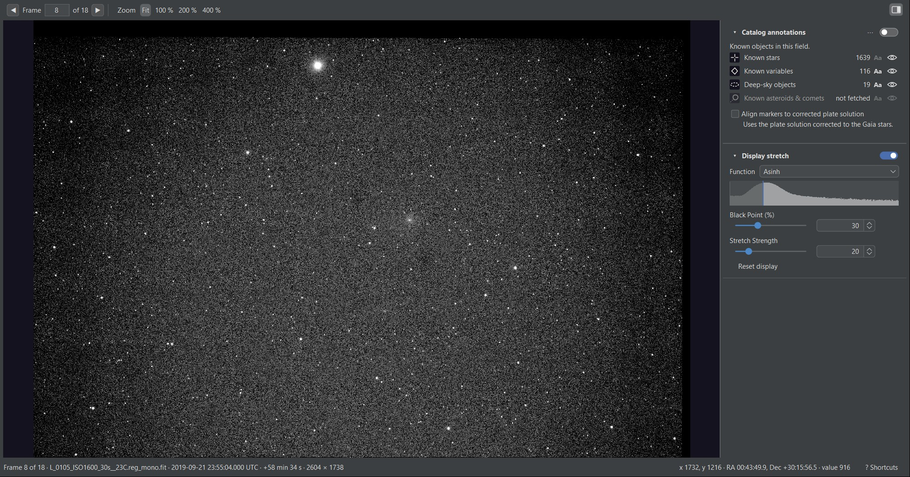

**Show full size** opens the frames of the session at full resolution, starting at the selected one, in a window that works like the other viewers: ← → to step, the same zoom and stretch, and the pixel value and RA/Dec under the cursor. Colour frames show in colour, and the status bar gives the frame size.

### Detect Iteratively (large datasets)

Runs ordinary detection repeatedly on progressively larger subsets spread across a dataset. You can open it before importing anything. Choose a **Source directory** in the configuration window; the session already open in the main window stays unchanged.

- **Start frames** defaults to 5 and cannot be lower.
- **Increase by** controls how much each pass grows.
- **Maximum frames** caps a pass at that many frames, or at the available count if smaller. Set 0 to include all available frames in the largest pass. The exact maximum is always included: Start 5, Increase 10, Maximum 32 gives passes of 5, 15, 25 and 32 frames.
- **Planned passes** previews the sizes before starting. Each subset includes the first and last frames and prefers even timestamp spacing; otherwise it uses even sequence spacing. Larger subsets are selected afresh and need not contain every frame from smaller passes.

With **Auto-Tune once before the passes** unchecked, the run uses the current Detection Settings, including unsaved edits. For manual tuning, import the dataset normally and use Detection Settings and Preview Frame to experiment, then run iteratively with Auto-Tune disabled. The configuration window includes this reminder.

With Auto-Tune enabled, select its sensitivity and sample limit (at least 5). The calibrated tuner runs once on the chosen dataset; its candidate limit is capped at the largest pass size. Every pass then uses the resulting settings. Tuning does not change the settings editor or the open session. If tuning cannot produce usable settings, the run stops with its explanation before starting the passes.

**Prepare non-ready inputs** creates detection-ready copies when conversion is needed, preserving the originals. **Keep negative pixel values by adding an offset** applies one sequence-wide offset; untick it to clip negative values to zero. With preparation disabled, the folder must already contain detection-ready images. Mixed or inconsistent sequences are rejected; import normally first if you need to choose one exposure group.

Click **Run iterations**. Each pass builds its own master and uses the same analyses and readiness checks as Detect Moving Targets, including variable-star photometry when enabled and ready. Reports, frame counts, quality rejections and photometry refer only to that pass's selected inputs. Pixel buffers are released between passes; choose a maximum appropriate for the image dimensions and available memory.

Results are written in an `iterative_detections_*` folder beside the source files. Its index links each completed report and the selected input list, with observing span, findings and pass outcome. Failed or declined passes are identified, and later passes can continue. Cancel stops further work and preserves completed reports and their index; if nothing finished, the unfinished run folder is removed. Counts are per pass: the same object may appear in several reports. Consolidating those findings into a combined report is a planned enhancement.

### Command line

The batch tool runs detection without the window, for example to process many sessions. From a Windows installation folder:

```powershell
.\spacepixels-batch.exe "C:\astro\session1" "app\config\default_detection_profile.json" --auto-tune high
```

From an unpacked Windows archive:

```
bin\batchDetect.bat "C:\astro\session1" "config\default_detection_profile.json" --auto-tune high
```

On Linux and macOS use `bin/batchDetect`. The profile can be `low`, `medium`, `high` or `maximum`. The CLI requires already prepared, uncompressed unsigned 16-bit monochrome FITS. It does not calibrate, align or convert input images. See the [command-line guide in the README](README.md#command-line-utilities) for launcher examples, profile files and memory settings; `--help` lists the accepted arguments.

---

## 8. Detection settings in brief

The **Detection Settings** tab has a list of pages on the left, a search box at the top (Ctrl+F) and **Save**, **Revert** and **Load Defaults** at the bottom.

- **Overview**: Auto-Tune, the most important settings (detection, star mask and star jitter) and the analyses of a run: slow movers, experimental faint movers, anomaly rescue, residual analysis and variable stars, each with a switch and a link to its settings.
- **Detection**: how objects are found in each frame (Streak Detection, with the **Faint Streak Search** switch; switch it off to save time on very large frames, where it can add about a third to the detection time) and which frames are used (Quality Control, with a **Strictness** choice of Lenient, Normal or Strict for leaving out frames that differ from the rest of the session).
- **Moving objects**: how detections are linked into tracks (Track Linking, with **Reject Camera-Fixed Sources** for hot pixels and dust) and the extra searches (Anomaly Detection, Slow Movers, Faint Movers (experimental), Residual Analysis).
- **Variable stars**: the photometry settings.
- **Report**: how images in the report are stretched and animated, and whether the report builds the **Enhanced Stack**. **Auto Stretch Black Sigma** and **White Sigma** have sliders, and a preview under them shows up to three crops with the values as you drag or type them: around the tracks of the last detection run, or, before a run, a quiet patch of sky, a busy star field and the brightest star of a frame in the middle of the session. Under each crop is the share of its pixels drawn black and drawn white; a large black share makes the sky grainy, and a large white share makes stars bloated.

Each page shows its main settings. The fine-tuning settings are expert settings: tick **Show expert settings** under the page list to see them on every page (SpacePixels remembers the choice). A search or **Show only unsaved changes** finds expert settings either way, and a page tells you how many expert settings it hides. Settings that only matter while a feature is on, such as those of the geometric linker, appear when you switch the feature on.

A setting you changed since the last save shows its name in blue; **Show only unsaved changes** lists only those, and the **Reset** button next to a changed setting puts it back to the saved value. **Save** keeps the settings for the next start; **Load Defaults** goes back to the starting settings of SpacePixels.

Residual Analysis settings also accept their profile field names in Search, for example `localActivityClusterRadiusPixels`. Search reveals matching expert settings without changing **Show expert settings**. The familiar labels, Save, Revert and Overview analysis switches keep the same behavior.

Save runs in the background and temporarily disables its button, not the settings fields. You can keep editing: only the values captured when you clicked Save are written, and later edits remain marked unsaved. Revert and each row's Reset use the last successfully saved values. If a save fails, your edits remain available and the error explains which files were saved; correct the problem and retry. Closing SpacePixels waits for queued settings writes without freezing the window.

Changes apply as soon as you make them. A run uses the settings as they are when you start it, so changing a setting during a run does not affect that run. An open Preview Frame follows your changes: it detects each frame with the settings as they are then, and its three per-frame settings are the ones on this tab. Text that is not a number, or is outside a setting's range, stays in the field outlined in red, and the line at the bottom says what to enter, for example *Detection Sigma: enter a number between 1.0 and 20.0*. Save and the runs do not start until it is corrected; SpacePixels shows you the setting instead. Some settings come in pairs: Grow Sigma, for example, cannot be above Detection Sigma. When a change crosses a pair, SpacePixels moves the other setting and says so at the bottom.

In most sessions you only need Auto-Tune and the profile. Change single settings when a report shows a specific problem; the tooltip of each setting explains what it does.

**Review rules…** explains advisory conflicts, including quality-grow thresholds, a star cap too small for photometry, and a limited-readiness amplitude below the ordinary minimum. **Keep settings** leaves these preferences unchanged. **Align listed changes** applies only the changes listed in the dialog, in memory; Save persists them. It does not change star caps, measured jitter or configured annulus factors. Warnings do not stop a run, and the dialog cannot predict whether a particular dataset has enough usable stars, frames or timestamps. The original paired-control adjustments still apply while you edit; rhythm/jump alignment is a legacy GUI policy, not a universal engine requirement.

---

## 9. Tips and troubleshooting

**Too many results, mostly noise.** Use a lower profile (High → Medium → Low). Uncalibrated or very noisy data produces more noise detections; hot pixels that drift with the frames can look like slow movers.

**A known object is missing.**
- Check the Unclassified Transient Inspector: if the object is there, it was detected but not linked into a track.
- Try a higher profile: it accepts more noise detections and uses a shallower star mask.
- Objects that cross bright stars are hidden by the star mask; the Star Mask Explorer shows where.
- Objects that hardly move during the session end up in the median stack and are masked. Use a longer session, or look at the slow-mover candidates.

**Frames were left out.** Quality control rejects blank frames, failed registrations, a frame shifted so far from the others that keeping it would cost every frame 5 % of the sky, and frames much worse than the rest (clouds, wind, focus). The sky and the stars of each frame are measured where every frame has image data, so a frame with a wider black registration border is compared fairly. The report lists every rejected frame and the reason.

**No identification buttons.** Plate-solve one frame (section [3, step 2](#step-2-optional-plate-solve-one-frame)). The buttons that show results **Here** need SpacePixels to be running.

**Something failed.** The error message has a **Copy details** button. It copies the message, the SpacePixels, JTransient and Java versions, and the full error, ready to paste into a bug report. Check the copied text before you share it: an error message can contain the path of your files.

**Out of memory.** Close other programs. If Auto-Tune runs out of memory, lower **Frames Used by Auto-Tune** (Detection Settings → Quality Control, an expert setting). For moving-object detection, use **Detect Iteratively** and set a smaller maximum frame count. Its optional Auto-Tune has a separate sample limit. A Maximum of 0 includes a full-dataset pass and can still require substantial memory.

**Colour frames.** Detection works on monochrome data; accept the conversion offer after import, or click **Convert to Mono** later, then import the generated mono folder.

**Signed 16-bit frames, or pixel values below zero.** SpacePixels reads 16-bit frames as unsigned values (`BZERO` 32768). Frames stored as signed 16 bit (`BZERO` 0) or with other scaling would be read at the wrong brightness level, so import offers to convert them into a new folder. When the conversion finds pixels below zero (frames bias- or dark-subtracted without a pedestal, in signed 16 bit or 32 bit), it asks how to store them. **Add an Offset** (recommended) adds one common offset before the sequence-wide linear scale, keeps normal negative values and leaves registration padding at 0; extreme values follow the separate outlier choice; the report takes the offset off again for the sky brightness. **Set to 0** clips negative values before the common linear conversion and cuts off the low side of the noise; when the sky itself is near zero, most of each frame becomes 0, every frame then looks like a failed registration and detection fails.

---

## Annex: What to avoid when preparing data

The goal of data preparation for SpacePixels is a sequence of individual sub-exposures that are calibrated and star-aligned, and otherwise left as measured. SpacePixels searches for variations across time by comparing physical pixel values from frame to frame. Image processing operations that look appealing for a final stacked astrophoto can corrupt or erase the real astrophysical signals SpacePixels searches for.

Whether you prepare your sub-exposures with Siril, PixInsight (WBPP), DeepSkyStacker, Astro Pixel Processor, or custom scripts, leave out the following operations:

### 1. Cosmetic correction and hot pixel removal
- **What to avoid:** Defect maps, automated hot/cold pixel detection and replacement (such as Siril `-cc` or PixInsight CosmeticCorrection with auto-detect).
- **Why:** A faint, slow-moving asteroid or a short streak in a single sub-exposure has a profile very similar to an isolated warm or hot pixel. Automated cosmetic filters can replace these faint targets with the surrounding background, erasing them before detection starts. In other cases, aggressive filtering leaves small negative pits ("holes") in the background that trigger false transient detections.
- **What SpacePixels does instead:** SpacePixels natively identifies stationary sensor defects and hot pixels by tracking stationary features across the sequence and masking them out with its master star and defect mask. Real movers, which change position across exposures, are preserved.

### 2. Dark optimization and dark scaling
- **What to avoid:** Dark frame optimization or adaptive dark scaling (for example Siril `-opt` or PixInsight "Optimize dark frames").
- **Why:** Dark scaling multiplies the master dark by a fitted factor to minimize residual noise against the light frame. On modern CMOS sensors with non-linear dark current and amplifier glow signatures, dark scaling leaves hot-pixel remnants and creates artificial non-uniform background patterns.
- **What to do instead:** Use dark exposures taken at the exact same exposure duration and sensor temperature as your light frames, and subtract the master dark directly without scaling.

### 3. Background extraction and per-frame gradient removal
- **What to avoid:** Dynamic background extraction (DBE), automatic background extraction (ABE), GraXpert, or per-frame photometric colour calibration (PCC) applied to individual sub-exposures.
- **Why:** Estimating and subtracting a varying background model from each frame individually alters the relative photometric baseline and local noise floor across the time series. This can disrupt detection thresholds and distort variable-star aperture photometry.
- **What to do instead:** Let SpacePixels measure the natural background and sky noise directly from your linear calibrated exposures.

### 4. Denoising, star removal, sharpening, and deconvolution
- **What to avoid:** AI-based or non-linear smoothing and sharpening filters (NoiseXTerminator, BlurXTerminator, StarNet, RC-Astro tools, wavelet filters, unsharp masks).
- **Why:** These tools suppress faint low-SNR features, alter stellar point-spread functions (PSFs), and invent synthetic smooth textures. SpacePixels' statistical extraction algorithms depend on unaltered sensor noise statistics and natural optical PSFs.

### 5. Comet alignment
- **What to avoid:** Aligning (registering) the sequence on the comet's nucleus instead of on the stars.
- **Why:** Comet alignment holds the comet stationary while trailing every star into lines. SpacePixels relies on a stationary star field to construct a master star mask; trailing the stars across the frame invalidates the star mask and prevents detection.
- **What to do instead:** Always register on the stars. SpacePixels will track moving comets and asteroids against the stationary star background.

### 6. Cropping to the common overlap
- **What to avoid:** Cropping all frames to their common intersection (for example Siril `-framing=min` or an automatic bounding-box crop).
- **Why:** SpacePixels inspects the zero-padded borders created by mount dithering and drift (`-framing=current` in Siril, "Standard Mode" in DeepSkyStacker) to measure tracking stability, distinguish image borders from valid sensor data, and reject false detections along image boundaries. Cropping to the common overlap destroys this boundary information.
- **What to do instead:** Keep the canvas size equal to the reference frame, with zero-filled margins where frames shifted.

### 7. Ringing interpolation filters and drizzle
- **What to avoid:** Lanczos or high-order sinc interpolation kernels during star registration, as well as drizzle resampling.
- **Why:** Lanczos and sinc filters produce negative ringing (dark halos or rings) around bright stars. These rings become high-contrast edges in difference frames, leaking through star masks and triggering false detections. Drizzle resamples data onto a non-uniform fractional grid that perturbs single-frame pixel statistics.
- **What to do instead:** Use standard linear or bilinear interpolation for star alignment.

---

## Annex: Preparing data with Siril

**Prepare with Siril** runs one fixed recipe. The steps in the window are in [Preparing an observing session](#preparing-an-observing-session). This annex explains the options in that recipe. **Preview processing instructions** shows the script before it runs, and the run folder keeps the same instructions.

The aim is a sequence of individual exposures that have been calibrated and aligned, and otherwise left as measured. Detection compares those frames. A stretched, denoised or stacked picture is a different product.

SpacePixels starts `siril-cli` on private copies in a new `spacepixels_prepared_…` folder. Your Siril preferences are neither read nor changed. The original files are not modified.

### What is left out

These operations are absent because each one would rewrite pixels the search compares from frame to frame.

- **Stretch, background extraction, photometric colour calibration, denoising and star removal.**
- **Cosmetic correction** (`-cc`). A hot pixel and a short trail can look alike. Filling pixels in before the search removes samples the search should see.
- **Dark optimization** (`-opt`). Siril would scale the dark to the light. The dark is subtracted as recorded, so it has to belong to the same exposure group as the lights. The group rule is in the preparing section: the full range may differ by up to 2% of the shortest exposure, with a minimum of 0.1 s.
- **CFA flat equalization** (`-equalize_cfa`). That rescales the colour channels of a flat toward the same mean and changes the tint of the calibrated lights.
- **Drizzle, comet alignment, and stacking the lights into the detection input.** Drizzle resamples onto a finer grid. Comet alignment holds the comet still and trails the stars. Detection needs the separate registered exposures. An optional reference stack can be written beside them; it is not the sequence that is imported.

### Private settings

Every script starts with `requires 1.4.0`, `set32bits`, compression turned off, and `setcpu` set to at most four threads, and to no more threads than the computer has. Working images stay 32-bit through calibration and registration. Rounding happens once, at the [16-bit handoff](#the-16-bit-sequence) below.

The run folder contains a private `siril.cfg`:

| Setting | Value | Role |
|---|---|---|
| `extension` | `.fit` | Working files are FITS under the name Siril writes |
| `compression` / `enabled` | `false` | The file Siril writes is the file SpacePixels reads back. Compression stays off in the configuration and again at the start of each script |
| `debayer` / `use_bayer_header` | `true` | The Bayer pattern comes from the working file, rather than from a pattern saved in the Siril application |
| `debayer` / `interpolation` | `8` | RCD demosaic in Siril 1.4. This is the method used, whichever demosaic method is selected in the Siril application |
| `mem_mode` | `0` | The memory limit is a fraction of available memory |
| `mem_ratio` | `0.35` | That fraction is 35% |

With **From file metadata**, the Bayer header on the converted working file is left as conversion recorded it. With a camera preset or **Custom**, SpacePixels writes the chosen pattern, row order and offsets onto the converted working copies before calibration. Originals are not rewritten. Row order changes which pixels are treated as red, green and blue. The preparing section describes those camera controls.

### Conversion

Each folder of exposures is converted on its own, without debayering:

```
convert lights -out=../../converted/lights
```

Darks, flats, biases and dark-flats use the same form. A colour camera RAW file becomes a CFA FITS mosaic. Siril's RAW reader still decodes the camera file, including its black level. Matching calibration folders go through the same conversion, so they stay in that domain. A master made by another program can disagree with that decoding. Prefer the original exposures, or a master produced from them in the same way.

An existing master FITS is not converted again. It is used as the calibration master.

Before Siril reads a FITS working copy, SpacePixels repairs two header forms Siril would drop. A dotted `DATE-OBS` time (`HH.mm.ss`) becomes colon-separated, and quoted `SITELAT` / `SITELONG` values become numeric degrees. Pixel bytes are unchanged. The preparing section describes the check that follows.

### Calibration masters

A folder of bias, dark or dark-flat exposures is stacked as a mean with outlier rejection, without normalization, in 32-bit:

```
stack biases rej 3 3 -nonorm -32b -out=../../masters/biases
```

`rej 3 3` is Siril's mean stack with Winsorized sigma clipping at 3 low and 3 high. The rejection name is left off, and Winsorized is Siril's default for that form. `-nonorm` keeps the measured pedestal. Siril would otherwise scale an additive frame, and the amount removed from the lights would no longer be the bias or dark that was measured.

Flats keep the illumination pattern and divide out the flat's overall brightness:

```
stack pp_flats rej 3 3 -norm=mul -32b -out=../../masters/flats
```

When a flat folder is supplied with a dark-flat, the flats are calibrated with that dark-flat before the stack (`calibrate flats -dark=…`). With no dark-flat, a bias is used (`-bias=…`). Dark optimization is not applied to that step either. Calibration frames are not debayered on their own, so a flat used on a mosaic stays a mosaic.

### Calibrating the lights

Lights are calibrated when a dark, a flat or a bias was supplied. **Colour (Bayer CFA)** is calibrated even without those files, because the mosaic still has to become RGB.

- A dark is subtracted when one was supplied. A separate bias is not subtracted as well: the dark master already contains the bias, and subtracting both would remove it twice. That bias is still applied to the flats when no dark-flat was supplied.
- With no dark, a bias is subtracted when one was supplied.
- A flat is applied when one was supplied.
- **Colour (Bayer CFA)** adds `-cfa -debayer`. Calibration runs on the mosaic, and `-debayer` then writes RGB with the RCD method from the private configuration. `-cfa` marks the frames as a colour mosaic. `-equalize_cfa` is not added.
- **Monochrome** lights are not debayered. **Already debayered RGB** lights are not debayered again.

A colour sequence with no dark, flat or bias still runs `calibrate lights -cfa -debayer`. A monochrome or already-RGB sequence with no calibration frames skips `calibrate` and registers the converted lights directly. After calibration the sequence name is `pp_lights`. Without calibration it stays `lights`.

### Registration

```
register pp_lights -2pass
seqapplyreg pp_lights -framing=current -interp=linear
```

`-2pass` selects the reference frame and computes the alignment. `seqapplyreg` writes the moved frames. The names above are for a calibrated colour or calibrated mono sequence; an uncalibrated sequence uses `lights` in both commands.

`-transf=` is omitted, so Siril uses its default transform, a homography: shift, rotation, scale and a small perspective term. That is the transform Siril uses for ordinary registration, including wide fields. A shift-only model would leave field rotation uncorrected. A similarity model (shift, rotation and one scale) is stricter. The recipe stays on the homography. A trail that is straight on the sky and visibly bent in the registered frames is the observation that would justify revisiting that choice.

On a colour image, star positions are measured on the green channel, which is Siril's default. The registered file still contains red, green and blue. Keeping only the green channel would discard the light in the other two, so the recipe does not do that extraction. The three channels are combined in the next step.

`-framing=current` keeps every registered frame the size of the reference frame. Where a frame does not cover that canvas, the margin stays zero. SpacePixels uses those margins to measure drift and to tell image from empty border. `-framing=min` would crop every frame to the common overlap and remove that evidence. Keep the same full canvas when registering outside SpacePixels.

`-interp=linear` places a sub-pixel dither onto the reference grid. Nearest-neighbour leaves that dither as a one-pixel step. Lanczos-4 rings around stars, and those rings would be part of the data detection measures. Drizzle is not used.

### The 16-bit sequence

Siril's registered frames are 32-bit. SpacePixels then writes the sequence detection reads: unsigned 16-bit monochrome FITS in `aligned/`.

- Red, green and blue become one plane by their arithmetic mean, with equal weight. This is a straight average, not a photometric luminance.
- One scale and one offset serve the whole sequence. Frames are not scaled one by one.
- Registration margins that are zero stay zero, including when the offset keeps ordinary negative values.
- Normalized values inside `[-0.5, 1.5]` are stored directly. Values outside that headroom open the dialog in the preparing section: **Clip extremes**, **Preserve all values**, or **Cancel**.

The detection engine reads 16-bit samples. The 32-bit working files exist so that calibration, registration and this final scale are not rounded at every step.

Source world-coordinate solutions are removed. Registration has moved the pixels, and the old solution is not rewritten to follow them. Plate-solve one prepared frame before catalogue or astrometric work.

Siril can leave out a frame it cannot register. At least three registered frames, each tied to one source exposure, are required. The completion message and `preparation.json` list anything left out.

**Generate a reference stack** adds one stack of the registered frames, with the same rejection and no normalization (`rej 3 3 -nonorm -32b`), stored in `reference/`. That stack is not a detection input.

---

## Annex: Local Stellarium integration

Beside the **Stellarium Web** links, every plate-solved finding in the report has **Stellarium Local** and **Stellarium Local Wide** buttons. Clicking either button slews a running desktop [Stellarium](https://stellarium.org/) installation on your computer to the detection's exact J2000 sky coordinates, UTC timestamp (paused), field of view, and—when available—observing site location.

To let SpacePixels and its reports control your local Stellarium window, enable Stellarium's built-in **Remote Control** plugin once:

1. Start **Stellarium** and open the **Configuration** window (**F2**), then select the **Plugins** tab and choose **Remote Control** in the list on the left. Tick **Load at startup** at the bottom. If it was not ticked before, restart Stellarium once so the plugin loads, then open **F2 → Plugins → Remote Control** again and click **configure**:

   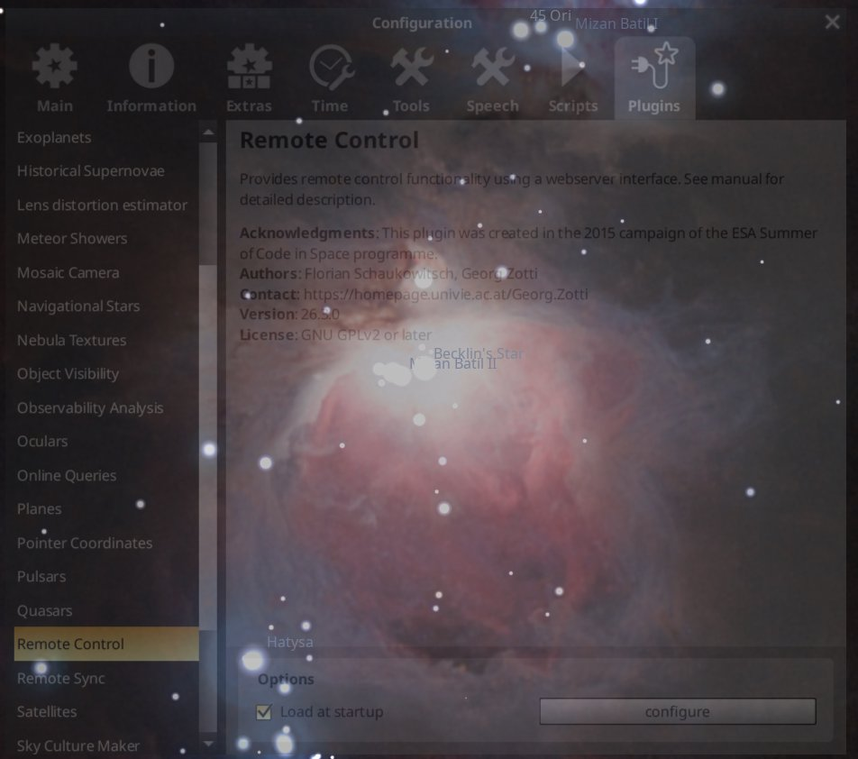

2. In the **Remote Control Plug-in Configuration** window, tick **Server enabled** and **Enable automatically on startup**, keep **Port Number** at `8090` (with **Access requires authentication** unticked), and click **Save settings**:

   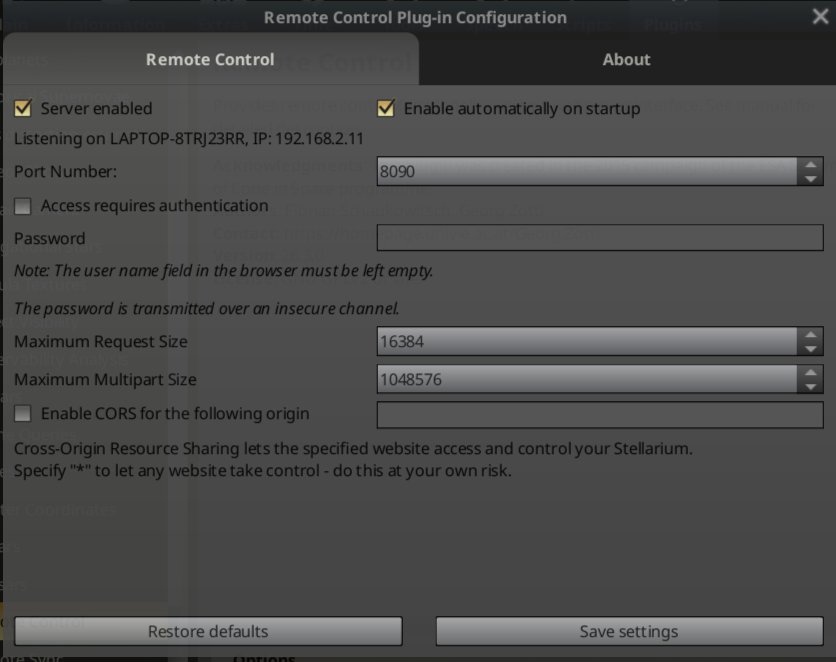

Once enabled, keep Stellarium open while reviewing a detection report and click **Stellarium Local** (crop FOV) or **Stellarium Local Wide** on any finding card to jump directly to that sky position and moment in Stellarium.

The report normally shows **Commands sent** with **Acceptance is unconfirmed**, because the direct browser connection cannot read Stellarium's reply. Check the Stellarium window to confirm the view. When replies can be read, the report checks that every command was accepted before saying so. The complete request has a **10-second timeout**; a timeout or error restores the button so you can retry. Some commands may already have been applied, so check Stellarium before retrying.

---

## Annex: Scientific references and algorithms

The references below describe methods and data actually used by SpacePixels and its libraries. Each entry identifies its role. Project-specific extensions, thresholds and selection gates are documented in [JTransient's algorithm guide](https://github.com/ppissias/JTransient/blob/master/ALGORITHM.md). The **Acknowledgements** link in the desktop window opens these references alongside the external services and software credits.

### Variable-star photometry

- **Honeycutt, R. K. (1992).** "CCD Ensemble Photometry on an Inhomogeneous Set of Exposures". *PASP*, 104, 435–440. [doi:10.1086/133015](https://doi.org/10.1086/133015)
  JTransient's `EnsembleSolver` uses the star-magnitude plus frame-zero-point model for differential light curves. Cauchy IRLS and spatial transparency planes are project extensions.
- **Stetson, P. B. (1996).** "On the Automatic Determination of Light-Curve Parameters for Cepheid Variables". *PASP*, 108, 851–876. [doi:10.1086/133808](https://doi.org/10.1086/133808)
  JTransient's `VariabilityScorer` adapts the $J$ statistic to consecutive usable residuals with a magnitude-neighbour noise estimate, alongside excess scatter, when selecting variable-star candidates.
- **Howell, S. B. (1989).** "Two-dimensional aperture photometry: Signal-to-noise ratio of point-source observations and optimal data-extraction techniques". *PASP*, 101, 616–622. [doi:10.1086/132477](https://doi.org/10.1086/132477)
  The sky-background and finite-annulus terms inform `ApertureMeasurer`'s flux errors; JTransient also measures an empirical blank-sky correction. These are background-noise estimates, rather than the complete source-photon/read-noise CCD equation. The code also uses its own fractional-pixel apertures and seeing-based radii; it does not implement Howell's growth-curve correction.
- **AAVSO observing guides.** [CCD/CMOS Photometry Guide](https://aavso.org/manuals/) and [VPhot User's Guide](https://www.aavso.org/sites/default/files/publications_files/VPHOT%20Users%20Guide%20V3.2.pdf).
  Observational guidance for aperture/annulus choices and interpreting differential light curves. The VPhot guide is further reading in JTransient's variable-star documentation; SpacePixels performs its photometry in JTransient.

### Astrometry and World Coordinate Systems (WCS)

- **Greisen, E. W., & Calabretta, M. R. (2002).** "Representations of world coordinates in FITS". *A&A*, 395, 1061–1075. [doi:10.1051/0004-6361:20021326](https://doi.org/10.1051/0004-6361:20021326)
  SpacePixels' `WcsCoordinateTransformer` reads reference pixels, coordinate values and CD or PC/CDELT matrices to map image pixels to intermediate coordinates.
- **Calabretta, M. R., & Greisen, E. W. (2002).** "Representations of celestial coordinates in FITS". *A&A*, 395, 1077–1122. [doi:10.1051/0004-6361:20021327](https://doi.org/10.1051/0004-6361:20021327)
  `WcsCoordinateTransformer` uses the TAN (gnomonic) celestial projection for sky annotations, catalogue matching and report coordinates.
- **Shupe, D. L., et al. (2005).** "The SIP Convention for Representing Distortion in FITS Image Headers". *ADASS XIV*, ASP Conf. Ser. 347, 491–495. [Caltech author record](https://authors.library.caltech.edu/records/fqnyw-qdw79)
  `WcsCoordinateTransformer` applies supplied SIP polynomial coefficients, with inverse iteration, in pixel/sky transformations for annotations and report coordinates. See also the [registered SIP specification](https://fits.gsfc.nasa.gov/registry/sip/SIP_distortion_v1_0.pdf).
- **Lang, D., et al. (2010).** "Astrometry.net: Blind astrometric calibration of arbitrary astronomical images". *AJ*, 139, 1782–1800. [doi:10.1088/0004-6256/139/5/1782](https://doi.org/10.1088/0004-6256/139/5/1782)
  The optional Nova Astrometry.net backend, called through JPlateSolve, supplies blind plate solutions used by SpacePixels.
- **Meeus, J. (1998).** *Astronomical Algorithms*, 2nd ed., Willmann-Bell. [Publisher](https://shopatsky.com/products/astronomical-algorithms-2nd-edition)
  The report's local sidereal-time polynomial and equatorial-to-horizontal conversion follow the conventional formulae described in this reference. Displayed Alt/Az uses UTC as an approximation to UT1, without a full apparent-place or atmospheric-refraction correction.

### Catalogue and data references

- **Gaia Collaboration (2016; 2023).** ["The Gaia mission", *A&A*, 595, A1](https://doi.org/10.1051/0004-6361/201629272); ["Gaia Data Release 3: Summary of the content and survey properties", *A&A*, 674, A1](https://doi.org/10.1051/0004-6361/202243940).
  Gaia DR3 positions, proper motions, G magnitudes and BP−RP colours supply the sky catalogue, plate-solution correction and field-depth/observing-condition diagnostics. Credit: **ESA/Gaia/DPAC**. Gaia data are processed by the [Data Processing and Analysis Consortium](https://www.cosmos.esa.int/web/gaia/dpac/consortium), supported by national institutions through the Gaia Multilateral Agreement. See [Gaia's credit and citation guidance](https://gea.esac.esa.int/archive/documentation/GDR3/Miscellaneous/sec_credit_and_citation_instructions/).
- **Wenger, M., et al. (2000).** "The SIMBAD astronomical database". *A&AS*, 143, 9–22. [doi:10.1051/aas:2000332](https://doi.org/10.1051/aas:2000332)
  SIMBAD supplies deep-sky and named-star entries in the sky catalogue and external object-search links in variable-star reports.
- **Ochsenbein, F., Bauer, P., & Marcout, J. (2000).** "The VizieR database of astronomical catalogues". *A&AS*, 143, 23–32. [doi:10.1051/aas:2000169](https://doi.org/10.1051/aas:2000169)
  VizieR hosts the Gaia DR3 and VSX tables queried by the sky-catalogue client and report lookups.
- **AAVSO VSX (Watson et al., 2006–).** *International Variable Star Index*, [VizieR catalogue B/vsx](https://cdsarc.cds.unistra.fr/viz-bin/cat/B/vsx).
  Known-variable positions, types, periods and magnitude ranges support annotations and report catalogue comparisons. Retrieved data are recorded with the session or lookup.

The viewer and report image stretch uses SpacePixels' normalized asinh **intensity** curve in `DisplayStretch`. It is separate from the differential-magnitude calculations above.
