# 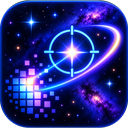 SpacePixels

### Find moving objects and brightness changes in your astrophotography exposures. 
SpacePixels analyzes aligned image sequences and produces an HTML report with tracks, image crops, animations and optional variable-star light curves.

Use the individual exposures before stacking. Rejection during stacking can suppress moving objects and brief events; SpacePixels helps you inspect those signals. Findings are candidates for review, not automatic confirmation of an object's identity or a new discovery.

[Download releases](https://github.com/ppissias/SpacePixels/releases) · [Website](https://startales.eu/SpacePixels/) · [User manual](MANUAL.md) · [Release notes](RELEASE_NOTES.md)

## Start here

- [Installation and launch](#installation-and-launch)
- [Features for Your Observing Session](#features-for-your-observing-session)
- [How SpacePixels Works](#how-spacepixels-works) ([Typical GUI Workflow](#typical-gui-workflow))
- [Video tutorials](#video-tutorials)
- [Screenshots and sample reports](#screenshots-and-sample-reports)
- [Acknowledgements](#acknowledgements)


## Installation and launch

### Running a release build

Choose an application package under **Assets** at [SpacePixels Releases](https://github.com/ppissias/SpacePixels/releases).

**Windows x64 installer:** download the EXE under Assets and run `SpacePixels-<installer-version>.exe`. It includes its own bundled Java runtime (Java 21 or newer), installs for your Windows account and offers desktop and Start menu shortcuts. Launch the installed **SpacePixels** shortcut or `SpacePixels.exe`. See the [manual's installation instructions](MANUAL.md#installing) for unsigned-installer notices, upgrades and uninstalling.

**ZIP/TAR archives (Windows, Linux and macOS):** install Java 21 or newer, for example [Eclipse Temurin](https://adoptium.net/temurin/releases/?version=21) or [Oracle Java](https://www.oracle.com/java/technologies/downloads/), then unpack the complete archive and run from its folder:

- Windows: double-click `StartSpacePixels.bat`, or run `.\StartSpacePixels.bat` in PowerShell.
- Linux/macOS: `./StartSpacePixels`.

The **Source code** ZIP/TAR links are source snapshots, not runnable application packages.

## Features for Your Observing Session

From frame preparation and GPU-assisted faint-mover searches to photometry, visual review and asteroid follow-up, powered by the JTransient detection engine.

- **Multi-Frame Detection.** Find moving targets, streak tracks, single-frame streaks and bright anomalies. A dedicated faint-streak search recovers weaker trails. Iterative detection runs overlapping subsets for large datasets or very slow targets.
- **Faint Movers (Experimental).** Digital tracking, also called shift-and-stack, combines weak signals along trial motions to find objects too faint for ordinary single-frame tracks. Review fitted paths, source and residual blinks, whole-session and half-session stacks, and exported measurements.
- **GPU Acceleration.** OpenCL accelerates the first pass of the faint-mover search. Auto mode verifies identical CPU results and a speed advantage before using a compatible GPU, with CPU fallback. Select a graphics device, run Test GPU, or choose Always GPU or Always CPU in Astrometry Config.
- **Slow Movers & Residual Candidates.** Inspect elongated maximum-stack footprints, repeated weak detections and local activity clusters. Slow-mover cards include original-frame centroid checks. Camera-fixed and common-motion filters help separate likely sensor artifacts from candidates that deserve a closer look.
- **Auto-Tuning.** Measure noise detections and artificial-star recovery on your own frames, then choose Low, Medium, High or Maximum sensitivity. Review calibration charts and live progress images, edit the detection settings, and preview their effect on real pixels.
- **Frame Quality & Equipment Diagnostics.** Check frame quality before a full run and inspect rejection reasons. Reports measure seeing, transparency, field depth, sky brightness, drift and dithering, with maps of star size, shape, coma and flat-field patterns where the required calibration is available.
- **Astrometry & Object Identification.** Plate-solve with ASTAP or Astrometry.net for sky coordinates. Compare tracks and faint movers with JPL and SkyBoT asteroid/comet predictions, check satellite exposure paths with SatChecker, and explore sky context in Stellarium Web or Local.
- **Sky Annotations & Plate Correction.** Overlay Gaia stars, SIMBAD deep-sky objects, VSX variables and predicted asteroid/comet paths in the viewers. Gaia-based plate correction refines the session's sky coordinates. Saved catalogues and report findings return when you reopen a compatible session.
- **Asteroid Measurements & MPC Export.** Use Asteroids & Comets to review identifications and reduce positions against Gaia DR3. Measure faint movers in independent sub-stacks, select observations, export ADES PSV files for the Minor Planet Center, and check the schema or MPC test service. You submit the final observations yourself.
- **Other Nights, Orbits & Light Curves.** Link an object's observations across nights and fit preliminary orbits with Find_Orb. Measure relative moving-object light curves with transparency correction, frame binning and CSV export. Compare observed motion with expected main-belt motion to guide follow-up.
- **Variable-Star Photometry.** Measure stationary stars with differential ensemble photometry and review variable candidates with light curves, comparison stars, readiness checks, noise diagnostics and CSV exports. AAVSO VSX matching and Gaia, VizieR and SIMBAD links support follow-up. Requires at least 20 frames after quality control.
- **Interactive Reports & Exports.** Review HTML reports with animated crops, adjustable playback, finding navigation, trajectory maps and an interactive Unclassified Transient Inspector. Share the complete report folder for offline review, or export GIFs, CSV/JSON data and a noise-weighted enhanced FITS stack. Dark/light themes and text-size controls aid reading.
- **Visual Inspection & Mask Tools.** Blink frames with report and catalogue overlays, export a region as a GIF, preview detections or inspect unlinked transients manually. Explore the star mask, exclude unusable image areas, and adjust display stretch with histograms. A separate export writes stretched copies.
- **Prepare Your Frames.** Import supported FITS or XISF sequences, decompress and convert them to unsigned 16-bit FITS, and create linear monochrome copies. Prepare Frames uses a separately installed Siril to calibrate, debayer and register private copies of your exposures, with input inspection and an optional reference stack.
- **Command Line & Java API.** Run headless batch detection with optional Auto-Tune, choose the GPU policy, and control report size or export data only. Integrate preparation and detection through the supported Java API. An artificial-star injection utility supports testing and validation.

## How SpacePixels Works

### In Your Astrophotography Workflow

Once your images are calibrated and aligned, you can stack them for a finished image and use the same frames in SpacePixels to find moving objects and transients.

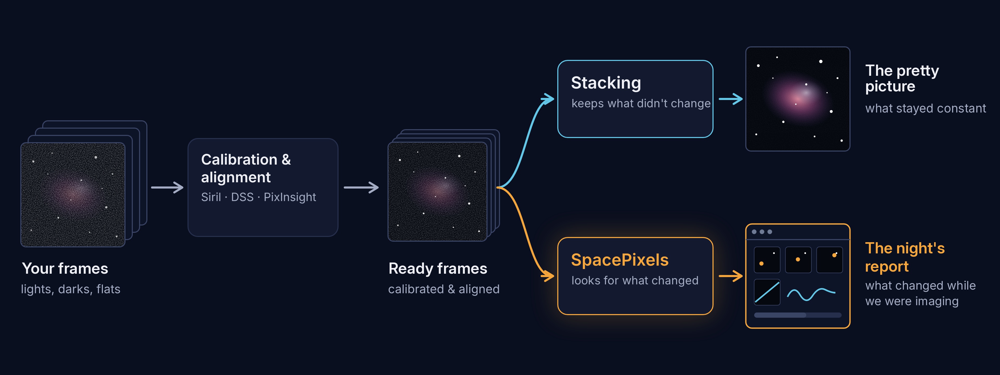

*The same calibrated, aligned exposures support both paths: a stacked image and a report of moving objects and brightness changes.*

### Inside SpacePixels Detection

SpacePixels checks frame quality, builds a median star map to mask stationary sources, then detects and links the remaining signals. Auto-Tune can calibrate the settings before detection; optional plate solving adds sky coordinates and identification tools.

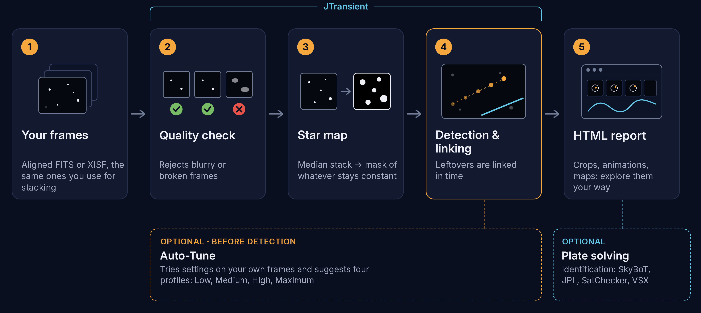

*The main pipeline leads from your frames to a report for review. Dotted branches show optional Auto-Tune and plate solving.*

### Typical GUI Workflow

1. Calibrate and star-align your exposures, using your usual software or **Prepare Frames…** with Siril.
2. Use **Import Aligned Frames…** or drop a folder of aligned FITS files or XISF-only images onto the window. Accept any required decompression or unsigned 16-bit conversion, then use **Convert to Mono** for color frames.
3. Use **Run quality control** and **Blink Selected** to inspect the sequence. Adjust **Image Stretch** for viewing, and exclude unusable areas in Preview Frame. Detection uses the linear pixel values.
4. Optionally configure your plate solver and observing site, then plate-solve one frame. Use **Fetch Sky Catalogue** for annotations and Gaia-based correction, and **Fetch Asteroids and Comets** for known-object comparisons.
5. Run **Auto-Tune Settings** and start with High. Review the variable-star and experimental faint-mover switches under **Analyses in This Run**; both are on by default and add processing time.
6. For faint movers, leave **First pass compute** on **Auto (recommended)** under **Astrometry Config → GPU acceleration**. SpacePixels uses a compatible GPU after verifying matching results and a speed advantage, otherwise it uses the CPU.
7. Run **Detect Moving Targets**.
8. Open the HTML report and inspect candidates in their image sequences. Use the identification links or **Asteroids & Comets…** for measurements, light curves, preliminary orbits and MPC export.

The [illustrated manual](MANUAL.md#3-workflow-find-moving-objects-in-a-session) explains each step and how to interpret the results. Local detection works without an online solver; catalogue downloads and online identification require internet access. For supported formats and detailed preparation rules, see [Input requirements](#input-requirements).

## Video Tutorials

These videos show the versions available when recorded. Use the [user manual](MANUAL.md) and [release notes](RELEASE_NOTES.md) for current controls and installation instructions.

<table>
  <tr>
    <td width="50%" valign="top" align="center">
      <a href="https://youtu.be/LhA1izPFql0" target="_blank" rel="noopener noreferrer">
        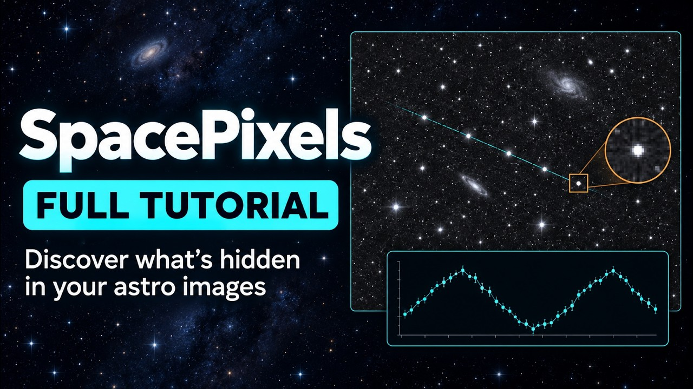
      </a>
      <br />
      <a href="https://youtu.be/LhA1izPFql0" target="_blank" rel="noopener noreferrer"><strong>Latest tutorial — watch on YouTube →</strong></a>
    </td>
    <td width="50%" valign="top" align="center">
      <a href="https://youtu.be/7XBdYh0Wn7A?si=ymQmXHg92X651RmZ" target="_blank" rel="noopener noreferrer">
        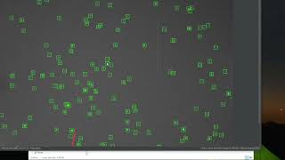
      </a>
      <br />
      <a href="https://youtu.be/7XBdYh0Wn7A?si=ymQmXHg92X651RmZ" target="_blank" rel="noopener noreferrer"><strong>Earlier tutorial — watch on YouTube →</strong></a>
    </td>
  </tr>
</table>

## Screenshots and sample reports

Explore full reports and animated detections from real sessions. Finding counts and labels depend on the input data and settings.

Many thanks to Klangwolke, TheStarsabove and Austral Kiwi at Cloudynights, and to Duncan Warren for the Apophis raw images. Many thanks to [Kumar](https://github.com/chvvkumar) for providing many, very useful datasets! DECam data from the [NSF NOIRLab Astro Data Archive](https://astroarchive.noirlab.edu/) were also used to test and improve SpacePixels.

**Check out sample reports:**

- [SpacePixels Report (Demonstrating digital tracking - 10 faint asteroids detected) - version 2026.11-01](https://startales.eu/various_files/detections_20261107_141108/detection_report.html) — HTML session report demonstrating digital tracking with 10 faint asteroids detected, known-asteroid comparisons, and diagnostics.
- [Sample SpacePixels session report (earlier version)](https://startales.eu/various_files/detections_20261015_144623/detection_report.html) — HTML session report with diagnostics and detection visualizations.
- [SpacePixels session report (3 asteroids) (earlier version)](https://startales.eu/various_files/detections_20261004_131720/detection_report_public.html) — Complete detection analysis with diagnostics and visualizations.
- [Sample SpacePixels report (Apophis) (earlier version)](https://startales.eu/various_files/detections_20260327_104057/detection_report.html) — Focused asteroid detection and tracking of Apophis.
- [Sample SpacePixels report (earlier version)](https://startales.eu/various_files/detections_20260327_104830/detection_report.html) — Another example of a SpacePixels detection report.

### A Closer Look at the Newer Tools

Examples from the [user manual](MANUAL.md) show how SpacePixels helps you inspect faint signals, understand your equipment and follow up moving objects. Select any image to view it at full size.

#### Finding Faint Movers with Digital Tracking

*Experimental search · Confirmed asteroid*

A moving object can be difficult to see in one exposure. Digital tracking, also called synthetic tracking or shift-and-stack, combines weak signals along trial motions so they can stand out together.

This manual example compares a source exposure, a processed residual, the whole-session shift stack, and independent first/second half stacks. The candidate has since been confirmed as the asteroid **74326 (1998 UU37)**, predicted magnitude 18.5. The report still calls it a possible identification, because SpacePixels never confirms an identity by itself. [Read the faint-mover guide](MANUAL.md#faint-movers-experimental).

<a href="docs/images/manual/report-faint-mover.png">
  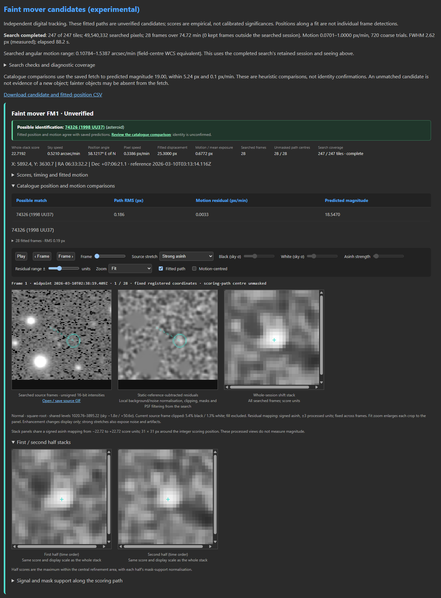
</a>

#### GPU Acceleration in One Measured Session

The full faint-mover stage ran **8.8× faster** with OpenCL in this paired validation run. GPU acceleration handles the first search pass; preparation and refinement still use the CPU.

| Compute backend | Faint-mover stage wall time | Relative speed |
| --- | ---: | ---: |
| Java CPU | 226.1 s | 1.0× |
| OpenCL GPU | 25.7 s | **8.8× faster** |

*M101 aligned sequence: 111 imported frames, 106 searched after quality control. AMD Ryzen 9 9955HX CPU and NVIDIA GeForce RTX 5060 Laptop GPU, Windows 11, SpacePixels 2026.11-04, 18 November 2026. Times show the full faint-mover stage wall time, excluding other detection stages and report generation. These are single-run measurements; gains vary with hardware and workload, and preparation can dominate on large sensors.*

#### Understand Your Night & Equipment

Follow seeing, transparency and sky brightness through the session. Field maps reveal patterns in star size, shape and coma that can help investigate focus, tilt or optical spacing.

<a href="docs/images/manual/report-night-equipment.png">
  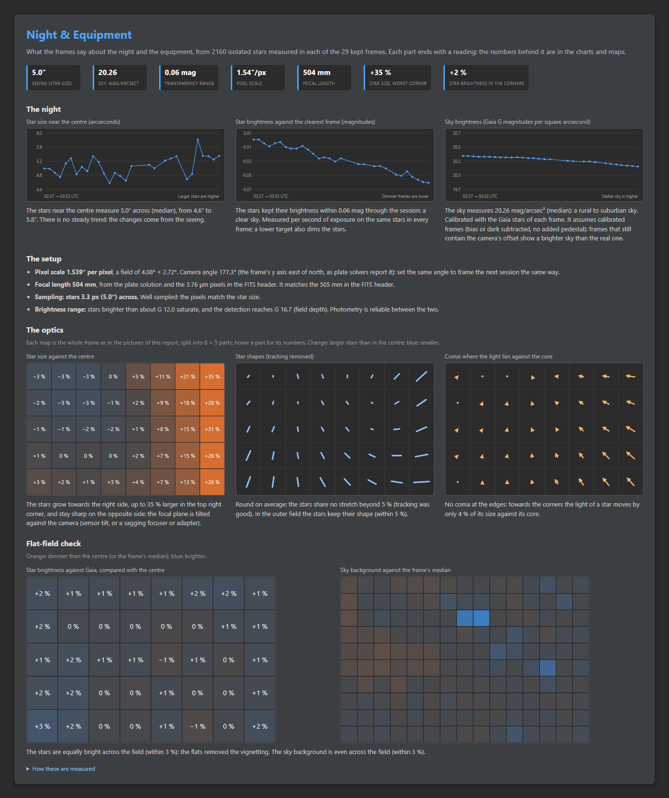
</a>

*Measurements from a real session, with explanations below each chart. Optical patterns guide investigation and do not establish a unique diagnosis.*

#### From Detection to Asteroid Follow-up

In **Asteroids & Comets**, check which known object you found and measure its exact sky position in each frame against Gaia catalogue stars, which is what the Minor Planet Center needs. Link observations across nights, fit preliminary orbits with Find_Orb, and prepare the ADES file you submit.

<table>
  <tr>
    <td width="72%" valign="top">
      <a href="docs/images/manual/ui-asteroids-comets.png">
        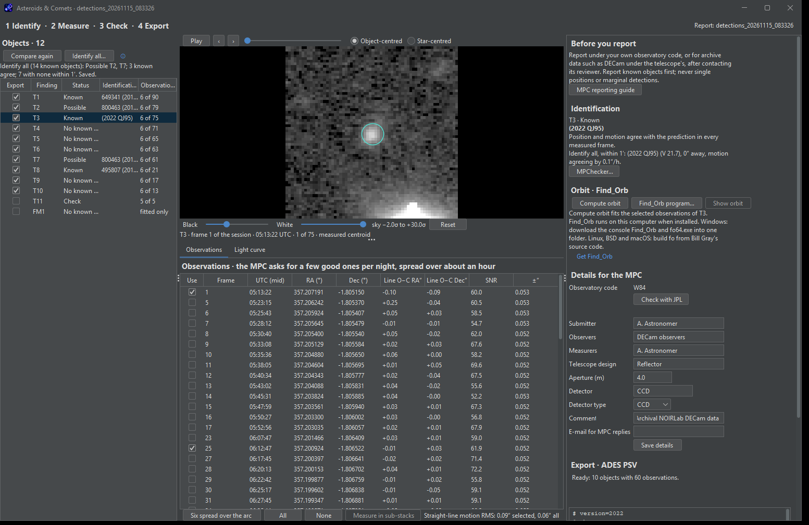
      </a>
      <br />
      <em>Identify objects and review the observations you will export.</em>
    </td>
    <td width="28%" valign="top">
      <a href="docs/images/manual/ui-asteroids-orbit.png">
        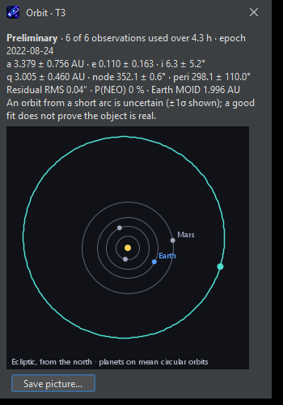
      </a>
      <br />
      <em>A preliminary orbit from one night remains uncertain.</em>
    </td>
  </tr>
</table>

<details>
  <summary><strong>See a moving-object light curve</strong></summary>
  <br />
  <a href="docs/images/manual/ui-asteroids-lightcurve.png">
    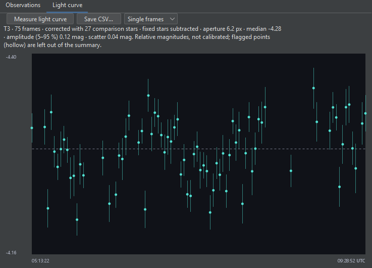
  </a>
  <br />
  <em>Measure relative brightness, compare frame bins and save the measurements as CSV. This example is not calibrated photometry or a rotation-period determination.</em>
</details>

#### Which Satellite Made This Trail?

A trail across several exposures may come from a satellite. On a streak track, **Compare track with satellites** asks SatChecker which satellites crossed the field during each exposure, then compares their predicted paths with the measured pieces of the trail. [Read how to identify objects](MANUAL.md#5-identifying-objects).

<a href="docs/images/manual/report-satellite-trail.png">
  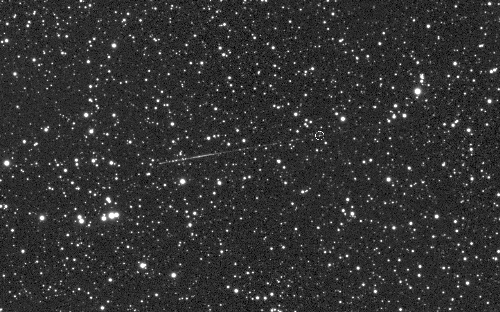
</a>

*The trail in one exposure of a real session (data: Klangwolke at Cloudynights).*

<a href="docs/images/manual/report-satellite-overlay.png">
  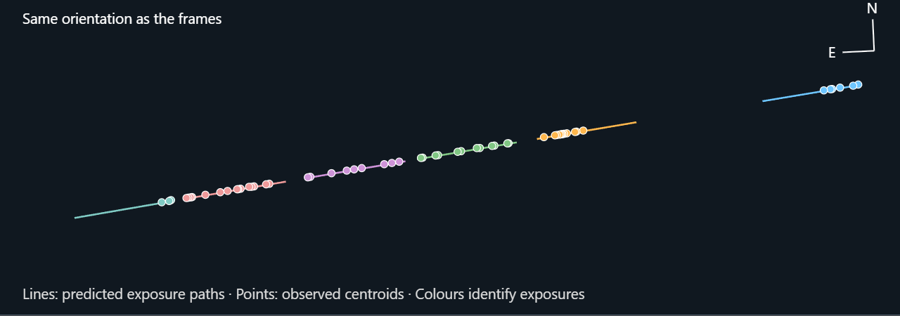
</a>

*The same track in the report. Lines: the predicted path of USA 65 during each exposure. Dots: the measured pieces of the trail. Each colour is one exposure; north and east are as in the frames.*

| Satellite | Typical distance from the trail | Exposures covered | Direction difference | Speed, predicted / measured |
| --- | ---: | ---: | ---: | ---: |
| USA 65 (NORAD 20929) | 11.4″ (7.4 px) | 6 of 6 | 0.06° | 15.03 / 15.01 ″/s |
| Next candidate: THORAD AGENA D DEB (NORAD 4143) | 121,810″ | 6 of 6 | 86.7° | 340.17 / 15.01 ″/s |

USA 65 follows the trail through all six exposures, in the same direction and at the same speed. A close fit like this is an association to inspect, not a confirmed identity.

### SpacePixels Main Interface

Prepare frames, configure astrometry, inspect your sequence and run detection from one workspace. This manual example shows an imported monochrome sequence.

<a href="docs/images/manual/ui-imported.png">
  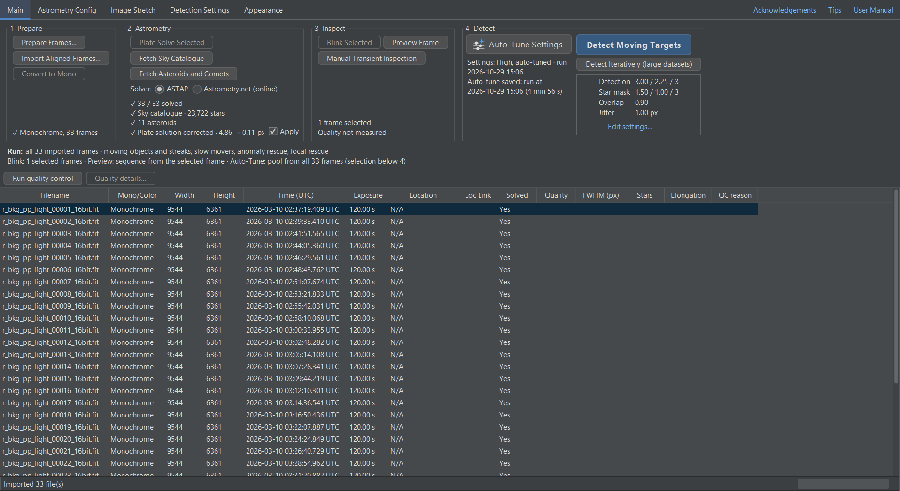
</a>

### Screenshots & Animated Detections

<table>
  <tr>
    <td width="33%" valign="top">
      <a href="docs/images/Bondia-moving_track_1_star_centric.gif">
        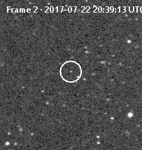
      </a>
      <br />
      <code>Asteroid</code><br />
      <strong>Asteroid Bondia</strong><br />
      <em>Star-Centric View</em><br />
      Asteroid Bondia — hiding in a 2017 dataset.
    </td>
    <td width="33%" valign="top">
      <a href="docs/images/Prokne-moving_track_2_star_centric.gif">
        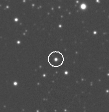
      </a>
      <br />
      <code>Asteroid</code><br />
      <strong>Asteroid Prokne</strong><br />
      <em>Star-Centric View</em><br />
      Animated detection of Prokne moving against the star field (data credit: Klangwolke @ Cloudynights).
    </td>
    <td width="33%" valign="top">
      <a href="docs/images/Sutoku-micro_drift_1_context.gif">
        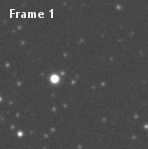
      </a>
      <br />
      <code>Asteroid</code><br />
      <strong>Asteroid Sutoku</strong><br />
      <em>Context View</em><br />
      Animated context view of Sutoku's slow local drift (data credit: Klangwolke @ Cloudynights).
    </td>
  </tr>
  <tr>
    <td width="33%" valign="top">
      <a href="docs/images/variable-star-detection.png">
        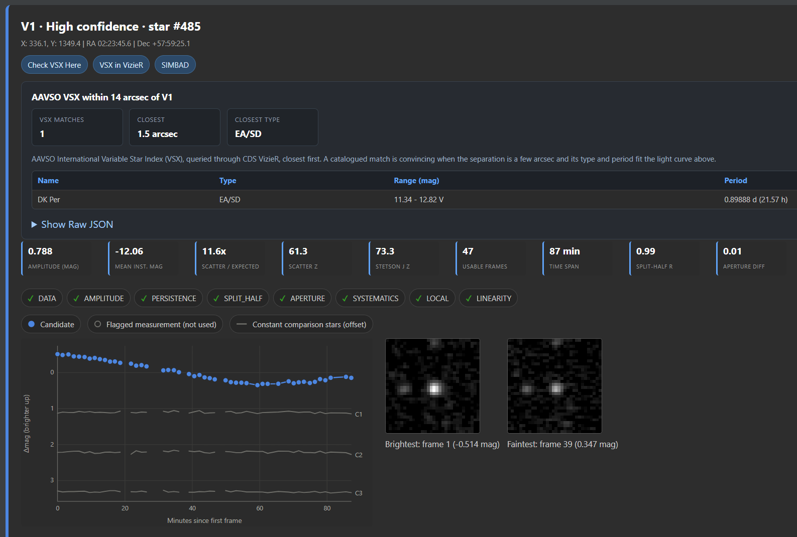
      </a>
      <br />
      <code>Variable Star</code><br />
      <strong>Variable Star DK Per</strong><br />
      <em>Detection &amp; Light Curve</em><br />
      Variable-star candidate details and light curve for DK Per.
    </td>
    <td width="33%" valign="top">
      <a href="docs/images/variable-star-tsvsc1-tn-n213111103-25-82-2.png">
        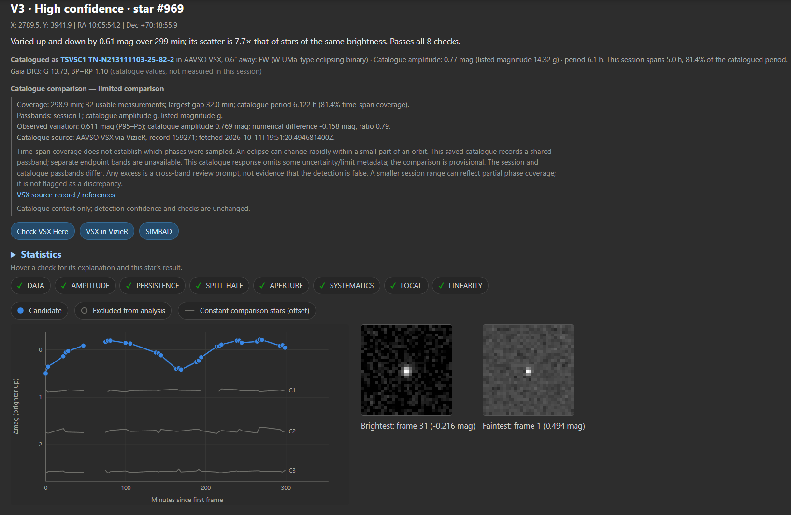
      </a>
      <br />
      <code>Variable Star</code><br />
      <strong>Variable Star TSVSC1 TN-N213111103-25-82-2</strong><br />
      <em>W UMa-Type Eclipsing Binary</em><br />
      High-confidence detection showing 0.61 mag variation over 299 minutes, with a light curve and a limited catalogue comparison.
    </td>
    <td width="33%" valign="top">
      <a href="docs/images/aptrack_1_object_centric.gif">
        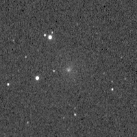
      </a>
      <br />
      <code>Comet</code><br />
      <strong>Comet Africano 2019</strong><br />
      <em>Object-Centric View</em><br />
      Detection with the comet centered in the animation.
    </td>
  </tr>
  <tr>
    <td width="33%" valign="top">
      <a href="docs/images/track_5_star_centric.gif">
        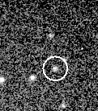
      </a>
      <br />
      <code>Asteroid</code><br />
      <strong>Apophis Asteroid 2021</strong><br />
      <em>Star-Centric View</em><br />
      Apophis moving against the star field (raw images credit: Duncan Warren).
    </td>
    <td width="33%" valign="top">
      <a href="docs/images/streak_track_3_star_centric.gif">
        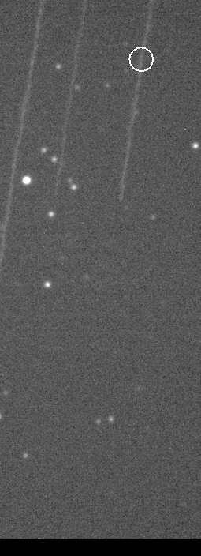
      </a>
      <br />
      <code>Streak Track</code><br />
      <strong>Streak Track Detection</strong><br />
      <em>Star-Centric View</em><br />
      Sample detection — streak track.
    </td>
    <td width="33%" valign="top">
      <a href="docs/images/anomaly_17_context.gif">
        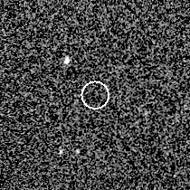
      </a>
      <br />
      <code>Anomaly Candidate</code><br />
      <strong>Single-Frame Anomaly Candidate</strong><br />
      <em>Cause Unconfirmed</em><br />
      A bright event in one exposure; its physical cause is not established (data credit: Cloudynights user TheStarsabove).
    </td>
  </tr>
</table>

## Input requirements

- Use individual, linear (unstretched), calibrated sub-exposures registered on the stars. Keep the zero-filled registration borders; do not crop every frame to the common overlap. Detection needs at least three usable frames after quality control; Auto-Tune needs at least four input frames. Variable-star photometry needs at least 20 frames after quality control and must pass additional readiness checks.
- All frames in a sequence must share the same dimensions, filename extension (case-insensitive), bit depth, sample scaling, colour layout, compression state and exposure time, and either all frames have timestamps or none. Import refuses a mixed folder. When the exposure times differ (exposures within 2 %, with a minimum tolerance of 0.1 s, count as the same), the GUI offers to copy the largest set of frames with one exposure time into a subfolder and import that.
- The GUI can import FITS directories (`.fit`, `.fits`, `.fts`). Directories containing XISF files and no native FITS files are converted to 16-bit monochrome FITS during import. Compressed `.fz` inputs are detected and can be decompressed into a new directory during import.
- The GUI can also standardize 32-bit FITS data, and signed or scaled 16-bit data (`BZERO` other than 32768), to standard unsigned 16-bit during import. When the conversion finds pixel values below zero, it asks whether to add an offset to every frame (recommended) or set them to 0.
- Automated detection requires 16-bit monochrome frames. If you import color images, use `Convert to Mono` before running the detection pipelines.
- The headless batch detector is stricter than the GUI: it expects uncompressed unsigned 16-bit monochrome FITS files (`BZERO` 32768, `BSCALE` 1).

## Command-line utilities

The Windows installer includes `spacepixels-batch.exe` and `injectStars.exe` beside `SpacePixels.exe`, with its example detection profile at `app/config/default_detection_profile.json`. That profile also runs variable-star photometry and the experimental faint-mover search.

Archive distributions keep the generated application and tool launchers in `bin`, with top-level `StartSpacePixels` wrappers that delegate to the generated launcher. After building or unpacking an archive, you should find:

- Release root:
  - `StartSpacePixels.bat`
  - `StartSpacePixels`
- Windows:
  - `bin\SpacePixels.bat`
  - `bin\batchDetect.bat`
  - `bin\injectStars.bat`
  - `config\default_detection_profile.json`
- Linux/macOS:
  - `bin/SpacePixels`
  - `bin/batchDetect`
  - `bin/injectStars`
  - `config/default_detection_profile.json`

### Headless batch detection

Use the native Windows `spacepixels-batch.exe`, the archive's `batchDetect` launcher or the Gradle task.

From a Windows installation folder:

```powershell
.\spacepixels-batch.exe "C:\astro\sequence" "app\config\default_detection_profile.json" --auto-tune high
```

Archive launcher examples:

- Windows:
  - `.\bin\batchDetect.bat "C:\astro\sequence" "config\default_detection_profile.json"`
  - `.\bin\batchDetect.bat "C:\astro\sequence" "config\default_detection_profile.json" --auto-tune high`
- Linux/macOS:
  - `bin/batchDetect "/data/sequence" "config/default_detection_profile.json" --auto-tune high`

Gradle examples from a source checkout (the example paths contain no spaces):

```powershell
.\gradlew.bat batchDetect '-PbatchArgs=C:/astro/sequence src/dist/config/default_detection_profile.json --auto-tune high'
```

```bash
./gradlew batchDetect -PbatchArgs='/data/sequence src/dist/config/default_detection_profile.json --auto-tune high'
```

For paths containing spaces, prefer the packaged launchers above: quote each path as its own argument.

`batchDetect` accepts a SpacePixels detection-profile JSON and can optionally run Auto-Tune with `low`, `medium`, `high` or `maximum` (the earlier names conservative, balanced and aggressive still work).

With the Gradle task, `-PbatchMaxHeap=8g` sets a fixed JVM heap instead of the default of up to 80% of RAM. A tested session of 33 frames of 61 megapixels needed about 11 GB of heap; requirements vary with the enabled analyses and the data.

### Artificial star injection

Use the native Windows `injectStars.exe`, the archive's `injectStars` launcher or the Gradle task. From a Windows installation folder:

```powershell
.\injectStars.exe "C:\astro\sequence" 15 10.0 4500 4.0
```

Packaged launcher examples:

- Windows:
  - `.\bin\injectStars.bat C:\astro\sequence 15 10.0 4500 4.0`
- Linux/macOS:
  - `bin/injectStars /data/sequence 15 10.0 4500 4.0`

Gradle task examples:

- Windows:
  - `.\gradlew.bat injectStars -PinjArgs="C:\astro\sequence 15 10.0 4500 4.0"`
- Linux/macOS:
  - `./gradlew injectStars -PinjArgs="/data/sequence 15 10.0 4500 4.0"`

This utility injects synthetic moving stars into a FITS sequence for testing and validation.

## Java API

The supported Java integration surface is [`eu.startales.spacepixels.api`](src/main/java/eu/startales/spacepixels/api).

Use `eu.startales.spacepixels:spacepixels:<version>` for headless embedding with its declared dependencies. This sole Maven artifact includes the API, preparation, detection, report resources and CLI tools, without GUI classes or FlatLaf. There is no separate core project/publication. Desktop distributions still include an unpublished GUI companion and all application dependencies. Java 21 and headless AWT (`java.desktop`) remain required.

For setup, request/result behavior, and usage examples, see [API.md](API.md).

## For developers

See [DEVELOPER.md](DEVELOPER.md) for source builds, tests, working rules and code organization; [HIGH_LEVEL_DESIGN.md](HIGH_LEVEL_DESIGN.md) for architecture; and [PUBLISHING.md](PUBLISHING.md) for desktop packaging and Maven publication. Proposed features and design changes are tracked separately in [FEATURE-REQUESTS.md](FEATURE-REQUESTS.md) and [DESIGN-IMPROVEMENTS.md](DESIGN-IMPROVEMENTS.md).

The [research evidence index](docs/research/README.md) links dated slow-mover investigations, numerical tables, figures and delivered engine/application code history.

Report reproducible problems through [GitHub Issues](https://github.com/ppissias/SpacePixels/issues). Include the application version and relevant error details, removing private paths and observing-site information before sharing.

### Running from source

Use JDK 21 or newer (`--release 21` compiles for Java 21+ JREs). From the project root:

- Windows: `.\gradlew.bat run`
- Linux/macOS: `./gradlew run`

To generate a local distribution with launch scripts:

- Windows: `.\gradlew.bat installDist`
- Linux/macOS: `./gradlew installDist`

On Windows x64, `.\gradlew.bat windowsAppImage` builds an application folder with its own runtime; distribute the entire `build/windows/image/SpacePixels` folder. `.\gradlew.bat windowsInstaller` wraps it in an EXE installer and also requires WiX 3. See [PUBLISHING.md](PUBLISHING.md#windows-installer).

### Console output

SpacePixels prints only problems to the console; the batch detector also prints the path of the report it wrote. For diagnostics (progress, per-frame statistics, timings and the detection engine's debug output), start the JVM with `-Dspacepixels.debug=true`. Archive launchers accept `JAVA_OPTS=-Dspacepixels.debug=true`; native Windows launchers use `java-options=-Dspacepixels.debug=true` under `[JavaOptions]` in `app/SpacePixels.cfg` or `app/spacepixels-batch.cfg`. From source, add `-PspacepixelsDebug` to the Gradle command.

## JTransient engine documentation

SpacePixels uses the [JTransient Engine](https://github.com/ppissias/JTransient) for the core extraction, purification, and track-linking pipeline.

For the underlying detection logic and the meaning of the engine configuration options, see:

- [JTransient repository](https://github.com/ppissias/JTransient)
- [JTransient algorithm overview](https://github.com/ppissias/JTransient/blob/main/ALGORITHM.md)
- [JTransient configuration reference](https://github.com/ppissias/JTransient/blob/main/CONFIG.md)
- [JTransient Auto-Tune](https://github.com/ppissias/JTransient/blob/main/ALGORITHM.md#auto-tuning)
- [JTransient variable-star photometry](https://github.com/ppissias/JTransient/blob/main/ALGORITHM.md#variable-star-photometry)

## Acknowledgements

### Astronomical Services & Data Providers

These services supply catalogue data, predictions and optional plate solutions for sky annotations, diagnostics and identification checks in SpacePixels.

####  NASA JPL (Jet Propulsion Laboratory)

- [SB-Ident API](https://ssd-api.jpl.nasa.gov/doc/sb_ident.html): Searches for known asteroids and comets in the field and around report findings.
- [Horizons System](https://ssd.jpl.nasa.gov/horizons/): Supplies observer ephemerides for known-object paths and exposure-midpoint annotations, including positional uncertainties when available. [Data citation guidance](https://ssd.jpl.nasa.gov/about/).

####  European Space Agency (ESA)

- [Gaia DR3](https://www.cosmos.esa.int/web/gaia): Star positions, proper motions, *G* magnitudes and *BP−RP* colours support sky overlays, plate-solution correction, field-depth and observing-condition diagnostics. Queried through VizieR TAP, then the ESA Gaia Archive, then [ARI Heidelberg](https://gaia.ari.uni-heidelberg.de/), for the main star catalogue and for the faint field-depth patches.

Credit: **ESA/Gaia/DPAC**. Gaia data are processed by the [Data Processing and Analysis Consortium](https://www.cosmos.esa.int/web/gaia/dpac/consortium); national institutions support DPAC through the Gaia Multilateral Agreement. Requested references: [Gaia Collaboration (2016), mission paper](https://doi.org/10.1051/0004-6361/201629272), and [Gaia Collaboration (2023), DR3 release paper](https://doi.org/10.1051/0004-6361/202243940). [Gaia citation guidance](https://gea.esac.esa.int/archive/documentation/GDR3/Miscellaneous/sec_credit_and_citation_instructions/).

####  CDS (Centre de Données astronomiques de Strasbourg)

- [SIMBAD](https://simbad.cds.unistra.fr/simbad/): Supplies deep-sky objects and named bright stars for sky annotations, from Strasbourg, then the [Harvard](https://simbad.cfa.harvard.edu/simbad/) and [IDIA](https://simbad.idia.ac.za/) mirrors when Strasbourg does not answer. Reports also link to object searches. [Wenger et al. (2000)](https://doi.org/10.1051/aas:2000332).
- [VizieR](https://vizier.cds.unistra.fr/): TAP access to Gaia DR3 (*I/355/gaiadr3*) and AAVSO VSX (*B/vsx/vsx*), including faint Gaia samples for field-depth estimates. [Ochsenbein, Bauer & Marcout (2000)](https://doi.org/10.1051/aas:2000169); [service DOI](https://doi.org/10.26093/cds/vizier).

####  Astrometry.net

- [Nova Astrometry.net](https://nova.astrometry.net/): Optional online blind plate solving through JPlateSolve, using the user's configured account. [Lang et al. (2010)](https://doi.org/10.1088/0004-6256/139/5/1782).

#### Other Services & Data Providers

- **AAVSO (American Association of Variable Star Observers)** — [International Variable Star Index (VSX)](https://vsx.aavso.org/): Variable-star positions, classifications, periods and brightness ranges, fetched for annotations from VizieR at CDS, then the [Harvard](https://vizier.cfa.harvard.edu/) and [IDIA](https://vizier.idia.ac.za/) copies when Strasbourg does not answer. Report cross-checks ask Strasbourg first, then the same Harvard and IDIA copies when Strasbourg does not answer. Details open on AAVSO's site. [Watson et al. (2006–), catalogue B/vsx](https://cdsarc.cds.unistra.fr/viz-bin/cat/B/vsx).
- **IAU CPS (Centre for the Protection of the Dark and Quiet Sky from Satellite Constellation Interference)** — [SatChecker](https://satchecker.cps.iau.org/): On-demand satellite-pass and ephemeris queries for report lookups and measured streak speed/direction comparisons. [API documentation](https://satchecker.readthedocs.io/en/latest/).

#### External Report Links

These open additional checks or information in a browser:

- **IMCCE / Observatoire de Paris** — [SkyBoT](https://ssp.imcce.fr/webservices/skybot/): Cone searches at a finding's sky position and observation epoch. Reference: Berthier et al. (2006), *ADASS XV*, ASP Conf. Ser. 351, 367.
- **NASA JPL** — [Small-Body Database (SBDB)](https://ssd.jpl.nasa.gov/tools/sbdb_lookup.html): Object details for asteroid and comet lookup results.
- [CelesTrak](https://celestrak.org/) & [N2YO](https://www.n2yo.com/): Catalogue and satellite-information links for returned NORAD identities.
- [Stellarium Web](https://stellarium-web.org/): Sky views centred on report findings. Local Stellarium control is described in Software & Utilities.

#### NSF NOIRLab (DECam data)

SpacePixels was tested and improved with public data obtained with the Dark Energy Camera (DECam), which was constructed by the Dark Energy Survey (DES) collaboration, on the Víctor M. Blanco 4-meter Telescope at NSF Cerro Tololo Inter-American Observatory, NSF NOIRLab, and distributed by the [NSF NOIRLab Astro Data Archive](https://astroarchive.noirlab.edu/). NSF NOIRLab is managed by the Association of Universities for Research in Astronomy (AURA) under a cooperative agreement with the U.S. National Science Foundation. [NOIRLab acknowledgement guidance](https://noirlab.edu/science/about/scientific-acknowledgments).

### Software & Utilities

#### Astronomical Software & Utilities

These optional tools are installed separately and used when configured:


**ASTAP** by Han Kleijn — The Astrometric STAcking Program supplies SpacePixels' local plate-solving backend through JPlateSolve ([ASTAP](https://www.hnsky.org/astap.htm)); its local star database is required for solving.


**Siril** by the Siril Development Team — The command-line backend for observing-session preparation: calibration, demosaicing, registration and optional reference stacking, according to the selected recipe ([Siril](https://siril.org/)).


**Stellarium** by the Stellarium Team — Report buttons send sky position, time, observer location and field of view to the local planetarium's Remote Control plugin ([Stellarium](https://stellarium.org/)).

**Find_Orb** by Bill Gray (Project Pluto) — Orbit determination software. In the Asteroids & Comets window, the command-line Find_Orb fits a preliminary orbit to an object's selected observations when it is installed; otherwise the observations are copied for the online Find_Orb ([Find_Orb](https://www.projectpluto.com/find_orb.htm)). Find_Orb is not part of SpacePixels and is installed separately.

#### Open Source Software & Libraries

SpacePixels is built with the following open-source Java libraries and components:

- **FlatLaf** by FormDev Software — Desktop Look and Feel, themes and interface scaling ([FlatLaf](https://www.formdev.com/flatlaf/)).
- **nom.tam.fits** — Java library for Flexible Image Transport System (FITS) I/O ([nom-tam-fits](https://nom-tam-fits.github.io/nom-tam-fits/)).
- **Gson** by Google — Java library for JSON serialization and parsing ([github.com/google/gson](https://github.com/google/gson)).
- **JTransient & JPlateSolve** by Petros Pissias — Detection, tracking and photometry engine; ASTAP and Astrometry.net plate-solving integration ([JTransient](https://github.com/ppissias/JTransient), [JPlateSolve](https://github.com/ppissias/JPlateSolve)).
- **Java / OpenJDK** — Java 21 runtime and Swing desktop; Windows packages bundle the runtime ([OpenJDK](https://openjdk.org/)).


#### Development & Packaging

[Gradle](https://gradle.org/) builds the application; [JUnit](https://junit.org/junit4/) and [AssertJ Swing (Hiroshi Miura's fork)](https://codeberg.org/miurahr/assertj-swing) support tests. JDK jpackage/jlink and [WiX Toolset](https://wixtoolset.org/) create the Windows installer.

#### AI Coding Assistants

Since 2026, the development of SpacePixels and its libraries has been supported by these AI coding assistants:

-  **Claude** by Anthropic ([Claude](https://www.anthropic.com/claude))
-  **Codex** by OpenAI ([Codex](https://openai.com/codex/))
-  **Gemini** by Google ([Gemini](https://gemini.google.com/))
-  **Grok** by xAI ([Grok](https://x.ai/grok))

Logos are trademarks of their respective owners.

### Scientific References & Algorithms

References for methods and standards implemented in SpacePixels and its libraries. Service and catalogue credits are listed under [Astronomical Services & Data Providers](#astronomical-services--data-providers). Each entry identifies its contribution; related literature is omitted unless it supplies an additional method used here. Implementation choices and empirical selection thresholds are described in the [JTransient algorithm documentation](https://github.com/ppissias/JTransient/blob/main/ALGORITHM.md).

#### Digital Tracking & Faint-Mover Detection

- **Heinze, Metchev & Trollo (2015)** — *Digital Tracking Observations Can Discover Asteroids 10 Times Fainter than Conventional Searches*, [AJ 150, 125](https://doi.org/10.1088/0004-6256/150/4/125) ([author preprint](https://arxiv.org/abs/1508.01599)).
  Method background for `FaintMoverSearch`: constant-velocity shift-and-stack detection, motion-grid spacing tied to image quality, and checking support in separate time subsets.

The engine's residual preparation, empirical scores and selection rules are described in its algorithm documentation. Published survey sensitivity is not a SpacePixels performance claim. The [investigation archive](https://github.com/ppissias/JTransient/blob/main/docs/research/slow-movers/README.md) keeps experimental alternatives separate from delivered methods.

#### Variable-Star Photometry

- **Honeycutt (1992)** — *CCD Ensemble Photometry on an Inhomogeneous Set of Exposures*, [PASP 104, 435–440](https://doi.org/10.1086/133015).
  JTransient's `EnsembleSolver` uses the star-magnitude plus frame-zero-point model for differential light curves, adding robust Cauchy reweighting and spatial transparency planes.
- **Stetson (1996)** — *On the Automatic Determination of Light-Curve Parameters for Cepheid Variables*, [PASP 108, 851–876](https://doi.org/10.1086/133808).
  JTransient's `VariabilityScorer` adapts the J statistic to consecutive usable residuals with a magnitude-neighbour noise estimate, alongside excess scatter, when selecting variable-star candidates.
- **Howell (1989)** — *Two-dimensional aperture photometry: Signal-to-noise ratio of point-source observations and optimal data-extraction techniques*, [PASP 101, 616–622](https://doi.org/10.1086/132477).
  The sky-background and finite-annulus terms inform `ApertureMeasurer`'s flux errors; JTransient also measures an empirical blank-sky correction. These are background-noise estimates, rather than the complete source-photon/read-noise CCD equation.

#### Astrometry & World Coordinate Systems (WCS)

- **Greisen & Calabretta (2002)** — *Representations of world coordinates in FITS*, [A&A 395, 1061–1075](https://doi.org/10.1051/0004-6361:20021326).
  `WcsCoordinateTransformer` reads reference pixels, coordinate values and CD or PC/CDELT matrices to map image pixels to intermediate coordinates.
- **Calabretta & Greisen (2002)** — *Representations of celestial coordinates in FITS*, [A&A 395, 1077–1122](https://doi.org/10.1051/0004-6361:20021327).
  `WcsCoordinateTransformer` uses the TAN (gnomonic) celestial projection for sky annotations, catalogue matching and report coordinates.
- **Shupe et al. (2005)** — *The SIP Convention for Representing Distortion in FITS Image Headers*, [ASP Conf. Ser. 347, 491–495](https://authors.library.caltech.edu/records/fqnyw-qdw79).
  `WcsCoordinateTransformer` applies supplied SIP polynomial coefficients, with inverse iteration, in pixel/sky transformations for annotations and report coordinates.
- **Meeus (1998)** — [*Astronomical Algorithms*, 2nd ed.](https://shopatsky.com/products/astronomical-algorithms-2nd-edition), Willmann-Bell.
  The report's local sidereal-time polynomial and equatorial-to-horizontal conversion follow the conventional formulae described in this reference; displayed Alt/Az uses UTC as an approximation to UT1.
