#  SpacePixels

Find moving objects and brightness changes in your astrophotography exposures. SpacePixels analyzes aligned image sequences and produces an HTML report with tracks, image crops, animations and optional variable-star light curves.

Use the individual exposures before stacking. Rejection during stacking can suppress moving objects and brief events; SpacePixels helps you inspect those signals. Findings are candidates for review, not automatic confirmation of an object's identity or a new discovery.

[Download releases](https://github.com/ppissias/SpacePixels/releases) · [Website](https://startales.eu/SpacePixels/) · [User manual](MANUAL.md) · [Release notes](RELEASE_NOTES.md)

## Start here

- [Installation and launch](#installation-and-launch)
- [Your first detection](#your-first-detection)
- [What SpacePixels does](#what-spacepixels-does)
- [Report output](#report-output)
- [Video tutorials](#video-tutorials)
- [Screenshots and sample reports](#screenshots-and-sample-reports)


## Installation and launch

### Running a release build

Choose an application package under **Assets** at [SpacePixels Releases](https://github.com/ppissias/SpacePixels/releases).

**Windows x64 installer:** download the EXE under Assets and run `SpacePixels-<installer-version>.exe`. It includes Java 21, installs for your Windows account and offers desktop and Start menu shortcuts. Launch the installed **SpacePixels** shortcut or `SpacePixels.exe`. See the [manual's installation instructions](MANUAL.md#installing) for unsigned-installer notices, upgrades and uninstalling.

**ZIP/TAR archives (Windows, Linux and macOS):** install Java 21 or newer, for example [Eclipse Temurin](https://adoptium.net/temurin/releases/?version=21) or [Oracle Java](https://www.oracle.com/java/technologies/downloads/), then unpack the complete archive and run from its folder:

- Windows: double-click `StartSpacePixels.bat`, or run `.\StartSpacePixels.bat` in PowerShell.
- Linux/macOS: `./StartSpacePixels`.

The **Source code** ZIP/TAR links are source snapshots, not runnable application packages.

<a id="typical-gui-workflow"></a>

## Your first detection

1. Start SpacePixels and choose **Import Aligned Frames…**. Select one folder of calibrated, registered exposures. Accept any required format conversion and import the resulting monochrome sequence.
2. Use **Blink Selected** to check alignment and image quality. If the exposures need calibration or registration first, see [Preparing an observing session](MANUAL.md#preparing-an-observing-session).
3. Optionally plate-solve one frame for sky coordinates and catalogue searches. Fetch the sky catalogue before detection if you want catalogue context in the report.
4. Run **Auto-Tune Settings** and start with **High**. Variable-star photometry is optional: enable it under **Detection Settings → Overview → Analyses in This Run**.
5. Click **Detect Moving Targets**, open the report when prompted, and inspect candidates in the animations and original frames.

The [illustrated manual](MANUAL.md#3-workflow-find-moving-objects-in-a-session) explains each step and how to interpret the results. Local detection works without an online solver; catalogue downloads and online identification require internet access.

For supported formats and detailed preparation rules, see [Input requirements](#input-requirements).

## What SpacePixels does

- Runs a standard multi-frame detection pipeline for moving targets, streak tracks, single-frame streaks, and bright anomalies.
- Reviews maximum-stack elongated morphology candidates using geometric shape and exact median-mask overlap filters; these are not confirmed moving tracks.
- Provides an iterative detection mode for large datasets and very slow targets.
- Auto-tunes the detection settings for each session. The calibrated tuner measures false detections and sensitivity on the session's own frames and offers four profiles: low, medium, high (the default) and maximum (as sensitive as possible, for small sensors or targeted searches for a faint object).
- Optionally measures the photometry of the stationary stars and reports variable-star candidates with light curves, readiness checks and a lookup in the AAVSO VSX catalogue. Switch it on under Analyses in This Run on the Detection Settings Overview; plate-solve one frame so candidates can be matched against VSX.
- Generates an HTML report with diagnostics, GIFs, geometric overlays, global maps and object-identification links.
- Supports manual transient inspection and frame-by-frame single-image detection preview, where the per-frame detection thresholds can be tried directly on the frame.
- Long jobs, such as a detection run or Auto-Tune, can be cancelled from their progress window.
- Blinks aligned frames for traditional visual inspection.
- Plate-solves images through ASTAP or Astrometry.net and uses WCS for RA/Dec overlays, SkyBoT/JPL moving-object identification, SatChecker satellite identification for streaks, and Stellarium Web context links.
- Batch-converts color FITS to monochrome and batch-stretches imported datasets.
- Includes headless utilities for batch detection.
- **Prepare Frames…** runs a separately installed Siril to calibrate and register exposures on private copies. The [manual](MANUAL.md#preparing-an-observing-session) explains the required inputs.

## Report output

The standard pipeline exports an HTML session report plus PNG and GIF assets. Depending on the data and configuration, the report can include:

- A session header (field, time span, frames, camera, plate-solve status), a sticky section navigation and an overview whose cards jump to each result
- Target visualizations for moving tracks, streak tracks, single-frame streaks, and anomalies
- WCS-aware identification helpers: SkyBoT and JPL Small-Body Identification for moving-object tracks, SatChecker for streak tracks, and Stellarium Web sky-context links for both moving tracks and streaks
- Deep-stack anomalies and maximum-stack streak hints
- Global trajectory and transient maps
- Interactive unclassified-transient map with time-colored source footprints and markers, metadata, and a zoomed inspection view that animates the detection frame and the two nearest quality-checked frames on either side
- Variable-star photometry (when enabled): readiness verdict with its reasons, checks and star/frame funnels, noise model, per-frame diagnostics, a candidate table with "Identify all in VSX", candidate light curves, CSV exports
- Collapsed diagnostics: astrometric context, frame quality control and rejected frames, the detection configuration (values that differ from the defaults highlighted, exported as `detection_config.json`), star mask, dither and drift, extraction, star removal and track linking

## Video Tutorials

These videos show the versions available when recorded. Use the manual for current controls and installation instructions.

### Latest tutorial

<a href="https://youtu.be/LhA1izPFql0" target="_blank" rel="noopener noreferrer">
  
</a>

[Watch the latest SpacePixels tutorial on YouTube](https://youtu.be/LhA1izPFql0)

### Earlier tutorial

<a href="https://youtu.be/7XBdYh0Wn7A?si=ymQmXHg92X651RmZ" target="_blank">
  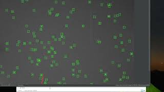
</a>

[Watch the earlier SpacePixels tutorial on YouTube](https://youtu.be/7XBdYh0Wn7A?si=ymQmXHg92X651RmZ)

## Screenshots and sample reports

Many thanks to Klangwolke at Cloudynights for providing amazing data for this report.

Many thanks to Cloudynights user TheStarsabove for providing data.

Many thanks to [Kumar](https://github.com/chvvkumar) for providing amazing data.

**Check out sample reports.**

<a href="https://startales.eu/various_files/detections_20261015_144623/detection_report.html" target="_blank">Sample SpacePixels session report</a><br/>
<a href="https://startales.eu/various_files/detections_20261004_131720/detection_report_public.html" target="_blank">Earlier SpacePixels session report</a><br/>
<a href="https://startales.eu/various_files/detections_20260327_104057/detection_report.html" target="_blank">Sample SpacePixels report (Apophis)</a> <br/>
<a href="https://startales.eu/various_files/detections_20260327_104830/detection_report.html" target="_blank">Sample SpacePixels report</a> <br/>

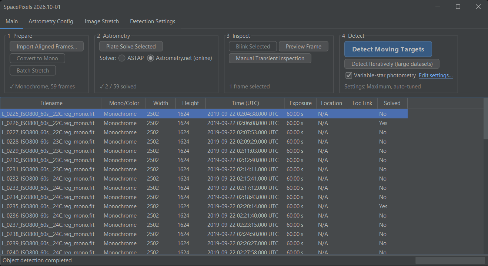
<br/>*The SpacePixels Main Workspace.*

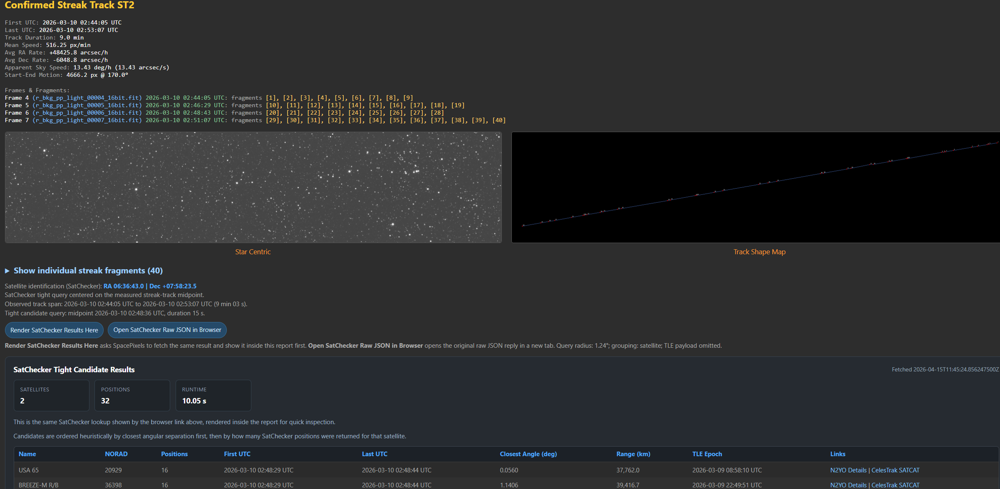
<br/>*Sample Detection - Streak track*

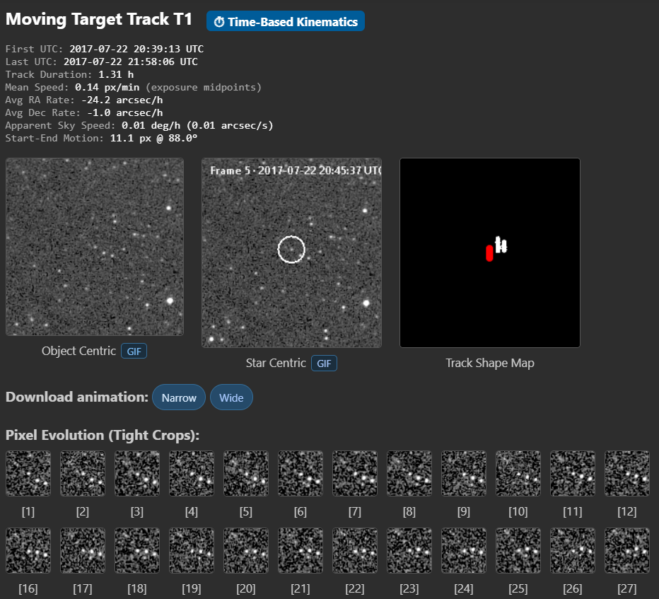
<br/>*Asteroid Bondia - hiding in a 2017 dataset*

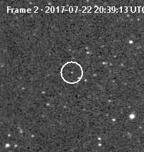
<br/>*Asteroid Bondia - hiding in a 2017 dataset*

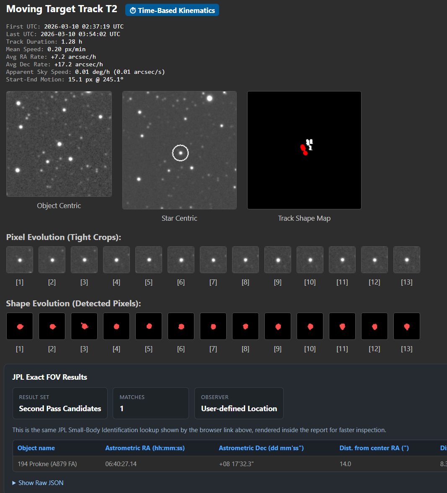
<br/>*Sample Detection - asteroid Prokne (data credit Klangwolke @ Cloudynights)*

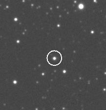
<br/>*Sample Detection - asteroid Prokne (data credit Klangwolke @ Cloudynights)*

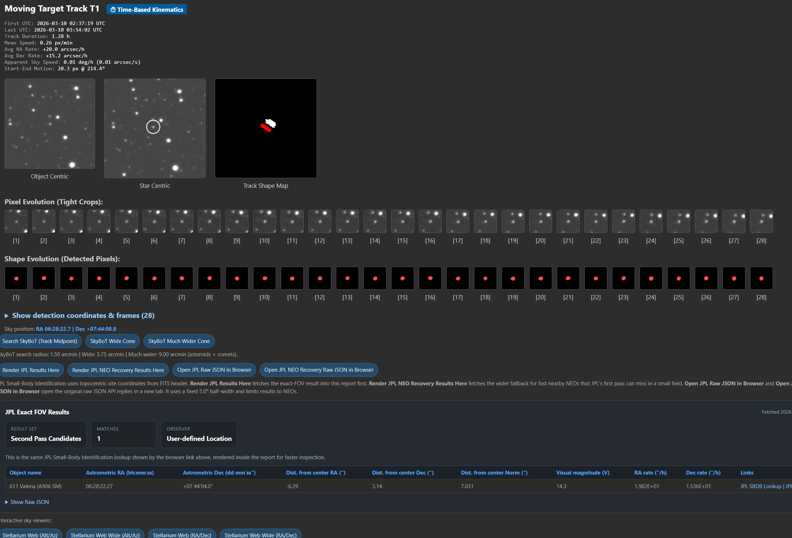
<br/>*Sample Detection - asteroid Valeria (data credit Klangwolke @ Cloudynights)*

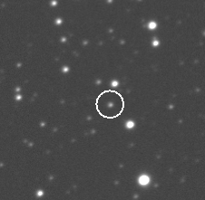
<br/>*Sample Detection - asteroid Valeria (data credit Klangwolke @ Cloudynights)*

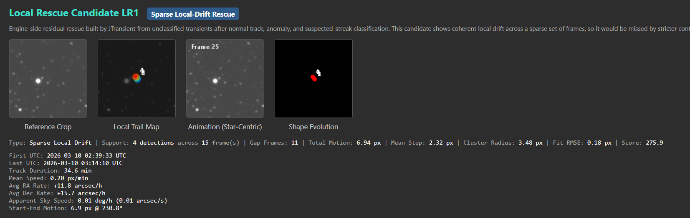
<br/>*Sample Detection - asteroid Sutoku (data credit Klangwolke @ Cloudynights)*

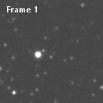
<br/>*Sample Detection - asteroid Sutoku (data credit Klangwolke @ Cloudynights)*

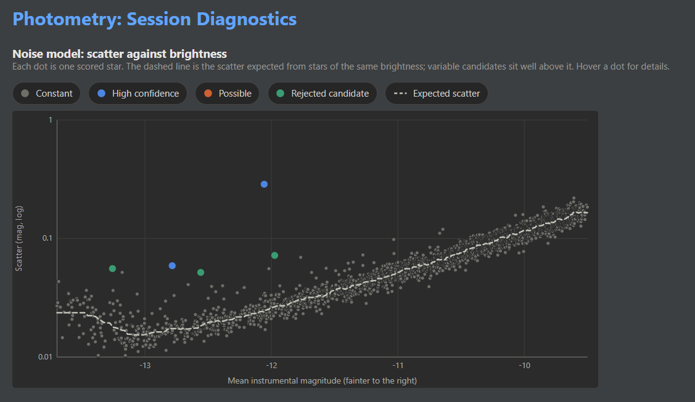
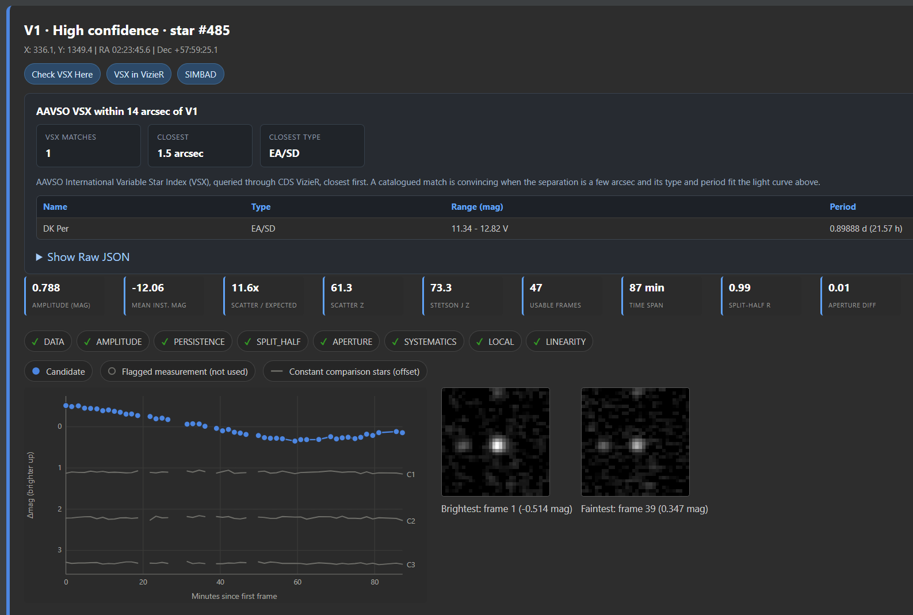
<br/>*Sample Detection - Variable star DK Per*

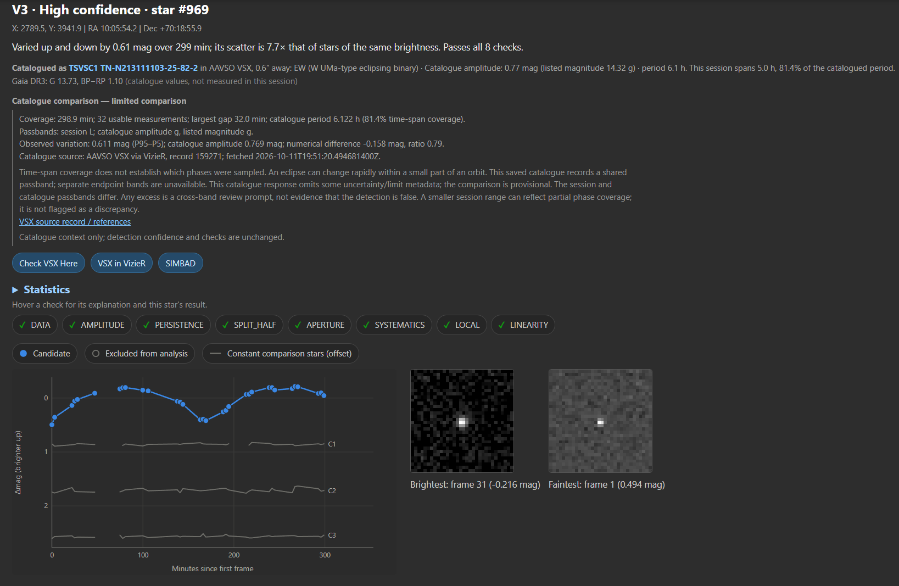
<br/>*Sample Detection - Variable star TSVSC1 TN-N213111103-25-82-2 (W UMa-type eclipsing binary), showing 0.61 mag variation over 299 minutes.*

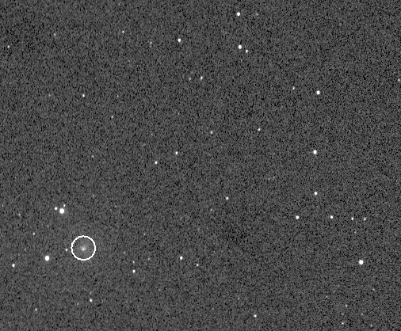
<br/>*Sample Detection - Comet Africano 2019*

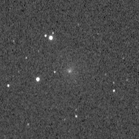
<br/>*Sample Detection - Comet Africano 2019*

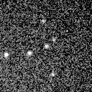
*Sample Detection - Apophis asteroid 2021 (raw images credit Duncan Warren), object-centric view.*

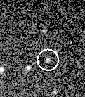
<br/>*Sample Detection - Apophis asteroid 2021 (raw images credit Duncan Warren), star-centric view.*

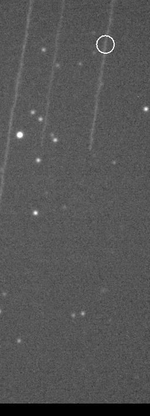
<br/>*Sample Detection - streak track.*

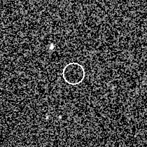
<br/> *Sample Detection - single-frame anomaly candidate (cause unconfirmed), data credit cloudynights user TheStarsabove.*

## Input requirements

- Use individual, linear (unstretched), calibrated sub-exposures registered on the stars. Keep the zero-filled registration borders; do not crop every frame to the common overlap. Detection needs at least three usable frames after quality control; Auto-Tune needs at least four input frames. Variable-star photometry needs at least 20 frames after quality control and must pass additional readiness checks.
- All frames in a sequence must share the same dimensions, filename extension (case-insensitive), bit depth, sample scaling, colour layout, compression state and exposure time, and either all frames have timestamps or none. Import refuses a mixed folder. When the exposure times differ (exposures within 2 %, with a minimum tolerance of 0.1 s, count as the same), the GUI offers to copy the largest set of frames with one exposure time into a subfolder and import that.
- The GUI can import FITS directories (`.fit`, `.fits`, `.fts`). Directories containing XISF files and no native FITS files are converted to 16-bit monochrome FITS during import. Compressed `.fz` inputs are detected and can be decompressed into a new directory during import.
- The GUI can also standardize 32-bit FITS data, and signed or scaled 16-bit data (`BZERO` other than 32768), to standard unsigned 16-bit during import. When the conversion finds pixel values below zero, it asks whether to add an offset to every frame (recommended) or set them to 0.
- Automated detection requires 16-bit monochrome frames. If you import color images, use `Convert to Mono` before running the detection pipelines.
- The headless batch detector is stricter than the GUI: it expects uncompressed unsigned 16-bit monochrome FITS files (`BZERO` 32768, `BSCALE` 1).

## Command-line utilities

The Windows installer includes `spacepixels-batch.exe` and `injectStars.exe` beside `SpacePixels.exe`, with its example detection profile at `app/config/default_detection_profile.json`.

Archive distributions keep the generated application and tool launchers in `bin`, with top-level `StartSpacePixels` wrappers that delegate to the generated launcher. After building or unpacking an archive, you should find:

- Release root:
  - `StartSpacePixels.bat`
  - `StartSpacePixels`
- Windows:
  - `bin\SpacePixels.bat`
  - `bin\batchDetect.bat`
  - `bin\injectStars.bat`
  - `config\default_detection_profile.json`
- Linux/macOS:
  - `bin/SpacePixels`
  - `bin/batchDetect`
  - `bin/injectStars`
  - `config/default_detection_profile.json`

### Headless batch detection

Use the native Windows `spacepixels-batch.exe`, the archive's `batchDetect` launcher or the Gradle task.

From a Windows installation folder:

```powershell
.\spacepixels-batch.exe "C:\astro\sequence" "app\config\default_detection_profile.json" --auto-tune high
```

Archive launcher examples:

- Windows:
  - `.\bin\batchDetect.bat "C:\astro\sequence" "config\default_detection_profile.json"`
  - `.\bin\batchDetect.bat "C:\astro\sequence" "config\default_detection_profile.json" --auto-tune high`
- Linux/macOS:
  - `bin/batchDetect "/data/sequence" "config/default_detection_profile.json" --auto-tune high`

Gradle examples from a source checkout (the example paths contain no spaces):

```powershell
.\gradlew.bat batchDetect '-PbatchArgs=C:/astro/sequence src/dist/config/default_detection_profile.json --auto-tune high'
```

```bash
./gradlew batchDetect -PbatchArgs='/data/sequence src/dist/config/default_detection_profile.json --auto-tune high'
```

For paths containing spaces, prefer the packaged launchers above: quote each path as its own argument.

`batchDetect` accepts a SpacePixels detection-profile JSON and can optionally run Auto-Tune with `low`, `medium`, `high` or `maximum` (the earlier names conservative, balanced and aggressive still work).

With the Gradle task, `-PbatchMaxHeap=8g` sets a fixed JVM heap instead of the default of up to 80% of RAM. A tested session of 33 frames of 61 megapixels needed about 11 GB of heap; requirements vary with the enabled analyses and the data.

### Artificial star injection

Use the native Windows `injectStars.exe`, the archive's `injectStars` launcher or the Gradle task. From a Windows installation folder:

```powershell
.\injectStars.exe "C:\astro\sequence" 15 10.0 4500 4.0
```

Packaged launcher examples:

- Windows:
  - `.\bin\injectStars.bat C:\astro\sequence 15 10.0 4500 4.0`
- Linux/macOS:
  - `bin/injectStars /data/sequence 15 10.0 4500 4.0`

Gradle task examples:

- Windows:
  - `.\gradlew.bat injectStars -PinjArgs="C:\astro\sequence 15 10.0 4500 4.0"`
- Linux/macOS:
  - `./gradlew injectStars -PinjArgs="/data/sequence 15 10.0 4500 4.0"`

This utility injects synthetic moving stars into a FITS sequence for testing and validation.

## Java API

The supported Java integration surface is [`eu.startales.spacepixels.api`](src/main/java/eu/startales/spacepixels/api).

Use `eu.startales.spacepixels:spacepixels:<version>` for headless embedding with its declared dependencies. This sole Maven artifact includes the API, preparation, detection, report resources and CLI tools, without GUI classes or FlatLaf. There is no separate core project/publication. Desktop distributions still include an unpublished GUI companion and all application dependencies. Java 21 and headless AWT (`java.desktop`) remain required.

For setup, request/result behavior, and usage examples, see [API.md](API.md).

## For developers

See [DEVELOPER.md](DEVELOPER.md) for source builds, tests, working rules and code organization; [HIGH_LEVEL_DESIGN.md](HIGH_LEVEL_DESIGN.md) for architecture; and [PUBLISHING.md](PUBLISHING.md) for desktop packaging and Maven publication. Proposed features and design changes are tracked separately in [FEATURE-REQUESTS.md](FEATURE-REQUESTS.md) and [DESIGN-IMPROVEMENTS.md](DESIGN-IMPROVEMENTS.md).

Report reproducible problems through [GitHub Issues](https://github.com/ppissias/SpacePixels/issues). Include the application version and relevant error details, removing private paths and observing-site information before sharing.

### Running from source

Use JDK 21. From the project root:

- Windows: `.\gradlew.bat run`
- Linux/macOS: `./gradlew run`

To generate a local distribution with launch scripts:

- Windows: `.\gradlew.bat installDist`
- Linux/macOS: `./gradlew installDist`

On Windows x64, `.\gradlew.bat windowsAppImage` builds an application folder with its own runtime; distribute the entire `build/windows/image/SpacePixels` folder. `.\gradlew.bat windowsInstaller` wraps it in an EXE installer and also requires WiX 3. See [PUBLISHING.md](PUBLISHING.md#windows-installer).

### Console output

SpacePixels prints only problems to the console; the batch detector also prints the path of the report it wrote. For diagnostics (progress, per-frame statistics, timings and the detection engine's debug output), start the JVM with `-Dspacepixels.debug=true`. Archive launchers accept `JAVA_OPTS=-Dspacepixels.debug=true`; native Windows launchers use `java-options=-Dspacepixels.debug=true` under `[JavaOptions]` in `app/SpacePixels.cfg` or `app/spacepixels-batch.cfg`. From source, add `-PspacepixelsDebug` to the Gradle command.

## JTransient engine documentation

SpacePixels uses the [JTransient Engine](https://github.com/ppissias/JTransient) for the core extraction, purification, and track-linking pipeline.

For the underlying detection logic and the meaning of the engine configuration options, see:

- [JTransient repository](https://github.com/ppissias/JTransient)
- [JTransient algorithm overview](https://github.com/ppissias/JTransient/blob/main/ALGORITHM.md)
- [JTransient configuration reference](https://github.com/ppissias/JTransient/blob/main/CONFIG.md)
- [JTransient Auto-Tune](https://github.com/ppissias/JTransient/blob/main/ALGORITHM.md#auto-tuning)
- [JTransient variable-star photometry](https://github.com/ppissias/JTransient/blob/main/ALGORITHM.md#variable-star-photometry)
