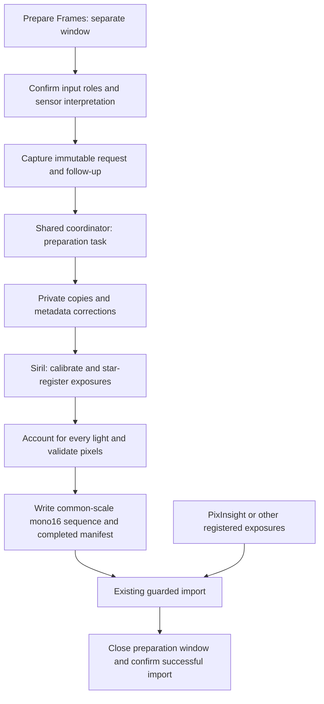

# Observing-session preparation

SpacePixels opens one modeless **Prepare observing session** window from **Prepare Frames…**, above **Import Aligned Frames…** on Main. It operates independently of the imported session and uses the same processing job slot as detection. The user workflow is in [MANUAL.md](../../MANUAL.md#preparing-an-observing-session); remaining acceptance and follow-ups are in [FEATURE-REQUESTS.md](../../FEATURE-REQUESTS.md#f13-observing-session-preparation).

## Scope and window ownership

The window provides one full-width Siril installation/status row, explicit input roles, optional folder suggestions, camera/CFA interpretation, output selection, generated-instruction preview and optional import. The camera interpretation starts unset. Both role matching and the effective recipe require confirmation; input/recipe edits invalidate the relevant confirmation and inspection evidence.

Path editors retain their preferred widths and shrink with the form; CFA choices use their natural widths. A fixed readiness/action sidebar remains visible while the form scrolls independently. Optional inputs explain their omitted meaning: the session folder is only a scanning shortcut, calibration roles can be left empty, and Siril needs an explicitly checked installation. A blank output parent resolves to the current lights source folder when capturing the request and is shown in readiness. Scanning does not fill the output field, so subsequent lights edits retain this default; explicit output selections take precedence and invalid path text is rejected.

PixInsight WBPP needs only the explanatory note and the existing importer. Its input must be individual calibrated **and registered** exposures. No PixInsight executable path, adapter or WBPP tree-discovery implementation is introduced.

`ApplicationWindow` owns one `PreparationWindow`, including closure at shutdown. `PreparationPanel` receives only the collaborators and callbacks it needs. It captures immutable `PreparationRequest`/follow-up values; filesystem inspection, installation probes and instruction generation run off the EDT. Request identity guards discard obsolete completions. The ordinary command availability rules make the entry point usable before import, while a running job or Blink prevents new preparation admission.

A prepared result is independent of its subsequent import outcome. Failure keeps the existing session and preparation window. Only successful installation of the new session closes the preparation window and shows its import confirmation. Closure, cancellation, refused admission or an unexpected session change suppresses pending follow-ups. Jobs are chained after preparation releases admission, never nested inside the occupied coordinator.

## Headless preparation boundary

| Component | Responsibility |
|---|---|
| `PreparationInputs` | Candidate extension inventories and bounded, unambiguous role-folder suggestions |
| `PreparationRequest` | Immutable Siril path, input paths, sensor/Bayer interpretation, output and reference-stack choice |
| `FramePreparationTask` | Desktop job adapter, cancellation and shutdown-cleanup completion |
| `FramePreparationService` | Input capture, private copies, tool execution, frame accounting and local manifest |
| `PreparationProcess` | Owned process tree, disk log, timeout and cancellation cleanup |
| `SirilPreparationRecipe` | Fixed Siril instructions over captured working files |
| `SirilHeaderCorrections` | The maintainer's targeted FITS metadata repairs before the tool reads its private copy |
| `PreparedSequenceWriter` | Bounded sequence planning, acquisition metadata and output writing through the shared FITS pixel converter |

The `preparation` package belongs to headless `main`, with no Swing, desktop-job or mutable session dependency. The build includes it explicitly and boundary tests enforce those dependencies. It is internal, like the other services outside `api`; this change introduces no supported Java API, CLI or MCP entry point. JTransient remains the scientific engine. Ordinary import and API conversion use the shared scaling policy described below.

## Tool discovery and settings

The installation row accepts a Siril installation folder or a direct CLI executable. `SirilInstallation` searches a small set of expected locations and rejects ambiguity or a graphical launcher. A private, bounded version probe identifies the program independently of dataset compatibility and enforces the same minimum version emitted in the generated recipes. The worker repeats this check before copying inputs. [Siril CLI manual](https://siril.org/docs/man/).

The checked path is held in `AppConfig.sirilExecutablePath`, copied in settings snapshots and saved through the existing application settings queue. Failed probes preserve the saved preference; save failures are reported by the queue. Tool identity is displayed and recorded as run provenance.

Siril runs with a private generated configuration: fixed `.fit` output, uncompressed working products, header-driven CFA interpretation and bounded resources. Personal Siril settings are neither loaded nor overwritten. The progress dialog streams sanitized live output, shows elapsed/quiet time and retains bounded selectable text, while the complete log stays on disk. `PreparationProcess` follows newly appended bytes during execution and delivers only the current command's text. The job coordinator guards detail delivery by job identity on the EDT, just as it does progress.

## Input and CFA interpretation

Input roles are explicit: lights, darks, flats, biases and dark-flats. A calibration file means an existing master FITS; a folder means exposures to combine. At least three lights are needed. Omitted calibration is visible in the readiness summary. Darks are not inferred from unrelated library directories, and image extensions do not establish a calibration role or camera compatibility.

Known FITS facts are checked for cohort and calibration compatibility, including dimensions, binning, filter and exposure duration. Contradictions fail before calibration; unknown RAW facts remain the external decoder's responsibility. The finished monochrome sequence must also pass the ordinary import validator before preparation is marked complete.

`PreparationInputs.scan` examines up to four directory levels without following links. It recognizes role prefixes/suffixes (`andromeda_lights`) and compact filter/number suffixes (`lightB`, `flatB`, `light1`). A role is inherited by nested filter/exposure folders; only populated folders are offered and their image lists are never merged. Known tool/output trees and role-prefixed processed folders such as `light-aligned` are skipped. The detached `Scan` retains every `Candidate` with its path, candidate count and master/file distinction. Only a single unambiguous exposure folder is suggested automatically. Multiple groups remain visible as explicit **Found** choices, including camera/filter/exposure groups.

Calibration files whose names identify them as masters are offered as explicit FITS-file choices, even when stored beside their source exposures. Such folders are not offered for recombination. `FramePreparationService.inspect` also rejects manually selected calibration folders containing named masters, with guidance to choose the master file or an exposures-only folder. This is a filename safeguard, not a claim to recognize arbitrary unlabelled masters or establish calibration compatibility.

Starting a scan clears every previous role and scan choice, and invalidates inspection/confirmations before filesystem work begins. Failed scans leave the mapping empty; late results cannot repopulate controls after edits, a newer scan or closure. Session-folder edits also discard old choices and inspection evidence. Explicit output selections are preserved. Existing image inventories still read only the selected folder, without mixing in registered/output descendants. Camera RAW decoding remains the external tool's responsibility.

Input interpretation has three modes: true monochrome, Bayer CFA, and already debayered RGB. The storage fact "one image plane" does not establish a monochrome sensor. Existing `FitsFileInformation.isMonochrome()` semantics are unchanged. CFA requires a known ordinary Bayer pattern, row order and compatible offsets; unresolved or inconsistent metadata fails explicitly. Manual overrides affect only owned copies. Metadata mode does not silently substitute RGGB. The row-order and Bayer-offset conventions follow the external reader. [Siril debayer preferences](https://siril.readthedocs.io/en/stable/preferences/preferences_gui.html#fits-ser-debayer), [Siril FITS conventions](https://siril.readthedocs.io/en/stable/file-formats/FITS.html#retrieving-the-bayer-matrix).

The desktop camera presets resolve into the existing immutable Bayer, row-order and offset request fields; they do not add a second interpretation policy. Astronomy-camera entries supply nominal manufacturer patterns, reset phase offsets to zero and retain metadata row order. Camera RAW shortcuts leave pattern resolution to the decoded file metadata. They do not promise decoder support for every model. Editing an interpretation control selects Custom. The advanced disclosure changes visibility only, retains values and does not invalidate recipe confirmation. Preset changes do invalidate it. Missing row order still requires an explicit choice; a model alone cannot establish storage orientation or the effect of an ROI/crop.

Preset references: [QHY's Bayer sequence appendix](https://www.qhyccd.com/astronomical-camera-qhy268/), [Player One's cooled-camera manual](https://player-one-astronomy.com/download/manuals/Professional%20Cooled%20Camera%20Manual%20pptx2026.pdf), and ZWO specifications and support confirmations for [ASI120MC](https://bbs.zwoastro.com/d/2193-asi-120-mc-which-settings), [ASI1600MC and ASI178MC](https://bbs.zwoastro.com/d/8117-bayerpattern), [ASI183MC](https://bbs.zwoastro.com/d/8057-any-fix-for-amp-glow-asi183mc), [ASI294MC](https://www.zwoastro.com/2017/08/24/which-debayer-algorithm-is-the-best-for-asi-cameras/3/), [ASI533MC Pro](https://astronomy-imaging-camera.com/product/asi533mc-pro-color/), and [ASI2600MC](https://bbs.zwoastro.com/d/10603-bayer-pattern-asi2600mc). These are nominal sensor layouts, not universal overrides for files written by every capture program.

Siril can apply explicit CFA/orientation overrides after converting camera RAW. Already RGB inputs are not debayered again. Calibration happens in the sensor domain before CFA debayering and star registration. No nonlinear stretch, per-frame background/white-balance correction, star removal, comet alignment or single-frame cosmetic suppression is part of the generated detection recipe.

## FITS header corrections and metadata preservation

The maintainer's Siril workflow supplied two specific pre-read repairs, now implemented directly in Java:

- Convert quoted decimal or signed sexagesimal `SITELAT`/`SITELONG` values into finite numeric degree cards, preserving a negative sign even for zero degrees and rejecting invalid ranges/minutes/seconds.
- Normalize the legacy `DATE-OBS` form `YYYY-MM-DDTHH.mm.ss[.fraction]` to colon-separated time, validating the calendar value without inventing a timezone or changing the date.

Repairs replace exact-width cards only in fresh working copies, including physical extension headers behind an empty compressed-FITS primary HDU. Pixel bytes and HDU offsets are unchanged. Any affected checksum cards are removed. Local provenance records the corrections; site values must not be copied into published screenshots or diagnostics.

For FITS sources, preservation is checked immediately after conversion as well as after registration. Site coordinates must agree; observation-time comparison allows Siril's documented-in-the-maintainer-workflow subsecond rounding, while final output restores the exact captured source timestamp. Exposure duration and required timing cards are checked. Camera RAW metadata comes from the external conversion, with the same subsequent registration check. Association uses canonical per-run identities; missing, duplicated or unmappable outputs fail rather than borrowing another exposure's metadata.

Acquisition cards are copied from the associated source metadata into the final frame. Source WCS and distortion coefficients are removed after registration: the initial integration does not claim to propagate a valid transformed astrometric solution. The user plate-solves the prepared sequence through the existing workflow.

## Scientific products and failure handling

All work occurs under a fresh `spacepixels_prepared_yyyyMMdd_HHmmss` directory (with a numbered collision suffix, using the report naming helper) in the selected output parent. Sources are copied, never hard-linked to originals. During processing the run contains inputs, converted/intermediate products and calibration masters. By default these three working trees are removed after the owned processes stop, on success, failure or cancellation. **Keep working files** opts into retaining them. Cleanup validates the owned absolute root and rejects directory redirections; it does not follow symbolic links or delete final/output trees. `aligned/`, the requested reference stack, generated scripts, `siril.cfg`, `preparation.log` and `preparation.json` remain. Completed manifests record source-to-output mappings, tool identity, sensor choices, retention selection, resolved CFA facts, common output transform and outcome. Mapped intermediate paths describe processing provenance even when those working files have been removed. These local records may contain private paths and observing metadata.

Siril writes every star-registered individual exposure with its two-pass registration/apply sequence. A reference stack is optional and kept outside detection inputs. A zero exit status alone is insufficient: every retained output needs one unambiguous original source association. Registration may exclude exposures; at least three validated retained frames are required. Numeric identity gaps remain gaps when source metadata is restored. Counts and excluded source identities are recorded in the manifest and reported on completion. [Siril registration](https://siril.readthedocs.io/en/stable/preprocessing/registration.html#pass-registration).

`PreparedSequenceWriter` checks the retained cohort with one image in memory at a time and rejects nonfinite pixels and incompatible dimensions. `ImageScaling` selects the same cohort-wide affine policy used by ordinary FITS and XISF conversion. Normalized headroom is `[-0.5,1.5]`; extremes require one explicit clipping or full-range decision. Headless callers reject them by default and receive structured diagnostics. Nominal level spacing is kept while the actual range fits, and otherwise the common multiplier is reduced. The selection and counts are recorded in headers and the preparation manifest. It delegates pixel decoding, fixed RGB arithmetic mean, zero-fill handling and 16-bit quantization to `FitsPixelConverter`, which also serves ordinary import. A sequence-wide nonnegative offset and common multiplier avoid clipping at the unsigned 16-bit boundary; both are recorded. Format decoders supply nominal scale and physical-value interpretation; they do not choose independent scaling or clipping policies. This is instrumental mono data, not calibrated standard-passband photometry. The same policy applies to ordinary import and API conversion; extreme values require an explicit decision, with refusal as the headless default. See [API input preparation](../../API.md#input-preparation-modes).

The canvas stays the size of the reference frame: Siril `-framing=current`. Common-overlap cropping is excluded. The shared converter leaves the exact-zero registration runs at either end of each row at physical zero, including entirely padded rows; only image data receives the common offset. When reducing RGB, every channel must be zero to count as fill. Interior zeros and samples whose RGB mean happens to be zero remain image data. This preserves the existing engine's drift/dither and valid-coverage measurements without changing JTransient. Framing and padding handling are recorded in the local manifest.

Subprocesses use argument lists without a shell, fixed generated recipe paths, bounded resources and full logs redirected to disk. Only a bounded log tail reaches failures. Cancellation/timeout stops and joins the owned process tree before cleanup and before the job releases admission. Cancellation is checked again after ordinary import validation, after working-file cleanup and before the final success notification, preventing a cancelled handover from triggering automatic import. Application shutdown additionally requests preparation stop and waits for cleanup on its shutdown worker. Failed/cancelled runs retain logs, metadata and any final products with a distinct outcome; working-file retention follows the captured request. They never receive a completed manifest or automatic import.

## Validation

Unit tests cover input-role ambiguity, shallow suggestions, extension-only inventories, duplicate role assignments, source immutability, legacy header repairs, checksum invalidation, shared intensity conversion, nonfinite data, stale WCS, application preference copies/round-trips, process logs and real child-JVM timeout/cancellation. Panel tests exercise explicit installation evidence, camera selection, confirmation invalidation and immutable admission without displaying native windows.

Preset tests cover camera-specific patterns, transition to Custom, reset of earlier phase overrides, metadata-based RAW choices and retention of collapsed advanced values. A native Siril colour-swatch check confirms that changing row order changes colour interpretation with identical stored pixels. Appearance and preparation layouts are also inspected at enlarged interface sizes; GUI mechanics exercise Appearance focus, scrolling and save/restart behavior in the real window.

Representative native FITS checks cover matching dark and dark-flat exposures, as well as existing library masters, with Siril. Completed sequences pass the ordinary importer and sampled calibration/alignment checks. Calibration folders must contain individual exposures only; existing masters are selected as files, separately from their source exposures.

Native tool and representative-data acceptance is separate from the ordinary test suite: installed Siril and camera data are not new Maven-bundle prerequisites. Release verification should include those workflows, source/header preservation, normal import and its completion notification, plus the existing scientific regression for any later shared conversion or engine change. Remaining broader format/platform and usability work stays in the feature request rather than this implementation description.
